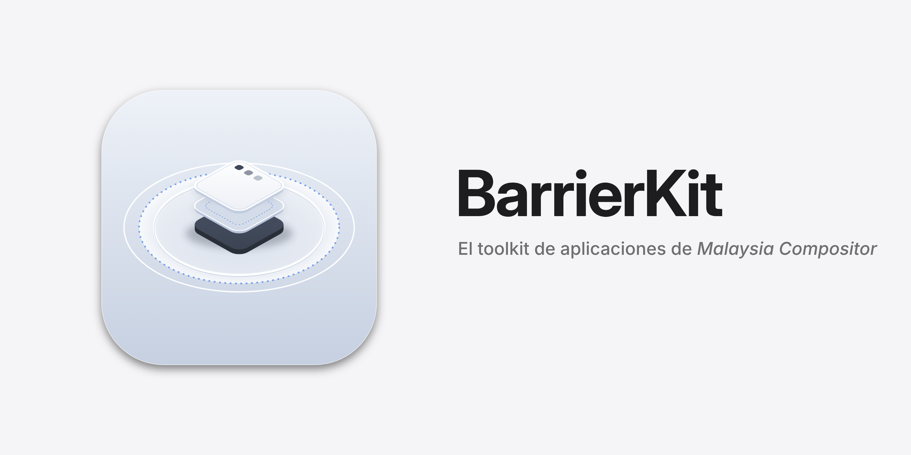

# BarrierKit



BarrierKit is the application toolkit for [Malaysia](https://github.com/HBlanqueto/malaysia): the GTK + libadwaita to its GNOME, or the AppKit to its macOS. It provides the layers, controls, containers and patterns used to build Malaysia's own apps and its shell.

## Crates

- `barrier-kit` — the toolkit itself: platform runner, style primitives, controls, views and window patterns.
- `vow-design` — Tengen, the design-token system. `tokens.json` and `components.json` become typed Rust constants through `build.rs`.
- `vow-appearance` — resolves `appearance.domain` and the desktop wallpaper into a concrete palette, and watches the file.
- `infinity-protocol` — private Wayland protocol shared with the Malaysia compositor. Features `client` (kit) and `server` (compositor).

## Build

The repository is built inside the Nix dev shell (ADR 0007):

```sh
nix develop
./dev.sh check
```

`./dev.sh check` runs fmt, clippy, the kit checks and the tests; its list is in [`dev.sh`](dev.sh).

The Skia prebuild for `freya-skia-bindings` 0.98.0 lives in `nix/skia.nix`.

## Try it on any desktop

`barrier-kit` can run as a Wayland client on any compositor, not only on Malaysia. An app starts with the basic protocol (`wl_compositor`, `xdg_shell`, `wl_seat`) and carries on when the optional globals are missing.

When `infinity_window_manager_v1`, `ext_foreign_toplevel_list_v1` / `zwlr_foreign_toplevel_manager_v1`, `wp_cursor_shape_manager_v1` or `org_kde_kwin_appmenu_manager` is missing, the runner logs it with `tracing::info!` and carries on.

## Documentation

[`docs/barrierkit/`](docs/barrierkit/README.md) explains the kit from the first window to the Wayland runner, with real screenshots.

## Decisions

- ADR 0047 — [BarrierKit in layers](docs/decisiones/0047-barrierkit-en-capas.md)
- ADR 0048 — [BarrierKit in its own repository](docs/decisiones/0048-barrierkit-repositorio-propio.md)
- ADR 0057 — [The full-screen glass covers the whole window; the sidebar over a tinted backdrop](docs/decisiones/0057-cristal-y-barra-lateral-sobre-fondo.md)

License: MIT
