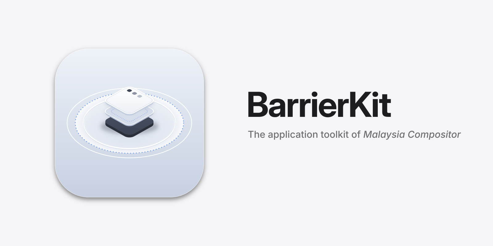

# BarrierKit



BarrierKit is the application toolkit for [Malaysia](https://github.com/HBlanqueto/malaysia): the GTK + libadwaita to its GNOME, or the AppKit to its macOS. It provides the layers, controls, containers and patterns used to build Malaysia's own apps and its shell.

## Crates

- `bk` — BarrierKit, the toolkit itself: platform runner, style primitives, controls, views and window patterns.
- `ctdesign` — CTDesign (CT = Curse Techniques): Tengen, the design-token system. `tokens.json` and `components.json` become typed Rust constants through `build.rs`.
- `ctappearance` — CTAppearance: resolves `appearance.domain` and the desktop wallpaper into a concrete palette, and watches the file.
- `infinity-protocol` — private Wayland protocol shared with the Malaysia compositor. Features `client` (kit) and `server` (compositor).

## Build

The repository is built inside the Nix dev shell (ADR 0007):

```sh
nix develop
./dev.sh check
```

`./dev.sh check` runs fmt, clippy, the kit checks and the tests; its list is in [`dev.sh`](dev.sh).

CI runs it on Linux for every push to `main` ([`.github/workflows/check.yml`](.github/workflows/check.yml)).

On a Mac without Nix, `./dev.sh check` runs with the user's Rust toolchain: `rust-toolchain.toml` makes `rustup` fetch `rustfmt` and `clippy` on the first run; run it from the repository root. It skips the `shell` feature and the Linux-only warnings, and ignores the four golden tests that need the Linux fonts ([18](docs/barrierkit/18-platform.md#build-and-check-on-macos)).

The Skia prebuild for `freya-skia-bindings` 0.104.0 lives in `nix/skia.nix`.

## Try it on any desktop

`bk` can run as a Wayland client on any compositor, not only on Malaysia. An app starts with the basic protocol (`wl_compositor`, `xdg_shell`, `wl_seat`) and carries on when the optional globals are missing.

When `infinity_window_manager_v1`, `ext_foreign_toplevel_list_v1` / `zwlr_foreign_toplevel_manager_v1`, `wp_cursor_shape_manager_v1` or `org_kde_kwin_appmenu_manager` is missing, the runner logs it with `tracing::info!` and carries on.

## Documentation

[`docs/barrierkit/`](docs/barrierkit/README.md) explains the kit from the first window to the Wayland runner, with real screenshots. Start with [your first app](docs/barrierkit/02-first-app.md). The [glossary](docs/barrierkit/20-glossary.md) maps every SwiftUI and AppKit name to its BarrierKit name.

AI agents start from one prompt: [`agents/prompt.md`](agents/prompt.md).

## Decisions

[`docs/decisions.md`](docs/decisions.md) gives the reason behind each decision that still holds.

License: MIT
