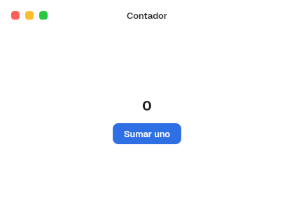

# 2. Your first app

**Goal:** open a window with a counter and understand the five ideas the whole
kit rests on.
**Reader:** anyone who has never used BarrierKit or Freya.
**Input:** the repository and `nix develop`. **Output:** a window that adds.

## The result



## The code

The full code is in [`crates/barrier-kit/examples/contador.rs`](../../crates/barrier-kit/examples/contador.rs):

```rust
struct Contador;

impl App for Contador {
    fn render(&self) -> impl IntoElement {
        let mut cuenta = use_state(|| 0);
        let palette = Palette::current();
        rect()
            .width(Size::fill())
            .height(Size::fill())
            .background(color(palette.window_background))
            .child(Titlebar::new().title("Contador"))
            .child(
                rect()
                    .width(Size::fill())
                    .height(Size::fill())
                    .direction(Direction::Vertical)
                    .main_align(Alignment::Center)
                    .cross_align(Alignment::Center)
                    .spacing(SPACE_3)
                    .child(text(cuenta.read().to_string(), TITLE_1, palette.label))
                    .child(
                        Button::new("Sumar uno")
                            .style(ButtonStyle::Primary)
                            .on_press(move |_| *cuenta.write() += 1),
                    ),
            )
    }
}

fn main() {
    run_window(
        AppComponent::new(Contador),
        WindowOptions::new("Contador", "contador")
            .size((420, 300))
            .min_size(Some(WINDOW_MIN_SIZE)),
    )
    .expect("contador");
}
```

## Running it

1. Enter the dev shell: `nix develop`.
2. Launch the example: `cargo run -p barrier-kit --example contador`.
3. Press «Sumar uno» ("Add one"): the number goes up and the window repaints.

## The five ideas

1. **The interface is a function of the state.** `render` describes how the
   window looks now. Nothing is moved or deleted by hand: when the state
   changes, the kit calls `render` again and applies the difference.
2. **The app holds the state.** `use_state(|| 0)` creates a value that
   survives between calls to `render`. `read()` reads it and `write()` changes
   it. The kit's controls are *controlled*: they receive the value (`value`,
   `on`, `selected`) and report the change (`on_change`, `on_toggle`,
   `on_press`).
3. **Everything is built by chaining methods.** `rect()` is Freya's basic box;
   the kit's controls (`Button`, `Titlebar`…) follow the same
   `Type::new(..).option(..)` pattern.
4. **No color or size is written by hand.** `Palette::current()` gives the
   system colors (text, background, accent) and `vow_design` gives the sizes
   and typefaces (`SPACE_3`, `TITLE_1`). This way the app follows light or dark
   mode and the accent on its own (chapter [4](04-apariencia-y-tokens.en.md)).
5. **`run_window` is the only entry point.** It receives the root
   (`AppComponent`) and the window options: title, name, size, minimum size,
   decoration and menu (chapter [6](06-ventanas-y-titlebars.en.md)).

## App and Component

The root implements `App`. Any reusable piece implements `Component` and must
be `PartialEq`, so the kit knows when to draw it again:

```rust
#[derive(PartialEq)]
struct Saludo {
    nombre: &'static str,
}

impl Component for Saludo {
    fn render(&self) -> impl IntoElement {
        text(self.nombre, TEXT, Palette::current().label)
    }
}
```

Next: [3. Layers](03-capas.en.md).
