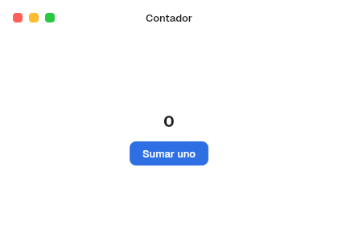

# 2. Tu primera app

**Objetivo:** abrir una ventana con un contador y entender las cinco ideas en
las que se basa todo el kit.
**Lector:** quien nunca ha usado BarrierKit ni Freya.
**Entrada:** el repositorio y `nix develop`. **Salida:** una ventana que suma.

## El resultado



## El código

Está completo en [`crates/barrier-kit/examples/contador.rs`](../../crates/barrier-kit/examples/contador.rs):

```rust
struct Contador;

impl App for Contador {
    fn render(&self) -> impl IntoElement {
        let mut cuenta = use_state(|| 0);
        let palette = Palette::current();
        rect()
            .width(Size::fill())
            .height(Size::fill())
            .background(color(palette.window_background))
            .child(Titlebar::new().title("Contador"))
            .child(
                rect()
                    .width(Size::fill())
                    .height(Size::fill())
                    .direction(Direction::Vertical)
                    .main_align(Alignment::Center)
                    .cross_align(Alignment::Center)
                    .spacing(SPACE_3)
                    .child(text(cuenta.read().to_string(), TITLE_1, palette.label))
                    .child(
                        Button::new("Sumar uno")
                            .style(ButtonStyle::Primary)
                            .on_press(move |_| *cuenta.write() += 1),
                    ),
            )
    }
}

fn main() {
    run_window(
        AppComponent::new(Contador),
        WindowOptions::new("Contador", "contador")
            .size((420, 300))
            .min_size(Some(WINDOW_MIN_SIZE)),
    )
    .expect("contador");
}
```

## Ejecutarlo

1. Entra en el dev shell: `nix develop`.
2. Lanza el ejemplo: `cargo run -p barrier-kit --example contador`.
3. Pulsa «Sumar uno»: el número sube y la ventana se repinta.

## Las cinco ideas

1. **La interfaz es una función del estado.** `render` describe cómo se ve la
   ventana ahora. No hay que mover ni borrar nada a mano: cuando el estado
   cambia, el kit vuelve a llamar a `render` y aplica la diferencia.
2. **El estado lo guarda la app.** `use_state(|| 0)` crea un valor que
   sobrevive entre llamadas a `render`. `read()` lo lee y `write()` lo cambia.
   Los controles del kit son *controlados*: reciben el valor (`value`, `on`,
   `selected`) y avisan del cambio (`on_change`, `on_toggle`, `on_press`).
3. **Todo se construye encadenando métodos.** `rect()` es la caja básica de
   Freya; los controles del kit (`Button`, `Titlebar`…) siguen el mismo patrón
   `Tipo::new(..).opción(..)`.
4. **Ningún color ni medida se escribe a mano.** `Palette::current()` da los
   colores del sistema (texto, fondo, acento) y `vow_design` las medidas y
   tipografías (`SPACE_3`, `TITLE_1`). Así la app cambia sola con el modo claro
   u oscuro y con el acento (capítulo [4](04-apariencia-y-tokens.md)).
5. **`run_window` es el único arranque.** Recibe la raíz (`AppComponent`) y las
   opciones de la ventana: título, nombre, tamaño, mínimo, decoración y menú
   (capítulo [6](06-ventanas.md)).

## App y Component

La raíz implementa `App`. Cualquier pieza reutilizable implementa `Component`
y debe ser `PartialEq`, para que el kit sepa cuándo volver a dibujarla:

```rust
#[derive(PartialEq)]
struct Saludo {
    nombre: &'static str,
}

impl Component for Saludo {
    fn render(&self) -> impl IntoElement {
        text(self.nombre, TEXT, Palette::current().label)
    }
}
```

Siguiente: [3. Capas](03-capas.md).
