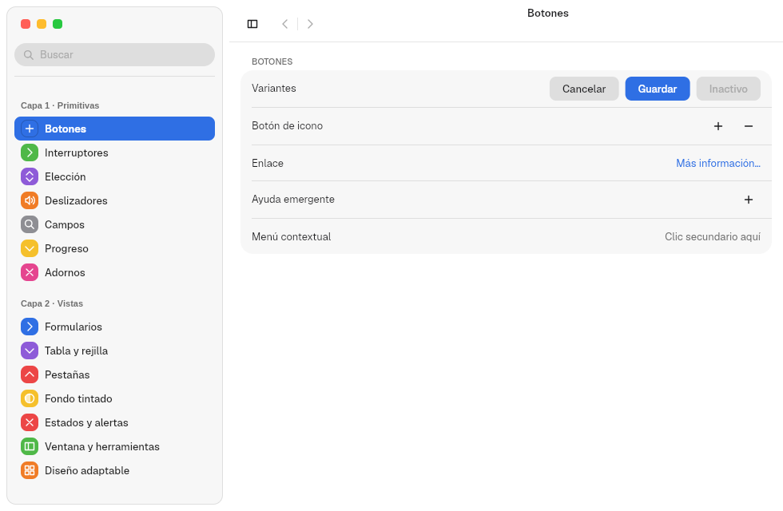
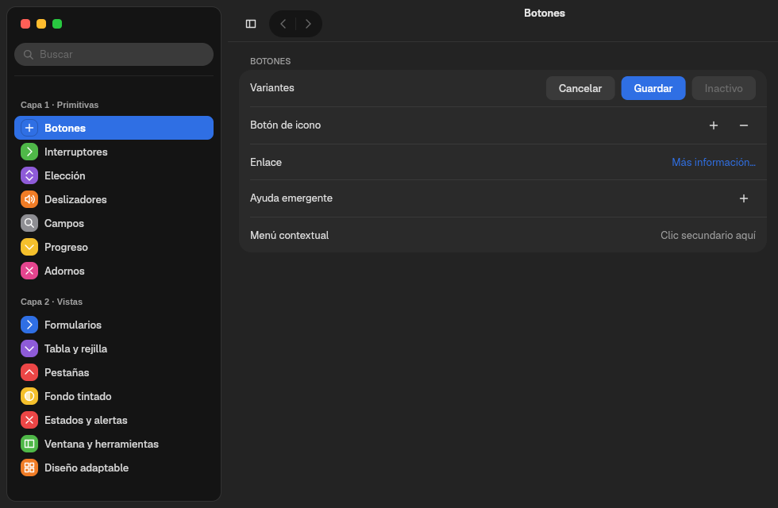
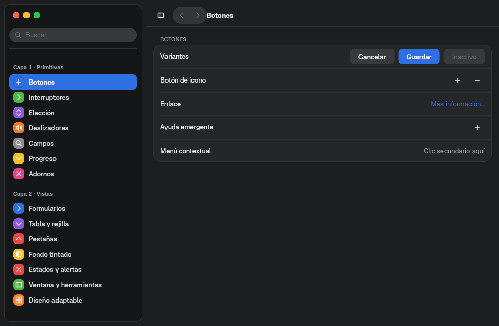
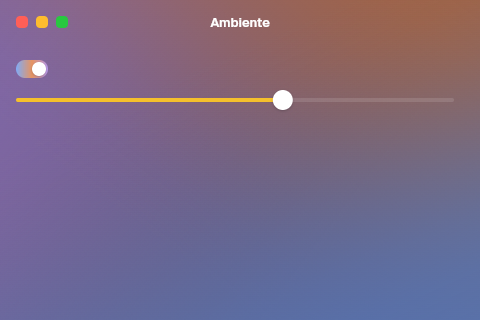

# 4. Appearance and tokens

**Goal:** know where each color and each size comes from, how it changes with
the system and how to add your own values.
**Reader:** anyone who designs an app or a component.

## Three levels

| Level | Who decides | Where it lives |
|---|---|---|
| Tengen **tokens**: base colors, radii, spacing, typefaces, durations, per-component metrics | The design system | `crates/vow-design/tengen/tokens.json` and `components.json` |
| **Appearance**: light or dark mode, accent, tints, island or flat sidebar, reduced motion | The user | `~/.config/malaysia/appearance.domain` |
| **Variants** of a control: primary, custom tint, tinted backdrop | The app | The app's code |

## Tokens: Tengen and `vow-design`

`crates/vow-design/build.rs` reads both JSON files and generates typed Rust
constants. An app imports them from `vow_design`:

```rust
use vow_design::{ACCENT_SWATCHES, BUTTON, DURATION_BASE, SPACE_3, SPLIT_VIEW, TITLE_1};
```

| Group | Examples |
|---|---|
| Spacing | `SPACE_1` … `SPACE_4` |
| Typography | `DISPLAY`, `TITLE_1`, `TITLE_2`, `HEADLINE`, `TEXT`, `CALLOUT`, `CAPTION` and the monospaced `MONO` (type `Font`) |
| Durations (ms) | `DURATION_FAST_MS` (120), `DURATION_BASE` (220), `DURATION_SLOW_MS` (420) |
| Per-component metrics | `BUTTON`, `SWITCH`, `SLIDER`, `SEGMENTED`, `TEXT_FIELD`, `TITLEBAR`, `SIDEBAR`, `SPLIT_VIEW`, `SPLIT_PANES`, `FLOATING_PANE`, `TABLE`, `COLLECTION`, `BREAKPOINT`… |
| Base colors | `LIGHT`, `DARK`, `DARK_TINT` and their backgrounds (`BG_WINDOW_LIGHT`…) |
| Accents | `ACCENT_SWATCHES`: Azul, Morado, Rosa, Rojo, Naranja, Amarillo, Verde, Gris (blue, purple, pink, red, orange, yellow, green, gray) |

The same JSON files also generate Slint, CSS and QML in `tengen/generated/`,
for projects that are not written in Rust.

### Adding your own value

A new color or size is never written in `barrier-kit`. It goes into Tengen:

1. Add the key to the component in `tengen/components.json` (or to
   `tokens.json` if it is a base value).
2. If the component has no struct yet, add the field to the struct in
   `crates/vow-design/src/lib.rs` and its emission in `crates/vow-design/build/`.
3. Use the constant in the code: `SPLIT_VIEW.key_step`.
4. Pass `./dev.sh check`. `scripts/check-design-tokens.sh` rejects color
   literals outside `vow-design`, the apps included.

## User appearance

`vow-appearance` resolves it and the kit watches it: if the file changes, the
window repaints without restarting. `MALAYSIA_CONFIG_DIR` changes the folder.

```toml
# ~/.config/malaysia/appearance.domain
color_scheme = "dark"            # auto | light | dark | dark_tint
accent_color = [0.18, 0.44, 0.89]
sidebar_style = "island"         # island | flat
traffic_lights = "auto"          # auto | standard | accent | wallpaper
traffic_light_shape = "square"  # square | round
window_color = "neutral"         # neutral | accent | wallpaper
tint_parts = ["sidebars", "window", "groups", "controls", "menus"]
tint_strength_accent = "normal"  # subtle | normal | strong | intense
contrast = false
reduced_motion = false
reduce_transparency = true
scroll_bars = "when_scrolling"   # when_scrolling | always
```

`theme::resolved()` carries these preferences already resolved; `contrast`
says whether the user asked for more contrast.

The same button in the three modes:

| Light | Dark | Tinted dark |
|---|---|---|
|  |  |  |

## The semantic palette

`style::Palette::current()` gives the colors already resolved for the mode,
the accent and the active or inactive window. An app or a component paints
only with it:

| Field | Use |
|---|---|
| `label`, `secondary_label`, `tertiary_label` | Primary, secondary and tertiary text |
| `window_background`, `content_background` | Window and content background |
| `control_background`, `control_hover`, `selected_control` | Controls at rest, under the pointer and selected |
| `accent`, `accent_inactive`, `on_accent` | Accent, accent in an inactive window and ink on the accent |
| `separator`, `control_border`, `card_border` | Lines and borders |
| `raised_background`, `sunken_background`, `scrim` | Raised surfaces, sunken surfaces and scrims |
| `destructive` | Destructive actions |

`style::text(contenido, fuente, tinta)` creates a text with a Tengen typeface.
`theme::color(rgba)` converts a Tengen color to the Freya type.
`theme::use_shell_theme()` gives Freya's components a theme with the resolved
palette and changes it with the appearance.

## Custom colors in an app

An app does not change individual colors: it picks a variant.

| I want… | Like this |
|---|---|
| A control in another color | `.tint(Tint::Color(ACCENT_SWATCHES[5].1))` on `Switch`, `Checkbox`, `Slider`, `LevelSlider`, `RadioGroup`, `ProgressBar` |
| A control filled with the backdrop gradient | `.tint(Tint::Backdrop)` inside a `Backdrop` |
| A custom accent for a whole area | `Backdrop::new(..).accent(Accent::Own(color))` or `Accent::FromBackdrop` |
| Let the user pick a color | `ColorWell::new("Color", &ACCENT_SWATCHES)` |
| Force light or dark in my window | `theme::use_appearance(\|config\| config.color_scheme = ColorScheme::Dark)` |

The [`ambiente.rs`](../../crates/barrier-kit/examples/ambiente.rs) example
uses the first three: a three-color backdrop, the accent taken from the
backdrop, a switch with `Tint::Backdrop` and a yellow slider.



In an inactive window, all tints use the palette's inactive accent. Tinted
backdrops are explained in chapter [13](13-fondos-y-medios.en.md).

Next: [5. Controls](05-controles.en.md).
