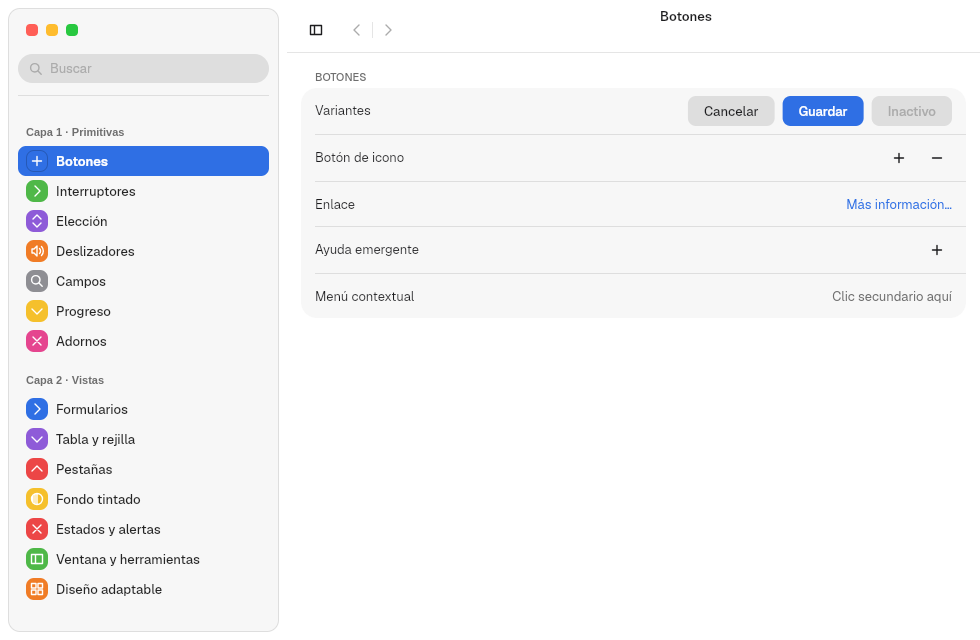
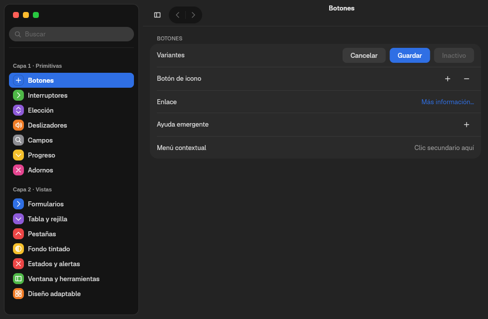
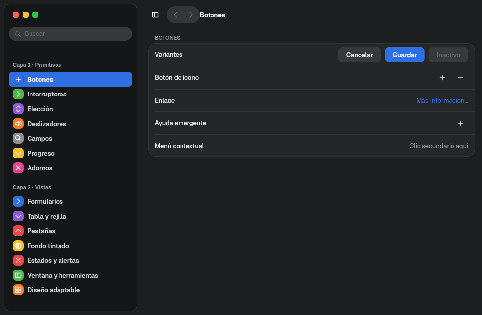
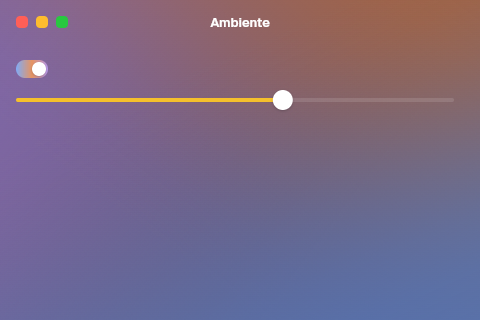

# 4. Apariencia y tokens

**Objetivo:** saber de dónde sale cada color y cada medida, cómo cambia con el
sistema y cómo añadir valores propios.
**Lector:** quien diseña una app o un componente.

## Tres niveles

| Nivel | Quién lo decide | Dónde vive |
|---|---|---|
| **Tokens** de Tengen: colores base, radios, espacios, tipografías, duraciones, medidas de cada componente | El sistema de diseño | `crates/vow-design/tengen/tokens.json` y `components.json` |
| **Apariencia**: modo claro u oscuro, acento, tintes, barra lateral en isla o plana, movimiento reducido | El usuario | `~/.config/malaysia/appearance.domain` |
| **Variantes** de un control: primario, tinte propio, fondo tintado | La app | El código de la app |

## Tokens: Tengen y `vow-design`

`crates/vow-design/build.rs` lee los dos JSON y genera constantes Rust tipadas.
Una app las importa de `vow_design`:

```rust
use vow_design::{ACCENT_SWATCHES, BUTTON, DURATION_BASE, SPACE_3, SPLIT_VIEW, TITLE_1};
```

| Grupo | Ejemplos |
|---|---|
| Espacios | `SPACE_1` … `SPACE_4` |
| Tipografía | `DISPLAY`, `TITLE_1`, `TITLE_2`, `HEADLINE`, `TEXT`, `CALLOUT`, `CAPTION` y la monoespaciada `MONO` (tipo `Font`) |
| Duraciones (ms) | `DURATION_FAST_MS` (120), `DURATION_BASE` (220), `DURATION_SLOW_MS` (420) |
| Medidas por componente | `BUTTON`, `SWITCH`, `SLIDER`, `SEGMENTED`, `TEXT_FIELD`, `TITLEBAR`, `SIDEBAR`, `SPLIT_VIEW`, `SPLIT_PANES`, `FLOATING_PANE`, `TABLE`, `COLLECTION`, `BREAKPOINT`… |
| Colores base | `LIGHT`, `DARK`, `DARK_TINT` y sus fondos (`BG_WINDOW_LIGHT`…) |
| Acentos | `ACCENT_SWATCHES`: Azul, Morado, Rosa, Rojo, Naranja, Amarillo, Verde, Gris |

Los mismos JSON generan también Slint, CSS y QML en `tengen/generated/`, para
proyectos que no son Rust.

### Añadir un valor propio

Un color o una medida nueva nunca se escribe en `barrier-kit`. Se añade a Tengen:

1. Añade la clave al componente en `tengen/components.json` (o a
   `tokens.json` si es un valor base).
2. Si el componente aún no tiene struct, añade el campo al struct de
   `crates/vow-design/src/lib.rs` y su emisión en `crates/vow-design/build/`.
3. Usa la constante en el código: `SPLIT_VIEW.key_step`.
4. Pasa `./dev.sh check`. `scripts/check-design-tokens.sh` rechaza literales de
   color fuera de `vow-design`, también en las apps.

## Apariencia del usuario

La resuelve `vow-appearance` y el kit la vigila: si el fichero cambia, la
ventana se repinta sin reiniciar. `MALAYSIA_CONFIG_DIR` cambia la carpeta.

```toml
# ~/.config/malaysia/appearance.domain
color_scheme = "dark"            # auto | light | dark | dark_tint
accent_color = [0.18, 0.44, 0.89]
sidebar_style = "island"         # island | flat
traffic_lights = "auto"          # auto | standard | accent | wallpaper
traffic_light_shape = "square"  # square | round
window_color = "neutral"         # neutral | accent | wallpaper
tint_parts = ["sidebars", "window", "groups", "controls", "menus"]
tint_strength_accent = "normal"  # subtle | normal | strong | intense
reduced_motion = false
reduce_transparency = true
scroll_bars = "when_scrolling"   # when_scrolling | always
```

El mismo botón en los tres modos:

| Claro | Oscuro | Oscuro tintado |
|---|---|---|
|  |  |  |

## La paleta semántica

`style::Palette::current()` da los colores ya resueltos para el modo, el acento
y la ventana activa o inactiva. Una app o un componente pinta solo con ella:

| Campo | Uso |
|---|---|
| `label`, `secondary_label`, `tertiary_label` | Texto principal, secundario y terciario |
| `window_background`, `content_background` | Fondo de ventana y de contenido |
| `control_background`, `control_hover`, `selected_control` | Controles en reposo, bajo el puntero y elegidos |
| `accent`, `accent_inactive`, `on_accent` | Acento, acento en ventana inactiva y tinta sobre el acento |
| `separator`, `control_border`, `card_border` | Líneas y bordes |
| `raised_background`, `sunken_background`, `scrim` | Superficies elevadas, hundidas y velos |
| `destructive` | Acciones destructivas |

`style::text(contenido, fuente, tinta)` crea un texto con una tipografía de
Tengen. `theme::color(rgba)` convierte un color de Tengen al tipo de Freya.
`theme::use_shell_theme()` da a los componentes de Freya un tema con la paleta
resuelta y lo cambia con la apariencia.

## Colores propios en una app

Una app no cambia colores sueltos: elige una variante.

| Quiero… | Así |
|---|---|
| Un control con otro color | `.tint(Tint::Color(ACCENT_SWATCHES[5].1))` en `Switch`, `Checkbox`, `Slider`, `LevelSlider`, `RadioGroup`, `ProgressBar` |
| Un control relleno con el degradado del fondo | `.tint(Tint::Backdrop)` dentro de un `Backdrop` |
| Un acento propio para toda una zona | `Backdrop::new(..).accent(Accent::Own(color))` o `Accent::FromBackdrop` |
| Que el usuario elija un color | `ColorWell::new("Color", &ACCENT_SWATCHES)` |
| Forzar claro u oscuro en mi ventana | `theme::use_appearance(\|config\| config.color_scheme = ColorScheme::Dark)` |

El ejemplo [`ambiente.rs`](../../crates/barrier-kit/examples/ambiente.rs) usa
las tres primeras: un fondo de tres colores, el acento sacado del fondo, un
interruptor con `Tint::Backdrop` y un deslizador amarillo.



En una ventana inactiva, todos los tintes usan el acento inactivo de la paleta.
Los fondos tintados se explican en el capítulo [13](13-fondos-y-medios.md).

Siguiente: [5. Controles](05-controles.md).
