# 5. Controls

**Goal:** know each interactive element of layer 1, its code and its look.
**Reader:** anyone who builds the interface of an app.

Each image is the kit's render reference (`crates/barrier-kit/tests/golden/`),
generated by the snippet next to it in `tests/kit/controls.rs`. All of them
exist in light and dark; here the light one is shown, with the dark one beside
it when it adds something. Live, all of them are in the Tengen App Show app
(chapter [15](15-apps-de-prueba.en.md)).

## Common rules

- The first argument of `new` is the **accessible label**.
- They are **controlled**: the app passes the value and receives the change.
- All of them respond to the keyboard: Tab moves the focus and draws the focus
  ring; Space or Enter activate; the arrow keys move sliders and segments.
- The ones with a fill accept `.tint(Tint::Accent | Tint::Color(c) | Tint::Backdrop)`.

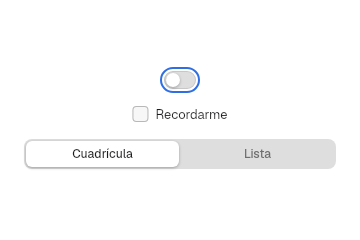

## Buttons

Modules `controls` and `compact`.

```rust
Button::new("Cancelar")
Button::new("Guardar").style(ButtonStyle::Primary)
Button::new("Borrar").disabled(true)
```

| Light | Dark |
|---|---|
| 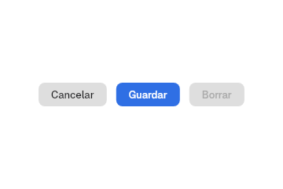 | 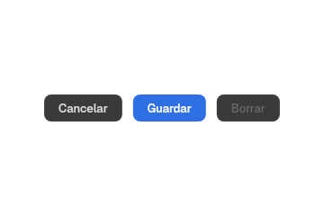 |

- `ButtonStyle`: `Secondary` (default) and `Primary`.
- Regular size: 24 tall, radius 6 and 12 side padding (`button`), AppKit's `regular` on macOS 26.
- `.small(true)`: 20 tall, 11 side padding and 11 text (`button.small`), like the one in «Acerca de este PC».
- `.large(true)`: 28 tall, capsule (`button.large`), AppKit's `large`; `Alert` uses it.
- `.width(Size)` and `.on_press(|_| ..)`. When pressed, the button scales to
  `BUTTON.pressed_scale` (0.97).

```rust
IconButton::new(Symbol::Plus, "Añadir")
Stepper::new("Núcleos", 1, 16).value(4)
ToggleGroup::new("Formato")
    .item("B", Face::Bold, "Negrita", true)
    .item("I", Face::Italic, "Cursiva", false)
    .item("U", Face::Underline, "Subrayado", false)
```

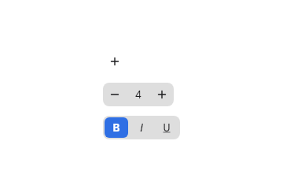

`IconButton` is 30 (`icon-button`). Inside a `ToolGroup` or a unified bar
(52) it becomes a 36 capsule, the `TOOLGROUP` height, like macOS 26
toolbar items.

`Stepper` shows the value and, 8 away, AppKit's arrows: 20 × 26, radius 6,
up on top and down below (`stepper`). The arrow keys also change the
value.

`Link::new("Más información…")` is a text link with `on_press`.

`ButtonStyle` also has `Glass` and `GlassProminent`, the macOS 26 `.glass` and
`.glassProminent` styles (a capsule with a thin border, neutral or with the
accent), and `Borderless`, with no background until hovered. `.toggled(bool)`
turns the button into a toggle: when on it takes the primary look and
reports itself as `toggled`.

`barrier_kit::buttons` adds:

- `MenuButton::new(label, items)`: a button with a chevron that opens a menu
  of actions (`NSPopUpButton` with `pullsDown`, SwiftUI `Menu`); it reports
  through `on_activate(id)`.
- `HelpButton`: the round help button with "?".
- `ControlGroup`: buttons joined by separators, like `ControlGroup`; give them
  the `Borderless` style.
- `ShareButton::new(label, content)`: copy, send by email and, for a link,
  open with another app (the `OpenURI` portal). freedesktop has no share
  portal, so these are the actions.

## Switch and checkbox

```rust
Switch::new("Apagado")
Switch::new("Encendido").on(true)
Switch::new("Inactivo").on(true).disabled(true)
Checkbox::new("Recordarme").checked(true)
```

| Switches | Checkbox |
|---|---|
| 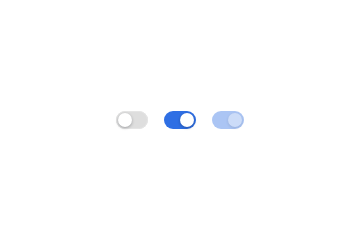 | 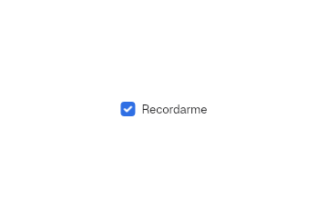 |

`Switch` reports with `.on_toggle(|on: bool| ..)`; `Checkbox` does the same.
The switch knob animates over `SWITCH.transition_ms`.

## Choice

```rust
RadioGroup::new("Aplicar el tinte a")
    .option("Solo las ventanas")
    .option("Todo el escritorio")

SegmentedControl::new("Periodo")
    .segment("Día").segment("Semana").segment("Mes")
    .selected(1)

PopUpButton::new("Semáforos")
    .item("Automático").item("Clásico").item("Acento")
    .selected(1)

ColorWell::new("Color de acento", &ACCENT_SWATCHES).selected(Some(0))
```

| Radio | Segmented |
|---|---|
| 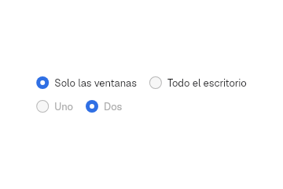 | 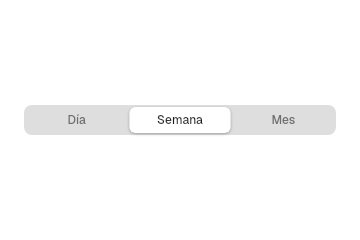 |

| Pop-up | Pop-up with icon | Color swatches |
|---|---|---|
| 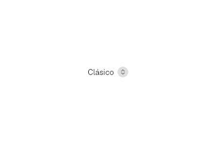 | 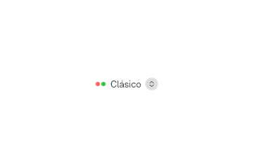 | 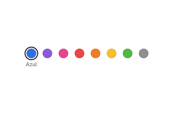 |

- `PopUpButton` opens a `MenuView` as a popup; `.icon_item(texto, MenuIcon::svg(..))`
  adds an icon, and `MenuIcon::Swatch(color)` adds a colour circle.
- In a menu, the mark has a column for the whole menu, only if some row uses
  it. The icon only shifts the text of its own row, as in macOS; a checked row
  keeps its icon.
- `.with_badge("12")` puts a counter on the right of the row, before the
  shortcut, like `NSMenuItemBadge`. `MenuItem::palette(vec![..])` groups
  actions with icons into one horizontal row, like the Finder's colour tags
  (`NSMenu.presentationStyle = .palette`): ← and → walk it and Enter picks.
  In the global menu (dbusmenu) each swatch becomes a plain action.
- `ImageWell::new("Avatar", imagen)` (`barrier_kit::image_well`), like the
  HIG image well, keeps a `State<Option<PathBuf>>`. It accepts an image
  dropped from another app (it lights up with the accent while one hovers),
  opens the portal chooser when pressed and clears with Delete or Backspace.
  It only takes image extensions (`is_image`). Its metrics
  (`components.image-well`: 64 pt, radius 8, inset 4) are estimates: the HIG
  gives no figures.
- Dropping files works on any element with `on_file_drop`. The runtime
  accepts `text/uri-list` on `wl_data_device` and emits `FileHover`,
  `FileHoverCancelled` and one `FileDrop` per file (`uri_list_paths`).
- `ChoiceCards::new(..).option(rótulo, vista_previa)` shows large cards (like
  «Claro, Oscuro, Acento», "Light, Dark, Accent", in Tengen App Show).

## Sliders

```rust
Slider::stepped(5).value(2).labels(&["A", "B", "C", "D", "E"])
LevelSlider::new("Brillo").value(0.3)
LevelSlider::new("Volumen").value(0.6).style(LevelStyle::Fat(Symbol::SpeakerWave))
```

| Stepped | Continuous and fat |
|---|---|
| 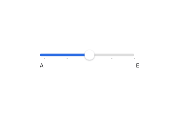 | 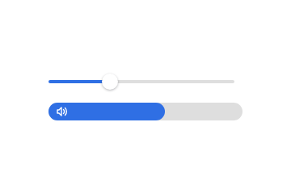 |

`Slider` works with indices (`usize`) and `LevelSlider` with an `f32` between
0 and 1.

## Text fields

```rust
let nombre = use_state(|| "hblanqueto".to_string());
TextField::new(nombre, "Nombre de usuario")
SearchField::new(consulta, "Buscar").auto_focus(true)
let clave = use_state(PasswordField::default);
SecureField::new(clave).on_submit(move |valor| entrar(valor))
ComboBox::new(shell, "Intérprete").item("zsh").item("fish")
TextEditor::new(notas, "Notas").height(Size::px(72.0))
```

| Text and search | Password |
|---|---|
| 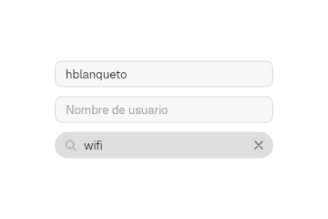 | 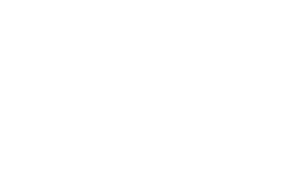 |

`TextField` and `SearchField` write directly into a `State<String>`. With the
focus in a field, Ctrl+A, C, V, X, Y and Z belong to the field before the menu.
`SearchField::auto_focus(true)` takes the focus when it mounts.

`SecureField` keeps the password in a `State<PasswordField>`
(`barrier_kit::password`) that the app creates. Enter calls `on_submit` with the
value in a `Zeroizing<String>`. Whoever draws their own field passes each key to
`PasswordField::handle_key(&key, modifiers)`: it returns the value on Enter.

`ComboBox` (`barrier_kit::combo_box`) is a text field with an arrow button,
like `NSComboBox`: you type freely or pick from the list, which opens below
with the kit menu. It measures like the AppKit render on macOS 26
([native-theme](https://github.com/tiborgats/native-theme)): a 24 × 20 button
4 from the edge, `radius.xs` corner and 6 between the text and the button
(`components.combo-box`).

`TextEditor` (`barrier_kit::text_editor`) edits several lines, like
`NSTextView`. Enter adds a line, Escape drops the focus and the text scrolls
inside the height `.height(..)` gives it (by default, the whole container). It
uses Freya's editing engine (`freya-edit`) and the look of `TextField`.

A secondary click on `TextField`, `SearchField`, `ComboBox`, `TokenField` or
`TextEditor` opens the HIG edit menu: Cut, Copy, Paste and Select All. Each
command focuses the field and sends it its shortcut (Ctrl+X, C, V or A), so it
acts on the selection the field already had.

In `TextEditor`, Ctrl+F opens a find bar above the text, like SwiftUI's
`findNavigator`: a `SearchField`, the counter ("2 of 3"), previous and next
(also ↑, ↓ and Enter) and Done. The current match stays selected and the
text scrolls to it (`ScrollController::reveal_y`). `find_matches` ignores case
and does not overlap matches. In `TextEditor`, Cut and Copy are disabled
without a selection. One-line fields keep them always enabled, because
Freya's `Input` does not expose its selection.

`TokenField` (`barrier_kit::token_field`), like `NSTokenField`, keeps tags in
a `State<Vec<String>>`: Enter or a comma turns the text into a capsule. On an
empty field, Backspace selects the last one and a second press deletes it; ←
and → walk the capsules, a click selects one and Backspace or Delete removes
it. `PathControl`
(`barrier_kit::path_control`), like `NSPathControl`, shows the parts of a
path separated by chevrons in a 22 row, each with its icon
(`.item(Symbol::Folder, "Documentos")`), and reports the pressed part through
`on_select`. The 22 height comes from Xcode xibs; the capsule (18 high, 7
padding and the accent at 20 %) is an estimate: there is no macOS 26 probe
for these two controls. `SearchField::tokens(state)` shows the same capsules
inside the search field, like the filters in Finder and Mail, and Backspace
on an empty field removes the last one.

`ColorPicker` (`barrier_kit::color_picker`) is a color well that opens a
popover with hue, saturation and brightness and the hex value, like a small
AppKit color panel.

`barrier_kit::portal` talks to xdg-desktop-portal: `open_files` and
`save_file` open the system file chooser (`FileChooser`), `open_uri` opens a
link (`OpenURI`) and `notify` sends a notification (`Notification`). They are
`async`; launch them with `spawn`.

```rust
DatePicker::new("Fecha", CivilDateTime::new(CivilDate::new(2026, 11, 6), 9, 30))
    .elements(DateElements::DateAndTime)
    .on_change(move |d| momento.set(d))
```

`DatePicker` (`barrier_kit::date_picker`) is the `textFieldAndStepper` style
of `NSDatePicker` with the pop-up calendar of `presentsCalendarOverlay`. `elements`
chooses date, time or both, like `NSDatePicker.ElementFlags`. The arrows, or ↑
and ↓, change the chosen part; ← and → move between parts, and a click on a
date part opens the calendar. Numbers can be typed: the part moves on when it
is full or when no other digit fits (a 4 in the day). The order of the parts and the first day
of the week come from the language (`date-order` and `week-start` in
`barrier-kit.ftl`). The calendar measures 139 × 148, like WebKit's
([WebDateTimePickerMac.mm](https://github.com/WebKit/WebKit/blob/e1b89c8323669cd1dcd013253cec56c8d46272b8/Source/WebKit/UIProcess/mac/WebDateTimePickerMac.mm#L35)),
and the chosen day has a 3 corner, as in
[macos_ui](https://pub.dev/packages/macos_ui). `barrier_kit::date::CivilDate`
does the calendar arithmetic without dependencies (algorithms by
[Howard Hinnant](https://howardhinnant.github.io/date_algorithms.html)).

## Progress

```rust
ProgressBar::determinate("Copiando sistema", 0.62)
ProgressBar::indeterminate("Buscando redes")
ProgressRing::new("Descargando", 0.4)
Spinner::new("Cargando")
```

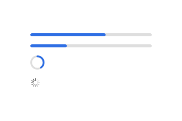

```rust
CapacityIndicator::new("Disco", 0.82).thresholds(0.75, 0.9)
RatingIndicator::new("Valoración", 3).on_change(move |v| estrellas.set(v))
CircularGauge::new("Temperatura", 0.64, "64°")
```

`barrier_kit::indicator` follows `NSLevelIndicator`. `CapacityIndicator` is a
bar of `LEVEL_INDICATOR.height` (16) that turns from green to yellow at the
warning threshold and to red at the critical one (`LEVEL_INDICATOR_COLORS`).
`RatingIndicator` shows 5 stars of 12; a click on one sets that value.
`CircularGauge` is the `accessoryCircular` style of `Gauge`: an open ring with
a marker at the value and the current value in the centre
([Apple](https://developer.apple.com/documentation/swiftui/gaugestyle/accessorycircular)).
Apple does not publish its measurements; the size (44), stroke (4) and arc
(270°) are an estimate. `.capacity(true)` switches it to the
`accessoryCircularCapacity` style: a closed ring that fills with the accent.
`CapacityIndicator::discrete(n)` splits it into `n` cells 2 apart, and
`RelevancyIndicator` draws the thin lines of the relevancy style. For a label
and value row (`LabeledContent`) there is already `Row::value(title, value)`. The
measurements come from Xcode xibs and from
[macos_ui](https://pub.dev/packages/macos_ui); there is no macOS 26 probe.

## Adornments

```rust
badge("2")
divider()
avatar("HB")
Link::new("Más información…")
```

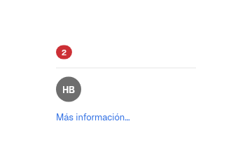

```rust
GroupBox::new(Some("Red")).child(Checkbox::new("Wi-Fi"))
DisclosureGroup::new("Avanzado").expanded(true).child(Checkbox::new("Wi-Fi"))
```

`barrier_kit::views::group` has `GroupBox` (`NSBox`, SwiftUI `GroupBox`) and
`DisclosureGroup`. The box has a 5 inner margin (the default
`contentViewMargins` of `NSBox`) and an 11 corner, the one Qt uses for the
macOS 26 box ([qmacstyle_mac.mm](https://github.com/qt/qtbase/blob/22c02af96a9c0bdcfac956231bf706d6189fab07/src/plugins/styles/mac/qmacstyle_mac.mm#L139)).
The disclosure group indents its content by 13, the `indentationPerLevel` of
`NSOutlineView` on macOS 26.6.2 measured by
[native-theme](https://github.com/tiborgats/native-theme), with a 24 header
(its `rowHeight`). A click or Space on the header opens or closes it.

## Popover

```rust
show_popover(area_del_boton, (240.0, 32.0), || text("Hola", TEXT, color).into_element());
```

`show_popover` (`barrier_kit::popover`) opens a popup below the area it gets,
sized to the content plus `POPOVER.padding` and the arrow band. The app asks
Malaysia with `infinity_window_style_v1.set_popover` (version 2) for the shape
of `NSPopover` on macOS 26: a continuous 20 corner and a 25.42 × 13 arrow with
a round tip, filleted into the body, pointing at the centre of the area. The
compositor clips, borders and shadows that shape
([ADR 0059](https://github.com/HBlanqueto/malaysia/blob/main/docs/decisiones/0059-radio-por-barra-y-esquina-continua.en.md));
the app only paints the background. The measurements are the ones the Flutter
package [`popover`](https://pub.dev/packages/popover) took from AppKit on
macOS 26.7. A click outside closes it.

## Tooltip and context menu

```rust
let ayuda = use_tooltip("Añadir una carpeta");
ayuda.attach(IconButton::new(Symbol::Plus, "Añadir"))

context_menu(fila, elementos, |id: String| { /* action */ })
```

- `use_tooltip` opens a popup without a grab under the pointer.
- `context_menu` opens a `MenuView` at the pointer on secondary click.
  `elementos` is a `Vec<MenuItem>`; `Action::item(true)` creates one from an
  action (chapter [11](11-app.en.md)).
- `MenuItem::action(id, texto)`, `::submenu(texto, elementos)`,
  `::header(texto)` and `::placeholder(texto)` create the others;
  `.with_shortcut`, `.with_enabled`, `.with_check` and `.with_icon` adjust them.
- `menu::normalize_query(texto)` prepares a search the way the menu does, and
  `menu::submenu_contents(cargando, elementos)` shows «Cargando…» ("Loading…")
  in a submenu that still arrives empty.

## Scrolling

```rust
ScrollView::new().height(Size::px(120.0)).child(lista)
```

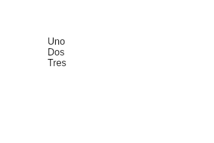

`ScrollView` supports `.direction(Direction::Horizontal)`, `.scroll_bar(false)`
and a `use_scroll_controller()` to scroll from code. The bar fades out over
`DURATION_FAST_MS` unless `scroll_bars = "always"`, which shows it with an
11 px track. `.top_line(true)` draws the divider over the content, which slides
under it when scrolled. `.edge_effect(true)` is the soft edge effect of
macOS 26 (`scrollEdgeEffectStyle(.soft)`): while scrolled, the content fades
under the top edge over `SCROLL_BAR.edge_height` (24, an estimate).

## Symbols

`Symbol` is the kit's icon registry (31 today): `MagnifyingGlass`, `XMark`,
`Plus`, `Minus`, `Chevron*`, `SidebarLeft`, `SpeakerWave`, `Play`, `Pause`,
`House`, `Star`, `Clock`, `Checkmark`… `symbol(Symbol::Plus, 16.0, color)`
draws it on its own; the controls take the `Symbol` directly.

## Creating a new control

1. Check whether it already exists (rule 1 of `AGENTS.md`); a new control
   composes kit primitives.
2. Use `use_interaction()` and `interaction.attach(rect(), habilitado)` for
   hover, pressed and focus; `interaction.focus_ring(..)` for the ring.
3. Paint only with `Palette::current()` and `vow_design` tokens.
4. Add its case to `tests/kit/controls.rs` (light and dark) and its page in
   Tengen App Show ([ADR 0047](../decisiones/0047-barrierkit-en-capas.en.md) §2).

Next: [6. Windows](06-ventanas.en.md).
