# 5. Controles

**Objetivo:** conocer cada elemento interactivo de la capa 1, su código y su
aspecto.
**Lector:** quien construye la interfaz de una app.

Cada imagen es la referencia de render del kit (`crates/barrier-kit/tests/golden/`),
generada por el fragmento que la acompaña en `tests/kit/controls.rs`. Todas
existen en claro y en oscuro; aquí se muestra el claro y el oscuro va al lado
cuando aporta. En vivo, todos están en la app Tengen App Show (capítulo [15](15-apps-de-prueba.md)).

## Reglas comunes

- El primer argumento de `new` es la **etiqueta accesible**.
- Son **controlados**: la app pasa el valor y recibe el cambio.
- Todos responden al teclado: Tab mueve el foco y dibuja el anillo de foco;
  Espacio o Intro activan; las flechas mueven deslizadores y segmentos.
- Los que tienen relleno aceptan `.tint(Tint::Accent | Tint::Color(c) | Tint::Backdrop)`.

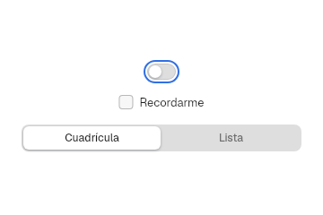

## Botones

Módulos `controls` y `compact`.

```rust
Button::new("Cancelar")
Button::new("Guardar").style(ButtonStyle::Primary)
Button::new("Borrar").disabled(true)
```

| Claro | Oscuro |
|---|---|
| 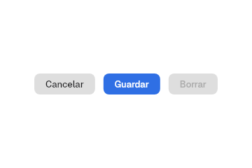 | 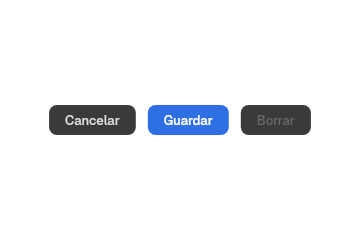 |

- `ButtonStyle`: `Secondary` (por defecto) y `Primary`.
- `.small(true)`: 24 px de alto y 13 px de margen lateral (`button.small`), como el de «Acerca de este PC».
- `.width(Size)` y `.on_press(|_| ..)`. Al pulsar, el botón se escala a
  `BUTTON.pressed_scale` (0,97).

```rust
IconButton::new(Symbol::Plus, "Añadir")
Stepper::new("Núcleos", 1, 16).value(4)
ToggleGroup::new("Formato")
    .item("B", Face::Bold, "Negrita", true)
    .item("I", Face::Italic, "Cursiva", false)
    .item("U", Face::Underline, "Subrayado", false)
```

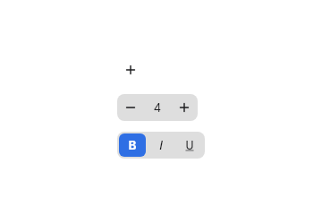

`Link::new("Más información…")` es un enlace de texto con `on_press`.

## Interruptor y casilla

```rust
Switch::new("Apagado")
Switch::new("Encendido").on(true)
Switch::new("Inactivo").on(true).disabled(true)
Checkbox::new("Recordarme").checked(true)
```

| Interruptores | Casilla |
|---|---|
| 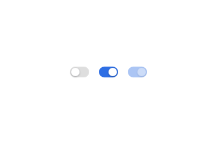 | 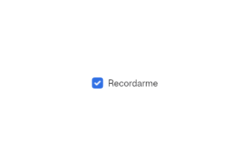 |

`Switch` avisa con `.on_toggle(|on: bool| ..)`; `Checkbox` igual. El pomo del
interruptor se anima en `SWITCH.transition_ms`.

## Elección

```rust
RadioGroup::new("Aplicar el tinte a")
    .option("Solo las ventanas")
    .option("Todo el escritorio")

SegmentedControl::new("Periodo")
    .segment("Día").segment("Semana").segment("Mes")
    .selected(1)

PopUpButton::new("Semáforos")
    .item("Automático").item("Clásico").item("Acento")
    .selected(1)

ColorWell::new("Color de acento", &ACCENT_SWATCHES).selected(Some(0))
```

| Radio | Segmentado |
|---|---|
| 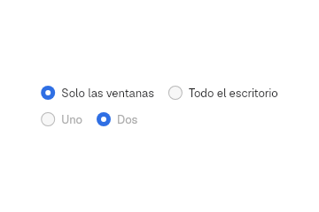 | 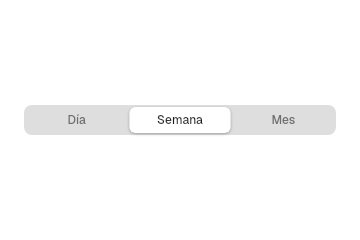 |

| Desplegable | Desplegable con icono | Muestras de color |
|---|---|---|
| 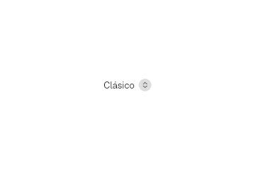 | 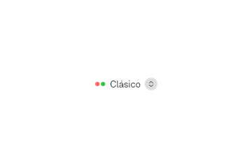 | 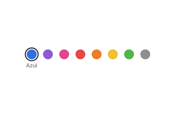 |

- `PopUpButton` abre un `MenuView` como popup; `.icon_item(texto, MenuIcon::svg(..))`
  añade un icono, y `MenuIcon::Swatch(color)`, un círculo de color.
- En un menú, la marca y el icono tienen columna propia: una fila marcada
  conserva su icono.
- `ChoiceCards::new(..).option(rótulo, vista_previa)` muestra tarjetas grandes
  (como «Claro, Oscuro, Acento» en Tengen App Show).

## Deslizadores

```rust
Slider::stepped(5).value(2).labels(&["A", "B", "C", "D", "E"])
LevelSlider::new("Brillo").value(0.3)
LevelSlider::new("Volumen").value(0.6).style(LevelStyle::Fat(Symbol::SpeakerWave))
```

| Por pasos | Continuo y grueso |
|---|---|
| 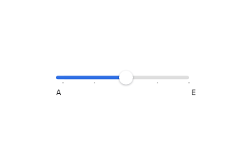 | 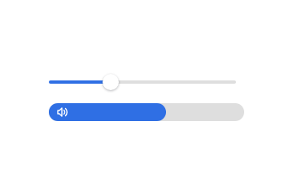 |

`Slider` trabaja con índices (`usize`) y `LevelSlider` con `f32` entre 0 y 1.

## Campos de texto

```rust
let nombre = use_state(|| "hblanqueto".to_string());
TextField::new(nombre, "Nombre de usuario")
SearchField::new(consulta, "Buscar")
SecureField::new()
```

| Texto y búsqueda | Contraseña |
|---|---|
| 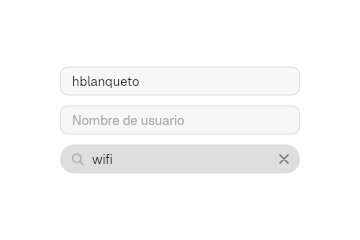 | 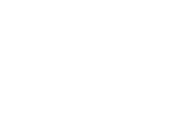 |

`TextField` y `SearchField` escriben directamente en un `State<String>`. Con
el foco en un campo, Ctrl+A, C, V, X, Y y Z son del campo antes que del menú.

## Progreso

```rust
ProgressBar::determinate("Copiando sistema", 0.62)
ProgressBar::indeterminate("Buscando redes")
ProgressRing::new("Descargando", 0.4)
Spinner::new("Cargando")
```

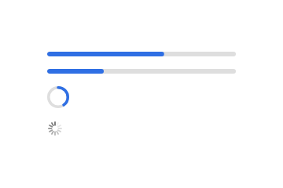

## Adornos

```rust
badge("2")
divider()
avatar("HB")
Link::new("Más información…")
```

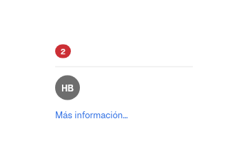

## Ayuda emergente y menú contextual

```rust
let ayuda = use_tooltip("Añadir una carpeta");
ayuda.attach(IconButton::new(Symbol::Plus, "Añadir"))

context_menu(fila, elementos, |id: String| { /* acción */ })
```

- `use_tooltip` abre un popup sin grab bajo el puntero.
- `context_menu` abre un `MenuView` en el puntero con el clic secundario.
  `elementos` es un `Vec<MenuItem>`; `Action::item(true)` crea uno desde una
  acción (capítulo [11](11-app.md)).

## Desplazamiento

```rust
ScrollView::new().height(Size::px(120.0)).child(lista)
```

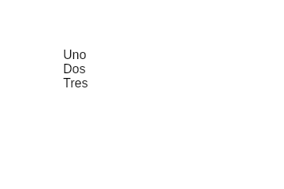

`ScrollView` admite `.direction(Direction::Horizontal)`, `.scroll_bar(false)`
y un `use_scroll_controller()` para desplazar desde el código. La barra se
desvanece en `DURATION_FAST_MS` salvo con `scroll_bars = "always"`, que la
muestra con carril de 11 px. `.top_line(true)` dibuja el divisor encima del
contenido, que pasa por debajo al desplazarse.

## Símbolos

`Symbol` es el registro de iconos del kit (31 hoy): `MagnifyingGlass`,
`XMark`, `Plus`, `Minus`, `Chevron*`, `SidebarLeft`, `SpeakerWave`, `Play`,
`Pause`, `House`, `Star`, `Clock`, `Checkmark`… `symbol(Symbol::Plus, 16.0, color)`
lo dibuja suelto; los controles reciben el `Symbol` directamente.

## Crear un control nuevo

1. Busca si ya existe (regla 1 de `AGENTS.md`); un control nuevo compone
   primitivas del kit.
2. Usa `use_interaction()` y `interaction.attach(rect(), habilitado)` para
   hover, pulsado y foco; `interaction.focus_ring(..)` para el anillo.
3. Pinta solo con `Palette::current()` y tokens de `vow_design`.
4. Añade su caso a `tests/kit/controls.rs` (claro y oscuro) y su página en
   Tengen App Show ([ADR 0047](../decisiones/0047-barrierkit-en-capas.md) §2).

Siguiente: [6. Ventanas](06-ventanas.md).
