# 5. Controls

**Goal:** add any interactive control to a window and keep its value in the app's state.
**Scope:** the kit's controls, from buttons to the canvas, and how to build a new one. Text
editing is in [6](06-text-and-editing.md); menus, popovers, tooltips and context menus are in
[7](07-menus-and-popovers.md); colors and tokens are in [4](04-appearance-and-tokens.md).
**Reader:** anyone who builds the interface of an app.
**Input:** a window that runs ([2](02-first-app.md)). **Output:** a window with controls whose
values live in `State`.

## Steps

1. Create the value in the view, with a hook at the top of the closure:

   ```rust
   let mut wifi = use_state(|| true);
   ```

2. Build the control. The first argument of `new` is its accessible label:

   ```rust
   Switch::new("Wi-Fi")
   ```

3. Pass the current value with the control's value method (`on`, `checked`, `value`,
   `selected`):

   ```rust
   Switch::new("Wi-Fi").on(*wifi.read())
   ```

4. Store the change in the callback (`on_toggle`, `on_change`, `on_press`):

   ```rust
   Switch::new("Wi-Fi")
       .on(*wifi.read())
       .on_toggle(move |on| wifi.set(on))
   ```

5. Add it to the view: `VStack::new().child(..)`. When `wifi` changes, the view runs again and
   the switch shows the new value.

Text fields skip steps 3 and 4: they take the `State<String>` itself
([Text fields](#text-fields)).

## The controlled pattern

| Rule | What happens |
|---|---|
| The app passes the value | The control seeds its own copy from it |
| The user changes it | The control shows the change at once and calls the callback with the new value |
| The app changes the value | The control drops its copy and shows the app's value |
| The new value equals the old one | No callback |

✗ Reading the control's value: there is no getter.
✓ Keeping the value in `State` and passing it on every render.

Three controls keep no copy and only show what the app passes: `RatingIndicator`,
`ColorPicker` and `FontPicker`. Their callback must update the state, or nothing changes.

## Common rules

- The label of `new` is the accessible name. Controls with visible text (`Button`,
  `Checkbox`, `RadioGroup` options) also show it.
- Tab moves the focus. A keyboard focus draws the focus ring
  (`FOCUS_RING`, 3 px, accent) only while the window is active.
- Space or Enter press the focused button. The arrow keys move sliders, steppers,
  segments and radio options.
- `.disabled(true)` dims the control and stops its callbacks.
- Controls with a fill take `.tint(Tint)` (`bk::backdrop::Tint`: `Accent`,
  `Color(Rgba)`, `Backdrop`; see [15](15-backdrops-and-media.md)).
- Visible text in a real app comes from `tr!` ([17](17-languages.md)); examples here use
  literals.
- Most controls take `.key(..)` (Freya's `KeyExt`) to keep their state in lists.

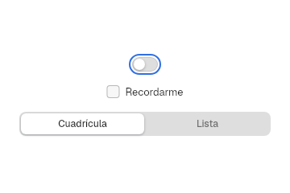

Each image is a golden render from `crates/bk/tests/kit/controls.rs`, in light and
dark (`-dark.png`).

## Buttons

`controls::Button` is a push button with a text label.

| Method | Default | Effect |
|---|---|---|
| `Button::new(label)` | — | `label` is `impl Into<String>` |
| `.style(\|s\| ..)` | Tengen, SwiftUI's `.bordered` | Look: a preset or any field of `ButtonStyle`, see below |
| `.size(ControlSize)` | `Regular` | Height, padding, font and corners |
| `.width(Size)` | `Size::auto()` | Fixed or fill width |
| `.toggled(bool)` | not a toggle | Makes it a toggle; `true` takes the `bordered_prominent` look and reports `toggled` |
| `.disabled(bool)` | `false` | Dims it, no `on_press` |
| `.on_press(\|_\| ..)` | — | Called on click, Space or Enter |

Presets of `ButtonStyle`, given as `.style(ButtonStyle::glass)`:

| Preset | Look |
|---|---|
| none (Tengen) | Control background; hover color under the pointer |
| `bordered_prominent` | Accent fill, `on_accent` text |
| `glass` | Capsule with a hairline border, raised background |
| `glass_prominent` | Capsule with a hairline border and the accent fill |
| `borderless` | No background until hovered |

`ControlSize`:

| Variant | Height | Padding | Font | Corner |
|---|---|---|---|---|
| `Small` | 20 | 11 | 11 | 4.5 |
| `Regular` | 24 | 12 | 13 | 6 (`radius.button`) |
| `Large` | 28 | 12 | 13 | capsule |

A pressed button scales to `BUTTON.pressed_scale` (0.97).

```rust
Button::new("Cancel")
Button::new("Save").style(ButtonStyle::bordered_prominent)
Button::new("Delete").disabled(true)
```

| Light | Dark |
|---|---|
| 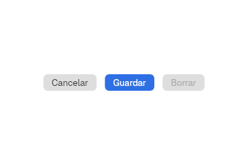 | 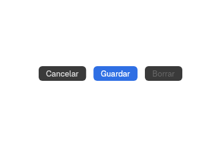 |

### Style

`Button` draws only from a `ButtonStyle`. `.style(..)` takes a preset or a
closure for one button, `.control_style(|s: ButtonStyle| ..)` for every button
inside a view and `Theme::tengen().style(ButtonStyle::glass)` for the whole
app. The fields, the presets and `.size` are in
[Styles and themes](../ai/styles.md#buttonstyle).

```rust
Button::new("Save").style(|s| ButtonStyle { shape: Shape::Capsule, ..s.bordered_prominent() })
```

## Compact buttons

Module `compact`.

| Item | Build | Reports |
|---|---|---|
| `IconButton` | `IconButton::new(Symbol, label)`, `.disabled(bool)`, `.style(\|s\| ..)` | `.on_press(\|_\| ..)` |
| `Stepper` | `Stepper::new(label, min, max)`, `.value(i64)` (clamped; default `min`), `.style(\|s\| ..)` | `.on_change(\|value: i64\| ..)` |
| `ToggleGroup` | `ToggleGroup::new(label)`, `.item(text, Face, label, on)` per toggle, `.style(\|s\| ..)` | `.on_toggle(\|(index, on)\| ..)` |

- `IconButton` is 30 × 30 with a 16 symbol (`ICON_BUTTON`). Inside a
  [`ToolGroup`](#toolbar-controls) it becomes a 36 capsule, the `TOOLGROUP` height.
- `Stepper` shows the value and, 8 to its right, the arrows: 20 × 26, up above down
  (`STEPPER`). ↑ and ↓ also step. An arrow is dimmed at its limit.
- `ToggleGroup` is a row of independent toggles on one background, for text formatting.
  `Face` (`Bold`, `Italic`, `Underline`) sets how `text` is drawn. A toggle that is on takes
  the accent.

```rust
IconButton::new(Symbol::Plus, "Add")
Stepper::new("Cores", 1, 16).value(4)
ToggleGroup::new("Format")
    .item("B", Face::Bold, "Bold", true)
    .item("I", Face::Italic, "Italic", false)
    .item("U", Face::Underline, "Underline", false)
```

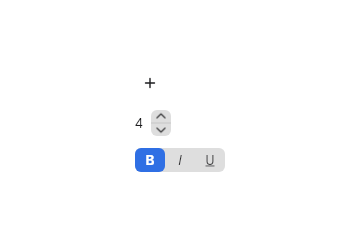

### Style

`IconButton` draws only from an `IconButtonStyle`, `Stepper` from a
`StepperStyle` and `ToggleGroup` from a `ToggleGroupStyle`. The arrows of a
[`DatePicker`](#date-picker) draw from the `StepperStyle` in context too. The
fields are in [Styles and themes](../ai/styles.md#iconbuttonstyle).

```rust
Stepper::new("Cores", 1, 16).style(|s| StepperStyle { value_position: Some(Edge::Trailing), ..s })
```

## Menu buttons

Module `buttons`. The menus they open are [`MenuItem`](07-menus-and-popovers.md) lists, shown
as a popover menu below the button.

| Item | Build | Reports |
|---|---|---|
| `MenuButton` | `MenuButton::new(label, items)`, `.style(\|s\| ..)` | `.on_activate(\|id: String\| ..)` |
| `ComboButton` | `ComboButton::new(label, items)`, `.style(\|s\| ..)` | `.on_press(\|_\| ..)` for the label, `.on_activate(\|id: String\| ..)` for the menu |
| `HelpLink` | `HelpLink::new()`, `.style(\|s\| ..)` | `.on_press(\|_\| ..)` |
| `ControlGroup` | `ControlGroup::new(label)`, `.child(..)`, `.style(\|s\| ..)` | — (its children report) |
| `ShareLink` | `ShareLink::new(label, content)`, `.style(\|s\| ..)` | — (acts by itself) |

- `MenuButton` is a button with a down chevron that opens a menu of actions.
- `ComboButton` has two halves split by a thin line: the label runs the main action, the
  chevron opens the menu.
- `HelpLink` is a 24 round button with "?".
- `ControlGroup` joins its children on one background with separators. Give child buttons
  the `borderless` preset.
- `ShareLink` opens a menu with Copy, Send by Email and, when `content` starts with
  `http://` or `https://`, Open With. Copy uses the clipboard; Send by Email opens
  `mail_uri(content)` and Open With opens the link, both through the `OpenURI` portal
  ([13](13-app.md)). freedesktop has no share
  portal, so these are the actions.
- `mail_uri(content)` returns `mailto:?body=…` with every byte but unreserved characters
  percent-encoded.

### Style

`MenuButton` draws only from a `MenuButtonStyle`, `ComboButton` from a
`ComboButtonStyle`, `HelpLink` from a `HelpLinkStyle` and `ControlGroup` from a
`ControlGroupStyle`, which paints only the group and its separators: its
children keep their own styles. `ShareLink` is a `MenuButton`, so it takes a
`MenuButtonStyle`. The fields are in
[Styles and themes](../ai/styles.md#menubuttonstyle-combobuttonstyle-and-helplinkstyle).

```rust
MenuButton::new("Sort", items).style(|s| MenuButtonStyle { shape: Shape::Capsule, ..s })
```

## Toolbar controls

| Item | Module | Build | Behavior |
|---|---|---|---|
| `ToolGroup` | `controls` | `ToolGroup::new()`, `.child(..)`, `.children(..)`, `.style(\|s\| ..)` | Puts each child in a 36 slot. With the `Island` sidebar style it adds separators and a capsule background |
| `ToolbarSearch` | `compact` | `ToolbarSearch::new(value, placeholder)`, `.collapsed(bool)`, `.style(\|s\| ..)` | A 180 wide `SearchField` (`TOOLBAR_SEARCH_WIDTH`). Collapsed, it shows a magnifying-glass `IconButton` until pressed or while the text is not empty |
| `ToolbarOverflow` | `compact` | `ToolbarOverflow::new(items)`, `.on_activate(\|id: String\| ..)`, `.style(\|s\| ..)` | A `»` `IconButton` that opens the items as a menu |

Where they sit in the title bar is in [9](09-titlebars.md).

### Style

`ToolGroup` draws only from a `ToolGroupStyle`: slot size, separators,
background, rim and `axis` (a vertical group stacks its items). Its Tengen
follows the user's sidebar style. The fields are in
[Styles and themes](../ai/styles.md#toolgroupstyle).

`ToolbarSearch` takes a `ToolbarSearchStyle` with only its `width`: the field
draws from the `SearchFieldStyle` and the collapsed button from the
`IconButtonStyle` in context. `ToolbarOverflow` is an `IconButton`, so its
`.style` takes an `IconButtonStyle`.

```rust
ToolGroup::new().child(back).child(forward).style(|s| ToolGroupStyle { axis: Axis::Vertical, ..s })
```

## Switch and checkbox

| Item | Build | Value | Reports |
|---|---|---|---|
| `Switch` | `Switch::new(label)` | `.on(bool)` | `.on_toggle(\|on: bool\| ..)` |
| `Checkbox` | `Checkbox::new(label)`, `.width(Size)` | `.checked(bool)` | `.on_toggle(\|checked: bool\| ..)` |

Both take `.disabled(bool)`, `.tint(Tint)` and `.style(|s| ..)`.

- `Switch` is 54 × 24 with a 31 × 20 knob that slides over `SWITCH.transition_ms`. Its label is
  only accessible; put the visible one in a [form row](11-views.md) or set the style's
  `label_position`.
- `Checkbox` is a 16 box with a 12 check mark, followed by the label.

```rust
Switch::new("Off")
Switch::new("On").on(true)
Switch::new("Inactive").on(true).disabled(true)
Checkbox::new("Remember me").checked(true)
```

| Switches | Checkbox |
|---|---|
| 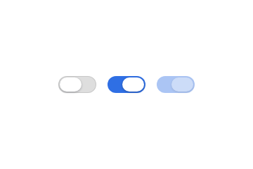 | 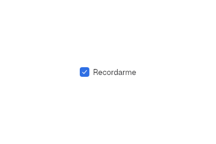 |

### Style

`Switch` draws only from a `SwitchStyle` and `Checkbox` from a
`CheckboxStyle`; `.tint(Tint)` sets their `fill`. Both styles place the label
with `label_position` (an `Edge`) and `layout_direction`. The fields are in
[Styles and themes](../ai/styles.md#switchstyle).

```rust
Checkbox::new("Remember me").style(|s| CheckboxStyle { label_position: Some(Edge::Leading), ..s })
```

## Choices

All of them report the chosen index with `.on_change(|index: usize| ..)`.

| Item | Module | Build | Value |
|---|---|---|---|
| `RadioGroup` | `choices` | `RadioGroup::new(label)`, `.option(text)`, `.disabled(bool)`, `.tint(Tint)`, `.style(\|s\| ..)` | `.selected(usize)` (default 0) |
| `SegmentedControl` | `controls` | `SegmentedControl::new(label)`, `.segment(text)`, `.style(\|s\| ..)` | `.selected(usize)` (default 0) |
| `PopUpButton` | `popup_button` | `PopUpButton::new(label)`, `.item(text)`, `.icon_item(text, MenuIcon)` | `.selected(usize)` (default 0) |
| `ColorWell` | `choices` | `ColorWell::new(label, swatches)`, `.disabled(bool)`, `.style(\|s\| ..)` | `.selected(Option<usize>)` (default `None`) |
| `ChoiceCards` | `choices` | `ChoiceCards::new(label)`, `.option(caption, preview)`, `.disabled(bool)`, `.style(\|s\| ..)` | `.selected(usize)` (default 0) |

- `RadioGroup` stacks its options in a column; its style's `axis` puts them in a row. The
  arrow keys move the choice and wrap at the ends.
- `SegmentedControl` fills its width; each segment is 24 tall. The chosen one is raised with a
  shadow. The arrows move the choice and wrap.
- `PopUpButton` shows the chosen item, its SVG icon if it has one, and an up-down chevron. A
  click opens the items as a menu with a radio mark, placed so the chosen row covers the
  button. `MenuIcon` is in [7](07-menus-and-popovers.md).
- `ColorWell` is a row of 18 swatches, 10 apart. `swatches` is
  `&'static [(&'static str, Rgba)]`, for example `ctdesign::ACCENT_SWATCHES`.
- `ChoiceCards` shows 66 × 44 previews with a caption below; the chosen card gets an accent
  ring.

```rust
RadioGroup::new("Apply the tint to")
    .option("Windows only")
    .option("The whole desktop")

SegmentedControl::new("Period")
    .segment("Day").segment("Week").segment("Month")
    .selected(1)

PopUpButton::new("Traffic lights")
    .item("Automatic").item("Classic").item("Accent")
    .selected(1)

ColorWell::new("Accent color", &ACCENT_SWATCHES).selected(Some(0))
```

| Radio | Segmented |
|---|---|
| 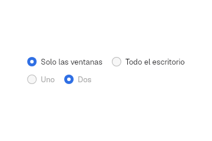 | 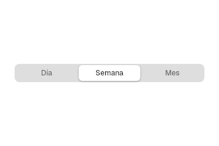 |

| Pop-up | Pop-up with icon | Color swatches |
|---|---|---|
| 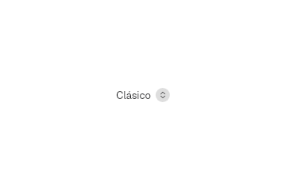 | 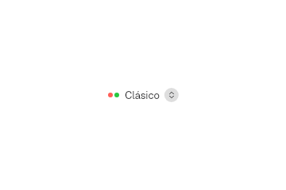 | 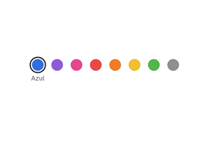 |

### Style

`SegmentedControl` draws only from a `SegmentedControlStyle`: the group, each
segment, the chosen one and `axis` (vertical stacks the segments). The fields
are in [Styles and themes](../ai/styles.md#segmentedcontrolstyle).

`RadioGroup` draws only from a `RadioGroupStyle`, with the `axis` of its
options and the `label_position` of each label; `.tint(Tint)` sets its `fill`.
`ColorWell` draws from a `ColorWellStyle` and `ChoiceCards` from a
`ChoiceCardsStyle`, each with an `axis` and `wraps` for its swatches or cards.
The fields are in [Styles and themes](../ai/styles.md#radiogroupstyle).

```rust
SegmentedControl::new("View").segment("Icons").segment("List")
    .style(|s| SegmentedControlStyle { axis: Axis::Vertical, ..s })
RadioGroup::new("Size").option("Small").option("Large")
    .style(|s| RadioGroupStyle { axis: Axis::Horizontal, ..s })
```

## Sliders

| Item | Module | Build | Value | Reports |
|---|---|---|---|---|
| `Slider` | `controls` | `Slider::stepped(label, steps)` (at least 2), `.labels(&[..])`, `.disabled(bool)`, `.tint(Tint)`, `.style(\|s\| ..)` | `.value(usize)` | `.on_change(\|step: usize\| ..)` |
| `LevelSlider` | `level` | `LevelSlider::new(label)`, `.disabled(bool)`, `.tint(Tint)`, `.style(\|s\| ..)` | `.value(f32)` (0 to 1) | `.on_change(\|value: f32\| ..)` |

- `Slider` is 220 wide with a tick under each step and an optional caption per step. A click
  or drag snaps to the nearest step; ← ↓ and → ↑ move one step.
- `LevelSlider` fills its width. The arrows move it by `SLIDER_KEY_STEP` (0.05).
- Its Tengen is a 6 track with a 20 × 16 knob. `.style(|s| s.fat(Symbol))` is the 22 tall
  Control Center bar with the symbol inside the fill.

```rust
Slider::stepped("Level", 5).value(2).labels(&["A", "B", "C", "D", "E"])
LevelSlider::new("Brightness").value(0.3)
LevelSlider::new("Volume").value(0.6).style(|s| s.fat(Symbol::SpeakerWave))
```

| Stepped | Regular and fat |
|---|---|
| 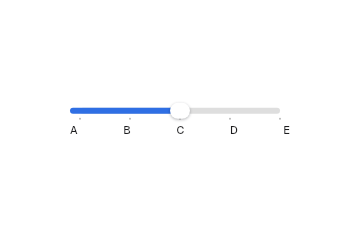 | 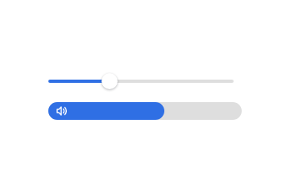 |

### Style

`Slider` draws only from a `SliderStyle` ([ADR 0064](../decisions/0064-styles-and-themes.md)).
`.tint(Tint)` sets its `fill`; `.style(|s| ..)` changes any other field for one slider,
`.control_style(|s: SliderStyle| ..)` for every slider inside a view and
`Theme::tengen().style(|s: SliderStyle| ..)`
for the whole app. The levels, the fields and the value types are in
[Styles and themes](../ai/styles.md). `LevelSlider` draws the same way from a
`LevelSliderStyle` ([fields](../ai/styles.md#levelsliderstyle)).

```rust
Slider::stepped("Volume", 10).style(|s| SliderStyle { track_height: 10.0, ..s })
```

## Text fields

One-line fields write straight into a `State<String>` that the app owns. Their edit menu and
spell checking are in [6](06-text-and-editing.md#edit-menu).

| Item | Module | Build | Options |
|---|---|---|---|
| `TextField` | `controls` | `TextField::new(value, placeholder)` | `.width(Size)` (fill), `.auto_focus(bool)`, `.style(\|s\| ..)` |
| `SearchField` | `controls` | `SearchField::new(value, placeholder)` | `.width`, `.auto_focus`, `.style`, `.tokens(State<Vec<String>>)`, `.a11y_id(AccessibilityId)`, `.on_focus_change(\|focused: bool\| ..)`, `.on_navigate(\|key: NamedKey\| ..)` |
| `SecureField` | `controls` | `SecureField::new(State<PasswordField>, label)` | `.width`, `.auto_focus`, `.style`, `.on_submit(\|secret: Zeroizing<String>\| ..)` |
| `ComboBox` | `combo_box` | `ComboBox::new(value, placeholder)` | `.item(text)`, `.width(Size)` |

- All are 24 tall with a 6 side padding. `SecureField` draws the focus ring; the others turn
  their border to the accent while focused.
- `auto_focus(true)` takes the focus when the field mounts.
- `SearchField` shows a clear button while it has text. `on_navigate` receives ↑, ↓ and Enter
  so a result list can follow the keys. `tokens` shows capsules before the text, like the
  filters in Finder; Backspace on an empty field removes the last one.
- `SecureField` shows one `•` per character. Enter hands the value to `on_submit` and empties
  the field ([Passwords](#passwords)).
- `ComboBox` is a text field with a 24 × 20 arrow button 4 from its right edge. The button or ↓
  opens the items as a menu; picking one writes it into `value`. Free typing also works.

```rust
let name = use_state(|| "hblanqueto".to_string());
TextField::new(name, "User name")
SearchField::new(query, "Search").auto_focus(true)
let password = use_state(PasswordField::default);
SecureField::new(password, "Password").on_submit(move |secret| sign_in(secret))
ComboBox::new(shell, "Shell").item("zsh").item("fish")
```

| Text and search | Password |
|---|---|
| 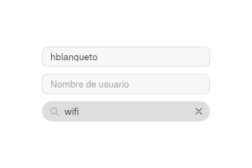 | 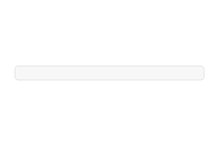 |

### Style

`TextField`, `SearchField` and `SecureField` draw only from a
`TextFieldStyle`, a `SearchFieldStyle` and a `SecureFieldStyle`: size, shape,
background, border, text, placeholder and font. The fields, and what Freya's
`Input` can draw, are in
[Styles and themes](../ai/styles.md#textfieldstyle-searchfieldstyle-and-securefieldstyle).

```rust
TextField::new(name, "User name").style(|s| TextFieldStyle { shape: Shape::Capsule, ..s })
```

## Passwords

`password::PasswordField` holds a secret in a `Zeroizing<String>` and a `password::State`
(`Idle`, `Verifying`, `Error(String)`). `SecureField` uses it; a custom field can too.

| Method | Effect |
|---|---|
| `PasswordField::default()` | Empty, `Idle` |
| `handle_key(&key, modifiers)` | Inserts text, Backspace deletes, Enter returns `take()` |
| `insert(char)`, `backspace()` | Edit; ignored while `Verifying`; an `Error` returns to `Idle` |
| `take()` | Returns the value and moves to `Verifying`; `None` if empty or already verifying |
| `set_error(message)` | Wipes the value and moves to `Error` |
| `reset()` | Wipes the value and moves to `Idle` |
| `state()`, `masked()` | The state and the `•` string |

Growing the buffer copies it into a new zeroized one, so no copy of the secret is freed
without being wiped.

## Color picker

`color_picker::ColorPicker::new(label, Rgba)` is a 48 × 24 well filled with the color. A click
opens a [popover](07-menus-and-popovers.md) with the hex value and hue, saturation and
brightness `LevelSlider`s. Each move calls `.on_change(|color: Rgba| ..)`.

| Helper | Returns |
|---|---|
| `hsb_to_rgb(hue, saturation, brightness)` | Opaque `Rgba`; all inputs 0 to 1 |
| `rgb_to_hsb(rgba)` | `(hue, saturation, brightness)`, 0 to 1 |
| `hex(rgba)` | `"#RRGGBB"` |

To choose from preset colors, use [`ColorWell`](#choices).

## Date picker

`date_picker::DatePicker::new(label, CivilDateTime)` is a text field with one segment per part
and a stepper beside it, like the `textFieldAndStepper` style of `NSDatePicker`. The
stepper's arrows draw from the [`StepperStyle`](../ai/styles.md#stepperstyle) in context.

| Method | Default | Effect |
|---|---|---|
| `.elements(DateElements)` | `Date` | `Date`, `Time` or `DateAndTime` |
| `.on_change(\|value: CivilDateTime\| ..)` | — | Called on every change |

| Input | Effect |
|---|---|
| ↑ ↓ or the arrows | Change the chosen part; hour and minute wrap |
| ← → | Move between parts |
| Digits | Type the part; it moves on when full or when no other digit fits (a 4 in the day) |
| Click on a date part | Opens a 139 × 148 month calendar below |

The order of the parts (`date-order`: `dmy`, `mdy` or `ymd`) and the first day of the week
(`week-start`) come from the language file `bk.ftl`.

```rust
DatePicker::new("Date", CivilDateTime::new(CivilDate::new(2026, 11, 6), 9, 30))
    .elements(DateElements::DateAndTime)
    .on_change(move |picked| moment.set(picked))
```

Module `date` does the calendar arithmetic without dependencies, with
[Howard Hinnant's algorithms](https://howardhinnant.github.io/date_algorithms.html).

| Item | What it does |
|---|---|
| `CivilDate { year, month, day }` | `new` clamps the month to 1–12 and the day to the month. `add_days`, `add_months`, `shifted(part, delta)`, `weekday_from_monday()`, `month_grid(monday_first)` (42 days) |
| `CivilDateTime { date, hour, minute }` | `new` clamps the hour to 23 and the minute to 59. `shifted(part, delta)`, `typed(part, value)` |
| `DatePart` | `Day`, `Month`, `Year`, `Hour`, `Minute`; `digits()` is 4 for the year, 2 otherwise |
| `days_in_month(year, month)` | 28 to 31, with leap years |
| `typing_is_done(part, typed)` | Whether typed digits fill the part |

## Path control

`path_control::PathControl::new(label)` shows the parts of a path in a 22 row, separated by
chevrons. `.item(Symbol, name)` adds a part with its icon. `.on_select(|index: usize| ..)`
reports the pressed part.

## Image well

`image_well::ImageWell::new(label, State<Option<PathBuf>>)` is a 64 square, corner 8, that
shows the image at the path.

| Input | Effect |
|---|---|
| Image file dragged over it | A 2 accent border |
| Image file dropped | Sets the path |
| Click, Space or Enter | Opens the portal file chooser ([13](13-app.md)) |
| Delete or Backspace | Clears it |

`is_image(path)` accepts `png`, `jpg`, `jpeg`, `gif`, `webp` and `bmp`, in any case.

## Progress

Module `progress`. They report nothing.

| Item | Build | Look |
|---|---|---|
| `ProgressView` | `ProgressView::determinate(label, value)` (0 to 1), `.tint(Tint)` | 8 tall bar |
| `ProgressView` | `ProgressView::indeterminate(label)` | A segment of 30 % that sweeps over 1.2 s |
| `ProgressRing` | `ProgressRing::new(label, value)` | 28 ring, 3.5 stroke |
| `Spinner` | `Spinner::new(label)` | 16, 12 spokes, one turn per second |

With reduced motion ([4](04-appearance-and-tokens.md)) the indeterminate bar and the spinner
stand still.

```rust
ProgressView::determinate("Copying system", 0.62)
ProgressView::indeterminate("Searching for networks")
ProgressRing::new("Downloading", 0.4)
Spinner::new("Loading")
```

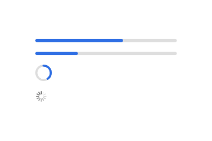

## Level indicators

Module `indicator`, after `NSLevelIndicator` and SwiftUI `Gauge`.

| Item | Build | Look |
|---|---|---|
| `CapacityIndicator` | `new(label, value)`, `.thresholds(warning, critical)` (default 1, 1), `.discrete(cells)` | 16 tall bar; green, then yellow at `warning`, red at `critical`. `discrete` splits it into cells 2 apart |
| `RelevancyIndicator` | `new(label, value)` | 11 tall row of 1 px lines, as many as `value` fills |
| `Gauge` | `new(label, value, current)`, `.capacity(bool)` | 44 open ring (270°) with a marker and `current` in the center; `capacity(true)` is a closed ring that fills with the accent |
| `RatingIndicator` | `new(label, stars)`, `.on_change(\|stars: u32\| ..)` | 5 stars of 12; editable only with `on_change` (click or arrows) |

| Helper | Returns |
|---|---|
| `level_color(value, warning, critical)` | 0, 1 or 2: the index into `LEVEL_INDICATOR_COLORS` |
| `gauge_marker(value)` | The `(x, y)` center of the gauge marker |

The gauge size, stroke and arc are estimates: Apple publishes no figures.

```rust
CapacityIndicator::new("Disk", 0.82).thresholds(0.75, 0.9)
RatingIndicator::new("Rating", 3).on_change(move |value| stars.set(value))
Gauge::new("Temperature", 0.64, "64°")
```

## Adornments

Module `adornments`. `Badge`, `Divider` and `Avatar` are rects: they take Freya's layout and
style methods.

| Item | What it is |
|---|---|
| `Badge::new(content)` | A 20 tall capsule, destructive red, with `content` in `CAPTION` |
| `Divider::new()` | A hairline that fills the width; also in the prelude |
| `Avatar::new(initials)` | A 38 circle with the initials in `HEADLINE` |
| `Link::new(text)`, `.on_press(\|_\| ..)` | Text in the link color |

```rust
Badge::new("2")
Divider::new()
Avatar::new("HB")
Link::new("Learn more…")
```

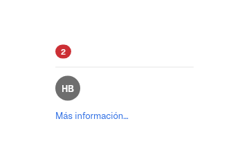

## Scrolling

`ScrollView` (in `controls` and the prelude) scrolls its children.

| Method | Default | Effect |
|---|---|---|
| `ScrollView::new()`, `.child(..)`, `.children(..)` | — | — |
| `.width(Size)`, `.height(Size)`, `.expanded()` | fill, fill | Size of the viewport |
| `.direction(Direction)` | `Vertical` | Scroll axis |
| `.scroll_bar(bool)` | `true` | Draws the bar |
| `.top_line(bool)` | `false` | A divider over the top edge; content slides under it |
| `.edge_effect(bool)` | `false` | While scrolled, content fades under the top edge over 24 (`SCROLL_BAR.edge_height`), like `scrollEdgeEffectStyle(.soft)` |
| `.controller(ScrollController)` | its own | Scroll from code |

The bar is a 7 thumb that appears while scrolling and fades 800 ms later. With the
appearance setting `scroll_bars = "always"` ([4](04-appearance-and-tokens.md)) it stays,
17 wide on a faint track.

`use_scroll_controller()` returns a `ScrollController` (`Copy`):

| Method | Effect |
|---|---|
| `reveal_y(top, bottom)` | Scrolls the least needed to show that band |
| `scroll_to_x(x)` | Jumps to that horizontal offset |
| `scroll_by_wheel(&WheelEventData)` | Scrolls by a wheel event caught on a layer above the view |

```rust
ScrollView::new().height(Size::px(120.0)).child(list)
```

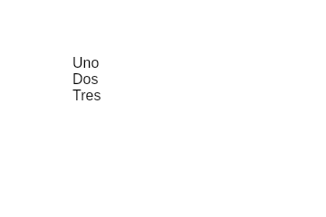

## Drag source

Module `drag`. It makes an element the source of a drag to another app. Receiving drops and
the clipboard are in [13](13-app.md).

```rust
let drag = use_drag_source();
drag.attach(rect(), || DragPayload::Files(paths.clone()))
```

| Item | What it is |
|---|---|
| `use_drag_source()` | Returns a `DragSource` (`Copy`) |
| `DragSource::attach(element, payload)` | Starts a drag when the pointer moves more than `DRAG.threshold` (8) with the primary button down; `payload` runs then |
| `DragPayload::Files(Vec<PathBuf>)` | Offered as `URI_LIST` and as plain text |
| `DragPayload::Text(String)` | Offered as plain text |
| `URI_LIST` | `"text/uri-list"` |

## Canvas

`canvas::Canvas::new(revision, painter)` fills its parent and hands the area to `painter`, which
draws with Skia in logical pixels. It repaints only when `revision` (`u64`) changes. Use it for
what is not rectangles or text, such as a terminal grid.

`CanvasContext` fields: `canvas` (the Skia canvas, clipped and scaled), `width`, `height`,
`scale` and `fonts` (the font collection).

```rust
Canvas::new(revision, move |ctx: &mut CanvasContext| { ctx.canvas.draw_rect(..); })
```

## Building a new control

1. Check that no control does it already (rule 1 of `AGENTS.md`). A new control composes kit
   primitives; it does not redraw menus, the sidebar or traffic lights (ADR 0047).
2. Call `use_interaction()` at the top of `render`.
3. `interaction.attach(rect(), enabled)` gives the element an accessibility id, focus,
   hover and press tracking. Set its `a11y_role` and `a11y_alt`.
4. Read `hovered()`, `pressed()` (held and still under the pointer), `held()`, `focused()` and
   `keyboard_focused()` to choose colors.
5. Wrap the result in `interaction.focus_ring(element, corner_radius)`.
   `element.focus_ring(radius, color)` ([`ViewModifiers`](07-menus-and-popovers.md#focus_ring))
   draws the same ring in another color, as a selection mark.
6. Paint only with `Palette::current()` and `ctdesign` tokens ([4](04-appearance-and-tokens.md)).
   New metrics go to `ctdesign`.
7. If the control keeps a value, follow [the controlled pattern](#the-controlled-pattern).
8. Add its case to `tests/kit/controls.rs`, in light and dark.

```rust
#[derive(PartialEq)]
struct Pill {
    label: &'static str,
}

impl Component for Pill {
    fn render(&self) -> impl IntoElement {
        let palette = Palette::current();
        let interaction = use_interaction();
        let background = if interaction.hovered() {
            palette.control_hover
        } else {
            palette.control_background
        };
        let pill = interaction
            .attach(rect(), true)
            .a11y_role(AccessibilityRole::Button)
            .a11y_alt(self.label)
            .height(Size::px(BUTTON.height))
            .corner_radius(BUTTON.height / 2.0)
            .background(color(background))
            .child(text(self.label, BODY, palette.label));
        interaction.focus_ring(pill, BUTTON.height / 2.0)
    }
}
```

`Interaction::request_focus()` moves the focus to the control from code.

Next: [6. Text and editing](06-text-and-editing.md).
