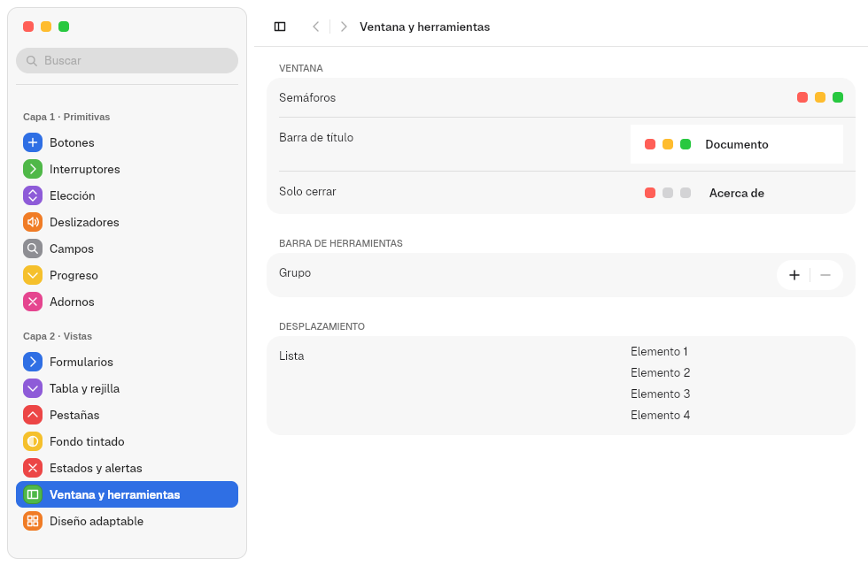
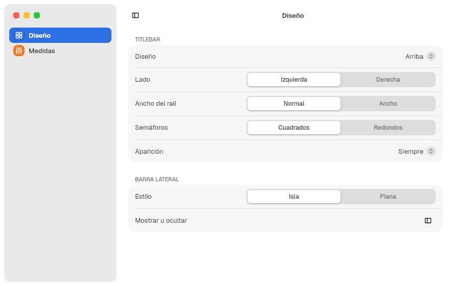
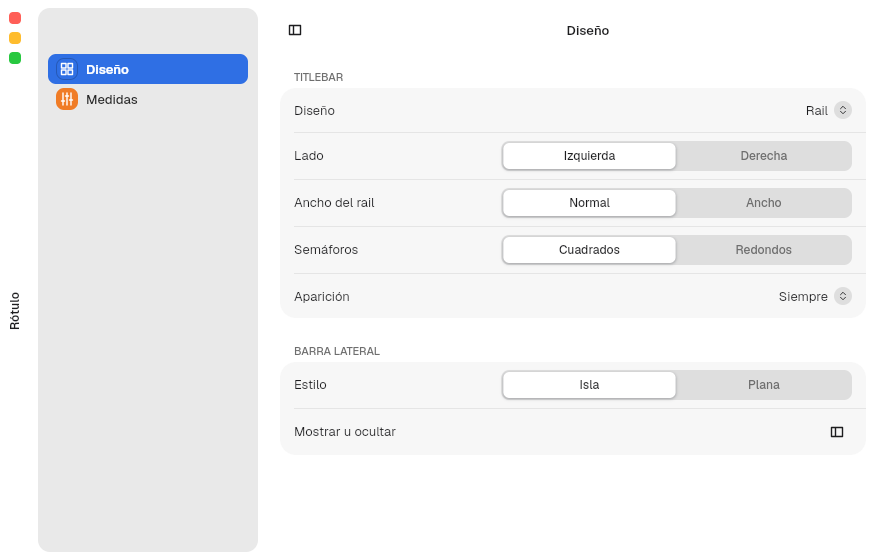
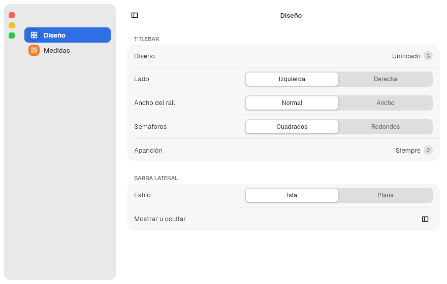
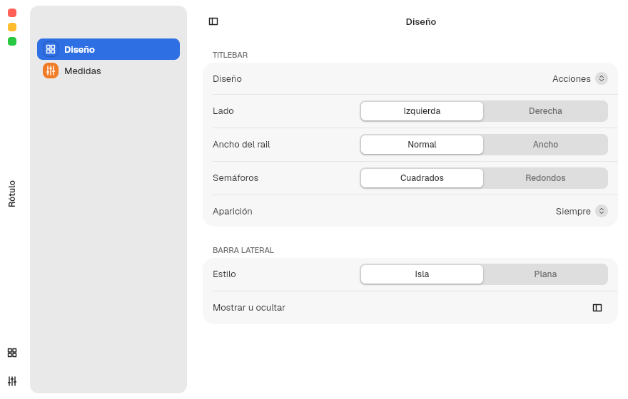
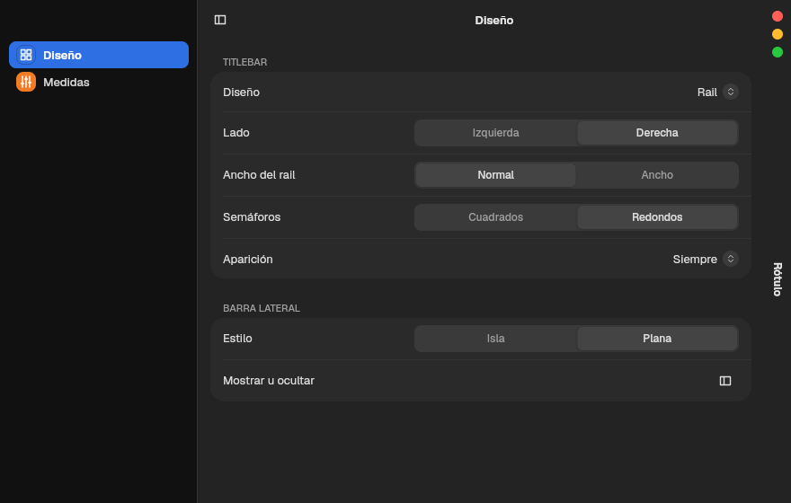

# 6. Windows and titlebars

**Goal:** open windows with the right options and choose the titlebar and
traffic light type.
**Reader:** anyone who defines the main window of an app.

## Opening a window

```rust
run_window(
    AppComponent::new(MiApp),
    WindowOptions::new("Notas", "notas")
        .decorations(Decorations::Client)
        .size((760, 520))
        .min_size(Some(WINDOW_MIN_SIZE))
        .menu(menu),
)
```

| Option | Effect |
|---|---|
| `new(título, nombre)` | Visible title and short name. The `app_id` is `io.github.hblanqueto.malaysia.<nombre>` unless you pass `.app_id(..)` |
| `.decorations(..)` | `Client` (default): the kit draws the titlebar. `Server`: it asks the compositor for it; if there is no `zxdg_decoration_manager_v1`, it falls back to `Client` |
| `.size((ancho, alto))` | Initial size (640 × 420 by default). If a saved one exists, it is restored |
| `.min_size(..)`, `.max_size(..)` | Limits. If they are equal, the window has a fixed size and the green button in `zoom` mode maximizes vertically only |
| `.parent(..)` | Child window (dialog) |
| `.menu(AppMenu)` | Global menu of the window (chapter [10](10-app.en.md)) |

Inside the app, `WindowControls::get()` gives the state (`activated`,
`maximized`, `fullscreen`, `decoration`, `fixed`) and the commands: `close()`,
`minimize()`, `toggle_maximize()`, `toggle_fullscreen()`, `move_window()`,
`resize(WindowEdge)`.

## The horizontal titlebar: `Titlebar`

```rust
Titlebar::new()
    .title("Documento")
    .with_sidebar(true)
    .left(SidebarToggle)
    .right(IconButton::new(Symbol::Plus, "Nuevo"))
```

- It has three areas: `left`, the centered title and `right`.
- Without a sidebar, the areas are symmetric so the title stays centered.
- With `.with_sidebar(true)` it aligns with the sidebar. The traffic lights
  stay fixed in place even when the sidebar collapses.
- Dragging it moves the window; double-click does what `window.domain` says.
- When `Decorations::Server` is granted, it measures 0 and draws nothing.
- `.close_only(true)` leaves only the close button, for dialogs.

The «Ventana y herramientas» ("Window and tools") pane of Tengen App Show
shows standalone traffic lights, a `Titlebar` with a title and another one with
`.close_only(true)`:



## The traffic lights: `TrafficLights`

Close, minimize and maximize. They are not usually created by hand:
`Titlebar` and `Sidebar::traffic_lights(true)` place them with
`titlebar::window_traffic_lights(enfocada, fija)`. If you need them standalone:

```rust
TrafficLights::new()
    .focused(true)
    .zoom_supported(true)
    .vertical(false)
    .round(false)
    .on_action(|boton: ButtonKind| { /* Close, Minimize, Maximize */ })
```

| Setting | Where | Values |
|---|---|---|
| Color | `appearance.domain` → `traffic_lights` | `auto`, `standard` (or `macos`), `accent`, `wallpaper` |
| Green button | `window.domain` → `green_button` | `focus` (default: full screen), `zoom`, `fullscreen`, `none` |
| Double-click on the titlebar | `window.domain` → `double_click_titlebar` | `zoom` (default), `fill`, `minimize`, `none` |

In an inactive window the traffic lights turn gray.

## Five titlebar types: `WindowChrome`

`chrome::WindowChrome::new(estilo, contenido)` wraps the window and places the
traffic lights and the title according to a `ChromeStyle`:

```rust
let estilo = ChromeStyle {
    layout: TitlebarLayout::Rail,
    side: Side::Left,
    rail_width: TITLEBAR_RAIL.width,
    round_lights: false,
    reveal: Reveal::Always,
    resting_edge: RestingEdge::None,
};
WindowChrome::new(estilo, SplitView::new(barra, detalle)).footer(pie)
```

| `TitlebarLayout` | What it is | Screenshot (Rótulo) |
|---|---|---|
| `Top` (default) | Horizontal titlebar at the top |  |
| `Rail` | Vertical strip on one side with the traffic lights in a column and the title rotated 90° |  |
| `Unified` | The traffic lights in a column inside the sidebar, with no strip of their own. Without a visible sidebar it becomes `Rail` |  |
| `Pill` | A floating pill with the traffic lights. In full screen it is glass |  |
| `Actions` | A wider `Rail` with an actions footer (`.footer(..)`) |  |

| Field | Values | Effect |
|---|---|---|
| `side` | `Left`, `Right` | Side of the rail |
| `rail_width` | `TITLEBAR_RAIL.width` or `.width_wide` | Width of the rail |
| `round_lights` | `bool` | Round or square (default) traffic lights |
| `reveal` | `Always`, `Drawer`, `Push`, `Corner`, `Popup` | Always visible, or it appears when the pointer comes close: as a drawer on top, pushing the content, only in the corner or as a pop-up pill |
| `resting_edge` | `None`, `Line`, `Accent` | What stays visible while it is hidden: nothing, a line or an accent line |

Some combinations make no sense and correct themselves
(`ChromeStyle::effective`): `Unified` with `Drawer`, `Push` or `Popup` becomes
`Corner`; `Pill` with `Drawer` or `Push` becomes `Popup`; in full screen,
`reveal` is always `Always`.

Rail on the right, round traffic lights, flat sidebar and dark mode:



The Rótulo app (chapter [14](14-apps-de-prueba.en.md)) tests every combination
live.

## Popups

Menus, pop-up buttons and tooltips use `xdg_popup`. For your own:

```rust
let id = Popups::get().open(spec, AppComponent::new(MiPopup));
Popups::get().close(id);
```

`PopupSpec` sets the anchor rectangle, the anchor, the gravity, the size, the
adjustment when it does not fit and whether it takes the pointer grab.

Next: [7. Sidebar and SplitView](07-barra-lateral.en.md).
