# 6. Ventanas y titlebars

**Objetivo:** abrir ventanas con las opciones correctas y elegir el tipo de
titlebar y de semáforos.
**Lector:** quien define la ventana principal de una app.

## Abrir una ventana

```rust
run_window(
    AppComponent::new(MiApp),
    WindowOptions::new("Notas", "notas")
        .decorations(Decorations::Client)
        .size((760, 520))
        .min_size(Some(WINDOW_MIN_SIZE))
        .menu(menu),
)
```

| Opción | Efecto |
|---|---|
| `new(título, nombre)` | Título visible y nombre corto. El `app_id` es `io.github.hblanqueto.malaysia.<nombre>` salvo que pases `.app_id(..)` |
| `.decorations(..)` | `Client` (por defecto): el kit dibuja la titlebar. `Server`: la pide al compositor; si no hay `zxdg_decoration_manager_v1`, vuelve a `Client` |
| `.size((ancho, alto))` | Tamaño inicial (640 × 420 por defecto). Si hay uno guardado, se restaura |
| `.min_size(..)`, `.max_size(..)` | Límites. Si son iguales, la ventana es de tamaño fijo y el botón verde la maximiza solo en vertical |
| `.parent(..)` | Ventana hija (diálogo) |
| `.menu(AppMenu)` | Menú global de la ventana (capítulo [10](10-app.md)) |

Dentro de la app, `WindowControls::get()` da el estado (`activated`,
`maximized`, `fullscreen`, `decoration`, `fixed`) y las órdenes: `close()`,
`minimize()`, `toggle_maximize()`, `toggle_fullscreen()`, `move_window()`,
`resize(WindowEdge)`.

## La titlebar horizontal: `Titlebar`

```rust
Titlebar::new()
    .title("Documento")
    .with_sidebar(true)
    .left(SidebarToggle)
    .right(IconButton::new(Symbol::Plus, "Nuevo"))
```

- Tiene tres zonas: `left`, título centrado y `right`.
- Sin barra lateral, las zonas son simétricas para que el título quede
  centrado.
- Con `.with_sidebar(true)` se alinea con la barra lateral. Los semáforos se
  quedan fijos en su sitio aunque la barra se pliegue.
- Arrastrarla mueve la ventana; el doble clic hace lo que diga `window.domain`.
- Con `Decorations::Server` concedida, mide 0 y no dibuja nada.
- `.close_only(true)` deja solo el botón de cerrar, para diálogos.

El panel «Ventana y herramientas» de Tengen App Show muestra los semáforos
sueltos, una `Titlebar` con título y otra con `.close_only(true)`:

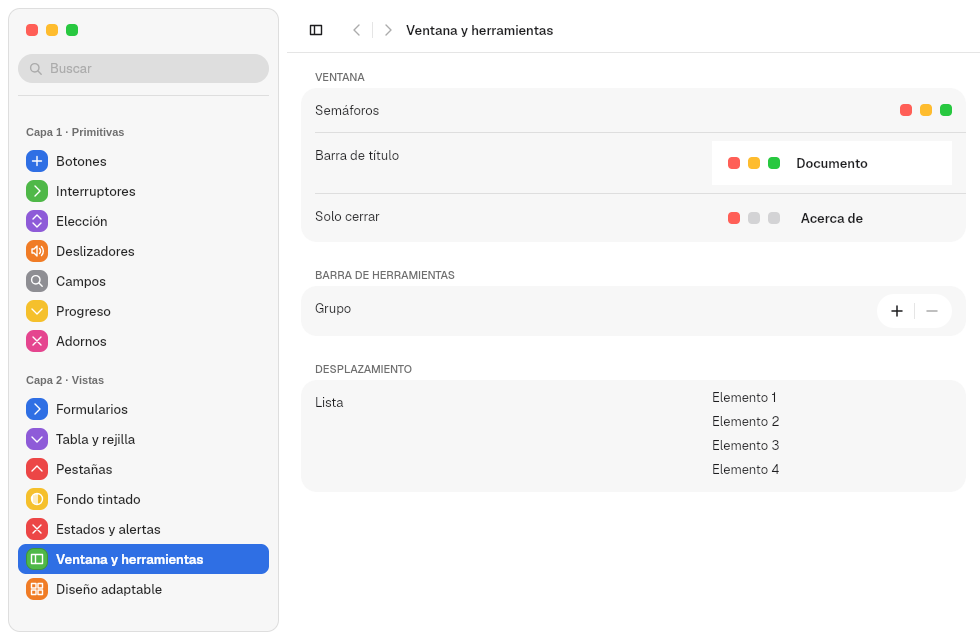

## Los semáforos: `TrafficLights`

Cerrar, minimizar y maximizar. Normalmente no se crean a mano:
`Titlebar` y `Sidebar::traffic_lights(true)` los colocan con
`titlebar::window_traffic_lights(enfocada, fija)`. Si se necesitan sueltos:

```rust
TrafficLights::new()
    .focused(true)
    .zoom_supported(true)
    .vertical(false)
    .round(false)
    .on_action(|boton: ButtonKind| { /* Close, Minimize, Maximize */ })
```

| Ajuste | Dónde | Valores |
|---|---|---|
| Color | `appearance.domain` → `traffic_lights` | `auto`, `standard` (o `macos`), `accent`, `wallpaper` |
| Botón verde | `window.domain` → `green_button` | `focus` (por defecto: pantalla completa), `zoom`, `fullscreen`, `none` |
| Doble clic en la titlebar | `window.domain` → `double_click_titlebar` | `zoom` (por defecto), `fill`, `minimize`, `none` |

En una ventana inactiva los semáforos se vuelven grises.

## Cinco tipos de titlebar: `WindowChrome`

`chrome::WindowChrome::new(estilo, contenido)` envuelve la ventana y coloca los
semáforos y el título según un `ChromeStyle`:

```rust
let estilo = ChromeStyle {
    layout: TitlebarLayout::Rail,
    side: Side::Left,
    rail_width: TITLEBAR_RAIL.width,
    round_lights: false,
    reveal: Reveal::Always,
    resting_edge: RestingEdge::None,
};
WindowChrome::new(estilo, SplitView::new(barra, detalle)).footer(pie)
```

| `TitlebarLayout` | Qué es | Captura (Rótulo) |
|---|---|---|
| `Top` (por defecto) | Titlebar horizontal arriba | 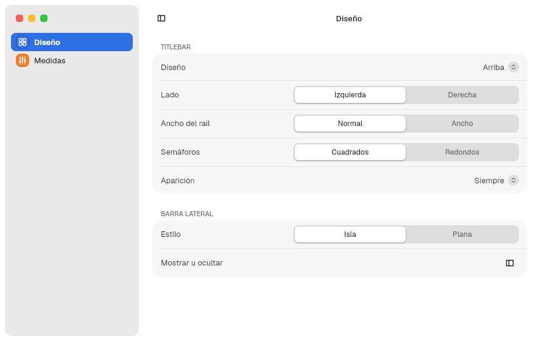 |
| `Rail` | Franja vertical a un lado con los semáforos en columna y el título girado 90° | 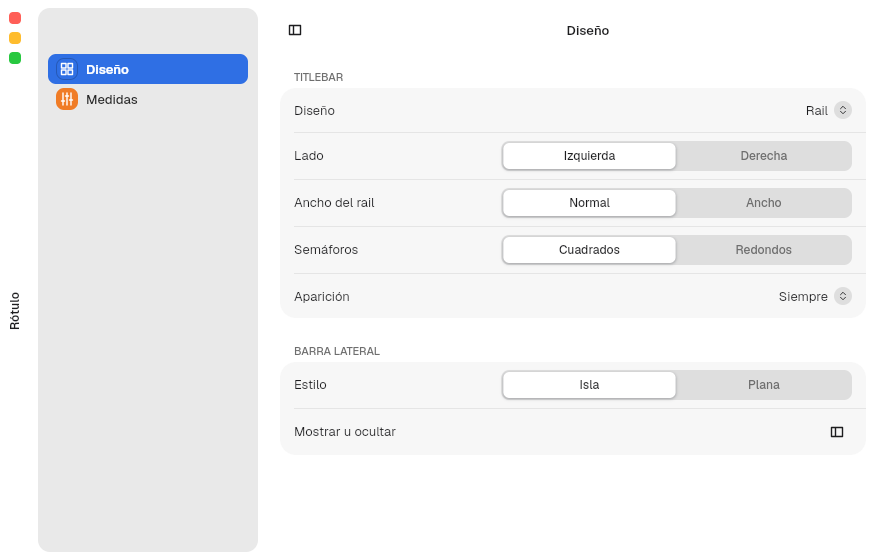 |
| `Unified` | Los semáforos en columna dentro de la barra lateral, sin franja propia. Sin barra lateral visible pasa a `Rail` | 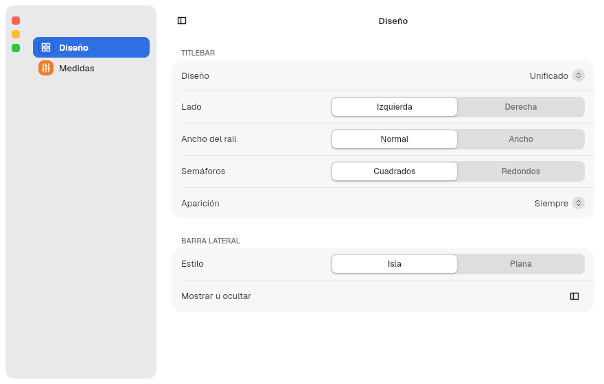 |
| `Pill` | Una píldora flotante con los semáforos. En pantalla completa es cristal |  |
| `Actions` | Un `Rail` más ancho con un pie de acciones (`.footer(..)`) | 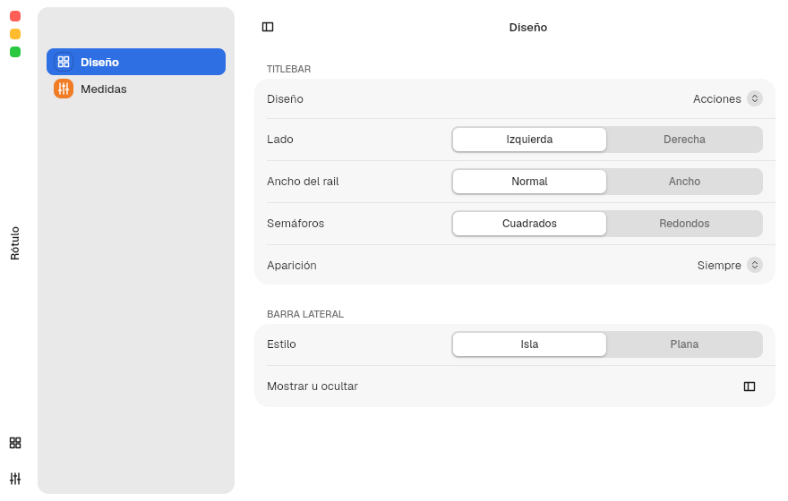 |

| Campo | Valores | Efecto |
|---|---|---|
| `side` | `Left`, `Right` | Lado del rail |
| `rail_width` | `TITLEBAR_RAIL.width` o `.width_wide` | Ancho del rail |
| `round_lights` | `bool` | Semáforos redondos o cuadrados (por defecto) |
| `reveal` | `Always`, `Drawer`, `Push`, `Corner`, `Popup` | Siempre visible, o aparece al acercar el puntero: como cajón encima, empujando el contenido, solo en la esquina o como píldora emergente |
| `resting_edge` | `None`, `Line`, `Accent` | Qué queda visible cuando está oculta: nada, una línea o una línea de acento |

Algunas combinaciones no tienen sentido y se corrigen solas
(`ChromeStyle::effective`): `Unified` con `Drawer`, `Push` o `Popup` pasa a
`Corner`; `Pill` con `Drawer` o `Push` pasa a `Popup`; en pantalla completa,
`reveal` es siempre `Always`.

Rail a la derecha, semáforos redondos, barra lateral plana y modo oscuro:

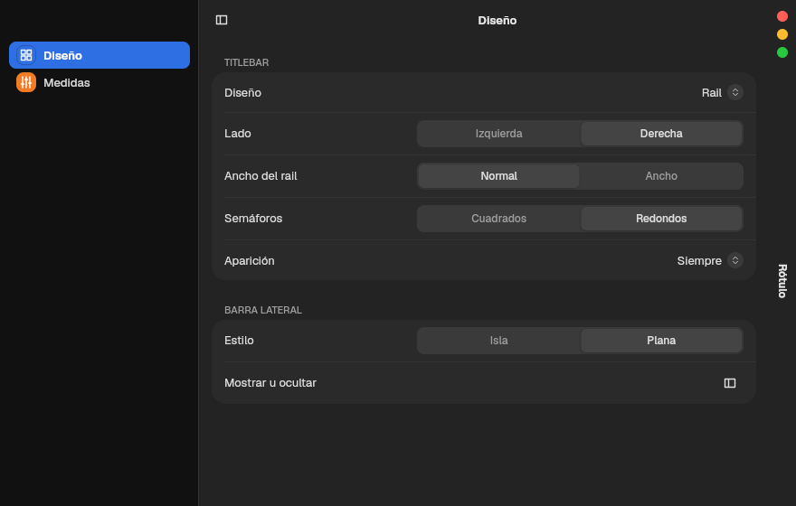

La app Rótulo (capítulo [14](14-apps-de-prueba.md)) prueba todas las
combinaciones en vivo.

## Maximizada, pantalla completa y modo foco

El estado llega en cada configure del compositor y se lee con
`WindowControls::get().status.read()`: `maximized`, `fullscreen` y `activated`.
Las capturas de esta sección son la ventana de Rótulo (barra lateral en isla,
diseño `Top` salvo donde se indica) renderizada por el kit en cada estado.

### Los cuatro estados con el diseño por defecto (`Top`)

| Estado | Cómo se entra | Qué hace el kit | Cómo se ve |
|---|---|---|---|
| Normal | — | Titlebar en su sitio, semáforos en la barra lateral. Los bordes de la ventana la redimensionan. Al cerrar se guarda el tamaño | 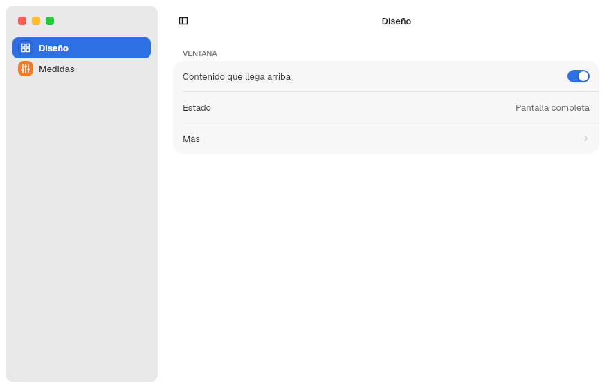 |
| Maximizada | Botón verde con `green_button = "zoom"`, doble clic con `zoom` o `fill`, o `toggle_maximize()` | Lo mismo que en normal, sin bordes de redimensionado. En MalaysiaDreams el compositor conserva el marco (esquinas y sombra). Al cerrar se guarda que estaba maximizada y vuelve a abrirse así |  |
| Pantalla completa sin el protocolo de foco (otro compositor) | Botón verde con `focus` (por defecto) o `fullscreen`, o `toggle_fullscreen()` | La titlebar se queda en su sitio y se ocultan los semáforos | 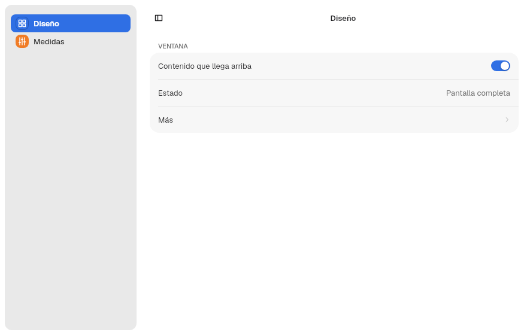 |
| Modo foco de MalaysiaDreams, barra arriba | Igual; el compositor da el estado `fullscreen` | La titlebar sale del diseño y el contenido ocupa toda la ventana | 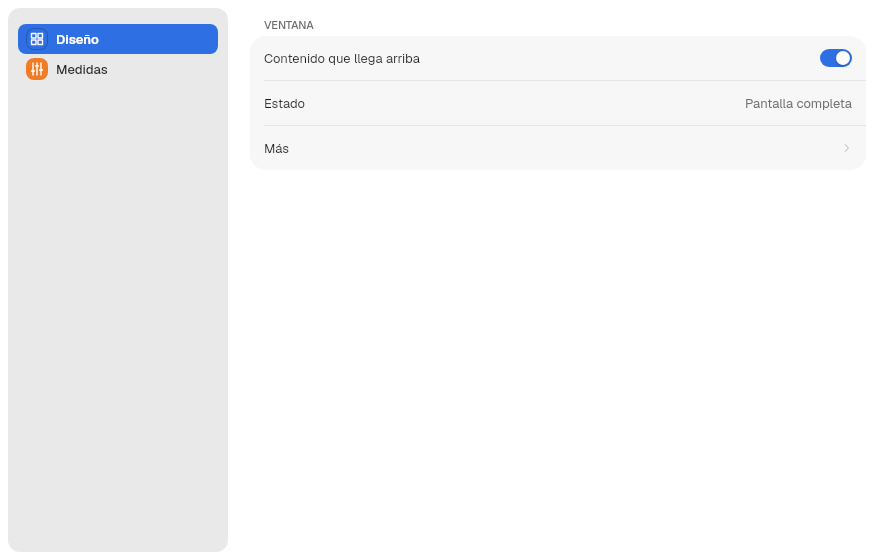 |

En MalaysiaDreams, el modo foco
([ADR 0051 y 0054 de MalaysiaDreams](https://github.com/HBlanqueto/malaysia/tree/main/docs/decisiones))
baja una barra negra al acercar el puntero arriba. El kit pide `set_overlay`
por `infinity_focus_v1` v2, así que la ventana no se mueve: mientras la barra
está bajada, `titlebar_overlaid()` es verdadero y la titlebar se dibuja encima
del contenido, justo debajo de la barra, con cristal progresivo. Aparece y
desaparece con la barra en `DURATION_BASE`. En pantalla completa, `reveal` es
siempre `Always`.

### Modo foco con la barra bajada, por diseño

En estas capturas, la franja negra de arriba (28 px) es la barra del
compositor, añadida a la imagen: la app no la dibuja.

| Diseño | Qué baja | Cómo se ve |
|---|---|---|
| `Top` (por defecto) | La `Titlebar` sobre el contenido; los semáforos de la barra lateral bajan lo mismo | 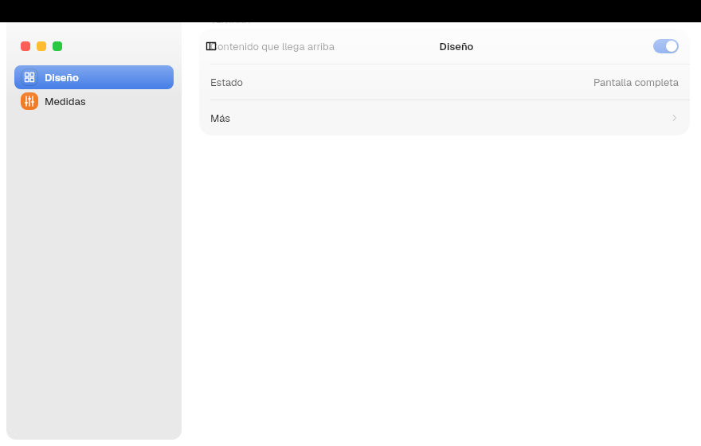 |
| `Unified` | Igual que `Top` | 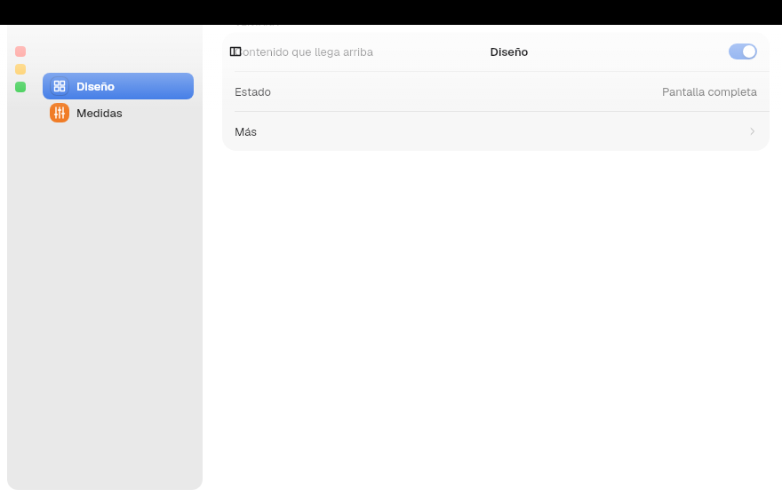 |
| `Rail` | El rail, como cristal, con los semáforos en columna | 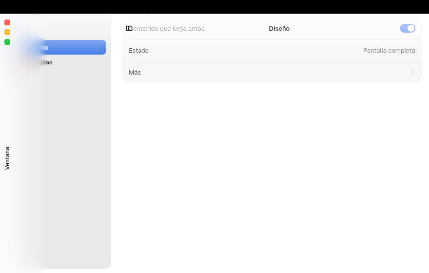 |
| `Actions` | El rail ancho con su pie de acciones | 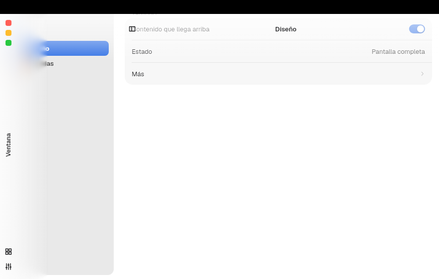 |
| `Pill` | La píldora de semáforos, como cristal; antes no se ve | 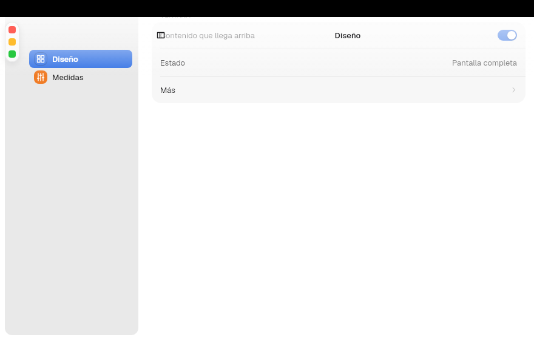 |

### Qué hace la app

1. Si usa `Titlebar`, `WindowChrome`, `Sidebar` o `PreferencesWindow`, no tiene
   que hacer nada: todos los estados de las tablas ya funcionan.
2. Deja hueco para la barra en el contenido que va bajo la titlebar
   superpuesta, como Ondina:

   ```rust
   let arriba = try_consume_root_context::<WindowControls>()
       .map_or(0.0, |controls| controls.fullscreen_content_top());
   rect().padding(Gaps::new(arriba, 0.0, 0.0, 0.0)).child(contenido)
   ```

3. Si una vista tapa la titlebar (un reproductor de vídeo a toda la ventana),
   pone sus propios semáforos para que se pueda maximizar o salir de pantalla
   completa sin ella, como el reproductor de Marea:

   ```rust
   window_traffic_lights(WindowControls::get().status.read().activated, false)
   ```

4. Para un comportamiento propio (un modo inmersivo que esconde paneles),
   lee el estado y decide:

   ```rust
   let controls = WindowControls::get();
   let inmersivo = controls.status.read().fullscreen;
   rect().maybe_child((!inmersivo).then(panel_de_herramientas))
   ```

5. Para ofrecerlo en un menú, llama a `toggle_maximize()` o
   `toggle_fullscreen()` desde una `Action` (capítulo [10](10-app.md)).

### Redimensionar por los bordes

Con decoración `Client`, el runner reserva dentro de la ventana una banda de
`WINDOW_RESIZE.edge` (5 px) en cada lado y de `WINDOW_RESIZE.corner` (16 px) a
lo largo de cada esquina:

1. Al pasar por la banda, el cursor cambia a la flecha del borde o la esquina y
   la app deja de recibir el movimiento.
2. Al pulsar con el botón izquierdo, el compositor empieza a redimensionar
   (`xdg_toplevel.resize`).
3. No hay banda si la ventana está maximizada, en pantalla completa, es de
   tamaño fijo o usa decoración del servidor, ni mientras se arrastra algo de
   la app.

### El botón verde y el doble clic

Los decide el usuario en `window.domain`. Con una ventana de tamaño fijo
(mínimo igual a máximo) cambian:

| `green_button` | Ventana normal | Tamaño fijo |
|---|---|---|
| `focus` (por defecto) | Pantalla completa | Maximiza en vertical |
| `zoom` | Maximiza | Maximiza en vertical |
| `fullscreen` | Pantalla completa | Maximiza en vertical |
| `none` | Nada; el botón se dibuja gris y sin glifo | Nada; el botón se dibuja gris y sin glifo |

| `double_click_titlebar` | Ventana normal | Tamaño fijo |
|---|---|---|
| `zoom` (por defecto), `fill` | Maximiza | Nada |
| `minimize` | Minimiza | Minimiza |
| `none` | Nada | Nada |

## Popups

Los menús, desplegables y ayudas usan `xdg_popup`. Para uno propio:

```rust
let id = Popups::get().open(spec, AppComponent::new(MiPopup));
Popups::get().close(id);
```

`PopupSpec` fija el rectángulo de anclaje, el ancla, la gravedad, el tamaño, el
ajuste si no cabe y si toma el grab del puntero.

Siguiente: [7. Barra lateral y SplitView](07-barra-lateral.md).
