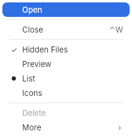
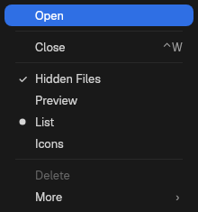
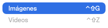
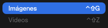

# 7. Menus and popovers

**Goal:** show a context menu, open a popover and add a tooltip.
**Scope:** menu items (`MenuItem`), the menu list (`MenuView`), its keyboard,
search, shortcuts, mnemonics and submenus; the view modifiers
(`.context_menu`, `.help`, `.focus_ring`) and `Popover`. The menu bar menu
(`MainMenu`) is in [13. App](13-app.md). The pop-up button (`PopUpButton`) is
a control: [5. Controls](05-controls.md).
Popup surfaces in general (`Popups`, `PopupSpec`) are in
[8. Windows](08-windows.md#popups).
**Reader:** anyone who adds a menu, a popover or a tooltip to an app.
**Input:** a window that runs with `Application` or `run_window`
([2. Your first app](02-first-app.md)). **Output:** a view with a context
menu, a button that opens a popover and a control with a tooltip.

## Steps

1. Build the items. Each action has an `id` that comes back when it is chosen:

   ```rust
   use bk::menu::{CheckState, MenuItem};

   let items = vec![
       MenuItem::action("open", tr!("open")).with_shortcut("Ctrl+O"),
       MenuItem::action("hidden", tr!("hidden-files")).with_check(CheckState::Checkbox(true)),
       MenuItem::Separator,
       MenuItem::submenu(tr!("share"), vec![MenuItem::action("mail", tr!("mail"))]),
   ];
   ```

2. Call `.context_menu` on the element that receives the secondary click:

   ```rust
   Text::new(tr!("file-name")).context_menu(items, |id: String| {
       // run the action `id`
   })
   ```

3. For a popover, keep the area of the element that opens it and call
   `Popover::show` with it on press:

   ```rust
   use bk::popover::Popover;
   use torin::prelude::Area;

   let mut area = use_state(Area::default);
   rect()
       .on_sized(move |event: Event<SizedEventData>| area.set_if_modified(event.area))
       .on_press(move |_| {
           Popover::new((240.0, 32.0), || Text::new(tr!("hello")).into())
               .show(*area.peek())
       })
       .child(Text::new(tr!("info")))
   ```

4. Add a tooltip with `.help`. Kit controls are components, so call it on the
   rect that holds the control:

   ```rust
   use bk::compact::IconButton;

   rect()
       .help(tr!("add-folder"))
       .child(IconButton::new(Symbol::Plus, tr!("add")))
   ```

## Menu items

`MenuItem` (`bk::menu`) is an enum. Build it with the constructors
and adjust it with the `with_*` methods; a method that does not apply to the
variant does nothing.

| Constructor | Variant | What it is |
|---|---|---|
| `MenuItem::action(id, label)` | `Action` | A command. Enabled, no check, no icon |
| `MenuItem::submenu(label, items)` | `Submenu` | A row that opens `items` in a child menu |
| `MenuItem::header(label)` | `Header` | A section title; not selectable. `Header { label, count: Some(n) }` adds a count at the right |
| `MenuItem::Separator` | `Separator` | A line between groups |
| `MenuItem::placeholder(label)` | `Action` | A disabled action with an empty `id`, for rows such as "No Items" |
| `MenuItem::palette(items)` | `Palette` | The actions in `items`, drawn as one horizontal row of icons, like `NSMenu.PresentationStyle.palette`. ← and → walk it; Enter picks |
| `MenuItem::SearchField { placeholder }` | `SearchField` | The search row of a searchable menu ([Search](#search)) |
| — | `SearchResult` | A row the menu builds for a search match; apps do not create it |

| Method | Applies to | Effect |
|---|---|---|
| `.with_shortcut(text)` | `Action` | Shows the shortcut at the right ([Shortcuts](#shortcuts)). It only shows it: the window menu or the app handles the key |
| `.with_enabled(bool)` | `Action`, `Submenu` | A disabled row is gray and skipped by the keyboard |
| `.with_check(CheckState)` | `Action` | `None` (default), `Checkbox(bool)`, `Radio(bool)` or `Minimized`: a check mark, a dot or the diamond of a minimized window in the leading column |
| `.with_icon(MenuIcon)` | `Action`, `Submenu` | An icon before the label |
| `.with_badge(text)` | `Action` | A counter at the right, before the shortcut, like `NSMenuItemBadge` |
| `.with_id(id)` | `Submenu` | Gives the submenu an id, so its contents can load on open ([Submenus](#submenus)) |
| `.label()` | all | The label, or `None` for `Separator`, `Palette` and `SearchField` |

`MenuIcon` has three variants:

| Variant | Build | What it draws |
|---|---|---|
| `Svg(Arc<str>)` | `MenuIcon::svg(text)` | An SVG, tinted with the row color |
| `Image(Arc<[u8]>)` | `MenuIcon::image(bytes)` | Encoded image bytes. Returns `None` above `MenuIcon::MAX_IMAGE_BYTES` (64 KiB). The row has no icon if a side is over `MenuIcon::MAX_IMAGE_SIDE` (1024 px) |
| `Swatch(Rgba)` | `MenuIcon::Swatch(color)` | A color circle |

The leading column for check marks exists only if some row uses it. An icon
shifts only the text of its own row; a checked row keeps its icon.

An app action from [13. App](13-app.md) becomes an item with
`action.item(enabled)` or `action.item_with(enabled, check)`.

## Menu view

`MenuView` draws a list of items. `.context_menu` and `PopUpButton` create it
for you; build one directly only for your own menu surface.

```rust
MenuView::new(items, |id: String| { /* chosen */ }, || { /* close every level */ })
    .with_surface(SurfaceKind::Toplevel)
```

`MenuView::new(items, on_activate, on_dismiss_all)` reports the chosen
action's `id` through `on_activate`, then calls `on_dismiss_all`.

| Method | Effect |
|---|---|
| `.with_surface(SurfaceKind)` | Palette for a window (`Toplevel`) or a shell surface (`LayerShell`, default). `SurfaceKind` is in `bk::theme` |
| `.with_popover_metrics()` | Uses the `MENU_POPOVER` sizes (24 px rows, 4 px padding, 180 px minimum width), the look of an app menu on macOS |
| `.with_fixed_palette(MenuPalette)` | A fixed palette that ignores the appearance (render tests use `MENU_LIGHT` and `MENU_DARK`) |
| `.with_items_source(f)` | Reads the items from `f` on every render instead of the fixed list |
| `.with_focused_index(Some(i))` | The row focused when it opens |
| `.with_popup_spec(spec)` | The `PopupSpec` the menu was opened with; the menu uses its anchor to place revealed menus |
| `.with_open_submenu(f)`, `.with_submenu_source(f)` | Lazy submenus ([Submenus](#submenus)) |
| `.with_searchable(f)`, `.with_help_topics(f)`, `.with_search_icons(menu, help)`, `.with_reveal_roots(f)`, `.with_query_state(state)` | Search ([Search](#search)) |
| `.with_navigation(f)` | ← and → at the edge call `f(MenuNavigation::Prev)` or `f(MenuNavigation::Next)`, so a menu bar moves to the neighbouring menu |
| `.style(\|s\| ..)` | Changes the `MenuStyle` of this menu and its submenus ([Style](#style)) |

`MenuView::preferred_size(&items, palette)` returns the `(width, height)` the
items need; open the popup with that size. Long labels are cut in the middle
with "…" at the palette's maximum width. An empty list shows a disabled
"No Items" row.

The keyboard works while the menu is open:

| Key | Effect |
|---|---|
| ↑, ↓ | Previous or next selectable row; headers, separators and disabled rows are skipped |
| Home, End | First or last selectable row |
| Enter, Space | Chooses the focused action or opens the focused submenu. Space types into the search while there is a query |
| → | Opens the focused submenu; on a plain row with navigation, `Next` |
| ← | Closes this submenu; with navigation, `Prev` |
| Esc | Clears the search if there is one; otherwise closes this menu |
| Alt (held) | Underlines the mnemonics ([Mnemonics](#mnemonics)) |

A menu taller than its popup shows scroll arrows at the ends. Hovering one
scrolls a third of a row every `MENU_SCROLL_TICK_MS` (30 ms); the wheel also
scrolls.

| Light | Dark |
|---|---|
|  |  |
|  |  |

### Style

Every menu, pop-up menu, popover and tooltip draws from a
[`MenuStyle`](../../agents/styles.md#menustyle), resolved through the theme and the
container styles of the view that opened it:

```rust
VStack::new()
    .child(PopUpButton::new("Sort").item("Name").item("Date"))
    .control_style(|s: MenuStyle| MenuStyle { item_radius: 0.0, ..s })
```

## Shortcuts

A shortcut is text: modifiers and a key joined with `+`, in any case.

| Part | Accepted names | Shown as |
|---|---|---|
| Control | `Ctrl`, `Control`, `Primary` | ⌃ |
| Alt | `Alt`, `Option`, `Opt`, `Mod1` | ⌥ |
| Shift | `Shift` | ⇧ |
| Super | `Super`, `Meta`, `Cmd`, `Command` | ❖ |
| Named keys | X keysym names or aliases: `Escape`/`Esc`, `Return`/`Enter`, `Tab`, `space`, `BackSpace`, `Delete`, `Left`, `Right`, `Up`, `Down`, `Home`, `End`, `Page_Up`, `Page_Down`, `comma`, `period`, `minus`, `plus`, `equal`, `slash`, `question`, `backslash`, `semicolon`, `apostrophe`, `bracketleft`, `bracketright` | ⎋ ↩ ⇥ ␣ ⌫ ⌦ ← → ↑ ↓ ↖ ↘ ⇞ ⇟ and the character |
| Any other single character | itself | in upper case |

Modifiers are always shown in the order ⌃ ⌥ ⇧ ❖.

| Function | What it does |
|---|---|
| `format_shortcut(text)` | `"Ctrl+Shift+G"` → `"⌃⇧G"` |
| `shortcut_matches(text, modifiers, &key)` | `true` when a key event is that shortcut. Only Control, Alt, Shift and Super count |

## Mnemonics

A mnemonic is the letter that Alt underlines. Put `MNEMONIC_MARK`
(U+2063, invisible separator) right before that letter in the label:

```rust
let label = format!("{}Open", bk::menu::MNEMONIC_MARK);
```

While Alt is held, the menu underlines the letter after the mark. The mark is
never drawn, and search ignores it. Pressing the letter does not choose the
row. `strip_mnemonic(label)` returns the label without the mark.

## Submenus

A `Submenu` row opens its items in a child popup, to the right or, when there
is no room, to the left. The pointer opens it after `MENU_SUBMENU_INTENT_MS`
(300 ms). While the pointer moves towards an open submenu, the rows it crosses
do not close it. Submenus open only when the `MenuView` lives in a popup.

For contents that arrive later (a dbusmenu `AboutToShow`, for example):

1. Give the submenu an id: `MenuItem::submenu(label, vec![]).with_id("recent")`.
2. `.with_open_submenu(|id| …)` is called with that id when it opens. Start
   loading there.
3. `.with_submenu_source(|id| …)` returns `Some(items)` once they exist. The
   child re-reads it on every render.
4. Until then the child shows a disabled "Loading…" row.
   `submenu_contents(loading, &items)` gives the same result for your own
   lists.

## Search

A menu with `.with_searchable(f)` filters while the user types, as the Help
menu on macOS does. The Malaysia menu bar uses it; most apps do not need it.

1. `f` returns one `SearchableEntry` per item that can be found:

   | Field | What it is |
   |---|---|
   | `item` | The `MenuItem` the result activates |
   | `location` | `Some(SearchLocation { title_index, indices })`: the top menu and the row indices that lead to the item, or `None` |

2. `.with_help_topics(f)` adds a second list of entries, shown under a "Help
   Topics" header.
3. Typing adds to the query; Backspace removes the last character; Esc clears
   it. A `SearchField` row shows the query in a capsule with no focus ring, as
   on macOS; the menu adds one at the top if the items have none.
4. Matches are ranked: label starts with the query, then a word starts with
   it, then it appears anywhere; disabled rows go after enabled ones. The menu
   shows up to `MenuView::MAX_MENU_ROWS` (9) menu results and
   `MenuView::MAX_HELP_ROWS` (5) help results, and ↑ ↓ scroll beyond them.
5. With `.with_reveal_roots(f)`, `f` returns the items of every top menu. When
   a menu result with a `location` is focused, the menu opens that top menu to
   its left, with the item focused, if there is room.
6. `.with_query_state(state)` shares the query (`SearchQuery { text, selected }`)
   through an `Rc<RefCell<SearchQuery>>`, so it survives when the menu is
   rebuilt.
7. `.with_search_icons(menu, help)` sets the SVG icons of the two result
   kinds. `search_icon_svg(template, text, accent)` fills the `{{text}}` and
   `{{accent}}` placeholders of a template with two colors.

`normalize_query(text)` prepares text the way the search compares it: it
removes the mnemonic mark, trims, lower-cases and folds accents (`"Vídeos"` →
`"videos"`).

## View modifiers

`modifiers::ViewModifiers` is a trait in the prelude. Its methods return the
same element, like SwiftUI's view modifiers. It is implemented for every
element with Freya's `EventHandlersExt`: `rect`, `label`, `Text`, `VStack`,
`HStack` and the kit's view types, such as `Divider` or `Sheet`. Kit controls
are components: call the modifier on a rect that holds them.

| Method | SwiftUI | What it adds |
|---|---|---|
| `.context_menu(items, on_activate)` | `.contextMenu` | A menu at the pointer on secondary click |
| `.help(text)` | `.help(_:)` | A tooltip |
| `.focus_ring(corner_radius, color)` | — | A ring around the element |
| `.foreground_style(ShapeStyle)` | `.foregroundStyle(_:)` | The text color of `Text`, `label` or `paragraph` |
| `.background_style(ShapeStyle)` | `.background(_:ignoresSafeAreaEdges:)` | A background paint, with blur for a material |
| `.shadows(Vec<ShadowStyle>)` | `.shadow(color:radius:x:y:)` | Shadows |

The last three take the paint types of the styling system and are described
in [Styles and themes](../../agents/styles.md#paint-on-views).

A modifier sets Freya event handlers on the element: `.context_menu` sets
`on_secondary_down`; `.help` sets `on_pointer_enter`, `on_pointer_move`,
`on_pointer_leave` and `on_pointer_down`. A handler for the same event, set
before or after, replaces the other one.

### `.context_menu`

`element.context_menu(items, on_activate)` adds a secondary-click handler to
`element`. On a secondary press it opens a `MenuView` at the
pointer, with the popover metrics, as a popup with a grab. Choosing an action
calls `on_activate(id)` and closes the menu; a click outside closes it. The
popup flips and slides to stay on screen.

Text fields and `TextEditor` already have their own edit menu
([6. Text and editing](06-text-and-editing.md)).

### `pop_up_menu`

`popup_button::pop_up_menu(items, rect, side, on_activate, on_close)` opens a
`MenuView` beside `rect`, in surface coordinates, toward `side` (a
`PopupAnchor`: `Top`, `Bottom`, `Left` or `Right`) and centred on that edge.
It is AppKit's `NSMenu.popUp(positioning:at:in:)`. `on_close` runs when the
menu closes, chosen or dismissed. Malaysia's Dock opens an icon's menu this
way, above the icon on a bottom Dock and beside it on a side Dock, and stays
up until `on_close`.

### `.help` (tooltips)

`element.help(text)` shows `text` as a tooltip over `element`. `text` is a
`&'static str`, which is what `tr!` returns. `.help` calls a hook: call it on
every render, never inside a condition. The tooltip works like this:

1. The pointer enters the element and stays `TOOLTIP.delay_ms` (1000 ms).
2. The tooltip opens as a popup without a grab, `TOOLTIP.pointer_gap` (16 px)
   below the pointer.
3. It closes when the pointer leaves, when a button is pressed and when the
   component is dropped.

It draws one line of `CAPTION` text with the popover colors, a hairline border
and square corners.

### `.focus_ring`

`element.focus_ring(corner_radius, color)` draws a ring of `FOCUS_RING.width`
(3) in `color` just outside the element: an outer border that follows the
element's corners, or `corner_radius` when the element has none. It needs an
element with a style: `rect`, `VStack`, `HStack` or a rect-like view type, not
`label` or `Text`. A control uses it as a selection
mark; the keyboard focus ring is `Interaction::focus_ring`
([5. Controls](05-controls.md#building-a-new-control)).

## Popovers

### `Popover`

`popover::Popover` is `NSPopover`. `Popover::new(size, content)` builds it and
`.show(anchor)` opens it below `anchor`, an `Area` in window coordinates:

| Argument | What it is |
|---|---|
| `size` | `(width, height)` of the content. The popup adds `POPOVER.padding` (12) on each side and the arrow band, `POPOVER.arrow_height` (13), on top |
| `content` | A closure that returns the content as an `Element`. The popover paints the background |
| `anchor` | The area the arrow points at |

It opens with a grab: a click outside closes it. It slides sideways to stay on
screen.

The app asks Malaysia, with `infinity_window_style_v1.set_popover` (version
2), for the shape of `NSPopover` on macOS 26: a continuous 20 px corner and a
25.42 × 13 px arrow with a round tip, filleted into the body, pointing at the
centre of the anchor. The compositor clips, borders and shadows that shape
([Malaysia ADR 0059](https://github.com/HBlanqueto/malaysia/blob/main/docs/decisions/0059-radius-per-bar-and-continuous-corner.md)).
The measurements come from the Flutter package
[`popover`](https://pub.dev/packages/popover), taken from AppKit on macOS
26.7. Without version 2, the popup is a plain rectangle.

## Helpers

| Function | What it does |
|---|---|
| `normalize_separators(&mut items)` | Removes leading, trailing and repeated separators, also in submenus |
| `measure_text(text, size)` | Width in pixels of `text` in the system sans font at `size` |
| `measure_text_weight(text, size, weight)` | The same with a `FontWeight` |

The type aliases `ItemsSource`, `SubmenuSource`, `SearchableSource` and
`RevealRoots` name the `Rc` closures that the `with_*` methods above store.

Next: [8. Windows](08-windows.md).
