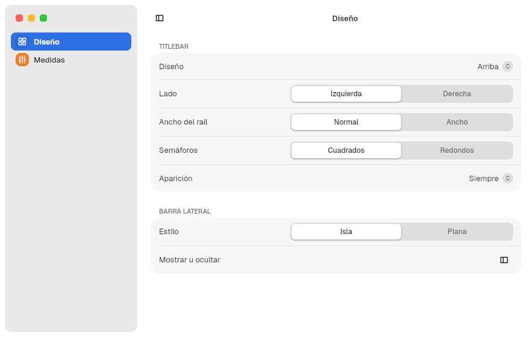
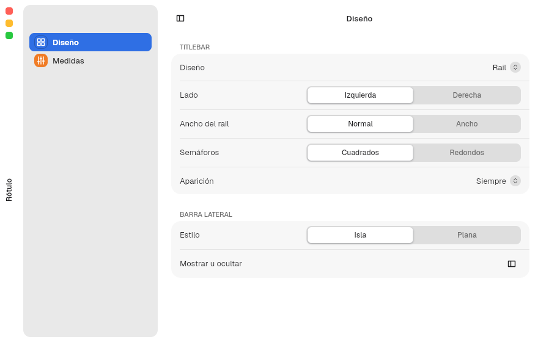
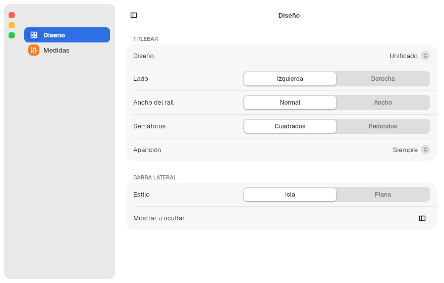
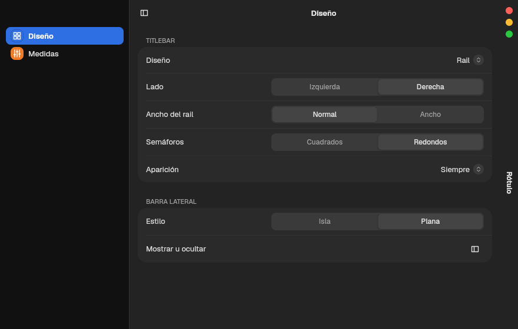
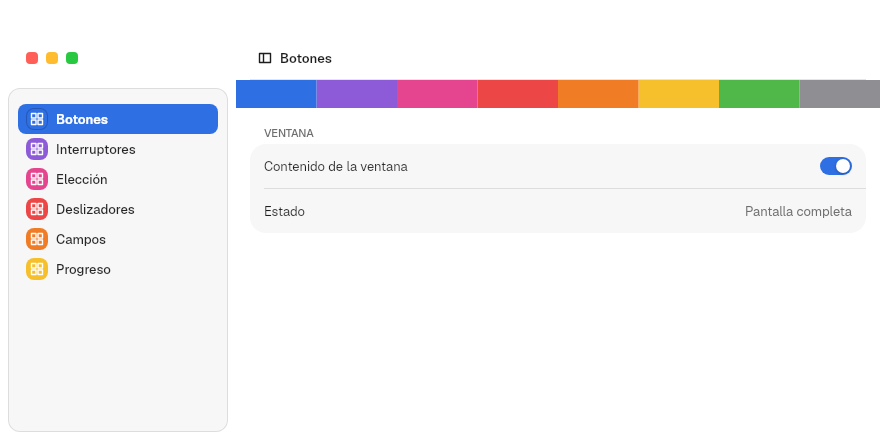
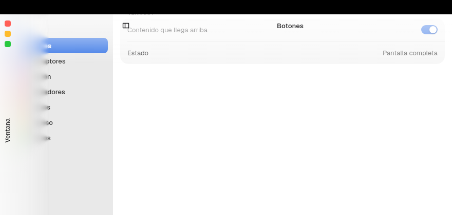
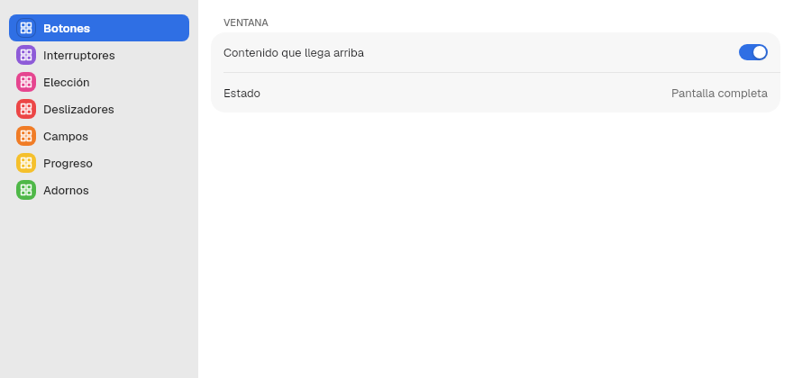

# 7. Titlebars

**Goal:** choose an app's titlebar and know how it looks in each state:
normal, unfocused, maximized, full screen and MalaysiaDreams focus mode.
**Reader:** anyone who designs an app's window.

## What there is

| Piece | For | Default |
|---|---|---|
| `Titlebar` | The horizontal CSD titlebar: traffic lights, left and right zones, title | With a sidebar when `.with_sidebar(true)` is passed |
| `TrafficLights` | Close, minimize and maximize | Square, `traffic_lights` colors |
| `WindowChrome` + `ChromeStyle` | Two layouts: `Top` and `Rail` (normal or unified); both accept the app's own items | `Top` |
| `FullscreenBar` | How the overlaid titlebar is drawn in full screen | `Solid` ("A · Lisa") |

## The horizontal titlebar: `Titlebar`

```rust
Titlebar::new()
    .title("Documento")
    .with_sidebar(true)
    .left(SidebarToggle)
    .right(IconButton::new(Symbol::Plus, "Nuevo"))
```

- It has three areas: `left`, the centered title and `right`.
- Without a sidebar, the areas are symmetric so the title stays centered.
- With `.with_sidebar(true)` it aligns with the sidebar. The traffic lights
  stay fixed in place even when the sidebar collapses.
- Dragging it moves the window; double-click does what `window.domain` says.
- When `Decorations::Server` is granted, it measures 0 and draws nothing.
- `.close_only(true)` leaves only the close button, for dialogs.

The «Ventana y herramientas» ("Window and tools") pane of Tengen App Show
shows standalone traffic lights, a `Titlebar` with a title and another one with
`.close_only(true)`:


### Variants in a normal window

The same `Titlebar` changes by itself with the sidebar, its style and focus.
The app chooses none of these variants: they come from `with_sidebar`, from
`sidebar_style` in `appearance.domain` and from whether the window is active.

| Variant | How it looks |
|---|---|
| With an island sidebar (default): the traffic lights go in the sidebar; the bar has no line |  |
| With an island sidebar, unfocused window: traffic lights and title in gray |  |
| With a flat sidebar: a `TITLEBAR_CLIENT_HEIGHT` bar with a line at the bottom |  |
| Without a sidebar: traffic lights in the bar and the title centered between two symmetric zones |  |
| Without a sidebar, unfocused window: `titlebar_inactive` background and gray traffic lights |  |

## The traffic lights: `TrafficLights`

Close, minimize and maximize. They are not usually created by hand:
`Titlebar` and `Sidebar::traffic_lights(true)` place them with
`titlebar::window_traffic_lights(enfocada, fija)`. If you need them standalone:

```rust
TrafficLights::new()
    .focused(true)
    .zoom_supported(true)
    .vertical(false)
    .round(false)
    .on_action(|boton: ButtonKind| { /* Close, Minimize, Maximize */ })
```

| Setting | Where | Values |
|---|---|---|
| Color | `appearance.domain` → `traffic_lights` | `auto`, `standard` (or `macos`), `accent`, `wallpaper` |
| Green button | `window.domain` → `green_button` | `focus` (default: full screen), `zoom`, `fullscreen`, `none` |
| Double-click on the titlebar | `window.domain` → `double_click_titlebar` | `zoom` (default), `fill`, `minimize`, `none` |

In an inactive window the traffic lights turn gray.

## Two titlebar types: `WindowChrome`

`chrome::WindowChrome::new(estilo, contenido)` wraps the window and places the
traffic lights, the title and the rail items according to a `ChromeStyle`:

```rust
let estilo = ChromeStyle {
    layout: TitlebarLayout::Rail,
    side: Side::Left,
    rail_width: TITLEBAR_RAIL.width,
    round_lights: false,
    rail_style: RailStyle::Normal,
    reveal: Reveal::Always,
    resting_edge: RestingEdge::None,
};
WindowChrome::new(estilo, SplitView::new(barra, detalle))
    .rail_top(arriba)
    .rail_bottom(abajo)
```

| `TitlebarLayout` | What it is | Screenshot (Rótulo) |
|---|---|---|
| `Top` (default) | Horizontal titlebar at the top, with items on the left and the right (`Titlebar::left` and `right`) |  |
| `Rail` | Vertical titlebar on one side, with the traffic lights in a column, the title rotated 90° and items at the top and the bottom (`rail_top` and `rail_bottom`) |  |

The `Rail` has two styles:

| `RailStyle` | What it is | Screenshot (Rótulo) |
|---|---|---|
| `Normal` (default) | Its own strip on one side of the window |  |
| `Unified` | No strip: the column goes inside the sidebar. Without a visible sidebar it is drawn as `Normal` |  |

### Rail items

Just as the `Top` `Titlebar` holds buttons or other items on the left and the
right, the `Rail` holds them vertically:

| Method | Where it goes |
|---|---|
| `WindowChrome::rail_top(items)` | Below the traffic lights |
| `WindowChrome::rail_bottom(items)` | At the foot of the rail |

With any item, the rail widens to `TITLEBAR_RAIL.actions_width` (34). In
`Unified` the items go in the sidebar column, in the same places.

| `Normal` with items | `Unified` with items |
|---|---|
|  |  |

### `ChromeStyle` fields

| Field | Values | Effect |
|---|---|---|
| `side` | `Left`, `Right` | Side of the rail |
| `rail_width` | `TITLEBAR_RAIL.width` or `.width_wide` | Width of the rail without items |
| `round_lights` | `bool` | Round or square (default) traffic lights |
| `rail_style` | `Normal`, `Unified` | Its own strip or a column inside the sidebar |
| `reveal` | `Always`, `Drawer`, `Push`, `Corner`, `Popup` | Always visible, or appears when the pointer nears: as a drawer on top, pushing the content, only in the corner, or as a popup pill with the traffic lights |
| `resting_edge` | `None`, `Line`, `Accent` | What stays visible while hidden: nothing, a line or an accent line |

Some combinations make no sense and correct themselves
(`ChromeStyle::effective`): a unified `Rail` with `Drawer`, `Push` or `Popup`
becomes `Corner`; in full screen, `reveal` is always `Always`.

Rail on the right, round traffic lights, flat sidebar and dark mode:



The Rótulo app (chapter [15](15-apps-de-prueba.en.md)) tests every combination
live.

## Maximized, full screen and focus mode

The state is read as chapter [6](06-ventanas.en.md#window-state) explains.
The screenshots in this section are the Rótulo window (island sidebar, `Top`
layout unless stated) rendered by the kit in each state.

### The four states with the default layout (`Top`)

| State | How it is entered | What the kit does | How it looks |
|---|---|---|---|
| Normal | — | Titlebar in place, traffic lights in the sidebar. The window edges resize it. On close, the size is saved |  |
| Maximized | Green button with `green_button = "zoom"`, double click with `zoom` or `fill`, or `toggle_maximize()` | Same as normal, without resize edges. In MalaysiaDreams the compositor keeps the frame (corners and shadow). On close, the kit saves that it was maximized and reopens it that way |  |
| Full screen without the focus protocol (another compositor) | Green button with `focus` (default) or `fullscreen`, or `toggle_fullscreen()` | The titlebar stays in place and the traffic lights hide |  |
| MalaysiaDreams focus mode, bar up | Same; the compositor gives the `fullscreen` state | The titlebar leaves the layout and the content fills the whole window |  |

In MalaysiaDreams, focus mode
([MalaysiaDreams ADRs 0051 and 0054](https://github.com/HBlanqueto/malaysia/tree/main/docs/decisiones))
slides a black bar down when the pointer nears the top. The kit requests
`set_overlay` through `infinity_focus_v1` v2, so the window does not move:
while the bar is down, `titlebar_overlaid()` is true and the titlebar is drawn
over the content, right below the bar, on the background the app chooses
(`FullscreenBar`, below). It appears and disappears with the bar in
`DURATION_BASE`. In full screen, `reveal` is always `Always`.

### The bar in full screen: `FullscreenBar`

Each window chooses how its overlaid titlebar is drawn. The option goes in
`WindowOptions` and applies to the whole overlaid titlebar:

```rust
WindowOptions::new("Ondina", "ondina").fullscreen_bar(FullscreenBar::ProgressiveGlass)
```

**By default, every app uses `Solid` ("A · Lisa").** Only Ondina requests
`ProgressiveGlass`. The four come from the "Ondina a pantalla completa"
proposal; "C · Degradado" was dropped. In the screenshots, the black strip at the
top is the compositor bar, added to the image.

| `FullscreenBar` | What it draws | Where the content starts (`fullscreen_content_top`) | How it looks |
|---|---|---|---|
| `Solid` ("A · Lisa", **default**) | An opaque band in the window color, as tall as the titlebar. It cuts what passes below with a hard edge | Bar + `FULLSCREEN_BAR.content_top` (44) |  |
| `Glass` ("B1 · Vidrio en banda") | A band as tall as the titlebar, from edge to edge of the window and over the sidebar, that blurs what is below (`FULLSCREEN_BAND`), with a tint and a line at the bottom | Bar + `FULLSCREEN_BAND.content_top` (44) |  |
| `ProgressiveGlass` ("B2 · Vidrio progresivo", Ondina) | Maximum blur at the top that fades out over 96 px, without a line, from edge to edge of the window and over the sidebar ([ADR 0057](../decisiones/0057-cristal-y-barra-lateral-sobre-fondo.md)) | Bar + `FULLSCREEN_GLASS.content_top` (74) |  |
| `Push` ("E · Empuja") | It covers nothing: the titlebar returns to the layout and pushes the detail column down by the height of the bar and the titlebar. The sidebar does not move | 0: the content moves down by itself |  |

With `Push` and the bar up, the content reaches the top edge:


Only `Glass` and `ProgressiveGlass` blur.

#### With the `Rail`

The rail uses the same bar, vertically. With the compositor bar up it is
hidden; when the bar comes down, it slides in from its side:

| `FullscreenBar` | The rail | How it looks |
|---|---|---|
| `Solid` ("A · Lisa", **default**) | An opaque strip as wide as the rail, over the content |  |
| `Glass` ("B1 · Vidrio en banda") | A strip as wide as the rail that blurs what is below, with a line on the inner edge |  |
| `ProgressiveGlass` ("B2 · Vidrio progresivo") | Maximum blur at the window edge that fades inward over 96 px |  |
| `Push` ("E · Empuja") | The rail returns to the layout and pushes the content sideways by its width |  |

With `Push` and the bar up, the content reaches the edge:



### Focus mode with the bar down, by layout

**With an island sidebar and the window maximized or in full screen, the
`Rail` becomes `Top`:** the strip or the unified column goes away and
the traffic lights return to the island. This is `Rail` with an island in focus
mode:


With a flat sidebar or no sidebar, each layout is kept. The screenshots in this
table use the flat sidebar (except `Top`) and the default bar (`Solid`). The
black strip at the top (28 px) is the compositor bar, added to the image: the
app does not draw it.

| Layout | What comes down | How it looks |
|---|---|---|
| `Top` (default) | The `Titlebar` over the content; the sidebar traffic lights move down by the same amount |  |
| Unified `Rail` | The sidebar column; the traffic lights appear with the bar, below it |  |
| `Rail` | The rail slides in from its side with the chosen bar (above, "With the `Rail`"); its traffic lights sit below the compositor bar |  |
| `Rail` with items | The same, with its items |  |

### What the app does

1. If it uses `Titlebar`, `WindowChrome`, `Sidebar` or `PreferencesWindow`, it
   does nothing: every state in the tables already works.
2. It leaves room for the bar in the content under the overlaid titlebar, as
   Ondina does:

   ```rust
   let arriba = try_consume_root_context::<WindowControls>()
       .map_or(0.0, |controls| controls.fullscreen_content_top());
   rect().padding(Gaps::new(arriba, 0.0, 0.0, 0.0)).child(contenido)
   ```

3. If a view covers the titlebar (a video player that fills the window), it
   adds its own traffic lights so the window can be maximized or leave full
   screen without it, as the Marea player does:

   ```rust
   window_traffic_lights(WindowControls::get().status.read().activated, false)
   ```

4. For its own behavior (an immersive mode that hides panels), it reads the
   state and decides:

   ```rust
   let controls = WindowControls::get();
   let inmersivo = controls.status.read().fullscreen;
   rect().maybe_child((!inmersivo).then(panel_de_herramientas))
   ```

5. To offer it in a menu, it calls `toggle_maximize()` or
   `toggle_fullscreen()` from an `Action` (chapter [11](11-app.en.md)).

Next: [8. Sidebar and SplitView](08-barra-lateral.en.md).
