# 7. Titlebars

**Objetivo:** elegir la titlebar de una app y saber cómo se ve en cada estado:
normal, sin foco, maximizada, en pantalla completa y en el modo foco de
MalaysiaDreams.
**Lector:** quien diseña la ventana de una app.

## Qué hay

| Pieza | Para | Por defecto |
|---|---|---|
| `Titlebar` | La titlebar horizontal CSD: semáforos, zonas izquierda y derecha, título | Con barra lateral si se pasa `.with_sidebar(true)` |
| `TrafficLights` | Cerrar, minimizar y maximizar | Cuadrados, colores de `traffic_lights` |
| `WindowChrome` + `ChromeStyle` | Cuatro diseños: `Top`, `Rail`, `Unified` y `Pill`; el `Rail` admite acciones propias | `Top` |
| `FullscreenBar` | Cómo se dibuja la titlebar superpuesta en pantalla completa | `Solid` («A · Lisa») |

## La titlebar horizontal: `Titlebar`

```rust
Titlebar::new()
    .title("Documento")
    .with_sidebar(true)
    .left(SidebarToggle)
    .right(IconButton::new(Symbol::Plus, "Nuevo"))
```

- Tiene tres zonas: `left`, título centrado y `right`.
- Sin barra lateral, las zonas son simétricas para que el título quede
  centrado.
- Con `.with_sidebar(true)` se alinea con la barra lateral. Los semáforos se
  quedan fijos en su sitio aunque la barra se pliegue.
- Arrastrarla mueve la ventana; el doble clic hace lo que diga `window.domain`.
- Con `Decorations::Server` concedida, mide 0 y no dibuja nada.
- `.close_only(true)` deja solo el botón de cerrar, para diálogos.

El panel «Ventana y herramientas» de Tengen App Show muestra los semáforos
sueltos, una `Titlebar` con título y otra con `.close_only(true)`:

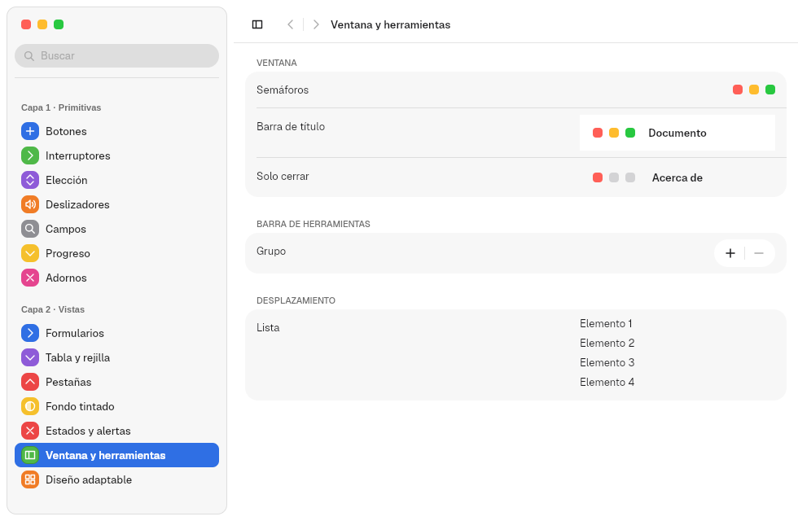

### Variantes en una ventana normal

La misma `Titlebar` cambia sola según la barra lateral, su estilo y el foco.
Ninguna de estas variantes la elige la app: salen de `with_sidebar`, de
`sidebar_style` en `appearance.domain` y de si la ventana está activa.

| Variante | Cómo se ve |
|---|---|
| Con barra lateral en isla (por defecto): los semáforos van en la barra lateral; la barra no lleva línea | 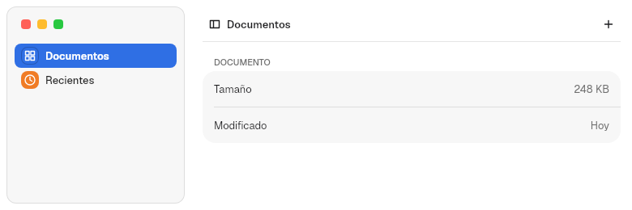 |
| Con barra lateral en isla, ventana sin foco: semáforos y título en gris | 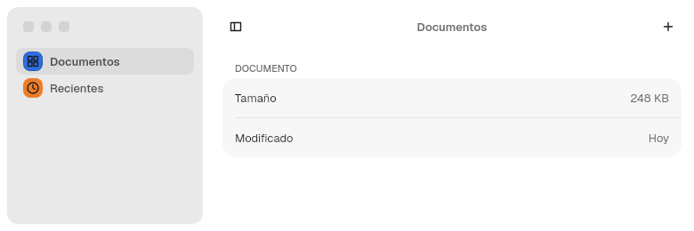 |
| Con barra lateral plana: barra de `TITLEBAR_CLIENT_HEIGHT` con línea abajo | 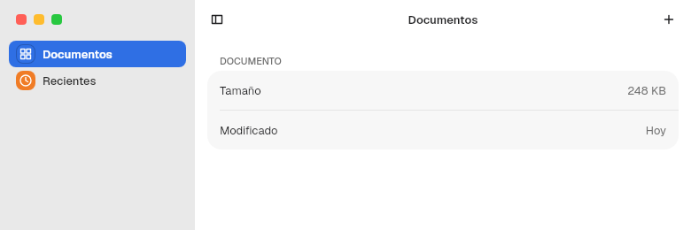 |
| Sin barra lateral: semáforos en la barra y título centrado entre dos zonas simétricas | 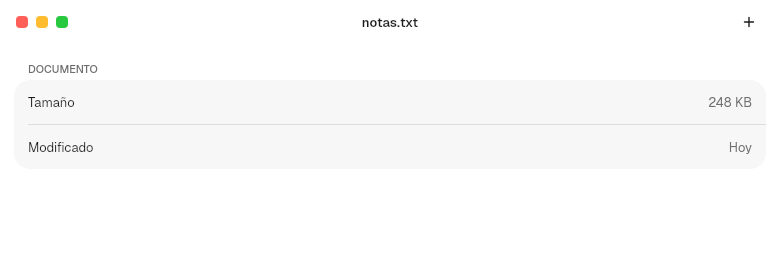 |
| Sin barra lateral, ventana sin foco: fondo `titlebar_inactive` y semáforos grises | 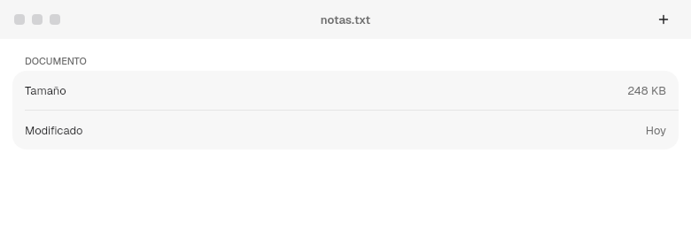 |

## Los semáforos: `TrafficLights`

Cerrar, minimizar y maximizar. Normalmente no se crean a mano:
`Titlebar` y `Sidebar::traffic_lights(true)` los colocan con
`titlebar::window_traffic_lights(enfocada, fija)`. Si se necesitan sueltos:

```rust
TrafficLights::new()
    .focused(true)
    .zoom_supported(true)
    .vertical(false)
    .round(false)
    .on_action(|boton: ButtonKind| { /* Close, Minimize, Maximize */ })
```

| Ajuste | Dónde | Valores |
|---|---|---|
| Color | `appearance.domain` → `traffic_lights` | `auto`, `standard` (o `macos`), `accent`, `wallpaper` |
| Botón verde | `window.domain` → `green_button` | `focus` (por defecto: pantalla completa), `zoom`, `fullscreen`, `none` |
| Doble clic en la titlebar | `window.domain` → `double_click_titlebar` | `zoom` (por defecto), `fill`, `minimize`, `none` |

En una ventana inactiva los semáforos se vuelven grises.

## Cuatro tipos de titlebar: `WindowChrome`

`chrome::WindowChrome::new(estilo, contenido)` envuelve la ventana y coloca los
semáforos y el título según un `ChromeStyle`:

```rust
let estilo = ChromeStyle {
    layout: TitlebarLayout::Rail,
    side: Side::Left,
    rail_width: TITLEBAR_RAIL.width,
    round_lights: false,
    pill_vertical: true,
    reveal: Reveal::Always,
    resting_edge: RestingEdge::None,
};
WindowChrome::new(estilo, SplitView::new(barra, detalle)).footer(pie)
```

| `TitlebarLayout` | Qué es | Captura (Rótulo) |
|---|---|---|
| `Top` (por defecto) | Titlebar horizontal arriba | 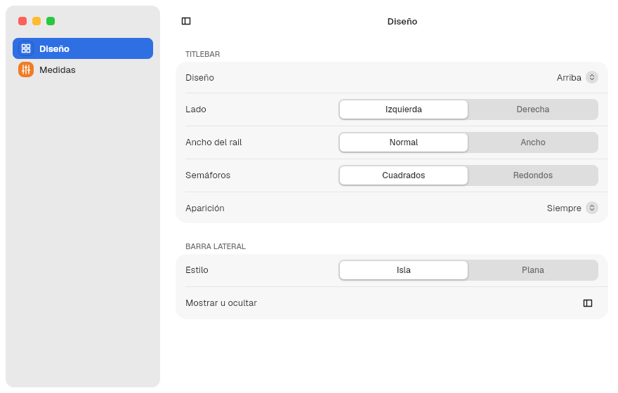 |
| `Rail` | Franja vertical a un lado con los semáforos en columna y el título girado 90°. Si la app pasa `.footer(..)` a `WindowChrome`, el rail añade abajo sus acciones y se ensancha a `TITLEBAR_RAIL.actions_width` (34) | 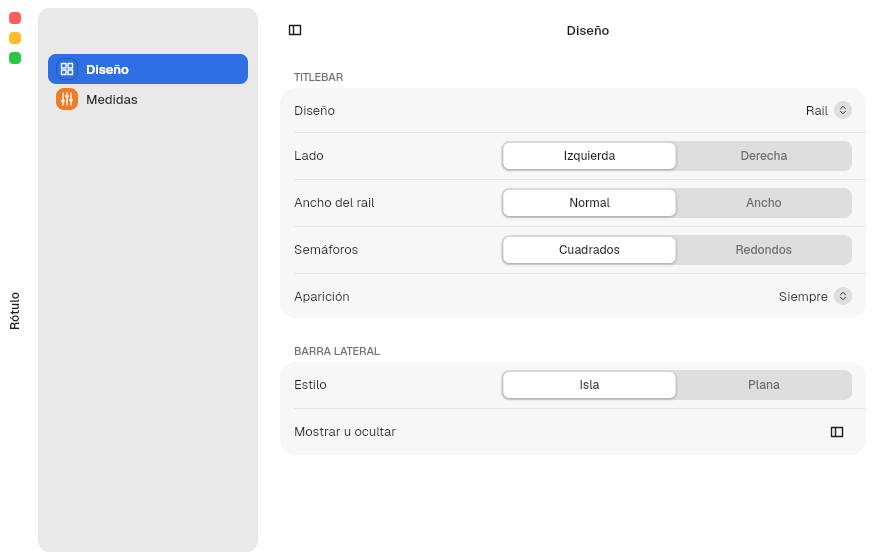 |
| `Unified` | Los semáforos en columna dentro de la barra lateral, sin franja propia. Sin barra lateral visible pasa a `Rail` | 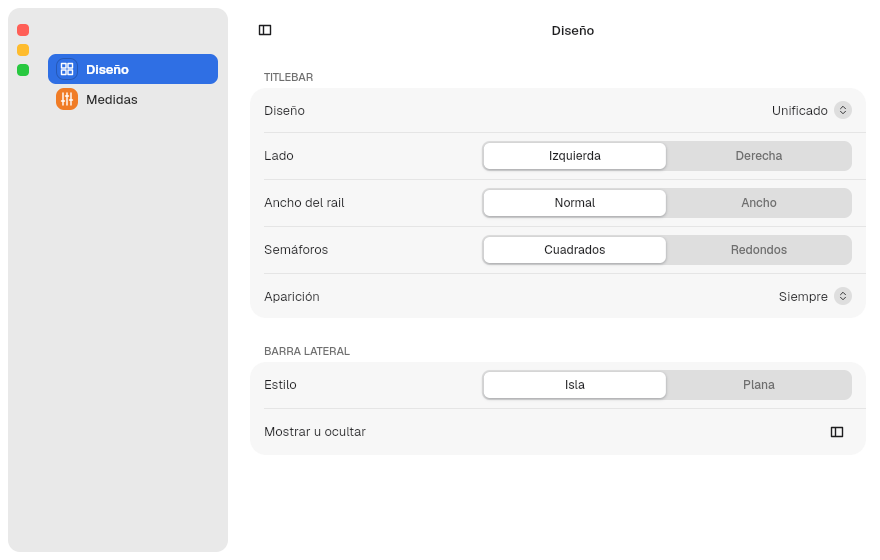 |
| `Pill` | Una píldora flotante con los semáforos, vertical (por defecto) u horizontal según `pill_vertical`. En pantalla completa es opaca o cristal según `FullscreenBar` |  |

| Campo | Valores | Efecto |
|---|---|---|
| `side` | `Left`, `Right` | Lado del rail |
| `rail_width` | `TITLEBAR_RAIL.width` o `.width_wide` | Ancho del rail |
| `round_lights` | `bool` | Semáforos redondos o cuadrados (por defecto) |
| `pill_vertical` | `bool` | Con `Pill`: semáforos en columna (`true`, por defecto) o en fila (`false`). La vertical reserva un margen en el lado; la horizontal va arriba y no lo reserva |
| `reveal` | `Always`, `Drawer`, `Push`, `Corner`, `Popup` | Siempre visible, o aparece al acercar el puntero: como cajón encima, empujando el contenido, solo en la esquina o como píldora emergente |
| `resting_edge` | `None`, `Line`, `Accent` | Qué queda visible cuando está oculta: nada, una línea o una línea de acento |

Algunas combinaciones no tienen sentido y se corrigen solas
(`ChromeStyle::effective`): `Unified` con `Drawer`, `Push` o `Popup` pasa a
`Corner`; `Pill` con `Drawer` o `Push` pasa a `Popup`; en pantalla completa,
`reveal` es siempre `Always`.

Rail a la derecha, semáforos redondos, barra lateral plana y modo oscuro:

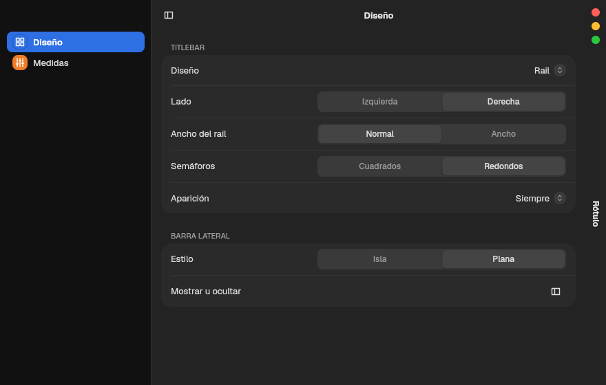

El `Rail` con acciones (`.footer(..)`), en una ventana normal:

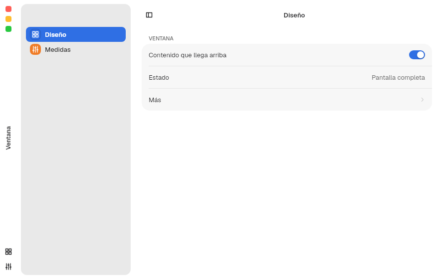

La píldora en sus dos orientaciones, en una ventana normal:

| `pill_vertical: true` (por defecto) | `pill_vertical: false` |
|---|---|
| 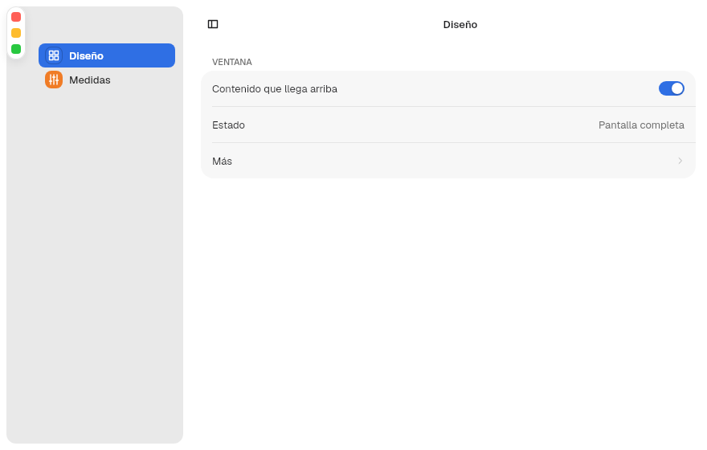 | 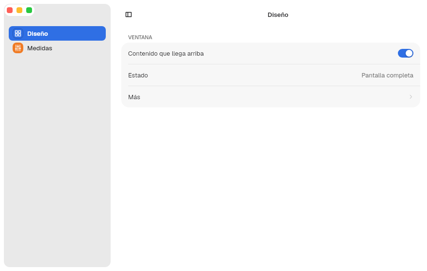 |

La app Rótulo (capítulo [15](15-apps-de-prueba.md)) prueba todas las
combinaciones en vivo.

## Maximizada, pantalla completa y modo foco

El estado se lee como explica el capítulo [6](06-ventanas.md#estado-de-la-ventana).
Las capturas de esta sección son la ventana de Rótulo (barra lateral en isla,
diseño `Top` salvo donde se indica) renderizada por el kit en cada estado.

### Los cuatro estados con el diseño por defecto (`Top`)

| Estado | Cómo se entra | Qué hace el kit | Cómo se ve |
|---|---|---|---|
| Normal | — | Titlebar en su sitio, semáforos en la barra lateral. Los bordes de la ventana la redimensionan. Al cerrar se guarda el tamaño | 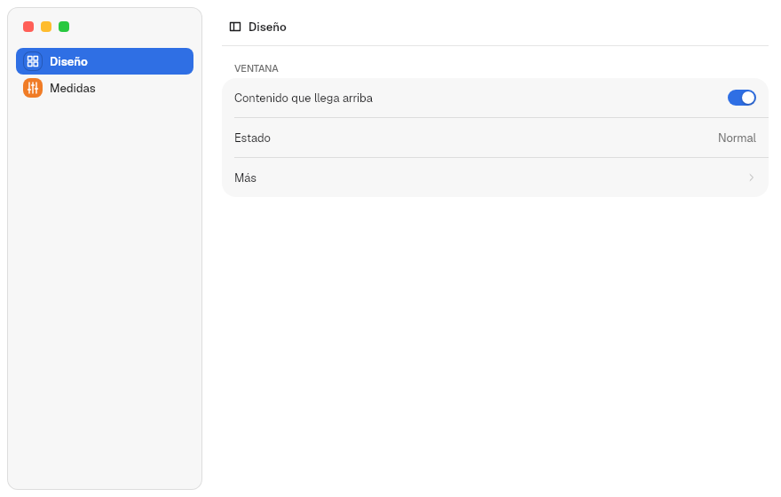 |
| Maximizada | Botón verde con `green_button = "zoom"`, doble clic con `zoom` o `fill`, o `toggle_maximize()` | Lo mismo que en normal, sin bordes de redimensionado. En MalaysiaDreams el compositor conserva el marco (esquinas y sombra). Al cerrar se guarda que estaba maximizada y vuelve a abrirse así |  |
| Pantalla completa sin el protocolo de foco (otro compositor) | Botón verde con `focus` (por defecto) o `fullscreen`, o `toggle_fullscreen()` | La titlebar se queda en su sitio y se ocultan los semáforos | 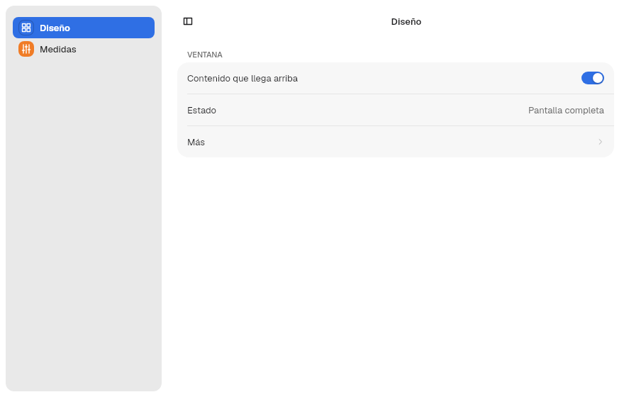 |
| Modo foco de MalaysiaDreams, barra arriba | Igual; el compositor da el estado `fullscreen` | La titlebar sale del diseño y el contenido ocupa toda la ventana | 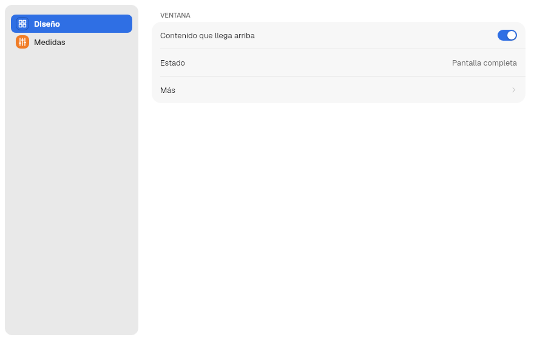 |

En MalaysiaDreams, el modo foco
([ADR 0051 y 0054 de MalaysiaDreams](https://github.com/HBlanqueto/malaysia/tree/main/docs/decisiones))
baja una barra negra al acercar el puntero arriba. El kit pide `set_overlay`
por `infinity_focus_v1` v2, así que la ventana no se mueve: mientras la barra
está bajada, `titlebar_overlaid()` es verdadero y la titlebar se dibuja encima
del contenido, justo debajo de la barra, sobre el fondo que elige la app
(`FullscreenBar`, abajo). Aparece y desaparece con la barra en
`DURATION_BASE`. En pantalla completa, `reveal` es siempre `Always`.

### La barra en pantalla completa: `FullscreenBar`

Cada ventana elige cómo se dibuja su titlebar superpuesta. La opción va en
`WindowOptions` y vale para la `Titlebar`, el rail y la píldora:

```rust
WindowOptions::new("Ondina", "ondina").fullscreen_bar(FullscreenBar::ProgressiveGlass)
```

**Por defecto, todas las apps usan `Solid` («A · Lisa»).** Solo Ondina pide
`ProgressiveGlass`. Las cuatro salen de la propuesta «Ondina a pantalla
completa»; «C · Degradado» se descartó. En las capturas, la franja negra de arriba
es la barra del compositor, añadida a la imagen.

| `FullscreenBar` | Qué dibuja | Dónde empieza el contenido (`fullscreen_content_top`) | Cómo se ve |
|---|---|---|---|
| `Solid` («A · Lisa», **por defecto**) | Una banda opaca del color de la ventana, del alto de la titlebar. Corta lo que pasa por debajo con un borde duro | Barra + `FULLSCREEN_BAR.content_top` (44) | 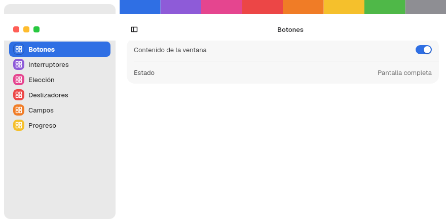 |
| `Glass` («B1 · Vidrio en banda») | Una banda del alto de la titlebar, de borde a borde de la ventana y sobre la barra lateral, que difumina lo de debajo (`FULLSCREEN_BAND`), con tinte y una línea abajo | Barra + `FULLSCREEN_BAND.content_top` (44) |  |
| `ProgressiveGlass` («B2 · Vidrio progresivo», Ondina) | Difuminado máximo arriba que se desvanece en 96 px, sin línea, de borde a borde de la ventana y sobre la barra lateral ([ADR 0057](../decisiones/0057-cristal-y-barra-lateral-sobre-fondo.md)) | Barra + `FULLSCREEN_GLASS.content_top` (74) | 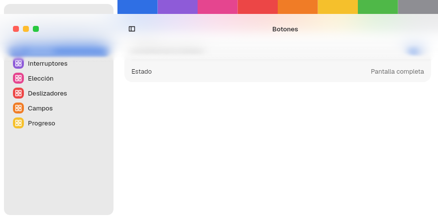 |
| `Push` («E · Empuja») | No tapa nada: la titlebar vuelve al diseño y empuja hacia abajo la columna de detalle lo que miden la barra y la titlebar. La barra lateral no se mueve | 0: el contenido baja solo | 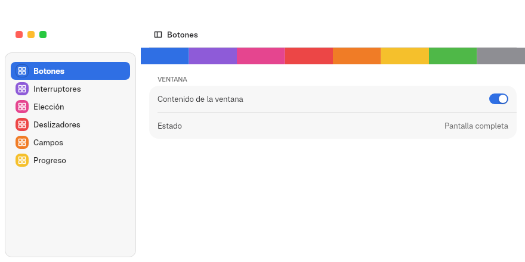 |

Con `Push` y la barra arriba, el contenido llega al borde superior:

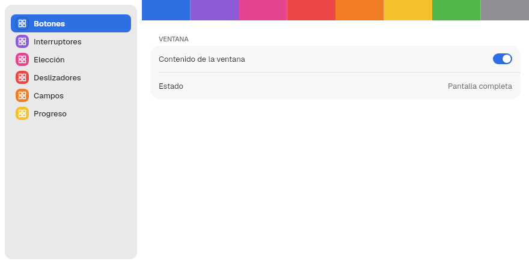

Solo `Glass` y `ProgressiveGlass` difuminan; con ellas, la píldora también es
cristal. Con las demás es opaca.

### Modo foco con la barra bajada, por diseño

**Con la barra lateral en isla y la ventana maximizada o en pantalla
completa, todos los diseños pasan a `Top`:** el rail, la columna de `Unified` y
la píldora desaparecen y los semáforos vuelven a la isla. Así se ve `Rail` con
isla en modo foco:


Con la barra lateral plana o sin barra lateral, cada diseño se conserva. Las
capturas de esta tabla usan la barra lateral plana (salvo `Top`) y la barra por
defecto (`Solid`). La franja negra de arriba (28 px) es la barra del
compositor, añadida a la imagen: la app no la dibuja.

| Diseño | Qué baja | Cómo se ve |
|---|---|---|
| `Top` (por defecto) | La `Titlebar` sobre el contenido; los semáforos de la barra lateral bajan lo mismo |  |
| `Unified` | Igual que `Top` | 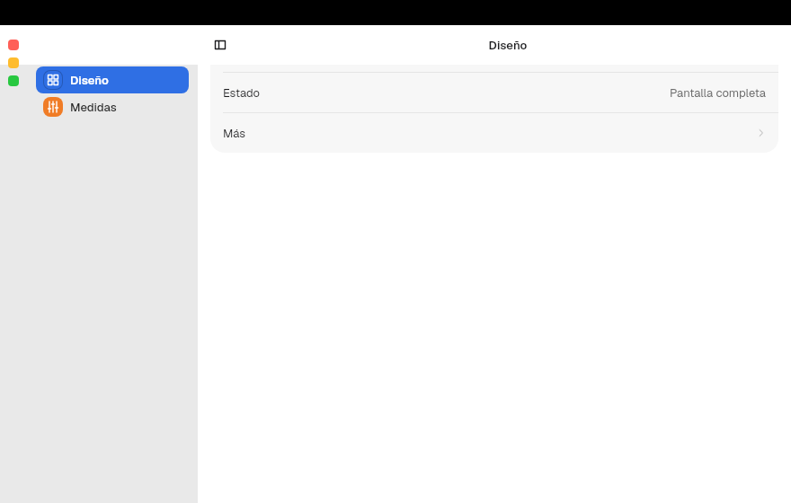 |
| `Rail` | Nada: el rail sigue en su sitio, sin tapar la barra lateral. Sus semáforos aparecen con la barra, debajo de ella | 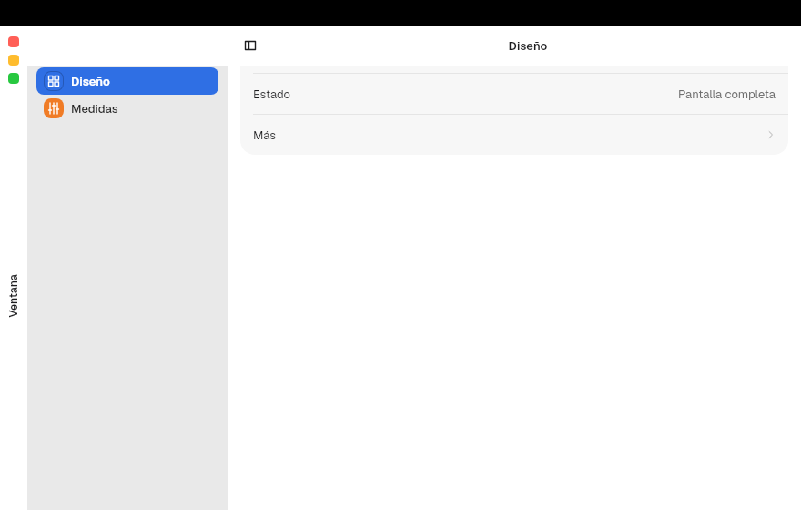 |
| `Rail` con acciones | Igual; las acciones siguen abajo | 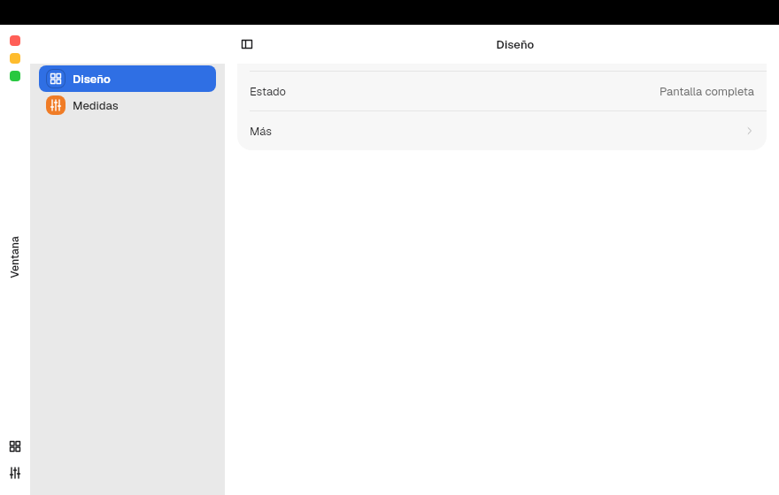 |
| `Pill` vertical | La píldora de semáforos; antes no se ve | 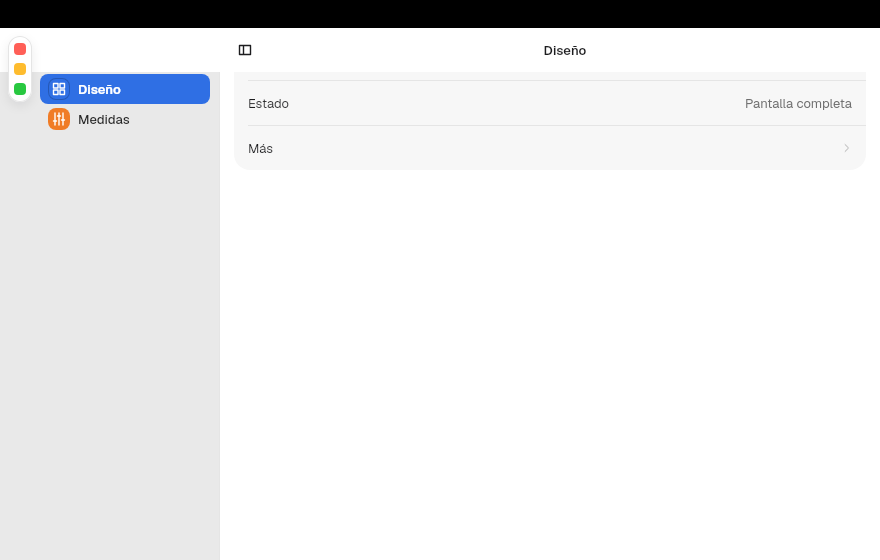 |
| `Pill` horizontal | Igual, en fila | 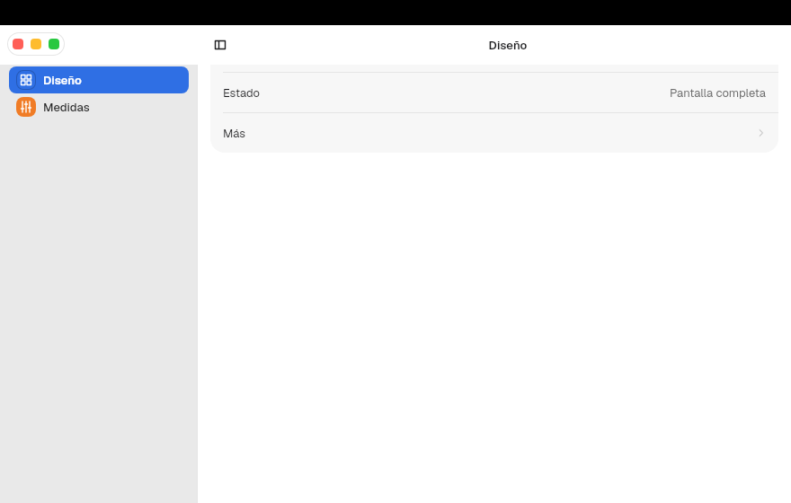 |

### Qué hace la app

1. Si usa `Titlebar`, `WindowChrome`, `Sidebar` o `PreferencesWindow`, no tiene
   que hacer nada: todos los estados de las tablas ya funcionan.
2. Deja hueco para la barra en el contenido que va bajo la titlebar
   superpuesta, como Ondina:

   ```rust
   let arriba = try_consume_root_context::<WindowControls>()
       .map_or(0.0, |controls| controls.fullscreen_content_top());
   rect().padding(Gaps::new(arriba, 0.0, 0.0, 0.0)).child(contenido)
   ```

3. Si una vista tapa la titlebar (un reproductor de vídeo a toda la ventana),
   pone sus propios semáforos para que se pueda maximizar o salir de pantalla
   completa sin ella, como el reproductor de Marea:

   ```rust
   window_traffic_lights(WindowControls::get().status.read().activated, false)
   ```

4. Para un comportamiento propio (un modo inmersivo que esconde paneles),
   lee el estado y decide:

   ```rust
   let controls = WindowControls::get();
   let inmersivo = controls.status.read().fullscreen;
   rect().maybe_child((!inmersivo).then(panel_de_herramientas))
   ```

5. Para ofrecerlo en un menú, llama a `toggle_maximize()` o
   `toggle_fullscreen()` desde una `Action` (capítulo [11](11-app.md)).

Siguiente: [8. Barra lateral y SplitView](08-barra-lateral.md).
