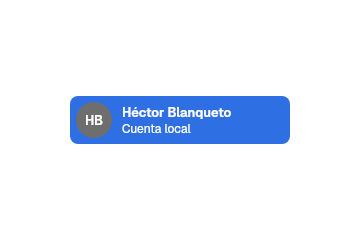
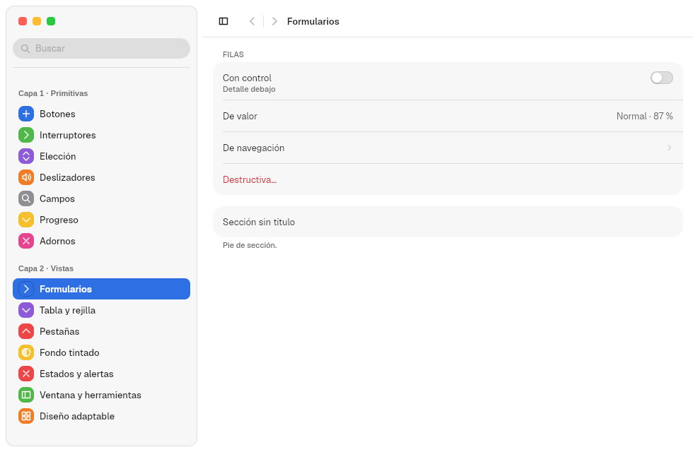
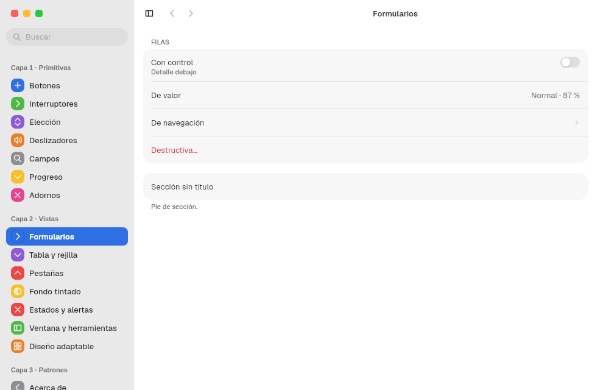
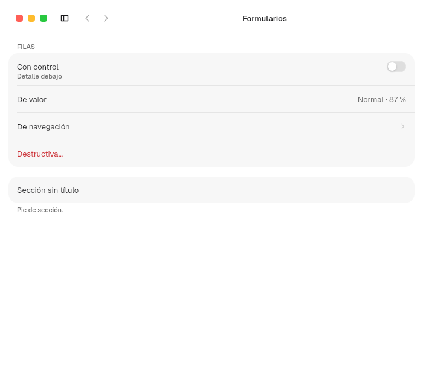
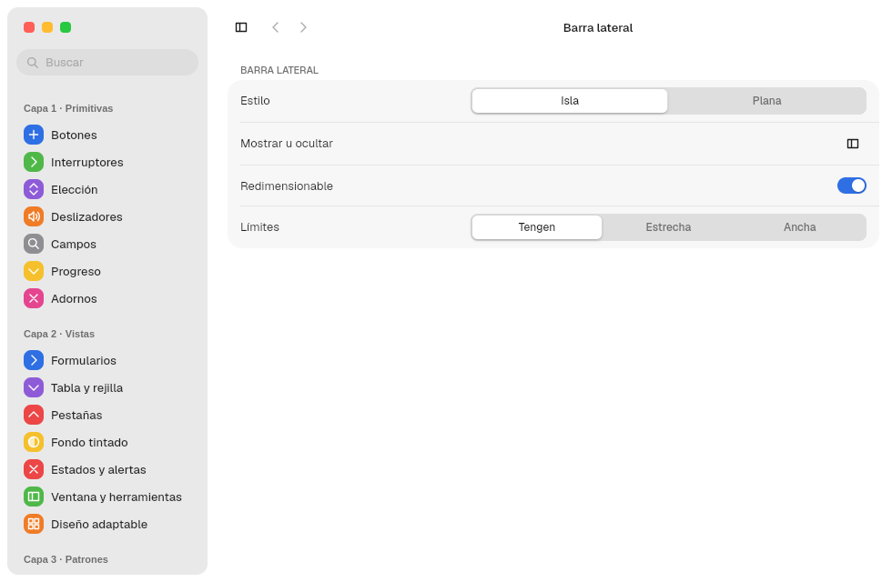

# 8. Sidebar and SplitView

**Goal:** set up a sidebar, choose its style and control how it resizes, hides
and collapses.
**Reader:** anyone who builds an app with side navigation.

## The two pieces

| Piece | Module | What it does |
|---|---|---|
| `Sidebar` | `sidebar` | The content: items, sections, account and traffic lights |
| `SplitView` | `views::split` | The container: sidebar + detail + optional inspector; width, hiding and collapsing |

## The sidebar: `Sidebar`

```rust
Sidebar::new()
    .traffic_lights(true)
    .child(SidebarAccount::new("HB", "Héctor Blanqueto", "Cuenta local"))
    .child(
        SidebarItem::new("Inicio")
            .symbol(Symbol::House, ACCENT_SWATCHES[0].1)
            .selected(true)
            .on_select(move |_| seccion.set(0)),
    )
    .child(
        SidebarSection::new("Biblioteca")
            .child(SidebarItem::new("Descargas").symbol(Symbol::ArrowDown, verde)),
    )
```

| Piece | Options |
|---|---|
| `SidebarItem::new(texto)` | `.symbol(Symbol, tinte)`, `.selected(bool)`, `.emphasized(bool)`, `.on_select(..)` |
| `SidebarSection::new(título)` | Open when mounted; a click on the title collapses or opens it with a `DURATION_BASE` animation |
| `SidebarAccount::new(iniciales, nombre, detalle)` | No options: it only shows the account |
| `Sidebar` | `.traffic_lights(true)` puts the traffic lights inside; `.backdrop(SidebarBackdrop::Tinted)` tints it over a tinted backdrop. With the `Rail`, its first row rises to the titlebar row (chapter [7](07-titlebars.en.md#the-sidebar-with-the-rail)) |



## Island or flat

The user decides in `appearance.domain` with `sidebar_style`
([ADR 0041](../decisiones/0041-barra-lateral-en-isla.en.md)). The app does
nothing:

| `island` (default) | `flat` |
|---|---|
|  |  |

Over a tinted backdrop (chapter [13](13-fondos-y-medios.en.md)), the flat
sidebar shows the backdrop, and the island either shows it or is tinted with
`SidebarBackdrop::Tinted` ([ADR 0057](../decisiones/0057-cristal-y-barra-lateral-sobre-fondo.en.md)).

The island sits `size.sidebar-inset` (8) from the edge and has radius
`size.sidebar-radius` (18 = 26 − 8), with the window's continuous corner:
it stays concentric with its `unified` corner (26).

## The container: `SplitView`

```rust
SplitView::new(barra, detalle)
    .inspector(inspector, inspector_shown)
    .sidebar_width(guardado.width)
    .sidebar_visible(guardado.visible)
    .on_layout(move |layout: SidebarLayout| disposicion.set(Some(layout)))
```

| Option | Default | Effect |
|---|---|---|
| `.sidebar_width(f32)` | `SIDEBAR.width` | Initial width |
| `.sidebar_visible(bool)` | `true` | Visible on open |
| `.resizable(bool)` | `true` | With `false` there is no grip: fixed width |
| `.sidebar_range(mín, máx)` | `SPLIT_VIEW.sidebar_min`, `.sidebar_max` (180–320) | Width limits. If they change, the width is clamped to the new range |
| `.narrow_sidebar(NarrowSidebar)` | `Overlay` | How it opens in a narrow window: see [Collapsing in narrow windows](#collapsing-in-narrow-windows) |
| `.inspector(content, presented)` | no inspector | Right pane of `SPLIT_VIEW.inspector` (270, the standard width of [`NSSplitViewItem(inspectorWithViewController:)`](https://developer.apple.com/documentation/appkit/nssplitviewitem/init(inspectorwithviewcontroller:))) with a separator; changing `presented` opens or closes it over `DURATION_BASE`, like `.inspector(isPresented:)` |
| `.on_layout(..)` | — | Reports `SidebarLayout { width, visible }` when the grip is released or the sidebar is hidden. Use it to save the layout |

### Resizing

The grip is a `SPLIT_VIEW.grip` (8 px) strip on the right edge of the sidebar:

1. On hover, the cursor changes to `col-resize` and an accent line of
   `grip_line` (2 px) appears, with `grip_line_inset` (18 px) free at the top
   and bottom.
2. While dragging, the width follows the pointer with a `DURATION_FAST_MS`
   (120 ms) spring and stays between the minimum and the maximum. With reduced
   motion, the change is immediate.
3. Tab focuses the grip; ← and → change the width in steps of
   `SPLIT_VIEW.key_step` (10 px).
4. On release, `on_layout` receives the final width.

### Hiding

- The `SidebarToggle` button (`SidebarLeft` symbol) and the `TOGGLE_SIDEBAR`
  action (Ctrl+Alt+S) show or hide it with a `DURATION_BASE` animation.
- From any child: `sidebar_control().map(|c| c.toggle())`.

### Collapsing in narrow windows

Below a window width of `SPLIT_VIEW.collapse_below` (760 px):

1. The sidebar hides on its own.
2. If the user opens it, `NarrowSidebar` decides where it appears:
   - `Overlay`: it floats on top of the content over the `scrim` veil, without
     moving it. It closes on a click on the veil, on Escape or when a
     `SidebarItem` is chosen.
   - `Push`: it docks and narrows the detail. At a 480 px window, the detail
     is left with 244 px.
3. When the window widens past 760 px, the sidebar comes back docked and
   visible, even if the user had closed it. This is the rule of
   [`AdwOverlaySplitView`](https://gnome.pages.gitlab.gnome.org/libadwaita/doc/1.4/class.OverlaySplitView.html)
   without `pin-sidebar`.

From a child, `sidebar_control().map(|c| c.dismiss())` closes the sidebar only
when it is overlaid.

| Wide | Narrow (700 px) |
|---|---|
|  |  |

### Trying it

In Tengen App Show, the «Ventana › Barra lateral» ("Window › Sidebar") pane
picks island or flat, turns resizing on or off and switches between three
ranges (Tengen 180–320, Estrecha "narrow" 160–220, Ancha "wide" 240–420), and
picks «En ventana estrecha» ("In a narrow window"): Superpuesta ("overlay") or
Forzada ("push"):



`PreferencesWindow` passes the same through `.sidebar_resizable(bool)`,
`.sidebar_range(Option<(mín, máx)>)` and `.narrow_sidebar(NarrowSidebar)`;
`.sidebar_toggle(false)` removes the `SidebarToggle` button.

Next: [9. Views](09-vistas.en.md).
