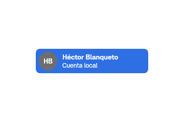
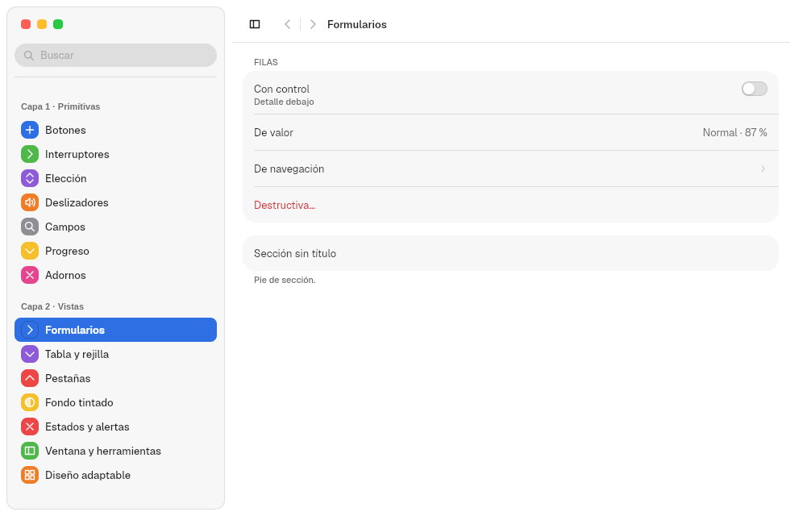
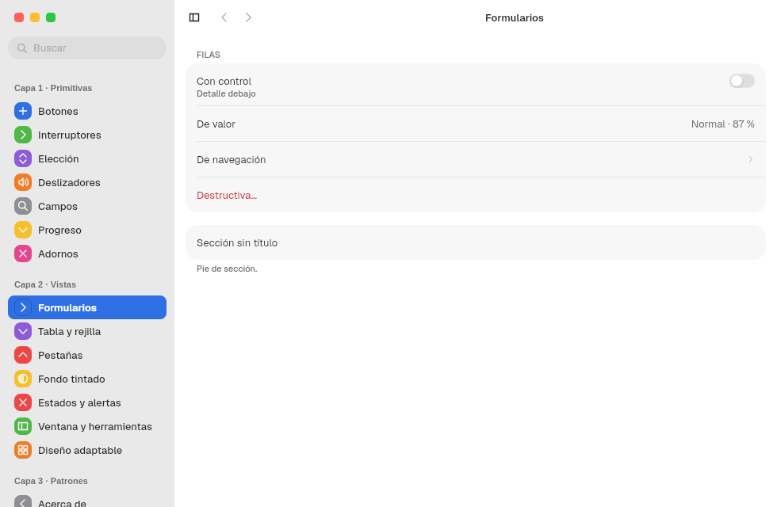
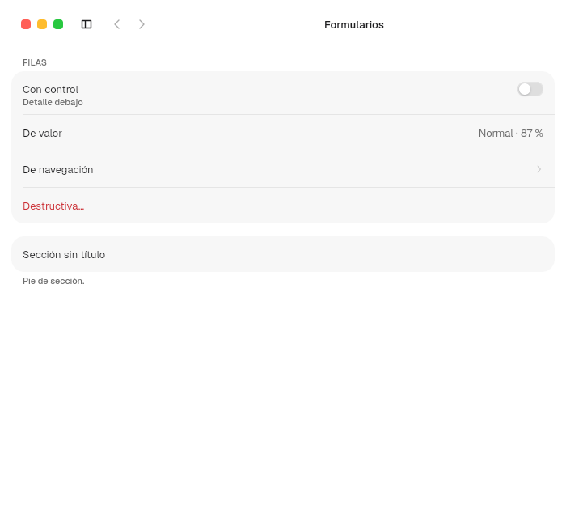
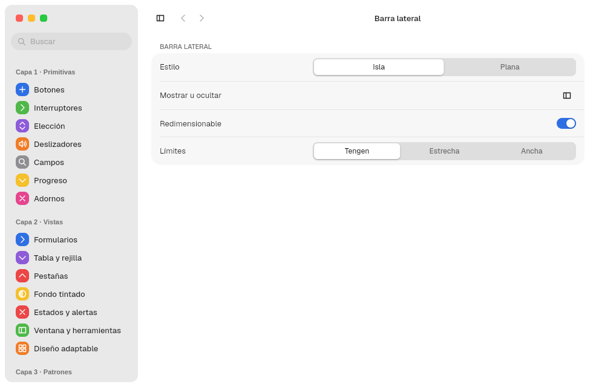

# 8. Barra lateral y SplitView

**Objetivo:** montar una barra lateral, decidir su estilo y controlar cómo se
redimensiona, se oculta y se pliega.
**Lector:** quien construye una app con navegación lateral.

## Las dos piezas

| Pieza | Módulo | Qué hace |
|---|---|---|
| `Sidebar` | `sidebar` | El contenido: ítems, secciones, cuenta y semáforos |
| `SplitView` | `views::split` | El contenedor: barra lateral + detalle + inspector opcional; ancho, ocultar y plegar |

## La barra lateral: `Sidebar`

```rust
Sidebar::new()
    .traffic_lights(true)
    .child(SidebarAccount::new("HB", "Héctor Blanqueto", "Cuenta local"))
    .child(
        SidebarItem::new("Inicio")
            .symbol(Symbol::House, ACCENT_SWATCHES[0].1)
            .selected(true)
            .on_select(move |_| seccion.set(0)),
    )
    .child(
        SidebarSection::new("Biblioteca")
            .child(SidebarItem::new("Descargas").symbol(Symbol::ArrowDown, verde)),
    )
```

| Pieza | Opciones |
|---|---|
| `SidebarItem::new(texto)` | `.symbol(Symbol, tinte)`, `.selected(bool)`, `.emphasized(bool)`, `.on_select(..)` |
| `SidebarSection::new(título)` | Abierta al montarse; un clic en el título la pliega o la abre con una animación de `DURATION_BASE` |
| `SidebarAccount::new(iniciales, nombre, detalle)` | Sin opciones: solo muestra la cuenta |
| `Sidebar` | `.traffic_lights(true)` pone los semáforos dentro; `.backdrop(SidebarBackdrop::Tinted)` la tiñe sobre un fondo tintado. Con el `Rail`, su primera fila sube a la fila de la titlebar (capítulo [7](07-titlebars.md#la-barra-lateral-con-el-rail)) |



## Isla o plana

Lo decide el usuario en `appearance.domain` con `sidebar_style`
([ADR 0041](../decisiones/0041-barra-lateral-en-isla.md)). La app no hace nada:

| `island` (por defecto) | `flat` |
|---|---|
|  |  |

Sobre un fondo tintado (capítulo [13](13-fondos-y-medios.md)), la barra plana
deja ver el fondo y la isla lo deja ver o se tiñe con
`SidebarBackdrop::Tinted` ([ADR 0057](../decisiones/0057-cristal-y-barra-lateral-sobre-fondo.md)).

## El contenedor: `SplitView`

```rust
SplitView::new(barra, detalle)
    .inspector(Some(inspector.into_element()))
    .sidebar_width(guardado.width)
    .sidebar_visible(guardado.visible)
    .on_layout(move |layout: SidebarLayout| disposicion.set(Some(layout)))
```

| Opción | Por defecto | Efecto |
|---|---|---|
| `.sidebar_width(f32)` | `SIDEBAR.width` | Ancho inicial |
| `.sidebar_visible(bool)` | `true` | Visible al abrir |
| `.resizable(bool)` | `true` | Con `false` no hay asa: ancho fijo |
| `.sidebar_range(mín, máx)` | `SPLIT_VIEW.sidebar_min`, `.sidebar_max` (180–320) | Límites del ancho. Si cambian, el ancho se recorta al nuevo rango |
| `.narrow_sidebar(NarrowSidebar)` | `Overlay` | Cómo se abre en ventana estrecha: ver [Plegar en ventanas estrechas](#plegar-en-ventanas-estrechas) |
| `.inspector(Option<Element>)` | `None` | Panel derecho de `SPLIT_VIEW.inspector` (240) con un separador |
| `.on_layout(..)` | — | Avisa de `SidebarLayout { width, visible }` al soltar el asa o al ocultar. Sirve para guardarlo |

### Redimensionar

El asa es una franja de `SPLIT_VIEW.grip` (8 px) en el borde derecho de la barra:

1. Al pasar el puntero, el cursor cambia a `col-resize` y aparece una línea de
   acento de `grip_line` (2 px) con `grip_line_inset` (18 px) libres arriba y
   abajo.
2. Al arrastrar, el ancho sigue al puntero con un resorte de
   `DURATION_FAST_MS` (120 ms) y se queda entre el mínimo y el máximo. Con
   movimiento reducido, el cambio es inmediato.
3. Con Tab se enfoca el asa; ← y → cambian el ancho en pasos de
   `SPLIT_VIEW.key_step` (10 px).
4. Al soltar, `on_layout` recibe el ancho final.

### Ocultar

- El botón `SidebarToggle` (símbolo `SidebarLeft`) y la acción `TOGGLE_SIDEBAR`
  (Ctrl+Alt+S) la muestran u ocultan con una animación de `DURATION_BASE`.
- Desde cualquier hijo: `sidebar_control().map(|c| c.toggle())`.

### Plegar en ventanas estrechas

Por debajo de `SPLIT_VIEW.collapse_below` (760 px) de ancho de ventana:

1. La barra se oculta sola.
2. Si el usuario la abre, `NarrowSidebar` decide dónde aparece:
   - `Overlay`: flota encima del contenido sobre el velo `scrim`, sin moverlo.
     Se cierra con un clic en el velo, con Escape o al elegir un
     `SidebarItem`.
   - `Push`: se acopla y estrecha el detalle. A 480 px de ventana, el detalle
     se queda en 244 px.
3. Al ensanchar por encima de 760 px, la barra vuelve acoplada y visible,
   aunque el usuario la hubiera cerrado. Es la regla de
   [`AdwOverlaySplitView`](https://gnome.pages.gitlab.gnome.org/libadwaita/doc/1.4/class.OverlaySplitView.html)
   sin `pin-sidebar`.

Desde un hijo, `sidebar_control().map(|c| c.dismiss())` cierra la barra solo
si está superpuesta.

| Ancha | Estrecha (700 px) |
|---|---|
|  |  |

### Probarlo

En Tengen App Show, el panel «Ventana › Barra lateral» elige isla o plana,
activa o quita el redimensionado y cambia entre tres rangos (Tengen 180–320,
Estrecha 160–220, Ancha 240–420) y elige «En ventana estrecha»: Superpuesta
o Forzada:



`PreferencesWindow` pasa lo mismo con `.sidebar_resizable(bool)`,
`.sidebar_range(Option<(mín, máx)>)` y `.narrow_sidebar(NarrowSidebar)`;
`.sidebar_toggle(false)` quita el botón `SidebarToggle`.

Siguiente: [9. Vistas](09-vistas.md).
