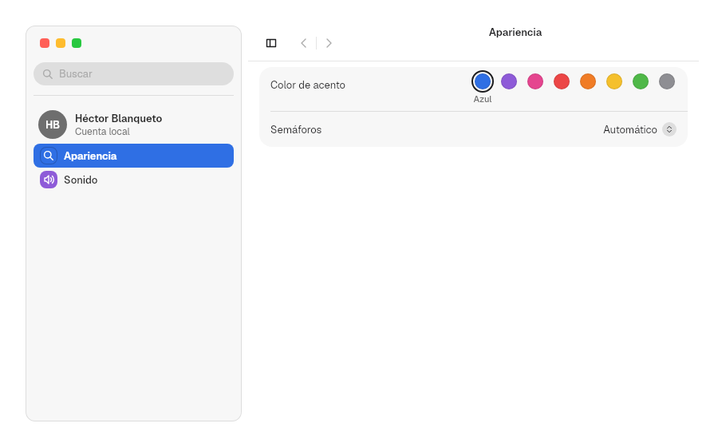
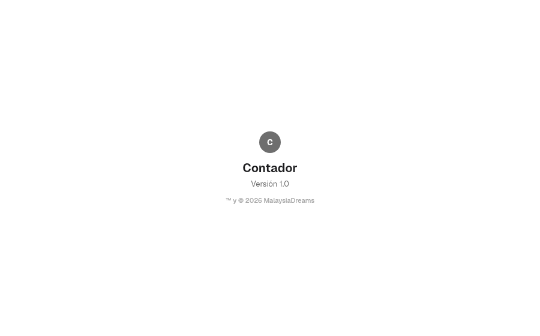

# 9. Patterns

**Goal:** build a complete window with a single piece.
**Reader:** anyone who makes a settings app or needs an "About" window.

## Preferences window: `PreferencesWindow`

It joins `SplitView`, `Sidebar`, search field, history and `Form`. The app only
declares the panes:

```rust
PreferencesWindow::new()
    .restoration(app_id)
    .suggestions(&["general"])
    .account("HB", "Héctor Blanqueto", "Cuenta local")
    .group(
        PaneGroup::new(Some("General")).pane(Pane::new(
            "general",
            "General",
            Symbol::CircleHalf,
            ACCENT_SWATCHES[0].1,
            Form::new().section(
                Section::titled("Etiqueta").row(
                    Row::new("Color")
                        .keywords(&["color", "etiqueta"])
                        .control(ColorWell::new("Color", &ACCENT_SWATCHES)),
                ),
            ),
        )),
    )
```



| Option | Effect |
|---|---|
| `Pane::new(id, título, símbolo, tinte, form)` | A pane: a sidebar item and its form |
| `PaneGroup::new(Some(título))` | Group with a title in the sidebar; `None` without a title |
| `.account(..)` | Account row at the top of the sidebar |
| `.restoration(app_id)` | Saves and restores the open pane, the recent searches and the width and visibility of the sidebar |
| `.suggestions(&[ids])` | Suggested panes when the search field is empty |
| `.sidebar_resizable(bool)`, `.sidebar_range(Option<(mín, máx)>)` | Passed on to `SplitView` (chapter [7](07-barra-lateral.en.md)) |

### The search field

- It searches the pane titles and the titles and `keywords` of each row.
- It shows each result with the icon of its pane. ↑, ↓ and Enter walk through
  them.
- Choosing a result opens the pane and highlights the row.
- The pane title appears in the bar, with the back and forward buttons.

Tengen App Show and System Settings are built with this pattern.

## "About": `about_window`

```rust
about_window(avatar("C"), "Contador", "Versión 1.0", "™ y © 2026 MalaysiaDreams")
```



Next: [10. App infrastructure](10-app.en.md).
