# 9. Titlebars

**Goal:** add a title bar to a window, choose its layout and know how it
looks in each window state.
**Scope:** `Titlebar`, `TrafficLights`, `WindowChrome` and its `WindowChromeStyle`,
and the full-screen bars (`FullscreenBar`). The window options and state they
read are in [8. Windows](08-windows.md). The sidebar that holds the traffic
lights is in [10. Sidebar](10-sidebar.md).
**Reader:** anyone who designs the window of an app that runs with
`run_window`.
**Input:** a window opened with `run_window` ([8](08-windows.md#running-a-window)).
**Output:** a window with its title bar, traffic lights and full-screen
behavior.

## Steps

1. Put a `Titlebar` at the top of the root view. With `Application`, `Scene`
   already does it ([2](02-first-app.md#what-application-does-for-you)).

   ```rust
   rect()
       .expanded()
       .background(color(Palette::current().window_background))
       .child(Titlebar::new().title(tr!("notes")))
       .child(content)
   ```

2. Add items to its left and right zones:

   ```rust
   Titlebar::new()
       .title(tr!("notes"))
       .left(SidebarToggle)
       .right(IconButton::new(Symbol::Plus, tr!("new-note")))
   ```

3. With a sidebar, pass `.with_sidebar(true)` so the bar aligns with it
   ([10](10-sidebar.md)).
4. For a vertical title bar or one that hides, wrap the window in
   `WindowChrome` and set its layout in a `WindowChromeStyle`
   ([Window chrome](#window-chrome)).
5. Choose the full-screen bar in `WindowOptions`
   ([The bar in full screen](#the-bar-in-full-screen-fullscreenbar)).
6. Leave room under the overlaid title bar in full screen
   ([What the app does](#what-the-app-does)).

## Titlebar

`Titlebar` (`bk::titlebar`, in the prelude) is the client-side title
bar: traffic lights, a left zone, the title and a right zone.

| Method | Default | Effect |
|---|---|---|
| `Titlebar::new()` | — | A bar that reads the title and state from `WindowControls` |
| `.title(text)` | the window title | Replaces the title shown |
| `.left(view)`, `.right(view)` | empty; with a `SplitView` above, `left` is the `SidebarToggle` | Items at each side |
| `.toolbar(content)` | none | Adds a `ToolbarItem` or a `ToolbarSpacer`; call it once per item ([Toolbar items](#toolbar-items)) |
| `.spacing(px)` | 0; `SETTINGS.toolbar_gap` (12) beside a sidebar | Gap between the bar's items. Beside a sidebar it is the gap before the title, so the title sits 20 from the sidebar's edge |
| `.with_sidebar(bool)` | `false` | Aligns the bar with a sidebar ([Variants](#variants-in-a-normal-window)) |
| `.toolbar_style(WindowToolbarStyle)` | `Unified` with a sidebar or items, else `UnifiedCompact` | The unified bar (52 high, the title at the start), the compact one (centered title) or the expanded one (a title row over the toolbar row), as SwiftUI's `windowToolbarStyle`; in a `HiddenTitleBar` window it also moves the native lights ([8](08-windows.md#window-style)) |
| `.close_only(bool)` | `false` | Only the close button works, for dialogs and panels |
| `.hairline(bool)` | `false` | The line under the bar of the sidebar layout. macOS draws none under a unified toolbar at rest over a scroll view; on macOS 26 and later, over content that does not scroll, AppKit's own title bar draws its separator ([15](15-backdrops-and-media.md#on-macos)); `true` draws `TitlebarStyle::line()`, as `NSTitlebarSeparatorStyle.line` does |
| `Titlebar::preview(status, title, fixed)` | — | Draws the bar for a given `WindowStatus` without a window, for previews and tests |

Behavior:

- Without a sidebar and without items, or with `.toolbar_style(UnifiedCompact)`,
  the left and right zones take the same width, so the title stays centered.
  The title uses `TITLEBAR.font`.
- With items the bar is the unified one, as in SwiftUI: 52 high, the traffic
  lights at (19, 19) and the title `SETTINGS.toolbar_lights_gap` (22) after them, in
  `TITLE_2`. The first item (the sidebar toggle, a `.left` view or a
  `Navigation` item) starts `TITLEBAR_TOOLBAR_START.unified`
  (16) after the lights, and the title follows it `SETTINGS.toolbar_gap` (13)
  later. In the compact bar that item starts `TITLEBAR_TOOLBAR_START.compact`
  (22) after the lights; they land at x 95 and 94, where SwiftUI puts them.
- With `.toolbar_style(Expanded)` the bar is two rows, as SwiftUI's
  `.expanded` on macOS 27.2: a `TITLEBAR_EXPANDED_TITLE_HEIGHT` (28) row with
  the traffic lights at (9, 9) and the title `TITLEBAR_EXPANDED_TITLE_GAP` (15) after them,
  in `TITLEBAR.font` and the dimmer `TitlebarStyle::row_title` ink of a title
  row (hidden in full screen, as SwiftUI does until the top edge), and a
  `TITLEBAR_CLIENT_HEIGHT` (40) toolbar row whose `Navigation` and
  `PrimaryAction` items sit together from `TITLEBAR_TOOLBAR_START.expanded` (11),
  `SETTINGS.toolbar_gap` (13) apart, `TITLEBAR_EXPANDED_TOOLBAR_BOTTOM` (5) above
  the row's middle, as SwiftUI puts them. Its items are 28 high
  (`TOOLGROUP.expanded_*`). It reports `Bar::Titlebar`; a `HiddenTitleBar`
  window then gives its empty `NSToolbar` the `.expanded` style, which puts the
  native lights at (9, 9).
- With `.with_sidebar(true)` the title goes at the start, next to `left`, in
  `TITLE_2`, as on macOS. While the sidebar shows, the traffic lights live in
  the sidebar; they keep their place while it folds.
- A press on the bar moves the window; a double click does what
  `double_click_titlebar` says ([Traffic lights](#traffic-lights)).
- `.close_only(true)`: a transparent bar `TITLEBAR.thickness` (32 px) tall,
  with only close enabled. Utility and HUD windows switch to it by themselves
  ([8](08-windows.md#utility-windows)).
- With server-side decoration (`DecorationResponse::Server`) the bar takes no
  space: the compositor draws one. On macOS, `WindowStyle::Plain` asks for the
  bar ([8](08-windows.md#window-style)).

### Toolbar items

`.toolbar(content)` is SwiftUI's `.toolbar { }`: it takes a
`ToolbarItem::new(placement, view)` or a `ToolbarSpacer` (`bk::views::toolbar`,
in the prelude) and lays it into the zones above. Call it again for more items;
they keep the order of the calls.

```rust
Titlebar::new()
    .toolbar(ToolbarItem::new(ToolbarItemPlacement::Navigation, back_and_forward))
    .toolbar(ToolbarItem::new(ToolbarItemPlacement::Principal, Text::new(page)))
    .toolbar(ToolbarSpacer::flexible())
    .toolbar(ToolbarItem::new(ToolbarItemPlacement::PrimaryAction, new_button))
```

The recipe is [`toolbar_items.rs`](../../agents/recipes/toolbar_items.rs).

| `ToolbarItemPlacement` | Where it goes |
|---|---|
| `Navigation` | The left zone, after the sidebar toggle |
| `Principal`, `Status` | The title's place: the item replaces the title text and is centered |
| `PrimaryAction` | The right zone |
| `Automatic` | The right zone; with a flexible spacer later in the list, the left zone |

- `ToolbarSpacer::flexible()` ends the left side: the `Automatic` items before
  it go next to the `Navigation` items and the ones after it go to the right
  zone. `ToolbarSpacer::fixed()` adds one gap (`TitlebarStyle::sidebar_padding_x`)
  to the zone where it falls.
- Items in a zone are `sidebar_padding_x` apart. A `.left` or `.right` view
  comes first in its zone; a `.left` view still replaces the sidebar toggle.
- A bar with toolbar items is the unified one.
- There is no overflow: the bar does not measure its items, so items that do
  not fit are clipped, not moved to a menu.
- macOS 27.2 (probe `toolbarplace`, 2026-11-22): `.navigation` items follow the
  sidebar toggle before the inline title, `.principal` and `.status` items sit
  in the center, and `.primaryAction` and `.automatic` items trail in the order
  declared. Apple's page for `primaryAction` says "leading edge" for macOS; the
  probe disagrees and the kit follows the probe. The same probe showed no effect
  of `ToolbarSpacer` in a plain `.toolbar { }`, so the spacer follows Apple's
  description of it (a gap, or a push), as [ADR 0108](../decisions.md) says.

### Style

`Titlebar::style` takes a `TitlebarStyle`: heights, paddings, background,
title color, font and position, and the hairline. The fields are in
[Styles and themes](../../crates/bk/src/styles/titlebar.rs).

```rust
Titlebar::new().style(|s: TitlebarStyle| TitlebarStyle {
    title_font: HEADLINE,
    ..s
})
```

### Variants in a normal window

The same `Titlebar` changes with the sidebar and the focus. The app chooses
neither variant.

| Variant | How it looks |
|---|---|
| Sidebar: the unified `SETTINGS.toolbar_height` (52 px) bar runs over the content, the traffic lights go in the sidebar at (19, 19), and a translucent line sits under the bar | 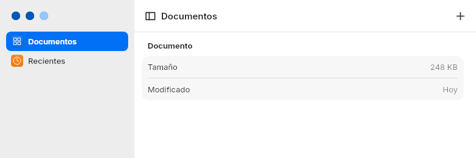 |
| Sidebar, inactive window: traffic lights and title in gray | 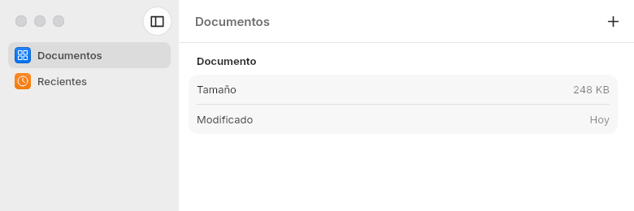 |
| No sidebar: traffic lights in the bar, title centered between two equal zones | 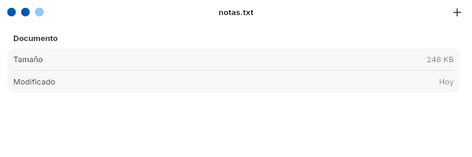 |
| No sidebar, inactive window: `titlebar_inactive` background and gray traffic lights | 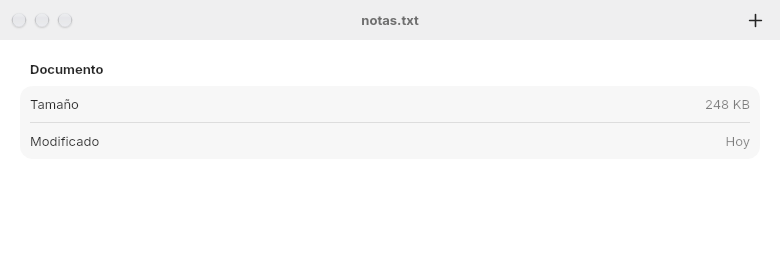 |

### Corner radius

The `Titlebar` tells the compositor which bar it draws with
`infinity_window_style_v1.set_bar`, and Malaysia rounds the window with that
bar's radius
([Malaysia ADR 0059](https://github.com/HBlanqueto/malaysia/blob/main/docs/decisions.md)).
The app does nothing:

| `Titlebar` | `Bar` | Height | Radius (`WINDOW_CORNER`) |
|---|---|---|---|
| Panel (`UtilityWindow`) | `Utility` | `TITLEBAR.thickness` (32) | `utility` (16) |
| `.close_only(true)` or HUD window | `Titlebar` | `TITLEBAR.thickness` (32) | `titlebar` (16) |
| `.with_sidebar(true)` | `Unified` | `SETTINGS.toolbar_height` (52) | `unified` (16) |
| The rest | `UnifiedCompact` | `TITLEBAR_CLIENT_HEIGHT` (40) | `unified_compact` (16) |

`Bar` (`bk::platform`) comes from the Infinity protocol and has four
values, each an AppKit window kind: `Titlebar` (no toolbar), `UnifiedCompact`
(`NSWindow.ToolbarStyle.unifiedCompact`), `Unified` (`.unified`) and
`Utility` (a panel, radius 16). Every radius is 16, as macOS 27.2.1 gives every window kind; the silhouette to draw is `CORNER_WINDOW.fitted` (16.8, [Corners](04-appearance-and-tokens.md#corners)).

An app that draws its own
bar without `Titlebar` declares it with
`WindowControls::get().set_bar(Bar::Titlebar)`; otherwise Malaysia uses
`unified` for a client-decorated window. The user can force one radius for
every window with `corner_radius` in `window.domain`.

## Traffic lights

Close, minimize and zoom, drawn as macOS 27 draws them: 14 pt discs with a
vertical gradient, a 0.5 pt ring, a halo in the light appearances and a glyph
while the pointer is over the group. The measurement is in
[macOS control metrics](../research/macos-control-metrics.md#traffic-lights-macos-27).
`Titlebar`, the `Rail` and
`Sidebar::traffic_lights(true)` place them with
`TrafficLights::for_window(focused, fixed)`, which wires them to
`WindowControls` and the user's settings. In a fixed-width window
(`WindowControls::fixed_width`) the green light is a plus and zooms to the full
height. Use it when a view covers the title bar and needs its own lights.

In a bar the lights sit `TITLEBAR.buttons.inset_compact` (12) from the left when
it is `TITLEBAR_CLIENT_HEIGHT` (40) tall and `TITLEBAR.buttons.inset` (9) when it
is `TITLEBAR.thickness` (32) tall, centred vertically, so 13 and 9 from the top.
`ctappearance::traffic::inset(bar_height)` is the one rule; the `Titlebar` and
the compositor both use it.

The kit stops at the compact style. macOS also has a 66 px toolbar title bar
whose lights sit 19 from the left and 19 from the top, not centred. No window of
the kit uses it, so it has no style, `Bar` value or token here; the
measurement stays in [macOS windows](../research/macos-windows.md).

For a standalone set, `TrafficLights` (`bk::traffic`):

```rust
use bk::traffic::TrafficLights;
use ctdesign::ButtonKind;

TrafficLights::new()
    .focused(true)
    .on_action(|kind: ButtonKind| { /* Close, Minimize or Maximize */ })
```

| Method | Default | Effect |
|---|---|---|
| `.focused(bool)` | `true` | Unfocused lights are gray until the pointer hovers them |
| `.zoom_supported(bool)` | `true` | Without zoom, the green light is gray, has no glyph and does nothing |
| `.fixed_width(bool)` | `false` | The zoom glyph is a plus, for fixed-width windows |
| `.close_only(bool)` | `false` | Only close is colored and clickable |
| `.vertical(bool)` | `false` | A column instead of a row |
| `.input(TrafficInput)` | — | Draws a fixed state (focus, hover, press) and ignores the pointer, for previews |
| `.on_action(f)` | — | Receives the `ButtonKind` pressed |

Each light has the accessible role button and the name "Close", "Minimize" or
"Zoom". Hovering the group shows the glyphs.

`.style(..)` takes a `TrafficLightsStyle`: size, gap, ring width, halo, and the
`ButtonVisual` of each light in each state; `.vertical` overrides its `axis`
([Styles and themes](../../crates/bk/src/styles/traffic_lights.rs)). The lights that
`TrafficLights::for_window` place take the theme and the containers:

```rust
Theme::tengen().style(|s: TrafficLightsStyle| TrafficLightsStyle {
    spacing: 12.0,
    ..s
})
```

### States

| State | Look |
|---|---|
| Focused window | The lit disc, no glyph |
| Pointer over any light | The three discs with their glyphs: × − and the full-screen arrows (a plus in a fixed-width window) |
| Pressed | The pressed light grows to 16 pt and brightens; the others keep the hover look |
| Full screen | Minimize is disabled (the unfocused gray, no glyph); zoom shows its exit glyph, two triangles that meet at the center. Entering or leaving full screen cross-fades the two zoom glyphs in `TRAFFIC_GLYPH_FADE_MS` (150 ms, `Animation::Ease`; none with Reduce Motion) |
| Unfocused window | Translucent gray discs; the pointer lights them with their glyphs |
| Disabled (zoom without zoom, or `close_only`) | The unfocused gray, no glyph, no press |

With `differentiate_without_color` the glyphs show without the pointer.

### Color

The user decides the rest. The appearance key `traffic_lights` (`standard`,
`accent`, `wallpaper`) is in
[4](04-appearance-and-tokens.md#the-appearance-file). `standard` is the measured
look of each light in each appearance, light, dark and Increase Contrast, and it
is exact. `accent` and `wallpaper` give the lights a tone: close and minimize
the accent (or the wallpaper's dominant color) darkened by
`TRAFFIC_CLOSE_MINIMIZE_DARKEN`, zoom lightened by `TRAFFIC_ZOOM_LIGHTEN`.
`ctappearance::traffic::looks` then recolors the measured look of each light
with that tone: it keeps the alpha, the lightness and the saturation of every
stop relative to the light's base, takes the tone's hue, and keeps the glyph at
3:1 against its fill (WCAG 2.2, 1.4.11). The gray unfocused look does not change.
The old key `traffic_light_shape` is ignored and removed on the next write: the
lights are discs in macOS 27. The behavior keys live in
`~/.config/malaysia/window.domain`
([4](04-appearance-and-tokens.md#window-behavior)); the compositor's own
title bars use the same functions. What each value does here:

| `green_button` | Normal window | Fixed size |
|---|---|---|
| `focus` (default; `fullscreen` is an alias) | Full screen | Maximizes |
| `zoom` | Maximizes | Maximizes |
| `none` | Nothing; the light is gray and has no glyph | Nothing |

| `double_click_titlebar` | Normal window | Fixed size |
|---|---|---|
| `zoom` (default), `fill` | Maximizes | Nothing |
| `minimize` | Minimizes | Minimizes |
| `none` | Nothing | Nothing |

A double click is two presses within `TITLEBAR_DOUBLE_CLICK.interval_ms`
(400 ms) and `slop` (4 px). `use_window_drag(fixed)` is the press handler
that moves the window or runs the double-click action; put it on your own
draggable areas.

## Window chrome

`WindowChrome` (`bk::chrome`) wraps the window and places the traffic
lights, the title and the rail items according to its `WindowChromeStyle`.
`Titlebar` and `Sidebar` inside it read the layout.

```rust
use bk::chrome::{TitlebarLayout, WindowChrome};

WindowChrome::new(window_content)
    .style(|s| WindowChromeStyle {
        layout: TitlebarLayout::Rail,
        ..s
    })
    .rail_top(top_items)
    .rail_bottom(bottom_items)
```

### `WindowChromeStyle` layout fields

These fields choose the layout. The style also holds the rail's paints,
padding, title and the pill
([Styles and themes](../../crates/bk/src/styles/window_chrome.rs)); a `Theme` sets them
for every window.

| Field | Default | Values |
|---|---|---|
| `layout` | `Top` | `TitlebarLayout::Top`: the horizontal `Titlebar`. `Rail`: a vertical bar on the left, with the traffic lights in a column, the title rotated 90° and the rail items |
| `rail_width` | `TITLEBAR_RAIL.width` (30) | Rail width without items |
| `rail_style` | `Normal` | `RailStyle::Normal`: its own strip. `Unified`: no strip; the column goes inside the sidebar, and without a visible sidebar it draws as `Normal` |
| `reveal` | `Always` | When the bar shows ([Reveal](#reveal)) |
| `resting_edge` | `None` | What stays while a hidden bar is away: `RestingEdge::None`, `Line` (`TITLEBAR_RAIL.edge_line`, 1 px) or `Accent` (`edge_accent`, 4 px, accent color) |

### Reveal

| `Reveal` | What happens |
|---|---|
| `Always` | The bar is always there |
| `Drawer` | Hidden. The pointer within `TITLEBAR_RAIL.reveal_zone` (8 px) of the edge slides it in over the content, with a shadow |
| `Push` | Hidden. It grows in from the edge and pushes the content |
| `Corner` | The bar stays; only the traffic lights fade in while the pointer is in the top-left `reveal_corner` (96 px) |
| `Popup` | The traffic lights leave the bar. The pointer at the edge slides in a pill with them, which stays while the pointer is in the corner |

The reveal animates over `DURATION_BASE`. Some combinations correct
themselves: a unified `Rail` turns `Drawer`, `Push` and `Popup` into
`Corner`. In Malaysia's focus mode the chrome behaves as `Always`.

### Rail items

As the `Top` titlebar holds items at its left and right, the `Rail` holds them
vertically:

| Method | Where it goes |
|---|---|
| `WindowChrome::rail_top(items)` | Below the traffic lights |
| `WindowChrome::rail_bottom(items)` | At the foot of the rail |

With any item, the rail widens to at least `TITLEBAR_RAIL.actions_width` (34).
In `Unified` the items go in the sidebar column, in the same places.

| `Normal` with items | `Unified` with items |
|---|---|
| 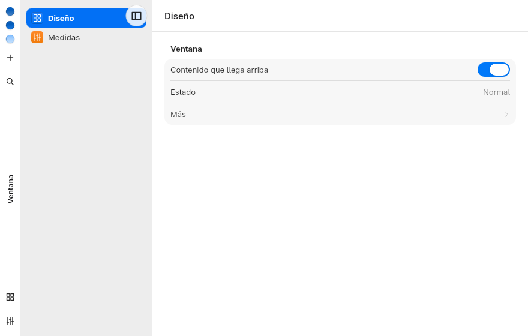 | 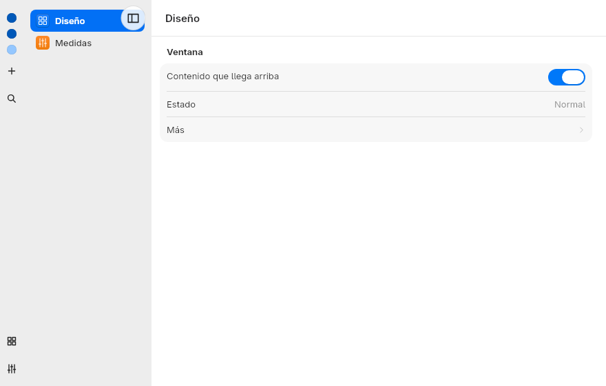 |

### The sidebar with the `Rail`

With the `Rail`, the traffic lights leave the sidebar. The `Sidebar` then
raises its first row (the search field in `SettingsWindow`) to the title
bar row; `sidebar_bar_height()` gives that row's height (52). Switching
between `Top` and `Rail` slides the row over `DURATION_BASE` with a cubic
ease-out; with reduced motion it jumps.

| `Top`: the search field below the traffic lights | `Rail`: the search field in the title bar row |
|---|---|
| 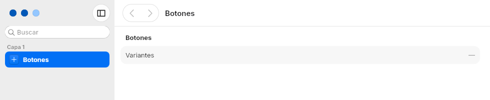 | 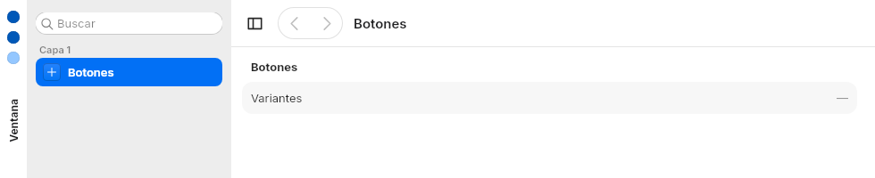 |

## Maximized, full screen and focus mode

The state comes from [`WindowStatus`](08-windows.md#window-state). The
screenshots are a test window (`Top` layout unless stated)
rendered by the kit in each state.

### The four states with the `Top` layout

| State | How it is entered | What the kit does | How it looks |
|---|---|---|---|
| Normal | — | Title bar in place, traffic lights in the sidebar. The edges resize the window | 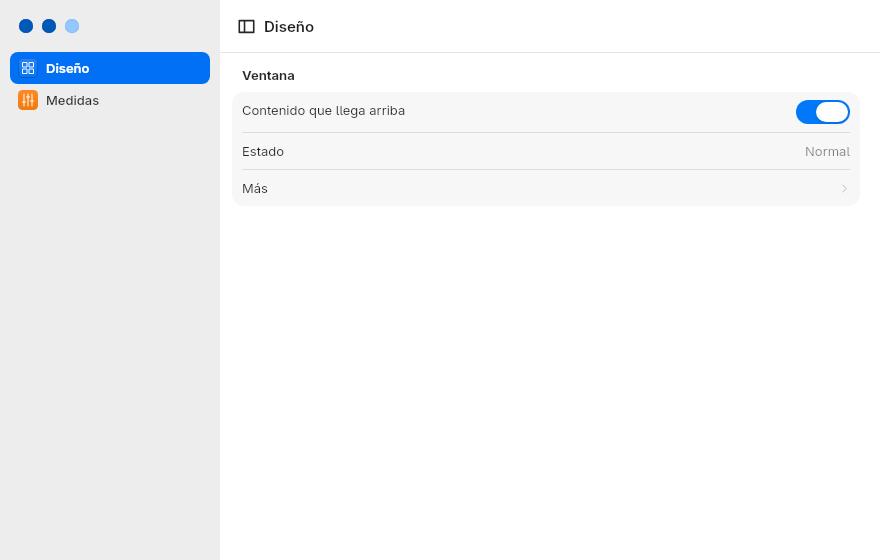 |
| Maximized | Green light with `zoom`, double click with `zoom` or `fill`, or `toggle_maximize()` | Same as normal, without resize edges. Malaysia keeps the frame (corners and shadow) |  |
| Full screen without the focus protocol (another compositor) | Green light with `focus`, or `toggle_fullscreen()` | The title bar stays; the traffic lights hide | 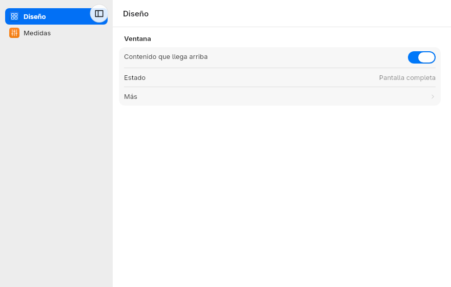 |
| Malaysia focus mode, bar up | The same; the compositor sends the `fullscreen` state | The title bar leaves the layout and the content fills the window | 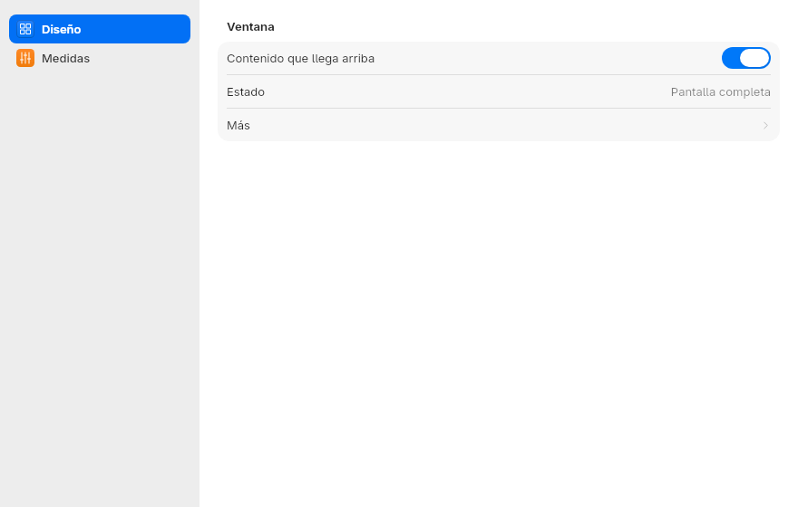 |

In Malaysia, focus mode
([Malaysia ADRs 0051 and 0054](https://github.com/HBlanqueto/malaysia/blob/main/docs/decisions.md))
slides a black bar down when the pointer nears the top. The kit asks for
`set_overlay` through `infinity_focus_v1` version 2, so the window does not
move: while the bar is down, `titlebar_overlaid()` is true and the title bar
is drawn over the content, right below the bar, on the background the app
chooses (`FullscreenBar`). It slides and fades with the bar over
`DURATION_BASE`.

### The bar in full screen: `FullscreenBar`

Each window chooses how its overlaid title bar is drawn, in `WindowOptions`
([8](08-windows.md#window-options)):

```rust
WindowOptions::new(tr!("ondina"), "ondina").fullscreen_bar(FullscreenBar::ProgressiveGlass)
```

The default is `Solid`. In the screenshots, the black strip at the top is the
compositor bar, added to the image.

| `FullscreenBar` | What it draws | Content starts (`fullscreen_content_top`) | How it looks |
|---|---|---|---|
| `Solid` (default) | An opaque band in the window color, as tall as the title bar, with a hard edge | Bar + `FULLSCREEN_BAR.content_top` (44) | 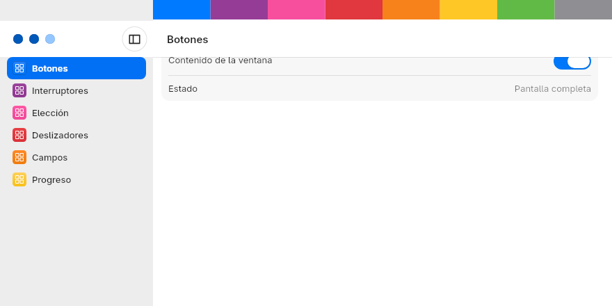 |
| `Glass` | A band as tall as the title bar, across the whole window and the sidebar, that the compositor blurs with a hard edge (`set_scroll_edge`, `hard`) | Bar + `FULLSCREEN_BAND.content_top` (44) | 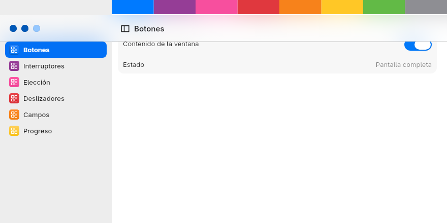 |
| `ProgressiveGlass` | Full blur at the top that the compositor fades out over `FULLSCREEN_GLASS.height` (96 px) (`soft`), across the whole window and the sidebar ([ADR 0057](../decisions.md)) | Bar + `FULLSCREEN_GLASS.content_top` (74) | 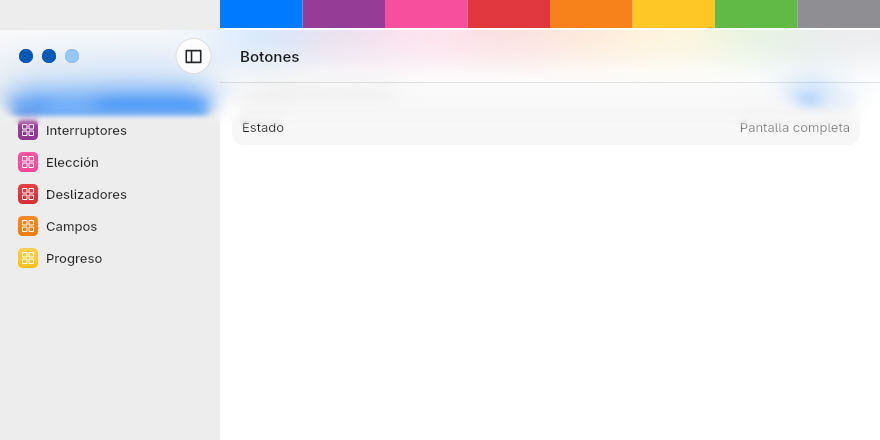 |

Only `Glass` and `ProgressiveGlass` blur, and the compositor draws that blur
([ADR 0100](../decisions.md)): the kit declares the band with `set_scroll_edge`
from a chrome sub-surface that holds the bar, so the bar stays sharp over it
([18](18-platform.md#glass-over-the-windows-content)). The glass does not
fade with the bar: the bar's items do, and the material is there from the first
frame. With a compositor below version 10, or when the user reduces transparency
(`reduce_transparency`, off by default), both draw as `Solid`; the content keeps
the offset of the chosen bar. Their tint, the depth of `ProgressiveGlass` and
the animation are a `FullscreenBarStyle`, set in the theme or with
`.control_style` ([Styles and themes](../../crates/bk/src/styles/titlebar.rs)).
The screenshots of the two glass bars were rendered before the blur moved to
the compositor and show the blur it draws.

#### Pushing the content: `fullscreen_push`

`fullscreen_push(true)` combines with any of the three bars. It is off by
default:

```rust
WindowOptions::new(tr!("ondina"), "ondina")
    .fullscreen_bar(FullscreenBar::ProgressiveGlass)
    .fullscreen_push(true)
```

Both options are initial values: the app changes them live through the
`WindowControls::fullscreen_bar` and `fullscreen_push` states.

With it, the bar covers nothing: all the content, sidebar included, moves down
by the height of the compositor bar plus the title bar. The traffic lights
move with the title bar, and `fullscreen_content_top()` is 0.

| Combination | How it looks |
|---|---|
| `Solid` + push | 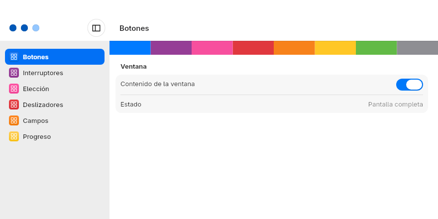 |
| `ProgressiveGlass` + push | 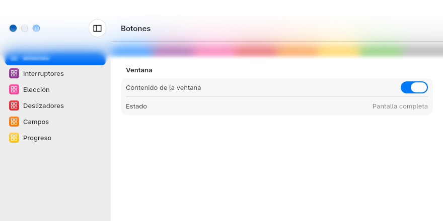 |
| Bar up: the content reaches the top edge | 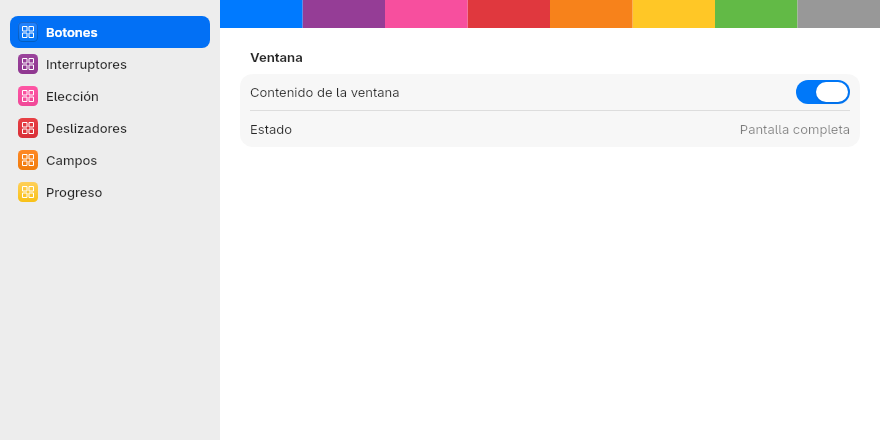 |

#### With the `Rail`

With the `Rail`, the top title bar neither retracts nor overlays: it stays in
place and nothing moves down with the compositor bar. Only the rail hides
while the compositor bar is up; when the bar comes down, the rail slides in
from the left with the same bar, vertically, its traffic lights below the
compositor bar:

| `FullscreenBar` | The rail | How it looks |
|---|---|---|
| `Solid` (default) | An opaque strip as wide as the rail, over the content | 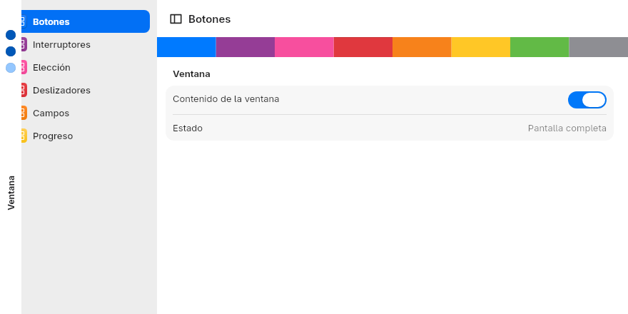 |
| `Glass` | A strip as wide as the rail that blurs what is below, with a line on the inner edge | 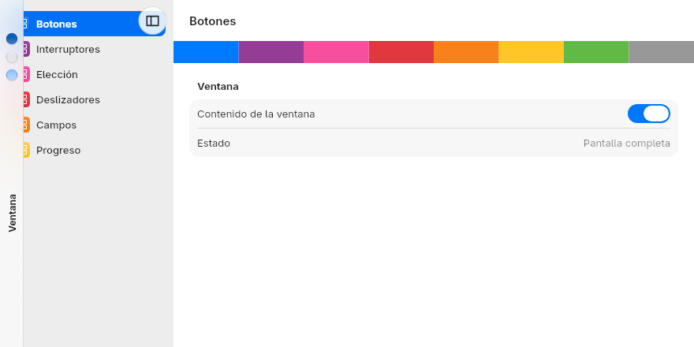 |
| `ProgressiveGlass` | Full blur at the window edge that fades inward over 96 px | 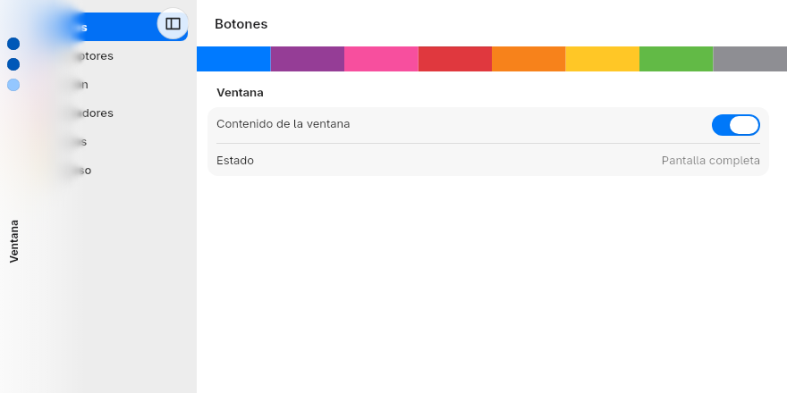 |
| Any, with push | The rail returns to the layout and pushes the content sideways by its width | 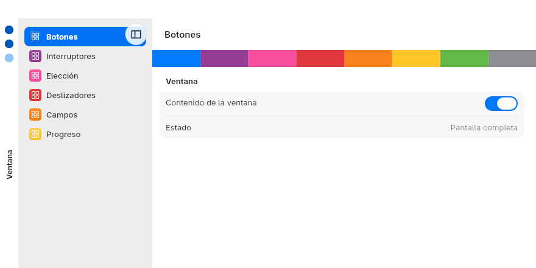 |

### Focus mode with the bar down, by layout

The layout is kept when the window is maximized and in full screen, also with
a sidebar: the `Rail` stays on the left.

| `Rail` with a sidebar, maximized | `Rail` with a sidebar, focus mode |
|---|---|
| 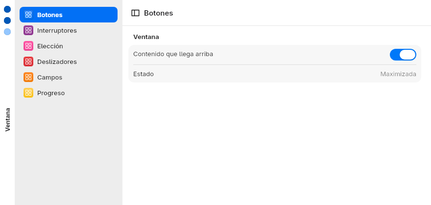 | 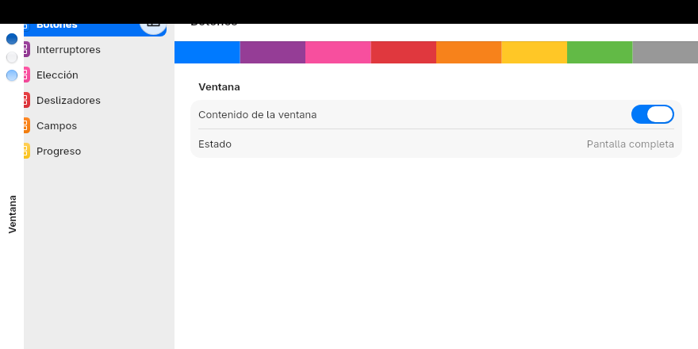 |

These screenshots use `Solid` (except `Top`). The black
strip at the top (30 px) is the compositor bar, added to the image.

| Layout | What comes down | How it looks |
|---|---|---|
| `Top` (default) | The `Titlebar` over the content; the sidebar traffic lights move down by the same amount | 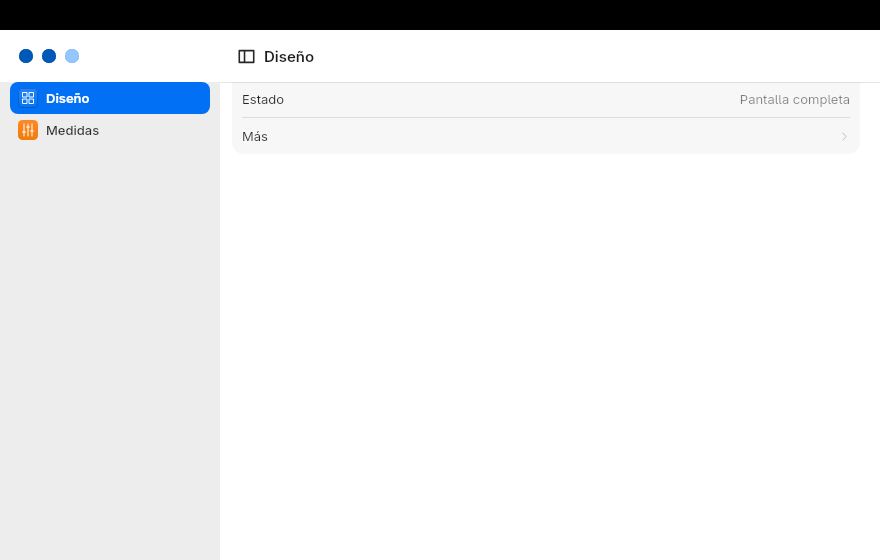 |
| Unified `Rail` | The sidebar column; the traffic lights appear with the bar, below it | 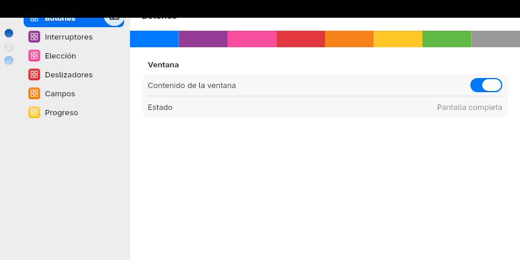 |
| `Rail` | The rail slides in from the left with the chosen bar; its traffic lights sit below the compositor bar |  |
| `Rail` with items | The same, with its items |  |

### What the app does

1. With `Titlebar`, `WindowChrome`, `Sidebar` or `SettingsWindow`, nothing:
   every state above already works.
2. It leaves room for the bar in content that sits under the overlaid title
   bar:

   ```rust
   let top = try_consume_root_context::<WindowControls>()
       .map_or(0.0, |controls| controls.fullscreen_content_top());
   rect().padding(Gaps::new(top, 0.0, 0.0, 0.0)).child(content)
   ```

3. If a view covers the title bar (a video player that fills the window), it
   adds its own traffic lights, so the window can leave full screen:

   ```rust
   TrafficLights::for_window(WindowControls::get().status.read().activated, false)
   ```

4. For its own behavior (an immersive mode that hides panels), it reads the
   state:

   ```rust
   let immersive = WindowControls::get().status.read().fullscreen;
   rect().maybe_child((!immersive).then(tool_panel))
   ```

5. To offer maximize or full screen in a menu, it calls `toggle_maximize()`
   or `toggle_fullscreen()` from an action ([13. App](13-app.md)).

## Helpers

| Function | Returns |
|---|---|
| `titlebar::app_id(app_name)` | The default `app_id`: `io.github.hblanqueto.malaysia.<app_name>` |
| `titlebar::sidebar_bar_height()` | Height of the title bar row beside a sidebar |
| `titlebar::use_window_drag(fixed)` | The move and double-click handler of the title bar ([Traffic lights](#traffic-lights)) |

Next: [10. Sidebar and split view](10-sidebar.md).
