# 9. Titlebars

**Goal:** add a title bar to a window, choose its layout and know how it
looks in each window state.
**Scope:** `Titlebar`, `TrafficLights`, `WindowChrome` and its `ChromeStyle`,
and the full-screen bars (`FullscreenBar`). The window options and state they
read are in [8. Windows](08-windows.md). The sidebar that holds the traffic
lights is in [10. Sidebar](10-sidebar.md).
**Reader:** anyone who designs the window of an app that runs with
`run_window`.
**Input:** a window opened with `run_window` ([8](08-windows.md#running-a-window)).
**Output:** a window with its title bar, traffic lights and full-screen
behavior.

## Steps

1. Put a `Titlebar` at the top of the root view. With `Application`, `Scene`
   already does it ([2](02-first-app.md#what-application-does-for-you)).

   ```rust
   rect()
       .expanded()
       .background(color(Palette::current().window_background))
       .child(Titlebar::new().title(tr!("notes")))
       .child(content)
   ```

2. Add items to its left and right zones:

   ```rust
   Titlebar::new()
       .title(tr!("notes"))
       .left(SidebarToggle)
       .right(IconButton::new(Symbol::Plus, tr!("new-note")))
   ```

3. With a sidebar, pass `.with_sidebar(true)` so the bar aligns with it
   ([10](10-sidebar.md)).
4. For a vertical title bar or one that hides, wrap the window in
   `WindowChrome` with a `ChromeStyle` ([Window chrome](#window-chrome)).
5. Choose the full-screen bar in `WindowOptions`
   ([The bar in full screen](#the-bar-in-full-screen-fullscreenbar)).
6. Leave room under the overlaid title bar in full screen
   ([What the app does](#what-the-app-does)).

## Titlebar

`Titlebar` (`barrier_kit::titlebar`, in the prelude) is the client-side title
bar: traffic lights, a left zone, the title and a right zone.

| Method | Default | Effect |
|---|---|---|
| `Titlebar::new()` | — | A bar that reads the title and state from `WindowControls` |
| `.title(text)` | the window title | Replaces the title shown |
| `.left(view)`, `.right(view)` | empty | Items at each side |
| `.spacing(px)` | 0 | Gap between the bar's items |
| `.with_sidebar(bool)` | `false` | Aligns the bar with a sidebar ([Variants](#variants-in-a-normal-window)) |
| `.close_only(bool)` | `false` | Only the close button works, for dialogs and panels |
| `.hairline(bool)` | `true` | The line at the bottom of the sidebar layout |
| `Titlebar::preview(status, title, fixed)` | — | Draws the bar for a given `WindowStatus` without a window, for previews and tests |

Behavior:

- Without a sidebar, the left and right zones take the same width, so the
  title stays centered. The title uses `TITLEBAR.font`.
- With `.with_sidebar(true)` the title goes at the start, next to `left`, in
  `TITLE_2`, as on macOS. While the sidebar shows, the traffic lights live in
  the sidebar; they keep their place while it folds.
- A press on the bar moves the window; a double click does what
  `double_click_titlebar` says ([Traffic lights](#traffic-lights)).
- `.close_only(true)`: a transparent bar `TITLEBAR.thickness` (32 px) tall,
  with only close enabled. Utility and HUD windows switch to it by themselves
  ([8](08-windows.md#utility-windows)).
- With server-side decoration (`DecorationResponse::Server`) the bar takes no
  space: the compositor draws one.

### Variants in a normal window

The same `Titlebar` changes with the sidebar, the `sidebar_style` of the user
appearance ([4](04-appearance-and-tokens.md#the-appearance-file)) and the focus.
The app chooses none of these variants.

| Variant | How it looks |
|---|---|
| Island sidebar (default): the traffic lights go in the sidebar; a translucent line at the bottom | 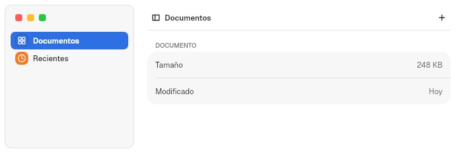 |
| Island sidebar, inactive window: traffic lights and title in gray | 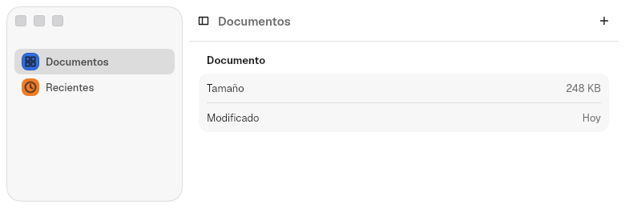 |
| Flat sidebar: a `TITLEBAR_CLIENT_HEIGHT` (40 px) bar with a line at the bottom | 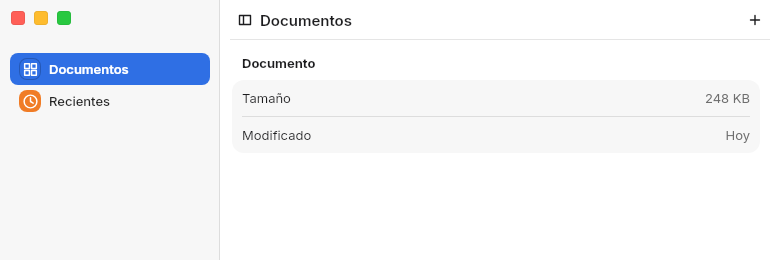 |
| No sidebar: traffic lights in the bar, title centered between two equal zones | 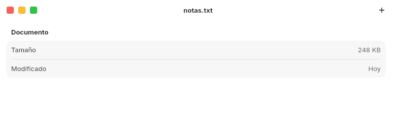 |
| No sidebar, inactive window: `titlebar_inactive` background and gray traffic lights | 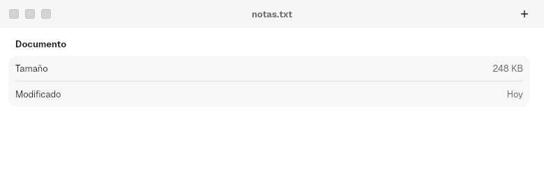 |

### Corner radius

The `Titlebar` tells the compositor which bar it draws with
`infinity_window_style_v1.set_bar`, and Malaysia rounds the window with that
bar's radius
([Malaysia ADR 0059](https://github.com/HBlanqueto/malaysia/blob/main/docs/decisiones/0059-radio-por-barra-y-esquina-continua.md)).
The app does nothing:

| `Titlebar` | `Bar` | Height | Radius (`WINDOW_CORNER`) |
|---|---|---|---|
| `.close_only(true)`, utility or HUD window | `Titlebar` | `TITLEBAR.thickness` (32) | `titlebar` (16) |
| `.with_sidebar(true)` and an island sidebar | `Unified` | `SETTINGS.toolbar_height` (52) | `unified` (26) |
| The rest | `Compact` | `TITLEBAR_CLIENT_HEIGHT` (40) | `compact` (20) |

`Bar` (`barrier_kit::platform`) comes from the Infinity protocol and has four
values, each an AppKit window kind: `Titlebar` (no toolbar), `Compact`
(`NSWindow.ToolbarStyle.unifiedCompact`), `Unified` (`.unified`) and
`Utility` (a panel, radius 15). The kit never sends `Utility`.

The bar is sent again when `sidebar_style` changes. An app that draws its own
bar without `Titlebar` declares it with
`WindowControls::get().set_bar(Bar::Titlebar)`; otherwise Malaysia uses
`unified` for a client-decorated window. The user can force one radius for
every window with `corner_radius` in `window.domain`.

## Traffic lights

Close, minimize and zoom. `Titlebar`, the `Rail` and
`Sidebar::traffic_lights(true)` place them with
`window_traffic_lights(focused, fixed)`, which wires them to `WindowControls`
and the user's settings. Use that function when a view covers the title bar
and needs its own lights.

For a standalone set, `TrafficLights` (`barrier_kit::traffic`):

```rust
use barrier_kit::traffic::TrafficLights;
use vow_design::ButtonKind;

TrafficLights::new()
    .focused(true)
    .on_action(|kind: ButtonKind| { /* Close, Minimize or Maximize */ })
```

| Method | Default | Effect |
|---|---|---|
| `.focused(bool)` | `true` | Unfocused lights are gray until the pointer hovers them |
| `.zoom_supported(bool)` | `true` | Without zoom, the green light is gray, has no glyph and does nothing |
| `.fixed_width(bool)` | `false` | The zoom glyph is a plus, for fixed-size windows |
| `.close_only(bool)` | `false` | Only close is colored and clickable |
| `.vertical(bool)` | `false` | A column instead of a row |
| `.round(bool)` | `false` | Round instead of square |
| `.input(TrafficInput)` | — | Draws a fixed state (focus, hover, press) and ignores the pointer, for previews |
| `.on_action(f)` | — | Receives the `ButtonKind` pressed |

Each light has the accessible role button and the name "Close", "Minimize" or
"Zoom". Hovering the group shows the glyphs.

The user decides the rest. The appearance keys `traffic_lights` (color:
`auto`, `standard`, `accent`, `wallpaper`) and `traffic_light_shape`
(`square`, `round`) are in
[4](04-appearance-and-tokens.md#the-appearance-file). `ChromeStyle::round_lights`
also makes them round. The behavior keys live in
`~/.config/malaysia/window.domain`
([4](04-appearance-and-tokens.md#window-behavior)); the compositor's own
title bars use the same functions. What each value does here:

| `green_button` | Normal window | Fixed size |
|---|---|---|
| `focus` (default; `fullscreen` is an alias) | Full screen | Maximizes |
| `zoom` | Maximizes | Maximizes |
| `none` | Nothing; the light is gray and has no glyph | Nothing |

| `double_click_titlebar` | Normal window | Fixed size |
|---|---|---|
| `zoom` (default), `fill` | Maximizes | Nothing |
| `minimize` | Minimizes | Minimizes |
| `none` | Nothing | Nothing |

A double click is two presses within `TITLEBAR_DOUBLE_CLICK.interval_ms`
(400 ms) and `slop` (4 px). `window_drag_handler(fixed)` is the press handler
that moves the window or runs the double-click action; put it on your own
draggable areas.

## Window chrome

`WindowChrome` (`barrier_kit::chrome`) wraps the window and places the traffic
lights, the title and the rail items according to a `ChromeStyle`. `Titlebar`
and `Sidebar` inside it read the style.

```rust
use barrier_kit::chrome::{ChromeStyle, TitlebarLayout, WindowChrome};

let style = ChromeStyle {
    layout: TitlebarLayout::Rail,
    ..ChromeStyle::default()
};
WindowChrome::new(style, window_content)
    .rail_top(top_items)
    .rail_bottom(bottom_items)
```

### `ChromeStyle` fields

| Field | Default | Values |
|---|---|---|
| `layout` | `Top` | `TitlebarLayout::Top`: the horizontal `Titlebar`. `Rail`: a vertical bar on the left, with the traffic lights in a column, the title rotated 90° and the rail items |
| `rail_width` | `TITLEBAR_RAIL.width` (30) | Rail width without items; `TITLEBAR_RAIL.width_wide` is 32 |
| `round_lights` | `false` | Round traffic lights |
| `rail_style` | `Normal` | `RailStyle::Normal`: its own strip. `Unified`: no strip; the column goes inside the sidebar, and without a visible sidebar it draws as `Normal` |
| `reveal` | `Always` | When the bar shows ([Reveal](#reveal)) |
| `resting_edge` | `None` | What stays while a hidden bar is away: `RestingEdge::None`, `Line` (`TITLEBAR_RAIL.edge_line`, 1 px) or `Accent` (`edge_accent`, 4 px, accent color) |

### Reveal

| `Reveal` | What happens |
|---|---|
| `Always` | The bar is always there |
| `Drawer` | Hidden. The pointer within `TITLEBAR_RAIL.reveal_zone` (8 px) of the edge slides it in over the content, with a shadow |
| `Push` | Hidden. It grows in from the edge and pushes the content |
| `Corner` | The bar stays; only the traffic lights fade in while the pointer is in the top-left `reveal_corner` (96 px) |
| `Popup` | The traffic lights leave the bar. The pointer at the edge slides in a pill with them, which stays while the pointer is in the corner |

The reveal animates over `DURATION_BASE`. Some combinations correct
themselves: a unified `Rail` turns `Drawer`, `Push` and `Popup` into
`Corner`. In Malaysia's focus mode the chrome behaves as `Always`.

### Rail items

As the `Top` titlebar holds items at its left and right, the `Rail` holds them
vertically:

| Method | Where it goes |
|---|---|
| `WindowChrome::rail_top(items)` | Below the traffic lights |
| `WindowChrome::rail_bottom(items)` | At the foot of the rail |

With any item, the rail widens to at least `TITLEBAR_RAIL.actions_width` (34).
In `Unified` the items go in the sidebar column, in the same places.

| `Normal` with items | `Unified` with items |
|---|---|
| 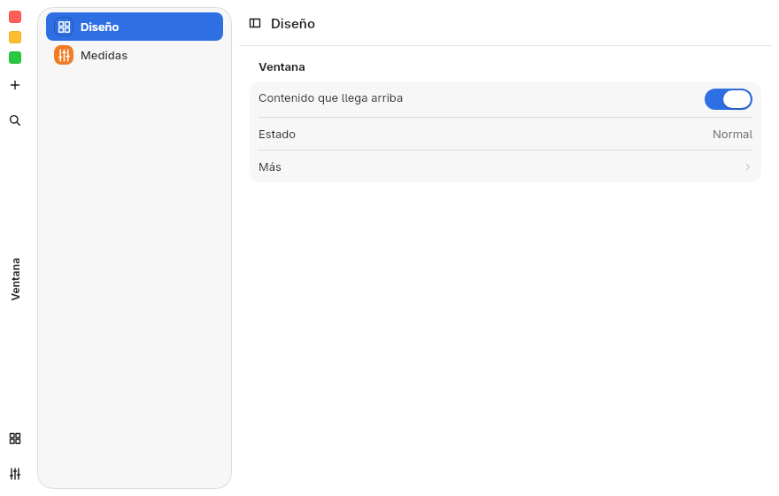 | 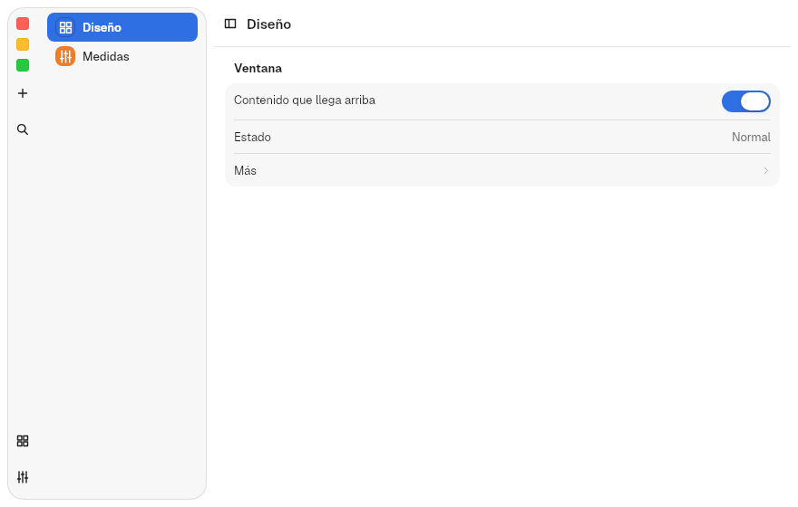 |

### The sidebar with the `Rail`

With the `Rail`, the traffic lights leave the sidebar. The `Sidebar` then
raises its first row (the search field in `PreferencesWindow`) to the title
bar row; `sidebar_bar_metrics()` gives that row's height and top padding for
the current sidebar style (52 and 0 for island, 40 and 0 for flat). Switching
between `Top` and `Rail` slides the row over `DURATION_BASE` with a cubic
ease-out; with reduced motion it jumps.

| `Top`: the search field below the traffic lights | `Rail`: the search field in the title bar row |
|---|---|
| 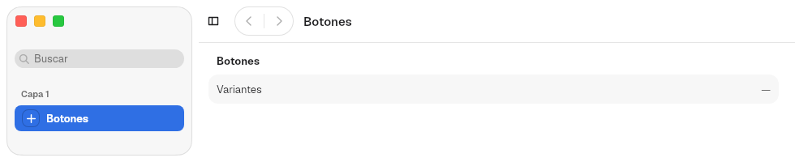 | 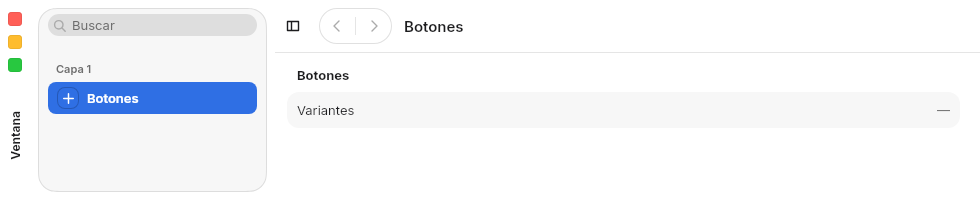 |

## Maximized, full screen and focus mode

The state comes from [`WindowStatus`](08-windows.md#window-state). The
screenshots are a test window (island sidebar, `Top` layout unless stated)
rendered by the kit in each state.

### The four states with the `Top` layout

| State | How it is entered | What the kit does | How it looks |
|---|---|---|---|
| Normal | — | Title bar in place, traffic lights in the sidebar. The edges resize the window | 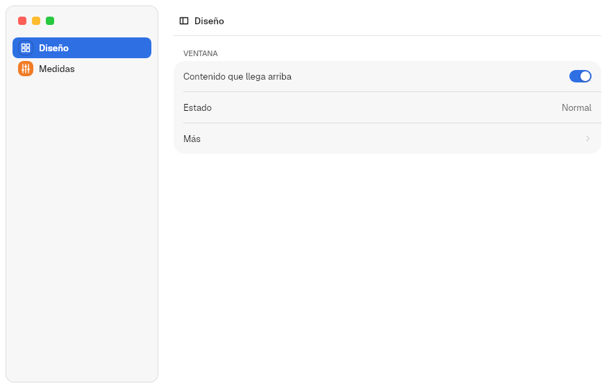 |
| Maximized | Green light with `zoom`, double click with `zoom` or `fill`, or `toggle_maximize()` | Same as normal, without resize edges. Malaysia keeps the frame (corners and shadow) | 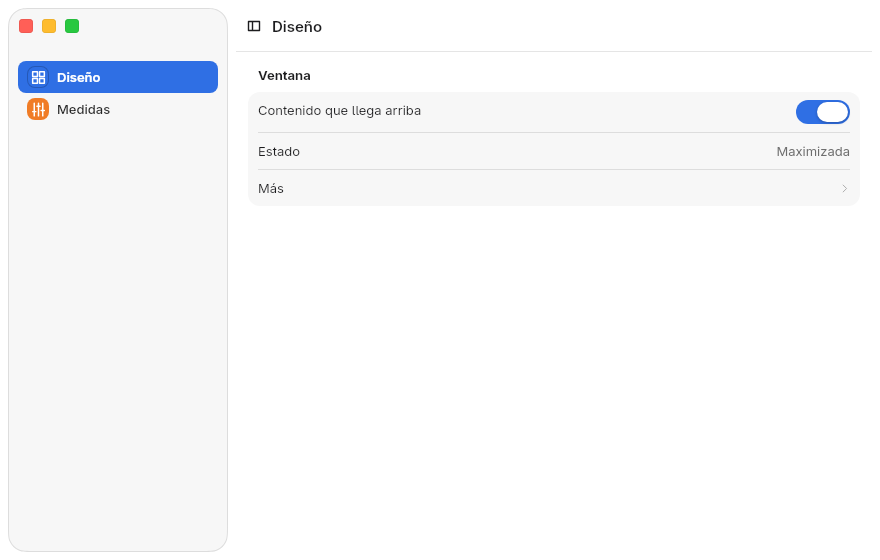 |
| Full screen without the focus protocol (another compositor) | Green light with `focus`, or `toggle_fullscreen()` | The title bar stays; the traffic lights hide | 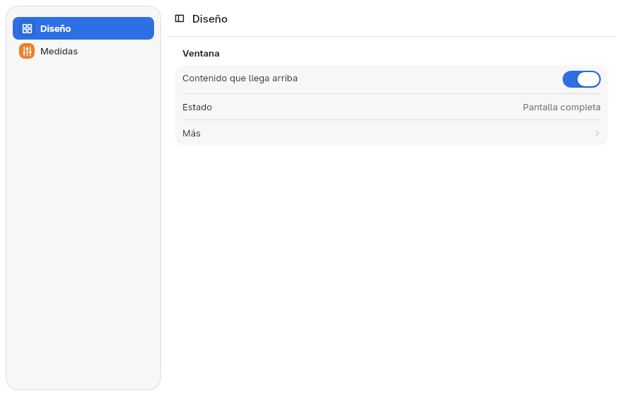 |
| Malaysia focus mode, bar up | The same; the compositor sends the `fullscreen` state | The title bar leaves the layout and the content fills the window | 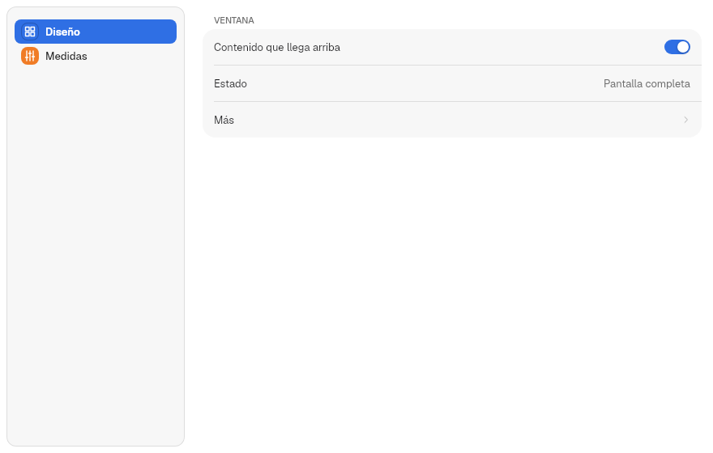 |

In Malaysia, focus mode
([Malaysia ADRs 0051 and 0054](https://github.com/HBlanqueto/malaysia/tree/main/docs/decisiones))
slides a black bar down when the pointer nears the top. The kit asks for
`set_overlay` through `infinity_focus_v1` version 2, so the window does not
move: while the bar is down, `titlebar_overlaid()` is true and the title bar
is drawn over the content, right below the bar, on the background the app
chooses (`FullscreenBar`). It slides and fades with the bar over
`DURATION_BASE`.

### The bar in full screen: `FullscreenBar`

Each window chooses how its overlaid title bar is drawn, in `WindowOptions`
([8](08-windows.md#window-options)):

```rust
WindowOptions::new(tr!("ondina"), "ondina").fullscreen_bar(FullscreenBar::ProgressiveGlass)
```

The default is `Solid`. In the screenshots, the black strip at the top is the
compositor bar, added to the image.

| `FullscreenBar` | What it draws | Content starts (`fullscreen_content_top`) | How it looks |
|---|---|---|---|
| `Solid` (default) | An opaque band in the window color, as tall as the title bar, with a hard edge | Bar + `FULLSCREEN_BAR.content_top` (44) | 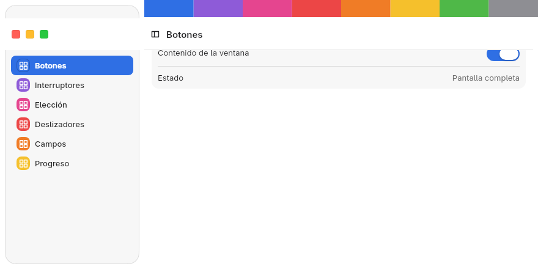 |
| `Glass` | A band as tall as the title bar, across the whole window and the sidebar, that blurs what is below (`FULLSCREEN_BAND`), with a tint and a line at the bottom | Bar + `FULLSCREEN_BAND.content_top` (44) |  |
| `ProgressiveGlass` | Full blur at the top that fades out over `FULLSCREEN_GLASS.height` (96 px), without a line, across the whole window and the sidebar ([ADR 0057](../decisions/0057-glass-and-sidebar-over-backdrop.md)) | Bar + `FULLSCREEN_GLASS.content_top` (74) |  |

Only `Glass` and `ProgressiveGlass` blur.

#### Pushing the content: `fullscreen_push`

`fullscreen_push(true)` combines with any of the three bars. It is off by
default:

```rust
WindowOptions::new(tr!("ondina"), "ondina")
    .fullscreen_bar(FullscreenBar::ProgressiveGlass)
    .fullscreen_push(true)
```

Both options are initial values: the app changes them live through the
`WindowControls::fullscreen_bar` and `fullscreen_push` states.

With it, the bar covers nothing: all the content, sidebar included, moves down
by the height of the compositor bar plus the title bar. The traffic lights
move with the title bar, and `fullscreen_content_top()` is 0.

| Combination | How it looks |
|---|---|
| `Solid` + push | 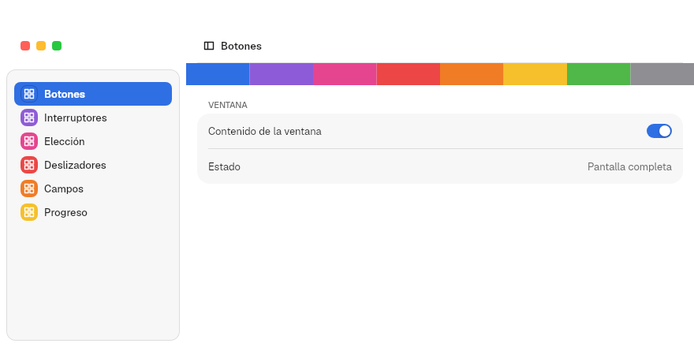 |
| `ProgressiveGlass` + push | 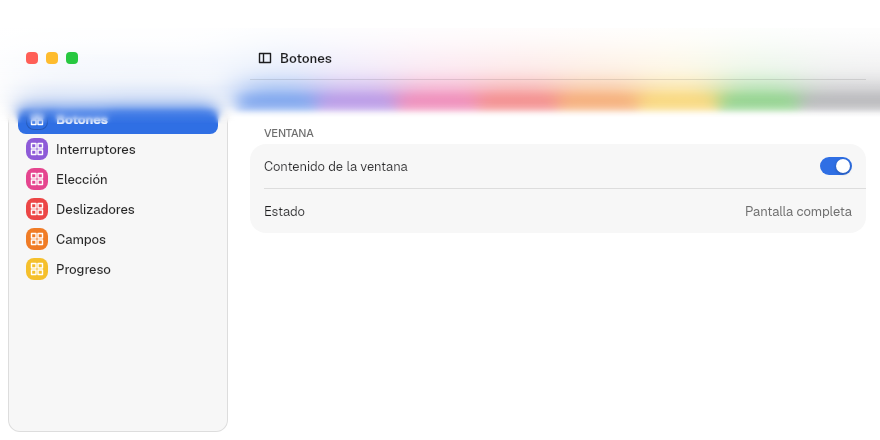 |
| Bar up: the content reaches the top edge | 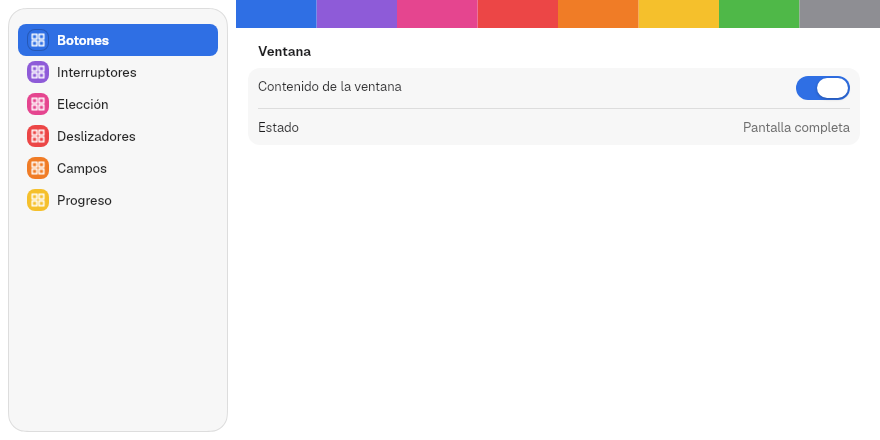 |

#### With the `Rail`

With the `Rail`, the top title bar neither retracts nor overlays: it stays in
place and nothing moves down with the compositor bar. Only the rail hides
while the compositor bar is up; when the bar comes down, the rail slides in
from the left with the same bar, vertically, its traffic lights below the
compositor bar:

| `FullscreenBar` | The rail | How it looks |
|---|---|---|
| `Solid` (default) | An opaque strip as wide as the rail, over the content | 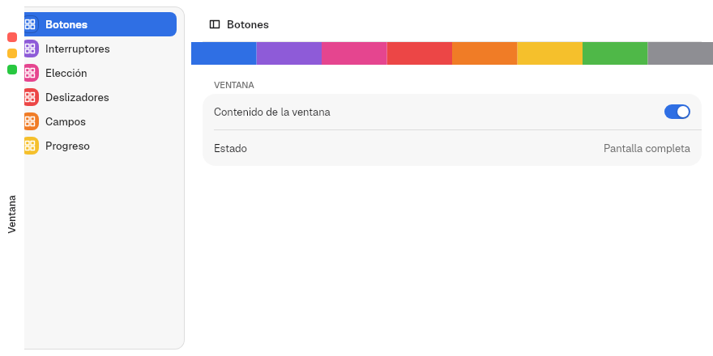 |
| `Glass` | A strip as wide as the rail that blurs what is below, with a line on the inner edge | 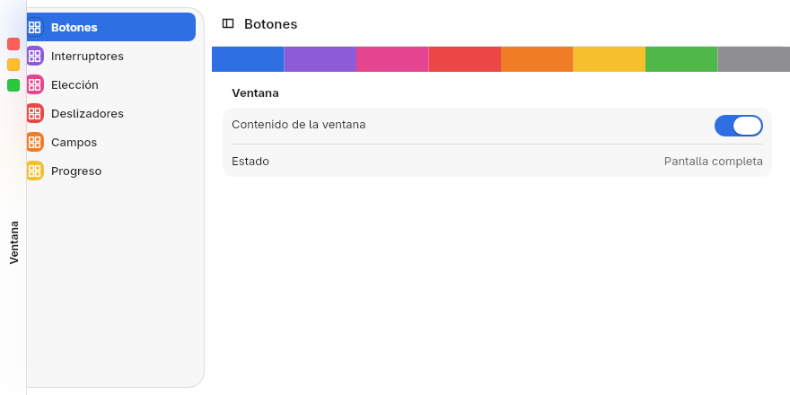 |
| `ProgressiveGlass` | Full blur at the window edge that fades inward over 96 px | 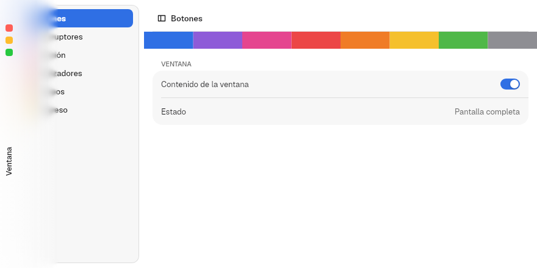 |
| Any, with push | The rail returns to the layout and pushes the content sideways by its width | 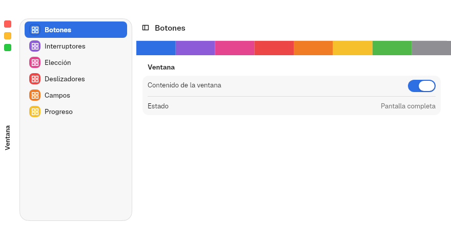 |

### Focus mode with the bar down, by layout

The layout is kept when the window is maximized and in full screen, also with
an island sidebar: the `Rail` stays on the left.

| `Rail` with an island, maximized | `Rail` with an island, focus mode |
|---|---|
| 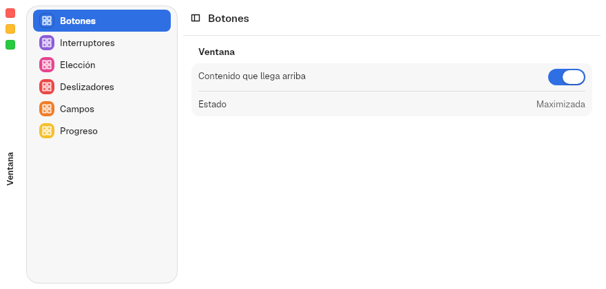 | 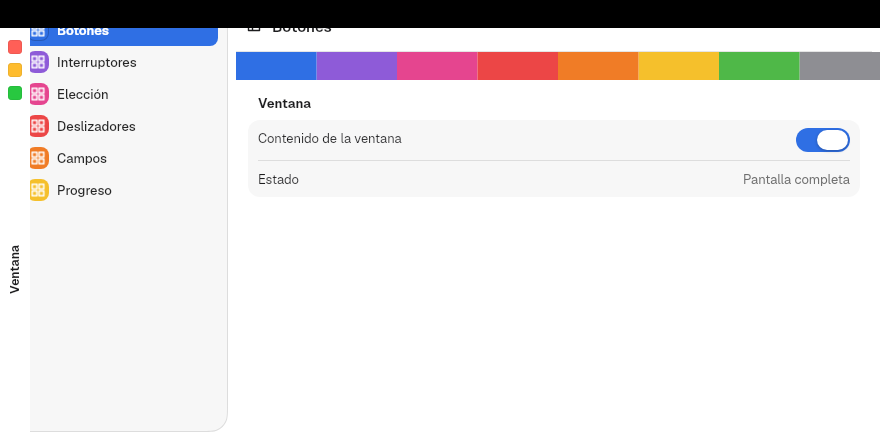 |

These screenshots use the flat sidebar (except `Top`) and `Solid`. The black
strip at the top (30 px) is the compositor bar, added to the image.

| Layout | What comes down | How it looks |
|---|---|---|
| `Top` (default) | The `Titlebar` over the content; the sidebar traffic lights move down by the same amount | 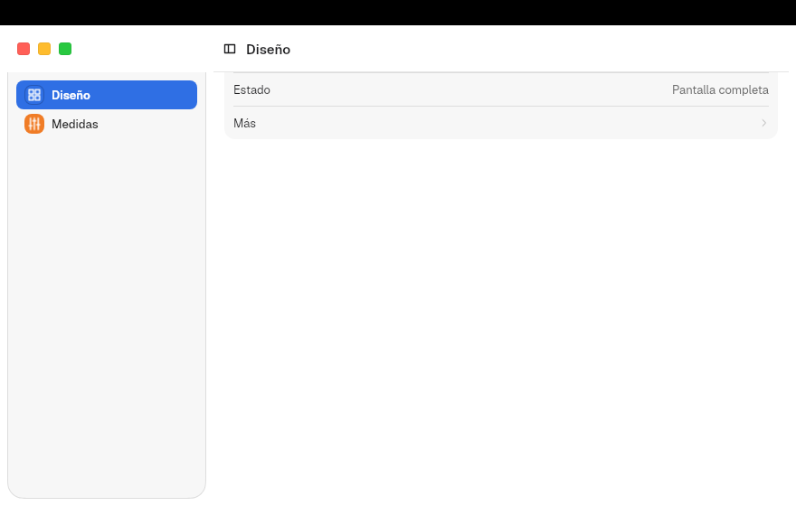 |
| Unified `Rail` | The sidebar column; the traffic lights appear with the bar, below it | 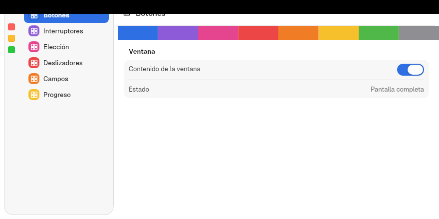 |
| `Rail` | The rail slides in from the left with the chosen bar; its traffic lights sit below the compositor bar |  |
| `Rail` with items | The same, with its items | 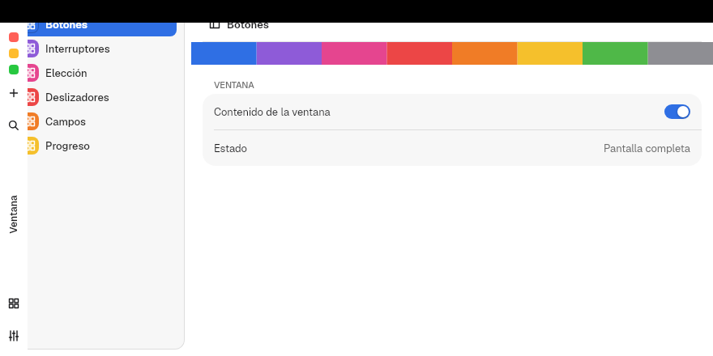 |

### What the app does

1. With `Titlebar`, `WindowChrome`, `Sidebar` or `PreferencesWindow`, nothing:
   every state above already works.
2. It leaves room for the bar in content that sits under the overlaid title
   bar:

   ```rust
   let top = try_consume_root_context::<WindowControls>()
       .map_or(0.0, |controls| controls.fullscreen_content_top());
   rect().padding(Gaps::new(top, 0.0, 0.0, 0.0)).child(content)
   ```

3. If a view covers the title bar (a video player that fills the window), it
   adds its own traffic lights, so the window can leave full screen:

   ```rust
   window_traffic_lights(WindowControls::get().status.read().activated, false)
   ```

4. For its own behavior (an immersive mode that hides panels), it reads the
   state:

   ```rust
   let immersive = WindowControls::get().status.read().fullscreen;
   rect().maybe_child((!immersive).then(tool_panel))
   ```

5. To offer maximize or full screen in a menu, it calls `toggle_maximize()`
   or `toggle_fullscreen()` from an action ([13. App](13-app.md)).

## Helpers

| Function | Returns |
|---|---|
| `titlebar::app_id(app_name)` | The default `app_id`: `io.github.hblanqueto.malaysia.<app_name>` |
| `titlebar::sidebar_bar_metrics()` | `(height, top padding)` of the title bar row beside a sidebar |
| `titlebar::window_traffic_lights(focused, fixed)` | `TrafficLights` wired to the window ([Traffic lights](#traffic-lights)) |
| `titlebar::window_drag_handler(fixed)` | The move and double-click handler of the title bar ([Traffic lights](#traffic-lights)) |

Next: [10. Sidebar and split view](10-sidebar.md).
