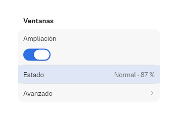
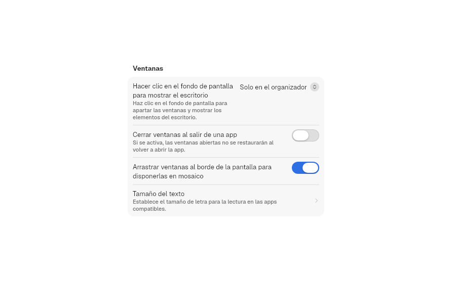
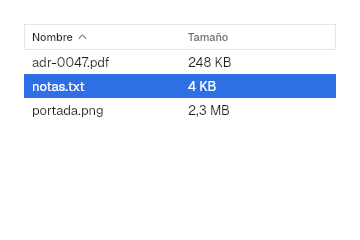
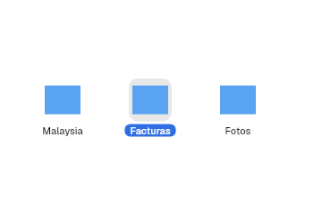
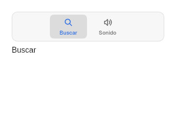
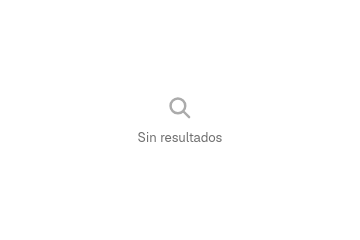
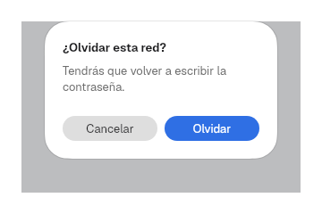

# 9. Views

**Goal:** know the layer 2 containers that organize the content.
**Reader:** anyone who assembles complete screens.

## Forms: `Form`, `Section`, `Row`

This is the settings piece: rows grouped in cards.

```rust
Form::new()
    .section(
        Section::titled("Windows")
            .row(Row::new("Zoom").control(Switch::new("Zoom").on(true)))
            .row(Row::value("Status", "Normal · 87 %"))
            .row(Row::navigation("Advanced", |_| {})),
    )
    .highlighted(Some("Status"))
```



| Row | For |
|---|---|
| `Row::new(title).control(..)` | Label and control |
| `Row::value(title, value)` | Read-only information |
| `Row::navigation(title, on_press)` | Going to a subpage (chevron) |
| `Row::destructive(title, on_press)` | Destructive action, in red |

- `.detail(text)` adds an explanation under the title; long texts wrap to
  several lines without clipping the control.
- `.keywords(&[..])` feeds the `PreferencesWindow` search.
- `Section::new()` has no title; `.footer(text)` adds a footer.
- `.highlighted(Some(title))` highlights the row chosen by the search.



## Table: `Table`

```rust
Table::new("Files", vec!["Name", "Size"])
    .rows(rows)
    .sort(Some(SortOrder { column: 0, ascending: true }))
    .selected(vec![1])
    .on_sort(move |order| sort.set(Some(order)))
    .on_select(move |rows: Vec<usize>| selected_rows.set(rows))
```



Clicking a header requests a new order (`next_sort` toggles ascending and
descending); the app sorts its rows.

Like `NSTableView`:

1. Ctrl+click adds or removes a row and Shift+click picks the range from the
   last click (`select`, shared with `CollectionView`).
2. The right edge of each header drags to fix its column's width, with a
   minimum of `components.table.min-column-width` (10 pt, the default
   `minWidth` of `NSTableColumn`). The handle is `resize-handle` wide (6 pt,
   estimated). Columns without a fixed width share the rest.
3. A secondary click on the header opens a menu with one checkbox per column
   to show or hide it. One column always stays visible (`toggle_column`).

## Grid: `CollectionView`

```rust
CollectionView::new("Documents")
    .item(icon(), "Malaysia")
    .item(icon(), "Invoices")
    .selected(vec![1])
    .on_select(move |chosen: Vec<usize>| selection.set(chosen))
```



Ctrl+click adds or removes an item and Shift+click picks a range, as in
`Table`.

## Tabs: `TabView`

```rust
TabView::new("Preferences")
    .tab(Symbol::MagnifyingGlass, "Search", search_page)
    .tab(Symbol::SpeakerWave, "Sound", sound_page)
    .selected(0)
```



## Outline and columns: `OutlineView`, `ColumnBrowser`

```rust
let nodes = vec![TreeNode::new("Documents").icon(Symbol::Folder).child(TreeNode::new("notes.txt"))];
OutlineView::new("Files", nodes.clone())
ColumnBrowser::new("Files", nodes)
```

`barrier_kit::views::tree` shows a `Vec<TreeNode>` as a tree with disclosure
triangles (`NSOutlineView`) or as columns, Finder style (`NSBrowser`). Rows
are 24 high and each level indents 13, what `NSOutlineView` measures on macOS
26.6.2. Columns are `DISCLOSURE.column_width` wide (200, an estimate). A path
is a list of indices from the root. `ColumnBrowser` reports through
`on_select(path)`. `OutlineView` reports through `on_select(paths)` and takes
Ctrl+click and Shift+click over the visible rows, as `Table` does.

## Window tabs: `WindowTabs`

```rust
WindowTabs::new(titles, selected).on_select(..).on_close(..).on_new(..)
```

The tab bar of a tabbed `NSWindow`: capsules that share the width, the chosen
one raised, with the X on hover and a + at the end. Its measurements are an
estimate. The app keeps each tab's content; tabs cannot be dragged to another
window.

## Split panes: `SplitPanes`

```rust
SplitPanes::new("Panes", Direction::Horizontal).pane(a).pane(b).ratios(vec![0.5, 0.5]).on_ratios(..)
```

Panes in a row or a column with dividers the user drags, like
`NSSplitView`. They nest: a pane can be another `SplitPanes`. The ratios add
up to 1; `on_ratios` reports when the divider is released, and no pane goes
below `SPLIT_PANES.pane_min`.

## Floating pane: `FloatingPane`

A pane over the window's content, with a title bar to move it, a band on the
edge to resize it, and a shadow. The app keeps its `PaneFrame` and receives
it in `on_frame`; `on_raise` reports a press so the app can raise it. The
outline takes the accent while it is active.

## Frameless text: `TextView`

```rust
TextView::new(text, MONO.family, 13.0, 16.0, ink).on_key(..).auto_focus(true)
```

Multi-line editable text without a frame or scrolling, like an `NSTextView`
inside a custom view. Enter breaks the line and Escape releases the focus,
unless `on_key` takes the key and returns `true`. For a framed field with
find and spelling there is `TextEditor`.

## Toolbar: search and overflow

`compact::ToolbarSearch::new(text, "Search").collapsed(narrow)` is the toolbar
search field: with `collapsed(true)` it stays a magnifying glass that opens
when pressed and closes when it loses focus empty. `ToolbarOverflow::new(items)`
is the » button that gathers what does not fit into a menu; the app shows it
instead of those items when the `Breakpoint` is `Compact`. Both go in
`Titlebar::right`.

## States, sheets and alerts

```rust
empty_state(Symbol::MagnifyingGlass, "No results")
sheet(content)
Alert::new("Forget this network?", "You will have to type the password again.")
    .confirm("Forget", |_| {})
    .cancel("Cancel", |_| {})
    .suppression(dont_ask_again)
```

| Empty | Alert |
|---|---|
|  |  |

`sheet` shows the content as a centered dialog over a scrim
(`Palette::scrim`) that covers the window. The dialog has radius 26 with a
continuous corner, like macOS 26 sheets and alerts. `Alert` is 260 wide,
splits its two large buttons (28, capsule) evenly, confirms with Enter and
cancels with Esc. `.suppression(State<bool>)` adds the "Do not show this
message again" checkbox above the buttons, `NSAlert`'s
`showsSuppressionButton`; the app reads the state on close.

## Navigation: `History`

```rust
let history = use_state(|| History::new(Page::Home));
history.write().push(Page::Settings);
navigation_buttons(history)
```

`History<T>` keeps the back/forward stack. `navigation_buttons` draws ‹ and ›
in a `ToolGroup` capsule with a divider and responds to the `GO_BACK` (Alt+←) and `GO_FORWARD` (Alt+→) actions.

## Search: `SearchIndex`

```rust
let mut index = SearchIndex::new();
index.add("wifi", "Wi-Fi", &["network", "wireless"]);
let results = index.search("WIREL");
```

It searches ignoring case and accents. `PreferencesWindow` builds it on its
own from the titles and the `keywords` of each `Row`.

## Rules: `RuleEditor`

`RuleEditor` (`barrier_kit::rule_editor`) is the filter editor of
`NSPredicateEditor`, as in Finder smart folders. It takes the fields
(`RuleField` with its `RuleKind`: text, number or choices) and a
`State<Predicate>`.

```rust
const FIELDS: [RuleField; 2] = [
    RuleField { label: "Name", kind: RuleKind::Text },
    RuleField { label: "Type", kind: RuleKind::Choice(&["PDF", "Image"]) },
];
let filter = use_state(|| Predicate { all: true, rules: vec![Criterion::Rule(Rule::new(1, &FIELDS, 0))] });
RuleEditor::new("Filter", FIELDS.to_vec(), filter)
```

1. The header chooses whether all rules or any of them must hold
   (`Predicate::all`).
2. Each row has the field, the operator and the value: a `TextField` or a
   `PopUpButton` with the choices. Text takes contains, begins with, ends
   with, is and is not; numbers take is, is not, greater and less.
3. − removes the row and + adds another below it. The last one cannot be
   removed.
4. With Alt held, + turns into … and adds a compound rule, like AppKit's
   Option-click: a `Criterion::Group` with its own "All" or "Any" and a first
   rule, indented `disclosure.indent` per level. A group left without rules
   disappears.
5. `Predicate::evaluate(&fields, &|field| value)` applies the filter; each
   group counts as one condition. Text
   ignores case and numbers compare the value parsed as `f64`.

## Adaptive layout

```rust
let adaptable = use_breakpoint();
match adaptable.current() {
    Breakpoint::Wide => three_columns(),
    Breakpoint::Medium => two_columns(),
    Breakpoint::Compact => one_column(),
}
```

The breakpoints are `BREAKPOINT.medium` (620) and `BREAKPOINT.wide` (900).
`adaptable.attach(rect())` measures the element it is attached to.

Next: [10. Patterns](10-patterns.md).
