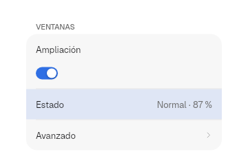
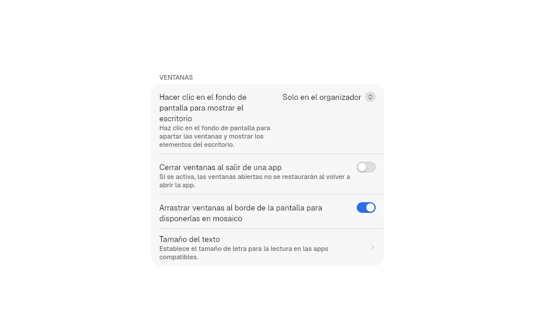
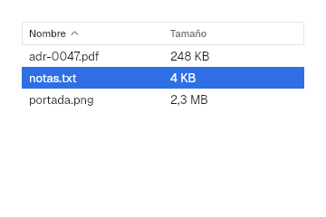
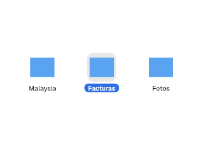
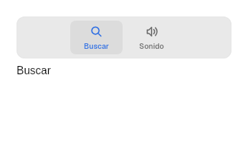
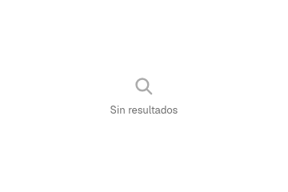
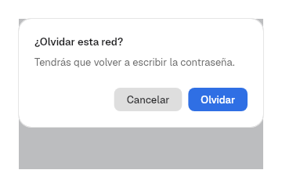

# 9. Views

**Goal:** know the layer 2 containers that organize the content.
**Reader:** anyone who assembles complete screens.

## Forms: `Form`, `Section`, `Row`

This is the settings piece: rows grouped in cards.

```rust
Form::new()
    .section(
        Section::titled("Ventanas")
            .row(Row::new("Ampliación").control(Switch::new("Ampliación").on(true)))
            .row(Row::value("Estado", "Normal · 87 %"))
            .row(Row::navigation("Avanzado", |_| {})),
    )
    .highlighted(Some("Estado"))
```



| Row | For |
|---|---|
| `Row::new(título).control(..)` | Label and control |
| `Row::value(título, valor)` | Read-only information |
| `Row::navigation(título, al_pulsar)` | Going to a subpage (chevron) |
| `Row::destructive(título, al_pulsar)` | Destructive action, in red |

- `.detail(texto)` adds an explanation under the title; long texts wrap to
  several lines without clipping the control.
- `.keywords(&[..])` feeds the `PreferencesWindow` search.
- `Section::new()` has no title; `.footer(texto)` adds a footer.
- `.highlighted(Some(título))` highlights the row chosen by the search.



## Table: `Table`

```rust
Table::new("Archivos", vec!["Nombre", "Tamaño"])
    .rows(filas)
    .sort(Some(SortOrder { column: 0, ascending: true }))
    .selected(Some(1))
    .on_sort(move |orden| criterio.set(Some(orden)))
    .on_select(move |fila| elegida.set(fila))
```



Clicking a header requests a new order (`next_sort` toggles ascending and
descending); the app sorts its rows.

## Grid: `CollectionView`

```rust
CollectionView::new("Documentos")
    .item(icono(), "Malaysia")
    .item(icono(), "Facturas")
    .selected(vec![1])
    .on_select(move |elegidos: Vec<usize>| seleccion.set(elegidos))
```



It supports multiple selection with a modifier.

## Tabs: `TabView`

```rust
TabView::new("Preferencias")
    .tab(Symbol::MagnifyingGlass, "Buscar", pagina_buscar)
    .tab(Symbol::SpeakerWave, "Sonido", pagina_sonido)
    .selected(0)
```



## States, sheets and alerts

```rust
empty_state(Symbol::MagnifyingGlass, "Sin resultados")
sheet(contenido)
Alert::new("¿Olvidar esta red?", "Tendrás que volver a escribir la contraseña.")
    .confirm("Olvidar", |_| {})
    .cancel("Cancelar", |_| {})
```

| Empty | Alert |
|---|---|
|  |  |

`sheet` shows the content as a centered dialog over a scrim
(`Palette::scrim`) that covers the window. `Alert` confirms with Enter and
cancels with Esc.

## Navigation: `History`

```rust
let historial = use_state(|| History::new(Seccion::Inicio));
historial.write().push(Seccion::Ajustes);
navigation_buttons(historial)
```

`History<T>` keeps the back/forward stack. `navigation_buttons` draws ‹ and ›
in a `ToolGroup` capsule with a divider and responds to the `GO_BACK` (Alt+←) and `GO_FORWARD` (Alt+→) actions.

## Search: `SearchIndex`

```rust
let mut indice = SearchIndex::new();
indice.add("wifi", "Wi-Fi", &["red", "inalámbrica"]);
let resultados = indice.search("inalam");
```

It searches ignoring case and accents. `PreferencesWindow` builds it on its
own from the titles and the `keywords` of each `Row`.

## Adaptive layout

```rust
let adaptable = use_breakpoint();
match adaptable.current() {
    Breakpoint::Wide => tres_columnas(),
    Breakpoint::Medium => dos_columnas(),
    Breakpoint::Compact => una_columna(),
}
```

The breakpoints are `BREAKPOINT.medium` (620) and `BREAKPOINT.wide` (900).
`adaptable.attach(rect())` measures the element it is attached to. Ondina uses
it to go from three columns to one (chapter [15](15-apps-de-prueba.en.md)).

Next: [10. Patterns](10-patrones.en.md).
