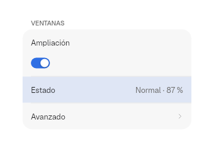
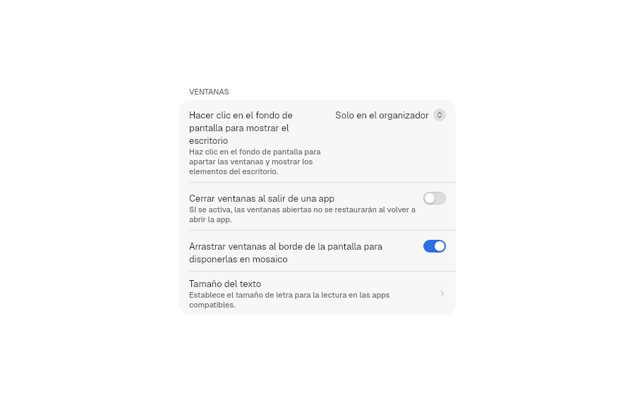
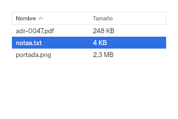
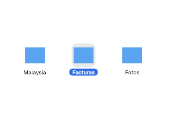
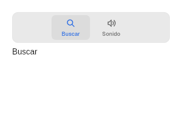
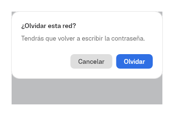

# 9. Vistas

**Objetivo:** conocer los contenedores de la capa 2 que organizan el contenido.
**Lector:** quien arma pantallas completas.

## Formularios: `Form`, `Section`, `Row`

Es la pieza de los ajustes: filas agrupadas en tarjetas.

```rust
Form::new()
    .section(
        Section::titled("Ventanas")
            .row(Row::new("Ampliación").control(Switch::new("Ampliación").on(true)))
            .row(Row::value("Estado", "Normal · 87 %"))
            .row(Row::navigation("Avanzado", |_| {})),
    )
    .highlighted(Some("Estado"))
```



| Fila | Para |
|---|---|
| `Row::new(título).control(..)` | Etiqueta y control |
| `Row::value(título, valor)` | Información de solo lectura |
| `Row::navigation(título, al_pulsar)` | Ir a una subpágina (chevron) |
| `Row::destructive(título, al_pulsar)` | Acción destructiva, en rojo |

- `.detail(texto)` añade una explicación bajo el título; los textos largos
  pasan a varias líneas sin cortar el control.
- `.keywords(&[..])` alimenta la búsqueda de `PreferencesWindow`.
- `Section::new()` va sin título; `.footer(texto)` añade un pie.
- `.highlighted(Some(título))` resalta la fila que eligió el buscador.



## Tabla: `Table`

```rust
Table::new("Archivos", vec!["Nombre", "Tamaño"])
    .rows(filas)
    .sort(Some(SortOrder { column: 0, ascending: true }))
    .selected(vec![1])
    .on_sort(move |orden| criterio.set(Some(orden)))
    .on_select(move |filas: Vec<usize>| elegidas.set(filas))
```



Pulsar una cabecera pide un orden nuevo (`next_sort` alterna ascendente y
descendente); la app ordena sus filas.

Como `NSTableView`:

1. Ctrl+clic añade o quita una fila y Mayús+clic elige el rango desde el
   último clic (`select`, compartido con `CollectionView`).
2. El borde derecho de cada cabecera se arrastra para fijar el ancho de su
   columna, con un mínimo de `components.table.min-column-width` (10 pt, el
   `minWidth` por defecto de `NSTableColumn`). El tirador mide
   `resize-handle` (6 pt, estimado). Las columnas sin ancho fijo se reparten
   el resto.
3. El clic secundario en la cabecera abre un menú con una casilla por columna
   para mostrarla u ocultarla. Siempre queda una visible (`toggle_column`).

## Rejilla: `CollectionView`

```rust
CollectionView::new("Documentos")
    .item(icono(), "Malaysia")
    .item(icono(), "Facturas")
    .selected(vec![1])
    .on_select(move |elegidos: Vec<usize>| seleccion.set(elegidos))
```



Ctrl+clic añade o quita un elemento y Mayús+clic elige un rango, igual que en
`Table`.

## Pestañas: `TabView`

```rust
TabView::new("Preferencias")
    .tab(Symbol::MagnifyingGlass, "Buscar", pagina_buscar)
    .tab(Symbol::SpeakerWave, "Sonido", pagina_sonido)
    .selected(0)
```



## Árbol y columnas: `OutlineView`, `ColumnBrowser`

```rust
let nodos = vec![TreeNode::new("Documentos").icon(Symbol::Folder).child(TreeNode::new("notas.txt"))];
OutlineView::new("Archivos", nodos.clone())
ColumnBrowser::new("Archivos", nodos)
```

`barrier_kit::views::tree` muestra un `Vec<TreeNode>` como árbol con
triángulos (`NSOutlineView`) o como columnas, al estilo del Finder
(`NSBrowser`). Las filas miden 24 y cada nivel sangra 13, lo que mide
`NSOutlineView` en macOS 26.6.2. Las columnas miden `DISCLOSURE.column_width`
(200, una estimación). Las dos avisan con `on_select(ruta)`, una lista de
índices desde la raíz.

## Pestañas de ventana: `WindowTabs`

```rust
WindowTabs::new(titulos, elegida).on_select(..).on_close(..).on_new(..)
```

La barra de pestañas de una ventana con pestañas de `NSWindow`: cápsulas
que se reparten el ancho, la elegida en relieve, con la X al pasar el puntero
y un + al final. Sus medidas son una estimación. La app guarda el contenido
de cada pestaña; las pestañas no se pueden arrastrar a otra ventana.

## Barra de herramientas: búsqueda y desbordamiento

`compact::ToolbarSearch::new(texto, "Buscar").collapsed(estrecha)` es el
buscador de la toolbar: con `collapsed(true)` queda en una lupa que se abre
al pulsarla y se cierra al perder el foco vacío. `ToolbarOverflow::new(items)`
es el botón » que reúne en un menú lo que no cabe; la app lo muestra en vez
de esos elementos cuando el `Breakpoint` es `Compact`. Los dos van en
`Titlebar::right`.

## Estados, hojas y alertas

```rust
empty_state(Symbol::MagnifyingGlass, "Sin resultados")
sheet(contenido)
Alert::new("¿Olvidar esta red?", "Tendrás que volver a escribir la contraseña.")
    .confirm("Olvidar", |_| {})
    .cancel("Cancelar", |_| {})
```

| Vacío | Alerta |
|---|---|
|  |  |

`sheet` muestra el contenido como diálogo centrado sobre un velo
(`Palette::scrim`) que cubre la ventana. El diálogo tiene radio 26 con
esquina continua, como las sheets y alertas de macOS 26. `Alert` mide 260
de ancho, reparte sus dos botones grandes (28, en cápsula) a partes iguales,
confirma con Intro y cancela con Esc.

## Navegación: `History`

```rust
let historial = use_state(|| History::new(Seccion::Inicio));
historial.write().push(Seccion::Ajustes);
navigation_buttons(historial)
```

`History<T>` guarda la pila atrás/adelante. `navigation_buttons` dibuja ‹ y ›
en una cápsula `ToolGroup` con divisor y responde a las acciones `GO_BACK` (Alt+←) y `GO_FORWARD` (Alt+→).

## Búsqueda: `SearchIndex`

```rust
let mut indice = SearchIndex::new();
indice.add("wifi", "Wi-Fi", &["red", "inalámbrica"]);
let resultados = indice.search("inalam");
```

Busca sin distinguir mayúsculas ni tildes. `PreferencesWindow` lo construye
solo con los títulos y las `keywords` de cada `Row`.

## Diseño adaptable

```rust
let adaptable = use_breakpoint();
match adaptable.current() {
    Breakpoint::Wide => tres_columnas(),
    Breakpoint::Medium => dos_columnas(),
    Breakpoint::Compact => una_columna(),
}
```

Los cortes son `BREAKPOINT.medium` (620) y `BREAKPOINT.wide` (900).
`adaptable.attach(rect())` mide el elemento al que se engancha. Ondina lo usa
para pasar de tres columnas a una (capítulo [15](15-apps-de-prueba.md)).

Siguiente: [10. Patrones](10-patrones.md).
