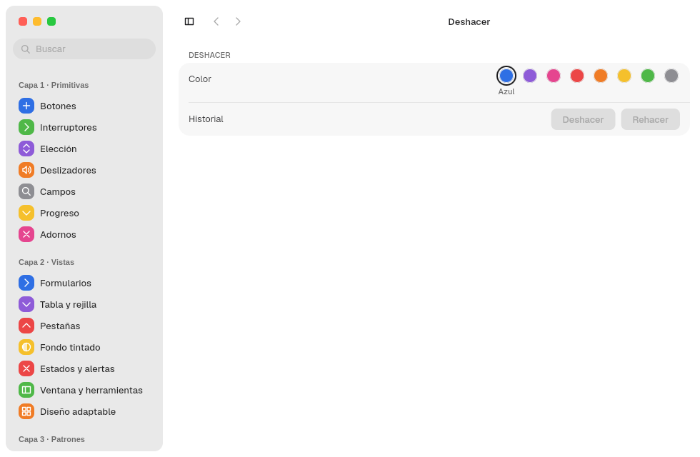

# 10. App infrastructure

**Goal:** give an app what any desktop app is expected to have: actions with
shortcuts, a global menu, a single instance, saved preferences and undo.
**Reader:** anyone preparing an app for real use.

Everything lives in `barrier_kit::app` and `barrier_kit::app_menu`.

## Actions and shortcuts: `Action`

An action is declared once and serves the global menu, the shortcut and the
context menus:

```rust
const RESET: Action =
    Action::new("reset", "Restablecer").shortcut(Shortcut::ctrl(ShortcutKey::Char('r')));

use_menu_action(move |id| {
    if id == RESET.id {
        historial.set(0);
    }
});
```

- `Shortcut::new(modificadores, tecla)` or `Shortcut::ctrl(tecla)`; the keys
  are `ShortcutKey::Char(c)`, `Left` and `Right`.
- `RESET.item(true)` creates the menu entry; `item_with(true, CheckState::Checkbox(on))`
  creates it with a checkbox.
- The handler always runs on the interface thread.
- A shortcut only arrives if its action is in the window's menu.

| Kit action | Shortcut |
|---|---|
| `UNDO` | Ctrl+Z |
| `REDO` | Ctrl+Shift+Z |
| `GO_BACK`, `GO_FORWARD` | Alt+←, Alt+→ |
| `TOGGLE_SIDEBAR` | Ctrl+Alt+S |

## Global menu: `AppMenu`

```rust
WindowOptions::new("Notas", "notas").menu(AppMenu::new(vec![Menu::new(
    "Edición",
    vec![UNDO.item(true), REDO.item(true), RESET.item(true)],
)]))
```

The menu is published over D-Bus (dbusmenu) and, if the compositor offers
`org_kde_kwin_appmenu_manager`, it appears in the MalaysiaDreams menu bar.
Without that protocol it still exists on D-Bus.

## Single instance: `launch`

```rust
let app_id = barrier_kit::titlebar::app_id("notas").leak();
let instancia = match launch(app_id) {
    Ok(Launch::Forwarded) => return,
    Ok(Launch::Primary(instancia)) => Some(instancia),
    Err(_) => None,
};
```

- A second run forwards its activation token to the first one and exits.
- The first one brings its window to the front (xdg-activation).
- Inside `render`, `instancia.listen()` (once, in `use_hook`) handles those
  notices and `ActivateAction`, which triggers the action with the same id.
- Without a session bus, `launch` fails and the app keeps running without a
  single instance.

## Preferences and restoration

| Function | File | For |
|---|---|---|
| `load_defaults::<T>(app_id)`, `save_defaults(app_id, &valor)` | `~/.config/malaysia/<app_id>.domain` (TOML) | User preferences |
| `use_defaults::<T>(app_id)` | the same | Reads them and updates if the file changes |
| `load_restoration::<T>(app_id)`, `save_restoration(..)` | `~/.local/share/malaysia/<app_id>.state` | Window state: pane, searches, sidebar |

`T` is a struct with `Serialize` and `Deserialize`. Writing is atomic
(temporary file and rename). `MALAYSIA_CONFIG_DIR` and `MALAYSIA_DATA_DIR`
change the folders. The window size is restored automatically.

## Undo: `use_undo`

```rust
let color = use_state(|| 0);
let historial = use_undo(color);
historial.set(3);
historial.undo();
```

`use_undo` wraps a `State`. Each `set` saves the previous value; `UNDO` and
`REDO` walk through it from the menu or the shortcut, and their menu entries
are disabled when the stack is empty.



## Clipboard

```rust
copy("texto");
let pegado: Option<String> = paste();
```

Text only, over `wl_data_device`.

## Complete example

[ADR 0047, annex A](../decisiones/0047-barrierkit-en-capas.md#anexo-a--cómo-se-escribe-una-app)
puts all of this together in a 60-line app.

Next: [11. Animations](11-animaciones.en.md).
