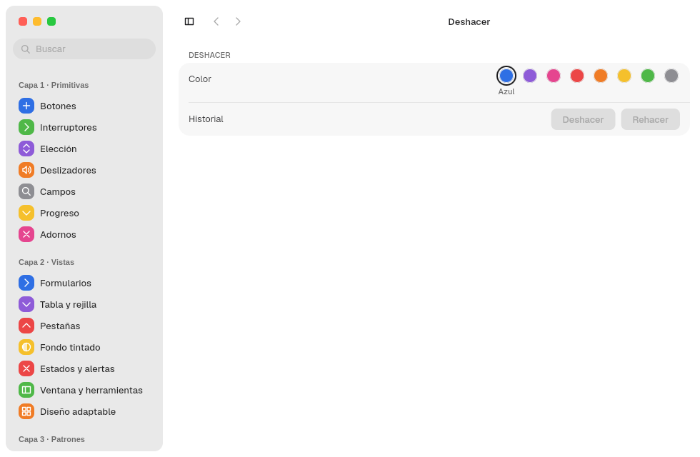

# 10. Infraestructura de app

**Objetivo:** dar a una app lo que se espera de cualquier app del escritorio:
acciones con atajos, menú global, una sola instancia, preferencias guardadas y
deshacer.
**Lector:** quien prepara una app para usarla de verdad.

Todo está en `barrier_kit::app` y `barrier_kit::app_menu`.

## Acciones y atajos: `Action`

Una acción se declara una vez y sirve para el menú global, el atajo y los
menús contextuales:

```rust
const RESET: Action =
    Action::new("reset", "Restablecer").shortcut(Shortcut::ctrl(ShortcutKey::Char('r')));

use_menu_action(move |id| {
    if id == RESET.id {
        historial.set(0);
    }
});
```

- `Shortcut::new(modificadores, tecla)` o `Shortcut::ctrl(tecla)`; las teclas
  son `ShortcutKey::Char(c)`, `Left` y `Right`.
- `RESET.item(true)` crea la entrada del menú; `item_with(true, CheckState::Checkbox(on))`
  la crea con casilla.
- El handler corre siempre en el hilo de la interfaz.
- Un atajo solo llega si su acción está en el menú de la ventana.

| Acción del kit | Atajo |
|---|---|
| `UNDO` | Ctrl+Z |
| `REDO` | Ctrl+Mayús+Z |
| `GO_BACK`, `GO_FORWARD` | Alt+←, Alt+→ |
| `TOGGLE_SIDEBAR` | Ctrl+Alt+S |

## Menú global: `AppMenu`

```rust
WindowOptions::new("Notas", "notas").menu(AppMenu::new(vec![Menu::new(
    "Edición",
    vec![UNDO.item(true), REDO.item(true), RESET.item(true)],
)]))
```

El menú se publica por D-Bus (dbusmenu) y, si el compositor ofrece
`org_kde_kwin_appmenu_manager`, aparece en la barra de menús de MalaysiaDreams.
Sin ese protocolo sigue existiendo en D-Bus.

## Una sola instancia: `launch`

```rust
let app_id = barrier_kit::titlebar::app_id("notas").leak();
let instancia = match launch(app_id) {
    Ok(Launch::Forwarded) => return,
    Ok(Launch::Primary(instancia)) => Some(instancia),
    Err(_) => None,
};
```

- Una segunda ejecución reenvía su token de activación a la primera y sale.
- La primera trae su ventana al frente (xdg-activation).
- Dentro de `render`, `instancia.listen()` (una vez, en `use_hook`) atiende
  esos avisos y `ActivateAction`, que lanza la acción del mismo id.
- Sin bus de sesión, `launch` falla y la app sigue sin instancia única.

## Preferencias y restauración

| Función | Fichero | Para |
|---|---|---|
| `load_defaults::<T>(app_id)`, `save_defaults(app_id, &valor)` | `~/.config/malaysia/<app_id>.domain` (TOML) | Preferencias del usuario |
| `use_defaults::<T>(app_id)` | el mismo | Las lee y se actualiza si el fichero cambia |
| `load_restoration::<T>(app_id)`, `save_restoration(..)` | `~/.local/share/malaysia/<app_id>.state` | Estado de la ventana: panel, búsquedas, barra lateral |

`T` es un struct con `Serialize` y `Deserialize`. La escritura es atómica
(fichero temporal y renombrado). `MALAYSIA_CONFIG_DIR` y `MALAYSIA_DATA_DIR`
cambian las carpetas. El tamaño de la ventana y si estaba maximizada se restauran solos.

## Deshacer: `use_undo`

```rust
let color = use_state(|| 0);
let historial = use_undo(color);
historial.set(3);
historial.undo();
```

`use_undo` envuelve un `State`. Cada `set` guarda el valor anterior; `UNDO` y
`REDO` lo recorren desde el menú o el atajo, y sus entradas del menú se apagan
cuando la pila está vacía.



## Portapapeles

```rust
copy("texto");
let pegado: Option<String> = paste();
```

Solo texto, sobre `wl_data_device`.

## Ejemplo completo

El [ADR 0047, anexo A](../decisiones/0047-barrierkit-en-capas.md#anexo-a--cómo-se-escribe-una-app)
une todo esto en una app de 60 líneas.

Siguiente: [11. Animaciones](11-animaciones.md).
