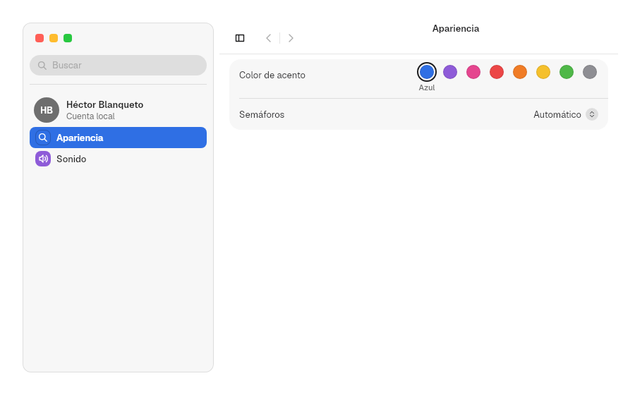
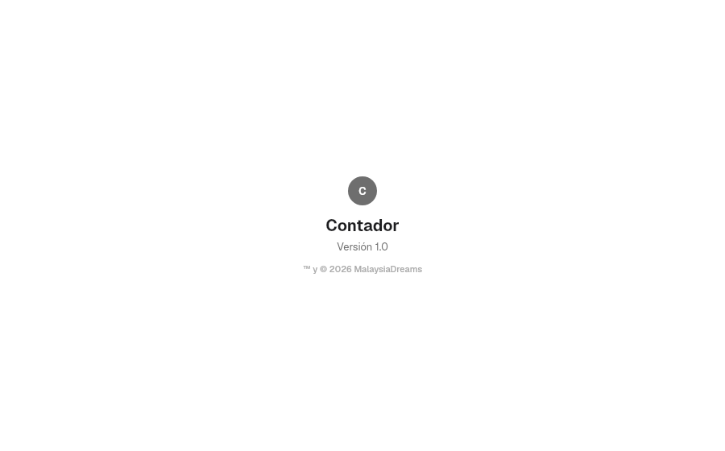

# 10. Patrones

**Objetivo:** montar una ventana completa con una sola pieza.
**Lector:** quien hace una app de ajustes o necesita un «Acerca de».

## Ventana de preferencias: `PreferencesWindow`

Une `SplitView`, `Sidebar`, buscador, historial y `Form`. La app solo declara
los paneles:

```rust
PreferencesWindow::new()
    .restoration(app_id)
    .suggestions(&["general"])
    .account("HB", "Héctor Blanqueto", "Cuenta local")
    .group(
        PaneGroup::new(Some("General")).pane(Pane::new(
            "general",
            "General",
            Symbol::CircleHalf,
            ACCENT_SWATCHES[0].1,
            Form::new().section(
                Section::titled("Etiqueta").row(
                    Row::new("Color")
                        .keywords(&["color", "etiqueta"])
                        .control(ColorWell::new("Color", &ACCENT_SWATCHES)),
                ),
            ),
        )),
    )
```



| Opción | Efecto |
|---|---|
| `Pane::new(id, título, símbolo, tinte, form)` | Un panel: un ítem de la barra lateral y su formulario |
| `PaneGroup::new(Some(título))` | Grupo con título en la barra lateral; `None` sin título |
| `.account(..)` | Fila de cuenta arriba de la barra |
| `.restoration(app_id)` | Guarda y restaura el panel abierto, las búsquedas recientes y el ancho y visibilidad de la barra |
| `.suggestions(&[ids])` | Paneles sugeridos cuando el buscador está vacío |
| `.sidebar_resizable(bool)`, `.sidebar_range(Option<(mín, máx)>)` | Pasan a `SplitView` (capítulo [8](08-barra-lateral.md)) |

### El buscador

- Busca en los títulos de los paneles y en los títulos y `keywords` de cada fila.
- Muestra cada resultado con el icono de su panel. ↑, ↓ e Intro lo recorren.
- Elegir un resultado abre el panel y resalta la fila.
- El título del panel aparece en la barra, con los botones atrás y adelante.

Tengen App Show y Ajustes del sistema están hechos con este patrón.

## «Acerca de»: `about_window`

```rust
about_window(avatar("C"), "Contador", "Versión 1.0", "™ y © 2026 MalaysiaDreams")
```



Siguiente: [11. Infraestructura de app](11-app.md).
