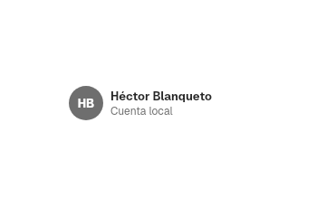

# 10. Sidebar and split view

**Goal:** build a window with a sidebar that selects what the detail shows, and
control how the sidebar resizes, hides and collapses.
**Scope:** from the sidebar content (`sidebar`) to the container that places it
beside the detail (`views::split`). The titlebar over the detail is in
[9](09-titlebars.md#titlebar); the views inside the detail are in
[11](11-views.md); a ready-made settings window with a sidebar is in
[12](12-patterns.md).
**Reader:** anyone who builds an app with side navigation.
**Input:** a window that draws its own titlebar with `run_window`
([2](02-first-app.md), [8](08-windows.md)). **Output:** a sidebar app whose
page follows the selected item.

## Steps

1. Keep the selected page in state:

   ```rust
   let mut page = use_state(|| 0);
   ```

2. Build one `SidebarItem` per page. It shows the selection the app passes and
   reports a press through `on_select`:

   ```rust
   let item = |index: usize, title: &'static str, glyph: Symbol| {
       SidebarItem::new(title)
           .symbol(glyph, ACCENT_SWATCHES[index].1)
           .selected(*page.read() == index)
           .on_select(move |_| page.set(index))
   };
   ```

3. Put the items in a `Sidebar`, grouped in `SidebarSection`s if needed:

   ```rust
   let sidebar = Sidebar::new()
       .traffic_lights(true)
       .child(item(0, "Home", Symbol::House))
       .child(
           SidebarSection::new("Library")
               .child(item(1, "Recent", Symbol::Clock))
               .child(item(2, "Downloads", Symbol::ArrowDown)),
       );
   ```

4. Build the detail: a `Titlebar` with `.with_sidebar(true)` and the
   `SidebarToggle` button, then the page:

   ```rust
   let detail = rect()
       .expanded()
       .direction(Direction::Vertical)
       .child(Titlebar::new().with_sidebar(true).title("Home").left(SidebarToggle))
       .child(VStack::new().expanded().child(Text::new("Home")));
   ```

5. Join both in a `SplitView` and return it from the `run_window` closure:

   ```rust
   SplitView::new(sidebar, detail)
   ```

6. Optional: save the layout the user leaves and pass it back on the next
   launch with `.sidebar_width(..)` and `.sidebar_visible(..)`:

   ```rust
   SplitView::new(sidebar, detail)
       .on_layout(move |layout: SidebarLayout| saved.set(Some(layout)))
   ```

The names come from `bk::sidebar`, `bk::views::split`,
`bk::symbol::Symbol` and `ctdesign::ACCENT_SWATCHES`.

## Sidebar content

### `Sidebar`

The column of navigation rows. Its children scroll in a
[`ScrollView`](05-controls.md). Its accessibility role is navigation.

| Method | Default | Effect |
|---|---|---|
| `Sidebar::new()` | — | An empty sidebar |
| `.child(view)`, `.children(views)` | — | Adds rows: items, sections, an account or any view |
| `.traffic_lights(bool)` | `false` | Draws the window's traffic lights in the sidebar's top corner. Where they go with each titlebar layout is in [9](09-titlebars.md) |
| `.backdrop(SidebarBackdrop)` | `Clear` | How the island looks over a tinted backdrop: see [`SidebarBackdrop`](#sidebarbackdrop); `Tinted` overrides the style's background and rim |
| `.style(f)` | Tengen | A `SidebarStyle` ([Style](#style)) |
| `.key(key)` | none | Diff key, as on any Freya element |

Its look comes from `sidebar_style` in `appearance.domain`
([4](04-appearance-and-tokens.md),
[ADR 0041](../decisions/0041-island-sidebar.md)). The app chooses nothing:

| `sidebar_style` | Look |
|---|---|
| `island` (default) | A floating panel `SIDEBAR.inset` (8) from the window edges, radius `SIDEBAR.radius` (18) with a continuous corner, and a rim. It stays concentric with the window's 26 corner |
| `flat` | Edge to edge, with a 1 px line on its right side |

The strip above the first row moves the window when dragged. When the traffic
lights are in the sidebar, the first row starts below them.

#### Style

`Sidebar::style`, `SidebarItem::style`, `SidebarSection::style`,
`SidebarAccount::style` and `SymbolTile::style` take a `SidebarStyle`,
`SidebarItemStyle`, `SidebarSectionStyle`, `SidebarAccountStyle` and
`SymbolTileStyle`. Their Tengen follows `sidebar_style`; the fields are in
[Styles and themes](../ai/styles.md#sidebarstyle-sidebaritemstyle-sidebarsectionstyle-sidebaraccountstyle-and-symboltilestyle).

```rust
Theme::tengen().style(|s: SidebarItemStyle| SidebarItemStyle {
    shape: Shape::Capsule,
    ..s
})
```

### `SidebarItem`

A row with an optional symbol tile and a one-line label.

| Method | Default | Effect |
|---|---|---|
| `SidebarItem::new(label)` | — | A row with that text |
| `.symbol(Symbol, tint)` | no tile | A [`SymbolTile`](#symboltile) of color `tint` before the label |
| `.selected(bool)` | `false` | Draws the row as selected. The app decides which row is selected |
| `.emphasized(bool)` | `true` | With `false`, the selection is gray instead of accent, as when the focus is elsewhere |
| `.style(f)` | Tengen | A `SidebarItemStyle` ([Style](#style)) |
| `.on_select(callback)` | none | Called when the row is pressed |
| `.key(key)` | none | Diff key |

**Events:** `on_select(())`. After it, the item closes the sidebar if it floats
over the content (see [Narrow windows](#narrow-windows)).

**Look:** `SIDEBAR.item_height` (32) high, radius `SIDEBAR.item_radius` (8),
text of `SIDEBAR.item_text_size` (13). The selected row has the accent
background and semibold text; hover shows a light background. In an inactive
window the selection turns gray.

### `SidebarSection`

A titled group of rows. It mounts open; a press on its title collapses or
opens it over `DURATION_BASE` (220 ms). A chevron appears on the title on hover
or with the keyboard focus.

| Method | Effect |
|---|---|
| `SidebarSection::new(title)` | A section with that title (11 pt, weight 600) |
| `.child(view)`, `.children(views)` | Adds rows |
| `.style(f)` | A `SidebarSectionStyle` ([Style](#style)) |
| `.key(key)` | Diff key |

### `SidebarAccount`

The account row at the top of the sidebar: an avatar with the initials, the
name in bold and a detail line below. `SETTINGS.account_height` (48) high. It
reports nothing; `.style(f)` takes a `SidebarAccountStyle`.

```rust
SidebarAccount::new("JA", "Jane Appleseed", "Local account")
```



### `SymbolTile`

`SymbolTile::new(glyph, tint)` draws the square tile of a sidebar item:
`SIDEBAR.app_icon` (22) wide, radius 8, filled with `tint`, the glyph in
`Palette::on_accent`. `.rim(color)` adds a 1 px inner border and `.style(f)`
takes a `SymbolTileStyle`; both build the tile again, so they come right after
`new`. It is a rect: it takes Freya's layout and style methods. `SidebarItem` uses it, and so do the
search results of [`SettingsWindow`](12-patterns.md#settingswindow).

### `SidebarBackdrop`

It matters only over a tinted backdrop
([15](15-backdrops-and-media.md),
[ADR 0057](../decisions/0057-glass-and-sidebar-over-backdrop.md)). Without one,
both values look the same.

| Variant | Island over a tinted backdrop |
|---|---|
| `Clear` (default) | Transparent: the backdrop shows through |
| `Tinted` | Filled with the backdrop's average color, with a separator rim |

The flat sidebar is always transparent over a tinted backdrop.

### `SidebarControl`

`sidebar_control() -> Option<SidebarControl>` gives any view inside a
`SplitView` a handle on its sidebar. Outside a `SplitView` it returns `None`.
`Titlebar` and `SidebarToggle` read it.

| Method | Returns or does |
|---|---|
| `.toggle()` | Shows the sidebar if it is hidden, hides it if it is shown |
| `.dismiss()` | Hides it only if it floats over the content |
| `.occupied()` | The width the docked sidebar takes now, animated; `0.0` while it floats |
| `.settled()` | `true` when it is shown and fully open |

```rust
if let Some(control) = sidebar_control() {
    control.toggle();
}
```

## Split view

### `SplitView`

The container: the sidebar on the left, the detail in the rest and an optional
inspector on the right. It paints the window background, so the app does not.
It is `NavigationSplitView` with a sidebar and a detail column.

| Method | Default | Effect |
|---|---|---|
| `SplitView::new(sidebar, detail)` | — | Both panes |
| `.sidebar_width(f32)` | `SIDEBAR.width` (220) | Width on the first render, clamped to the range |
| `.sidebar_visible(bool)` | `true` | Visibility on the first render |
| `.sidebar_range(min, max)` | `SPLIT_VIEW.sidebar_min`, `.sidebar_max` (180, 320) | Width limits. A new range clamps the current width |
| `.resizable(bool)` | `true` | With `false` there is no grip: the width is fixed |
| `.narrow_sidebar(NarrowSidebar)` | `Overlay` | Where the sidebar opens in a narrow window: see [Narrow windows](#narrow-windows) |
| `.inspector(view, presented)` | none | See [Inspector](#inspector) |
| `.background_extension(view)` | none | See [Background extension](#background-extension) |
| `.on_layout(callback)` | none | Reports [`SidebarLayout`](#sidebarlayout) |
| `.style(f)` | Tengen | A `SplitViewStyle`: inset, grip, background, scrim, inspector line and the animations ([Styles and themes](../ai/styles.md#splitviewstyle-splitpanesstyle-and-floatingpanestyle)) |
| `.key(key)` | none | Diff key |

`sidebar_width` and `sidebar_visible` are starting values. After the first
render the user owns the layout; read it back with `on_layout`.

### Resizing

The grip is a `SPLIT_VIEW.grip` (8 px) strip on the sidebar's right edge. It
exists only with `.resizable(true)` and while the sidebar is fully open.

1. On hover, the cursor becomes `col-resize` and an accent line of
   `SPLIT_VIEW.grip_line` (2 px) appears, `grip_line_inset` (18 px) from the
   top and the bottom.
2. While dragging, the width follows the pointer and stays in the range.
3. Tab focuses the grip; ← and → change the width by `SPLIT_VIEW.key_step`
   (10 px) with a `DURATION_FAST_MS` (120 ms) spring. With reduced motion the
   change is immediate.
4. On release, `on_layout` receives the new width.

### Hiding: `SidebarToggle` and `TOGGLE_SIDEBAR`

`SidebarToggle` is a unit struct: an icon button with the `SidebarLeft` symbol
that calls `SidebarControl::toggle`. Its label is "Show or Hide Sidebar". It is
disabled outside a `SplitView`. Put it in the titlebar's left zone:
`Titlebar::new().left(SidebarToggle)`. It takes `IconButtonStyle`.

`TOGGLE_SIDEBAR` is the [`Action`](13-app.md) with the id `toggle-sidebar` and
the shortcut Ctrl+Alt+S. `SplitView` answers its shortcut itself; add the
action to the app's menu to show it there.

Hiding and showing animate over `DURATION_BASE` (220 ms).

### Narrow windows

`NarrowSidebar` decides where the sidebar opens when the window is narrower
than `SPLIT_VIEW.collapse_below` (760 px):

| Variant | The sidebar opens |
|---|---|
| `Overlay` (default) | Floating over the detail, above the `Palette::scrim` veil, without moving the detail. A click on the veil, Escape or an item's `on_select` closes it |
| `Push` | Docked: it narrows the detail |

1. When the window becomes narrow, the sidebar hides by itself.
2. The user opens it with `SidebarToggle` or Ctrl+Alt+S; it appears as
   `NarrowSidebar` says.
3. When the window grows past 760 px again, the sidebar comes back docked and
   visible, even if the user had closed it. This is the rule of
   [`AdwOverlaySplitView`](https://gnome.pages.gitlab.gnome.org/libadwaita/doc/1.4/class.OverlaySplitView.html)
   without `pin-sidebar`.

### `SidebarLayout`

`SidebarLayout { width: f32, visible: bool }`, what `on_layout` reports. It is
`Serialize` and `Deserialize`, so it can be saved as is. `SplitView` reports it
when the width or the visibility changes, never during a drag. A sidebar that
hid by itself in a narrow window counts as visible.

### Inspector

`.inspector(view, presented)` adds a right pane `SPLIT_VIEW.inspector` (270)
wide, the width of
[`NSSplitViewItem(inspectorWithViewController:)`](https://developer.apple.com/documentation/appkit/nssplitviewitem/init(inspectorwithviewcontroller:)),
after a 1 px separator. Changing `presented` opens or closes it over
`DURATION_BASE`, like SwiftUI's `.inspector(isPresented:content:)`.

### Background extension

`.background_extension(view)` paints `view` under the docked sidebar, as macOS
26 `.backgroundExtensionEffect()` does. The view is laid out as wide as the
detail and its first pixel column is stretched to the window edge. Apple
mirrors the view; Freya 0.4.3 drops children under a negative scale, so the
edge is stretched instead. It is not drawn while the sidebar floats.

Next: [11. Views](11-views.md).
