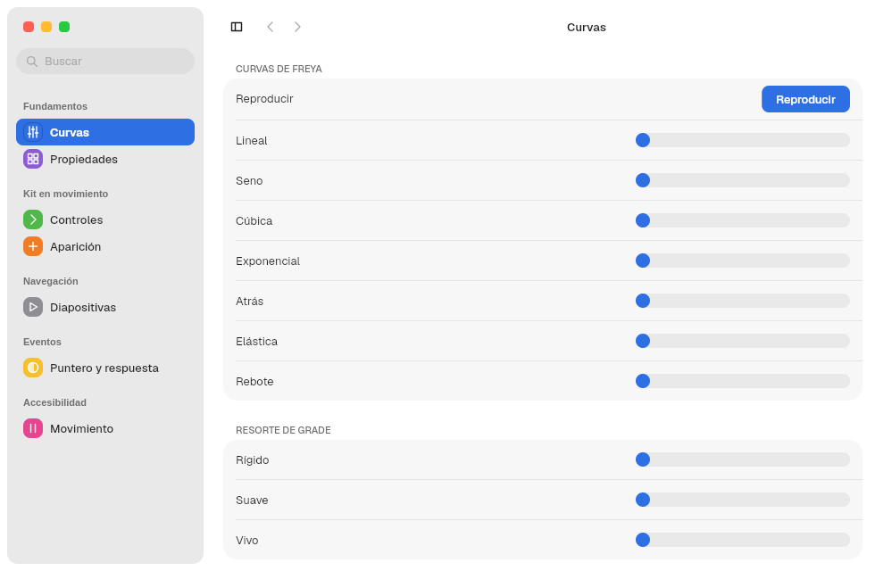
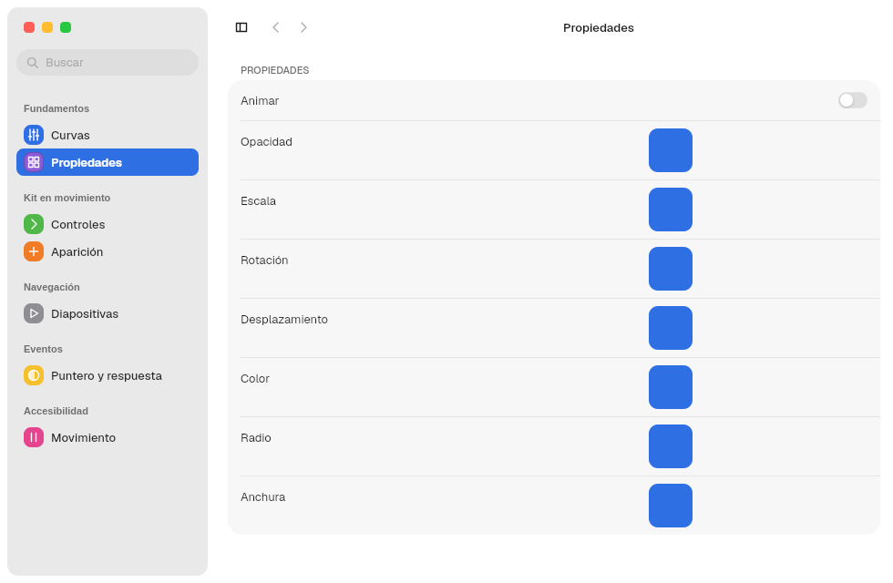
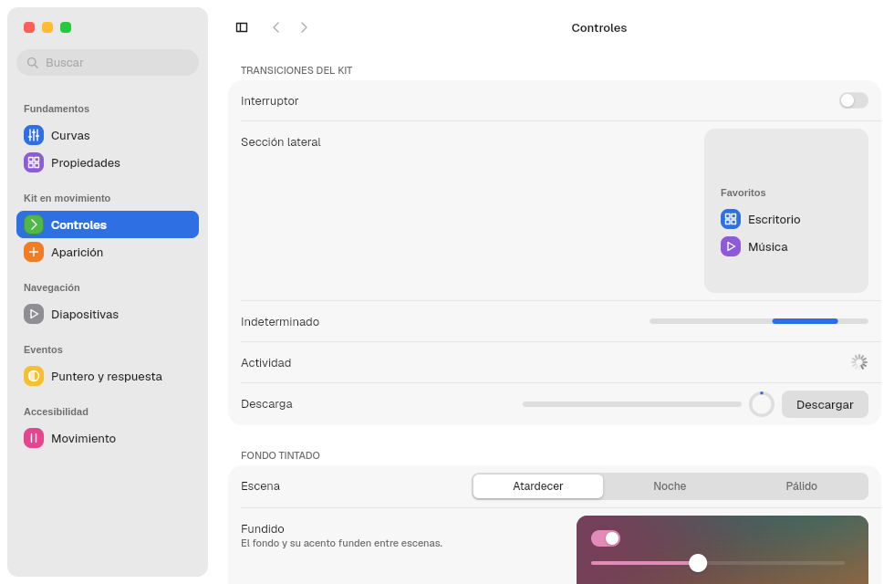
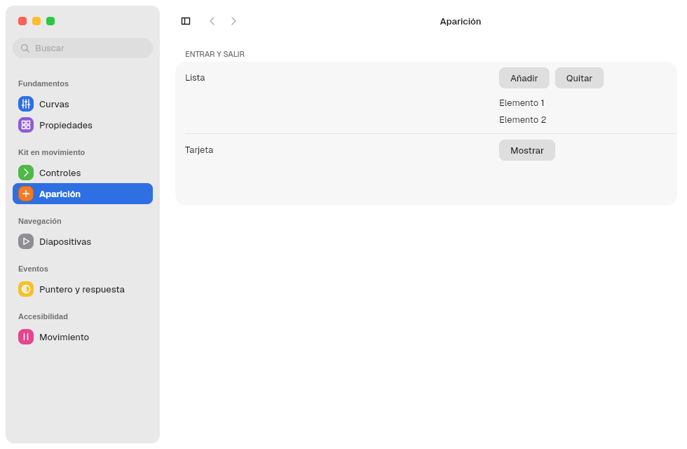
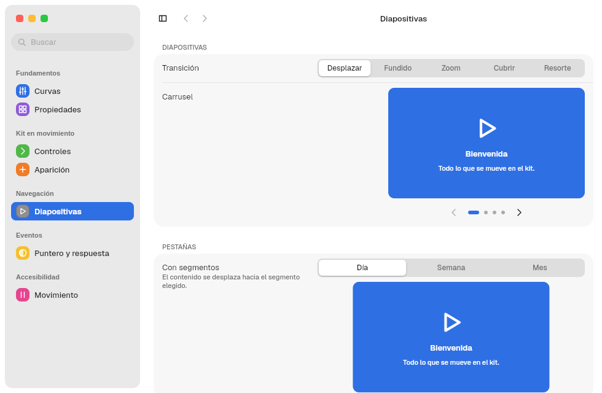
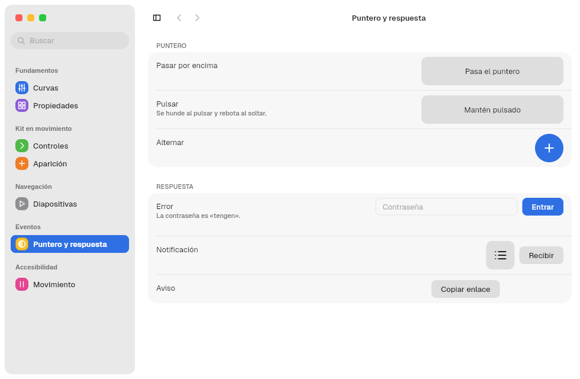
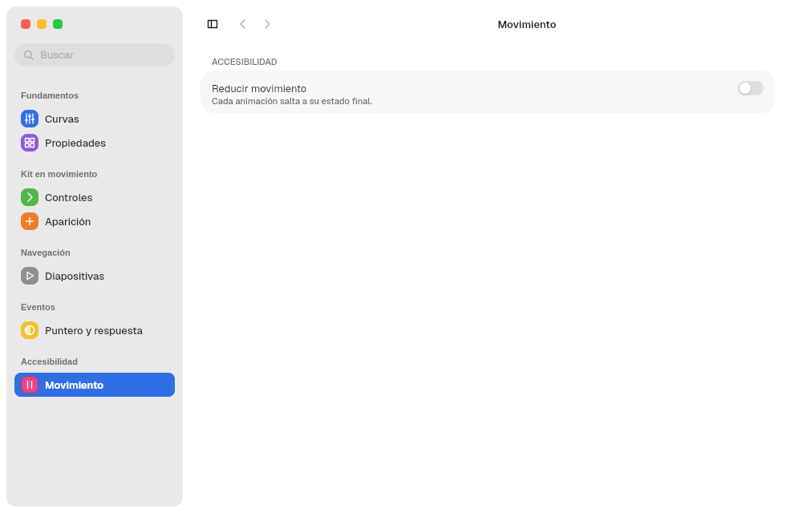

# 11. Animations

**Goal:** know what already animates, how to animate something of your own and
how reduced motion is respected.
**Reader:** anyone who adds motion to an app or a component.

## Basis

Animations use `freya-animation` (`use_animation`,
`use_animation_transition`, `AnimNum` with `Ease` and `Function`) and the kit's
own spring, **Grade**: `animation::Spring`. The durations come from Tengen:

| Token | ms | Typical use |
|---|---|---|
| `DURATION_FAST_MS` | 120 | Immediate responses: following the pointer, scroll bars |
| `DURATION_BASE` | 220 | Showing, hiding and collapsing |
| `DURATION_SLOW_MS` | 420 | Backdrop fades |

## What animates in the kit

| Element | Duration | Curve |
|---|---|---|
| `Switch` knob | `SWITCH.transition_ms` | Ease out, cubic |
| Collapsing a `SidebarSection` | `DURATION_BASE` | Ease out, cubic |
| Showing or hiding the sidebar | `DURATION_BASE` | Ease out, cubic |
| Sidebar width while dragging | `DURATION_FAST_MS` | `Spring`, no bounce |
| Revealing hidden titlebars (`Reveal`) | `DURATION_BASE` | Ease out, cubic |
| Indeterminate `ProgressBar` | `PROGRESS.indeterminate_ms` | In-out, cubic, looping |
| `Spinner` | `PROGRESS.spinner_ms` | Linear, looping |
| Fade between `Backdrop` backgrounds | `DURATION_SLOW_MS` | In-out, cubic |
| Scroll bar | `DURATION_FAST_MS` | Fade |

Pressing a button scales it to `BUTTON.pressed_scale` without animation.

## The spring: `Spring`

```rust
use freya_animation::prelude::use_animation_transition;

let destino = use_state(|| 0.0f32);
let movimiento = use_animation_transition(destino, |desde, hasta| {
    Spring::new(desde, hasta, Duration::from_millis(DURATION_BASE), 0.3)
});
let x = movimiento.get().current();
```

- The app needs `freya-animation` in its `Cargo.toml`; `Spring` is imported
  from `barrier_kit::animation`.
- `Spring::new(desde, hasta, duración, rebote)`. The bounce goes from 0 to 1.
- With bounce 0 it is a cubic ease-out curve. With more, it is a damped
  oscillation.
- It implements `AnimatedValue`, so it works in `use_animation` like any Freya
  animation.

## Reduced motion

With `reduced_motion = true` in `appearance.domain`, every kit animation uses
duration 0 and the loops stop. Your own animation must do the same:

```rust
let tiempo = if theme::resolved().reduced_motion { 0 } else { DURATION_BASE };
```

## See it live: Tengen Motion Show

| Freya curves and Grade springs | Animatable properties |
|---|---|
|  |  |

| Kit controls | Appearance |
|---|---|
|  |  |

| Slides | Pointer and response | Reduced motion |
|---|---|---|
|  |  |  |

Motion Show is a test bench: what works there is later moved into the kit.

Next: [12. Tinted backdrops and media](12-fondos-y-medios.en.md).
