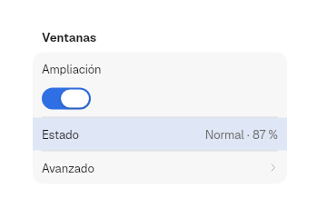
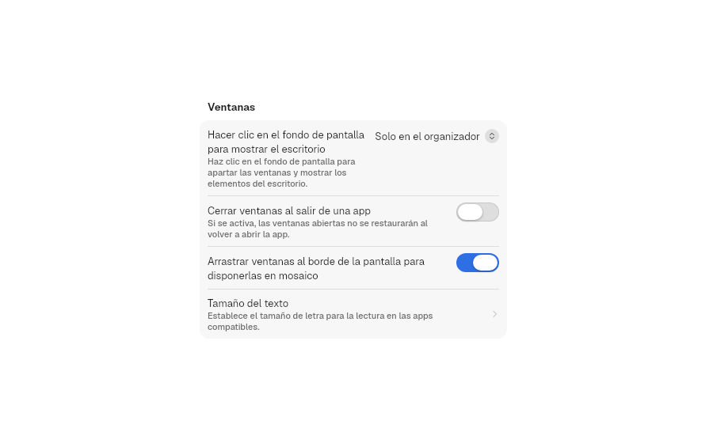
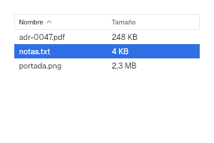
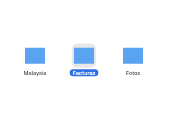
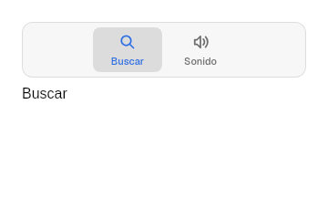
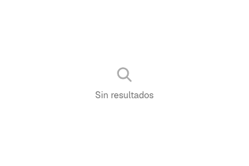
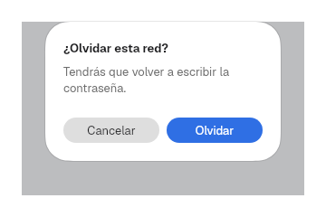

# 11. Views

**Goal:** compose the content of a window from the kit's containers: forms,
tables, grids, trees, tabs, panes, alerts and navigation.
**Scope:** every module under `bk::views` except `split` (the sidebar
container, in [10](10-sidebar.md)), plus `bk::adaptive`. Single
controls are in [5](05-controls.md), framed text editing in
[6](06-text-and-editing.md), complete windows in [12](12-patterns.md).
**Reader:** anyone who assembles full screens.
**Input:** a window ([2](02-first-app.md)) or the detail of a `SplitView`
([10](10-sidebar.md)). **Output:** a content view that shows data, reports
what the user picks and adapts to the width.

## Steps

The task: a file list that shows an empty state, sorts, selects and asks
before deleting.

1. Keep the data, the order and the selection in state:

   ```rust
   let mut files = use_state(Vec::<Vec<String>>::new);
   let mut sort = use_state(|| None::<SortOrder>);
   let mut selected = use_state(Vec::<usize>::new);
   ```

2. With no data, show an empty state:

   ```rust
   if files.read().is_empty() {
       return ContentUnavailableView::new("No files", Symbol::Folder).into_element();
   }
   ```

3. Otherwise, build the view and write back what it reports. The view never
   changes the data: the app sorts `files` when `sort` changes.

   ```rust
   let table = Table::new("Files", vec!["Name", "Size"])
       .rows(files.read().clone())
       .sort(*sort.read())
       .selected(selected.read().clone())
       .on_sort(move |order| sort.set(Some(order)))
       .on_select(move |rows: Vec<usize>| selected.set(rows));
   ```

4. Ask before a destructive action. Draw the `Alert` while a flag is set and
   clear the flag in both callbacks:

   ```rust
   let mut confirming = use_state(|| false);
   let alert = confirming.read().then(|| {
       Alert::new("Delete these files?", "You cannot undo this action.")
           .confirm("Delete", move |_| {
               files.write().clear();
               confirming.set(false);
           })
           .cancel("Cancel", move |_| confirming.set(false))
   });
   ```

5. Measure the width and choose the layout with `use_size_class`:

   ```rust
   let adaptive = use_size_class();
   adaptive
       .attach(rect().expanded())
       .child(table)
       .maybe_child((adaptive.current() != SizeClass::Compact).then(|| details()))
       .maybe_child(alert)
   ```

## Forms

### `Form`

The settings layout: sections of rows inside rounded cards. It is SwiftUI's
`Form` with the grouped style.

```rust
Form::new()
    .section(
        Section::titled("Windows")
            .row(Row::new("Zoom").control(Switch::new("Zoom").on(true)))
            .row(Row::value("Status", "Normal · 87 %"))
            .row(Row::navigation("Advanced", |_| {})),
    )
    .highlighted(Some("Status"))
```



| Method | Effect |
|---|---|
| `Form::new()` | An empty form |
| `.section(Section)` | Adds a section |
| `.highlighted(Option<&str>)` | Tints the row with that title with the accent at 12 % |

`sections` is a public field: [`SettingsWindow`](12-patterns.md#settingswindow)
reads it to build its search. Below `LIST_GROUP.stack_below` (360 px) of width,
rows with a control put the label above the control.

### `Section`

| Method | Effect |
|---|---|
| `Section::new()` | A card without a title |
| `Section::titled(title)` | A card with a `HEADLINE` title above |
| `.row(Row)` | Adds a row; rows are separated by a line |
| `.header(view)` | A view in place of the title, such as a title with buttons; the title still names the section for search |
| `.illustration(view)` | A full-width view at the top of the card, above the rows |
| `.footer(text)` | A `CAPTION` note below the card |

`title` and `rows` are public fields.

### `Row`

| Constructor | The row shows |
|---|---|
| `Row::new(title)` | Only the title. Add `.control(view)` to put a control on the right |
| `Row::value(title, value)` | Read-only text on the right |
| `Row::navigation(title, on_press)` | A chevron; the whole row is a button |
| `Row::page(title, pane_id)` | A chevron; the row opens that page of a [`SettingsWindow`](12-patterns.md#pane) |
| `Row::destructive(title, on_press)` | The title in red; the whole row is a button |

| Method | Effect |
|---|---|
| `.control(view)` | The control on the right, aligned with the first line of the title |
| `.detail(text)` | An explanation under the title |
| `.symbol(symbol, tint)` | A [`SymbolTile`](10-sidebar.md#symboltile) before the title |
| `.icon(view)` | Any view before the title, such as a device picture; it replaces `.symbol` |
| `.hover_control(view)` | A control before the accessory that shows only while the pointer is over the row, like «Connect» in a Wi-Fi list |
| `.stacked()` | The control goes under the title at any width, as macOS does with radio groups and lists of checkboxes |
| `.keywords(&[..])` | Extra words for the `SettingsWindow` search |

Long titles and details wrap without clipping the control.



### Style

`Form::style` takes a `FormStyle`: the cards, the rows and their texts. The
fields are in [Styles and themes](../../crates/bk/src/styles/form.rs).

```rust
Form::new().section(section).style(|s| FormStyle { section_spacing: 32.0, ..s })
```

## Groups

### `GroupBox`

`GroupBox::new(Option<label>).child(view)`: a rounded box (radius
`GROUP_BOX.radius`, 11) with a faint fill and a hairline border, and the label
above it. It groups related controls without a form.

### `DisclosureGroup`

`DisclosureGroup::new(label).expanded(bool).child(view)`: a header row with a
chevron that shows or hides its children, indented `DISCLOSURE.indent` (13).
`.expanded` is the starting state; after that the user owns it.

### Style

`GroupBox::style` and `DisclosureGroup::style` take a `GroupBoxStyle` and a
`DisclosureGroupStyle`. The fields are in
[Styles and themes](../../crates/bk/src/styles/form.rs).

## Tables

### `Table`

Rows of text in columns with a header, like `NSTableView`.



| Method | Effect |
|---|---|
| `Table::new(label, columns)` | `label` names it for accessibility; `columns` are the header titles |
| `.rows(Vec<Vec<String>>)` | One `Vec` of cells per row |
| `.sort(Option<SortOrder>)` | Shows the arrow on the sorted column |
| `.selected(Vec<usize>)` | Selected rows |
| `.on_sort(callback)` | Receives the [`SortOrder`](#sortorder) the user asks for |
| `.on_select(callback)` | Receives the new selection, `Vec<usize>` |

1. A click on a header asks for a new order with
   [`next_sort`](#table-helpers). The app sorts its rows.
2. A click selects a row. Ctrl+click or Super+click adds or removes it;
   Shift+click selects the range from the last click
   ([`select`](#select)). ↑ and ↓ move a single selection.
3. The right edge of each header drags to fix the column's width, with a
   minimum of `TABLE.min_column_width` (10, the default `minWidth` of
   `NSTableColumn`). The handle is `TABLE.resize_handle` (6) wide. Columns
   without a fixed width share the rest.
4. A secondary click on the header opens a menu with a checkbox per column to
   show or hide it. One column always stays.

The table keeps column widths and hidden columns itself and does not report
them. Rows are `TABLE.row_height` (24) high, striped, and only the visible
ones are built.

### `SortOrder`

`SortOrder { column: usize, ascending: bool }`: the column index and the
direction.

### Table helpers

| Function | Returns |
|---|---|
| `next_sort(current, column)` | The same column flips its direction; another column starts ascending |
| `shown_columns(hidden, count)` | The indices in `0..count` not in `hidden` |
| `toggle_column(hidden, column, count)` | `hidden` with `column` shown again, or hidden if another column stays visible |

### Style

`Table::style` takes a `TableStyle`: the header, the stripes and the
selection. The fields are in
[Styles and themes](../../crates/bk/src/styles/table.rs).

## Collections

### `CollectionView`

A wrapping grid of icons with names, like `NSCollectionView`.

```rust
CollectionView::new("Documents")
    .item(icon(), "Notes")
    .item(icon(), "Invoices")
    .selected(vec![1])
    .on_select(move |chosen: Vec<usize>| selection.set(chosen))
```



| Method | Effect |
|---|---|
| `CollectionView::new(label)` | An empty grid; `label` names it for accessibility |
| `.item(icon, name)` | A `COLLECTION.tile` (92) wide tile with a 48 icon area |
| `.selected(Vec<usize>)` | Selected items |
| `.on_select(callback)` | Receives the new selection |

Clicks select as in [`Table`](#table). A plain click on an item already
selected reports nothing.

### `select`

`select(current, index, held: Modifiers) -> Vec<usize>` is the click rule of
`Table`, `CollectionView` and `OutlineView`:

| Held | Result |
|---|---|
| Nothing | Only `index` |
| Ctrl or Super | `current` with `index` added or removed |
| Shift | The range from the last item of `current` (the anchor, kept last) to `index` |

### Style

`CollectionView::style` takes a `CollectionViewStyle` for its tiles. The
fields are in [Styles and themes](../../crates/bk/src/styles/table.rs).

## Trees

### `TreeNode`

`TreeNode::new(title).icon(Symbol).child(TreeNode)`: one node of a tree. Its
fields `title`, `icon` and `children` are public. A path is the list of child
indices from the root: `[0, 1]` is the second child of the first node.

### `OutlineView`

`OutlineView::new(label, nodes).on_select(callback)`: the tree as indented
rows with disclosure chevrons, like `NSOutlineView`. Rows are
`DISCLOSURE.row_height` (24) high and each level indents 13. The view keeps
which nodes are open. `on_select` receives the selected paths,
`Vec<Vec<usize>>`; Ctrl+click and Shift+click work over the visible rows as in
[`select`](#select).

### `Browser`

`Browser::new(label, nodes).on_select(callback)`: the tree as columns,
like Finder's column view (`NSBrowser`). Choosing a node with children opens
the next column. Columns are `DISCLOSURE.column_width` (200) wide and scroll
sideways. `on_select` receives the chosen path, `Vec<usize>`.

### Tree helpers

| Function | Returns |
|---|---|
| `visible_rows(nodes, expanded)` | `(path, depth)` for each row shown when the paths in `expanded` are open |
| `node_at(nodes, path)` | The node at `path`, or `None` |

### Style

`OutlineView::style` and `Browser::style` take the same `OutlineViewStyle`,
so a theme draws both alike. The fields are in
[Styles and themes](../../crates/bk/src/styles/table.rs).

```rust
Theme::tengen().style(|s: OutlineViewStyle| OutlineViewStyle { row_shape: Shape::Capsule, ..s })
```

## Tabs

### `TabView`

Pages chosen from a centered strip of tabs with an icon above the title.

```rust
TabView::new("Preferences")
    .tab(Symbol::MagnifyingGlass, "Search", search_page)
    .tab(Symbol::SpeakerWave, "Sound", sound_page)
    .selected(0)
    .on_change(move |index: usize| tab.set(index))
```



| Method | Effect |
|---|---|
| `TabView::new(label)` | An empty tab view; `label` names the strip for accessibility |
| `.tab(Symbol, title, content)` | Adds a tab and its page |
| `.selected(usize)` | The selected tab. A new value selects it again |
| `.on_change(callback)` | Receives the index the user picks |

The view switches pages by itself; `on_change` is for the app to remember.

### Style

`TabView::style` takes a `TabViewStyle`: the strip and its tabs. The fields
are in [Styles and themes](../../crates/bk/src/styles/tab_view.rs).

## Window tabs

### `WindowTabs`

The tab bar of a tabbed window, like `NSWindowTabGroup`: capsules that share
the width, the selected one raised.

```rust
WindowTabs::new(titles, selected)
    .on_select(move |index: usize| current.set(index))
    .on_close(move |index: usize| close(index))
    .on_new(move |_| open())
```

| Method | Effect |
|---|---|
| `WindowTabs::new(titles, selected)` | One tab per `String`; `selected` is raised |
| `.on_select(callback)` | Receives the pressed tab |
| `.on_close(callback)` | Receives the tab whose × was pressed. The × shows on the selected tab and on hover, only with two or more tabs |
| `.on_new(callback)` | Adds a + button at the end |

The app keeps each tab's content. Tabs cannot be dragged.

### Style

`WindowTabs::style` takes a `WindowTabsStyle`. The fields are in
[Styles and themes](../../crates/bk/src/styles/tab_view.rs).

## Split panes

### `SplitPanes`

Panes in a row or a column with dividers the user drags, like `NSSplitView`. A
pane can be another `SplitPanes`.

```rust
SplitPanes::new("Panes", Direction::Horizontal)
    .pane(list)
    .pane(preview)
    .ratios(ratios.read().clone())
    .on_ratios(move |next: Vec<f32>| ratios.set(next))
```

| Method | Default | Effect |
|---|---|---|
| `SplitPanes::new(label, Direction)` | — | `Horizontal` places panes side by side, `Vertical` stacks them |
| `.pane(view)` | — | Adds a pane |
| `.ratios(Vec<f32>)` | equal | The share of each pane. A list of the wrong length means equal shares |
| `.on_ratios(callback)` | none | Receives the new shares on every pointer move of a drag |
| `.divider(Rgba)` | `Palette::separator` | Divider color, an instance override of the style's `divider` |
| `.style(f)` | Tengen | A `SplitPanesStyle`: divider width and paint ([Styles and themes](../../crates/bk/src/styles/split_panes.rs)) |

The ratios are controlled: store what `on_ratios` reports and pass it back, or
the divider does not move. A drag changes only the two panes beside the
divider, and neither goes below `SPLIT_PANES.pane_min` (60 px). Dividers are
`SPLIT_PANES.divider` (3 px) thick.

## Floating panes

### `FloatingPane`

A pane over the window content with a title bar that moves it, edges that
resize it and a shadow. It has no constructor: fill its public fields.

```rust
FloatingPane {
    frame: *frame.read(),
    title: "Inspector".into(),
    active: true,
    accent: Palette::current().accent,
    title_bar: Palette::current().control_background,
    title_ink: Palette::current().label,
    content: inspector.into(),
    on_raise: Callback::new(|_| {}),
    on_frame: Callback::new(move |next| frame.set(next)),
    style: Theme::tengen(),
}
```

| Field | Meaning |
|---|---|
| `frame: PaneFrame` | Position and size, relative to the parent |
| `title`, `title_bar`, `title_ink` | Title text, bar color and text color |
| `active`, `accent` | An active pane has an `accent` outline; an inactive one, the separator color |
| `content: Element` | The pane's body |
| `on_raise` | Called on any press in the pane, so the app can put it on top |
| `on_frame` | Receives the new `PaneFrame` on every pointer move of a drag |
| `style: Theme` | `Theme::tengen()`; `.style(f)` adds a `FloatingPaneStyle` override ([Styles and themes](../../crates/bk/src/styles/floating_pane.rs)). `accent`, `title_bar` and `title_ink` override its `outline`, `title_bar` and `title` before it |

The title bar is `FLOATING_PANE.title_height` (22) high. A
`FLOATING_PANE.resize_band` (6) band around the pane resizes it from each edge
and corner. Like `SplitPanes`, the frame is controlled: store it and pass it
back.

### `PaneFrame`

`PaneFrame { x, y, width, height }`, all `f32`.

## Text view

### `TextView`

Multi-line editable text without a frame or scrolling, like an `NSTextView`
inside a custom view. For a framed field with find and spelling, see
[6](06-text-and-editing.md).

```rust
TextView::new(text, MONO.family, 13.0, 16.0, color(Palette::current().label))
    .auto_focus(true)
    .on_key(|press: KeyPress| press.key == Key::Named(NamedKey::Tab))
```

| Method | Default | Effect |
|---|---|---|
| `TextView::new(value, family, size, line_height, ink)` | — | `value: State<String>` holds the text; `ink` is a `Color` |
| `.cursor(Color)` | `ink` | Caret color |
| `.width(Size)`, `.height(Size)` | fill, auto | Size |
| `.auto_focus(bool)` | `false` | Takes the focus when mounted |
| `.on_change(callback)` | none | Receives the text after each edit |
| `.on_focus_change(callback)` | none | Receives `true` on focus and `false` on blur |
| `.on_key(callback)` | none | Sees each key first; returning `true` consumes it |

1. Enter breaks the line.
2. Escape and a click outside release the focus.
3. Ctrl or Super with a letter types nothing, except the editing keys A, C,
   X, V, Z and Y.

### `KeyPress`

What `on_key` receives: `key`, `modifiers` and `cursor_utf16`, the caret
position in UTF-16 units.

### Style

`TextView::style` takes a `TextViewStyle`: the paint of the text and the
caret. `ink` and `.cursor(color)` override it before `.style`
([Styles and themes](../../crates/bk/src/styles/text_view.rs)).

## Feedback

Module `views::feedback`. `ContentUnavailableView` and `Sheet` are rects: they
take Freya's layout and style methods.

### `ContentUnavailableView`

`ContentUnavailableView::new(title, symbol)` draws a large faint symbol over a
line of text, for a view with nothing to show, like SwiftUI's
`ContentUnavailableView`.

### `Sheet`

`Sheet::new(content)` covers the window with the `Palette::scrim` veil and
shows `content` in a dialog centered in the window. The dialog has radius 26
with a continuous corner, 20 of padding and the window shadow (`SHADOW`, or
`SHADOW_DARK` in dark), so it floats like a window of its own. Draw it while it should show;
remove it to close it.

In a window, the sheet is a window of its own, like an AppKit sheet: a child
toplevel marked modal with `xdg-dialog-v1`, sized to its content (it starts at
`DIALOG_SHEET_WIDTH` × `DIALOG_SHEET_HEIGHT`). The compositor keeps it centered
on the window that opened it and moves it with that window. It is not a
panel: it takes the keyboard, so the window behind deactivates and dims under
the veil. Without a window
(tests, shell layers) it draws inside the surface over the veil.

While a sheet or an [`Alert`](#alert) shows, the window that opened it is modal
as in AppKit: its content takes no clicks, minimize and zoom still work, and the
close light is disabled.

### `Alert`

A [`Sheet`](#sheet) with a title, a message and two buttons, like `NSAlert`.

```rust
Alert::new("Forget this network?", "You will have to type the password again.")
    .confirm("Forget", move |_| forget())
    .cancel("Cancel", move |_| close())
    .suppression(dont_ask_again)
```

| Empty state | Alert |
|---|---|
|  |  |

| Method | Default | Effect |
|---|---|---|
| `Alert::new(title, message)` | — | Title in `HEADLINE`, message below |
| `.confirm(label, callback)` | "OK", nothing | The primary button, on the right; Enter presses it |
| `.cancel(label, callback)` | "Cancel", nothing | The other button; Escape presses it |
| `.suppression(State<bool>)` | none | Adds the "Do not show this message again" checkbox bound to the state, like `NSAlert`'s `showsSuppressionButton` |
| `.destructive()` | off | The primary button takes `ButtonStyle::destructive`, like `NSAlert.hasDestructiveAction` |

The alert is `DIALOG_ALERT_WIDTH` (260) wide and splits its two large buttons
evenly. It does not close itself: the callbacks stop drawing it.

### Style

`Sheet::style`, `Alert::style` and `ContentUnavailableView::style` take a
`SheetStyle`, an `AlertStyle` and a `ContentUnavailableViewStyle`. An `Alert`
draws on the `SheetStyle` of the theme and the containers. The fields are in
[Styles and themes](../../crates/bk/src/styles/sheet.rs).

## Navigation

### `History`

`History<T>` keeps a back-and-forward list of pages.

| Method | Effect |
|---|---|
| `History::new(root)` | A history at `root` |
| `.current()` | The page shown |
| `.push(page)` | Goes to `page` and drops the forward pages. Pushing the current page does nothing |
| `.back()`, `.forward()` | Move one step if possible |
| `.can_go_back()`, `.can_go_forward()` | Whether a step is possible |

### `NavigationButtons`

`NavigationButtons::new(State<History<T>>)` draws ‹ and › in a
[`ToolGroup`](05-controls.md) capsule. Each button is disabled at its end of
the history. It also answers the shortcuts of `GO_BACK` and `GO_FORWARD`.

```rust
let mut history = use_state(|| History::new(Page::Home));
let open_settings = move |_| history.write().push(Page::Settings);
Titlebar::new().left(NavigationButtons::new(history))
```

### `GO_BACK` and `GO_FORWARD`

Two [`Action`](13-app.md)s: `go-back` ("Back", Alt+←) and `go-forward`
("Forward", Alt+→).

### Style

`NavigationButtons` takes no style of its own: its group takes
`ToolGroupStyle` and its arrows `IconButtonStyle`
([Styles and themes](../../agents/styles.md#which-controls-take-a-style)).

## Search

### `SearchIndex`

A list of entries searched by title and keywords, ignoring case and accents.

```rust
let mut index = SearchIndex::new();
index.add("wifi", "Wi-Fi", &["network", "wireless"]);
let hits = index.search("WIREL");
```

| Method | Effect |
|---|---|
| `SearchIndex::new()` | An empty index; the key type `K` is any `Clone` |
| `.add(key, title, keywords)` | Adds an entry |
| `.search(query)` | The entries whose folded title or a keyword contains the folded query, in the order added. A blank query finds nothing |

`SettingsWindow` builds one from its panes
([`index`](12-patterns.md#index)).

### `Entry`

`Entry { key, title, keywords }`: one result of `search`.

### Search helpers

| Function | Returns |
|---|---|
| `fold(text)` | `text` in lowercase without accents: combining marks dropped, `ß` → `ss`, `ø` → `o`, `ł` → `l` and similar |
| `word_start(name, query)` | `true` if `query` starts a word of `name` other than the first |

## Adaptive layout

### `use_size_class`

`use_size_class() -> SizeClassReader` creates a width reader.
`SizeClassReader::attach(rect)` measures that element and `SizeClassReader::current()`
returns its [`SizeClass`](#sizeclass). Before the first measure, it is
`Wide`.

```rust
let adaptive = use_size_class();
let columns = match adaptive.current() {
    SizeClass::Wide => 3,
    SizeClass::Medium => 2,
    SizeClass::Compact => 1,
};
adaptive.attach(rect().expanded()).child(grid(columns))
```

### `SizeClass`

| Variant | Width |
|---|---|
| `Compact` | Below `BREAKPOINT.medium` (620) |
| `Medium` | From 620 to below `BREAKPOINT.wide` (900) |
| `Wide` | 900 and more |

`SizeClass::for_width(f32)` maps a width to its variant.

Next: [12. Patterns](12-patterns.md).
