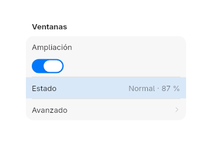
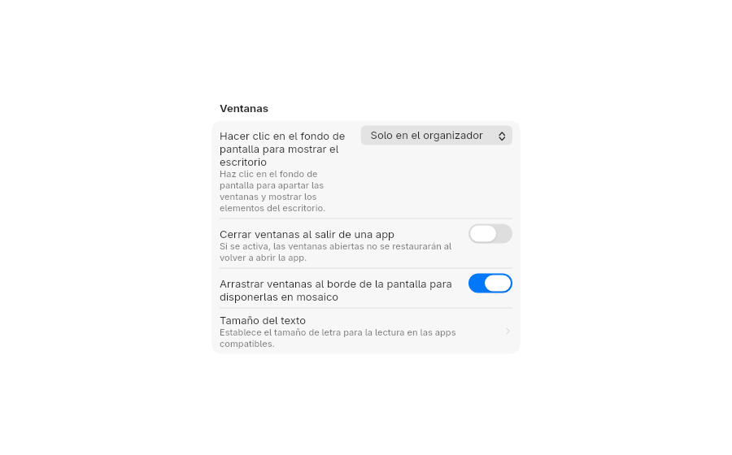
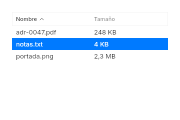
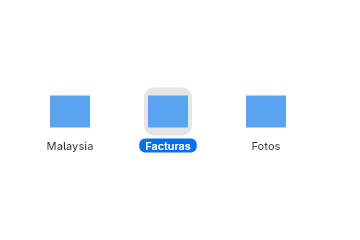
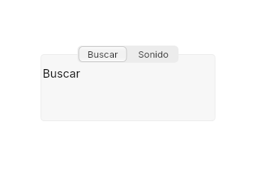
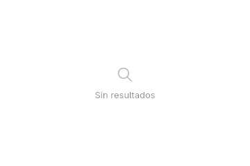
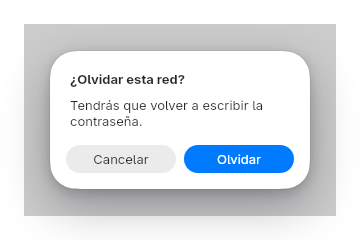

# 11. Views

**Goal:** compose the content of a window from the kit's containers: layout
views, forms, tables, grids, trees, tabs, panes, alerts and navigation.
**Scope:** every module under `bk::views` except `split` (the sidebar
container, in [10](10-sidebar.md)), and `bk::layout`. Single
controls are in [5](05-controls.md), framed text editing in
[6](06-text-and-editing.md), complete windows in [12](12-patterns.md).
**Reader:** anyone who assembles full screens.
**Input:** a window ([2](02-first-app.md)) or the detail of a `SplitView`
([10](10-sidebar.md)). **Output:** a content view that shows data, reports
what the user picks.

## Steps

The task: a file list that shows an empty state, sorts, selects and asks
before deleting.

1. Keep the data, the order and the selection in state:

   ```rust
   let mut files = use_state(Vec::<Vec<String>>::new);
   let mut sort = use_state(|| None::<SortOrder>);
   let mut selected = use_state(Vec::<usize>::new);
   ```

2. With no data, show an empty state:

   ```rust
   if files.read().is_empty() {
       return ContentUnavailableView::new("No files", Symbol::Folder).into_element();
   }
   ```

3. Otherwise, build the view and write back what it reports. The view never
   changes the data: the app sorts `files` when `sort` changes.

   ```rust
   let table = Table::new("Files", vec!["Name", "Size"])
       .rows(files.read().clone())
       .sort(*sort.read())
       .selected(selected.read().clone())
       .on_sort(move |order| sort.set(Some(order)))
       .on_select(move |rows: Vec<usize>| selected.set(rows));
   ```

4. Ask before a destructive action. Draw the `Alert` while a flag is set and
   clear the flag in both callbacks:

   ```rust
   let mut confirming = use_state(|| false);
   let alert = confirming.read().then(|| {
       Alert::new("Delete these files?", "You cannot undo this action.")
           .confirm("Delete", move |_| {
               files.write().clear();
               confirming.set(false);
           })
           .cancel("Cancel", move |_| confirming.set(false))
   });
   ```

5. Put the table and the alert in the view:

   ```rust
   rect().expanded().child(table).maybe_child(alert)
   ```

## Layout

`Spacer`, `Frame` and `Grid` are in `bk::layout`, and the prelude exports them.
A `VStack` or an `HStack` is a column or a row; these say what a stack cannot.

### `Spacer`

`Spacer::new()` takes the space that the other children of its `HStack` or
`VStack` leave, and two spacers share it equally. `.min_length(f32)` is the
least it takes (default `SPACE_2`, what SwiftUI gives `Spacer()` on macOS 27.2.1).
A stack that holds a `Spacer` fills its own axis unless it has a size, and its
other axis stays as its children make it. In a `rect()` of your own, a `Spacer`
grows along both axes and the `rect()` needs `.content(Content::flex())`.

```rust
HStack::new()
    .child(Button::new("Reset"))
    .child(Spacer::new())
    .child(Button::new("Save"))
```

### `Frame`

`view.frame()` wraps the view in a `Frame`: a `rect()` with Freya's size
methods (`width`, `height`, `min_width`, `max_width`). `.alignment(ContentAlignment)` places
the view inside it, `CENTER` by default. `ContentAlignment` is SwiftUI's
`Alignment` with its nine constants, from `TOP_LEADING` to `BOTTOM_TRAILING`;
`HorizontalAlignment` and `VerticalAlignment` are its two axes. `Leading` and
`Trailing` are left and right.

```rust
// SwiftUI: Text("Name").frame(width: 100, alignment: .trailing)
Text::new("Name").frame().width(Size::px(100.0)).alignment(ContentAlignment::TRAILING)
```

`frame(maxWidth: .infinity)` is `.width(Size::fill())` in a column. In a row
`Size::fill()` overflows the siblings after it: give the `HStack`
`.content(Content::flex())` and the frame `.width(Size::flex(1.0))`.

### `Grid` and `GridRow`

`Grid::new()` lines up the cells of its rows. A `GridRow` holds the cells of one
row (`.child`, `.children`) and `Grid::row` adds it. Each column is as wide as
its widest cell, each row as tall as its tallest, and a cell sits in its slot
by `ContentAlignment`, `CENTER` by default.

| Method | What it does |
|---|---|
| `Grid::alignment(ContentAlignment)` | Where each cell sits in its slot |
| `Grid::horizontal_spacing(f32)`, `Grid::vertical_spacing(f32)` | The gaps between columns and between rows; both default to `SPACE_2` |
| `GridRow::alignment(VerticalAlignment)` | Overrides the vertical alignment of that row |
| `Grid::child(view)` | A view outside a row: it spans every column, as in SwiftUI |
| `view.grid_cell_columns(n)` | The cell spans `n` columns; the width it needs beyond them is split equally among them |
| `view.grid_column_alignment(HorizontalAlignment)` | Aligns the whole column of that cell; a cell that spans columns ignores it |

The program is [`layout_grid.rs`](../../agents/recipes/layout_grid.rs). Three limits:

1. Cells are content-sized. A cell with `Size::fill()` or `Size::flex` takes the
   width the Grid has available, not its column's: give a separator a width.
2. Torin places a Grid by the size it had before the Grid arranged its cells.
   The width is exact; the height is the tallest column. A parent that centers
   or ends its children places the Grid off when the tallest cells of
   different rows are in different columns. Put the Grid in a parent aligned
   `Start`, or give it a `.height`.
3. There is no `gridCellAnchor`, no hidden row and no baseline alignment: torin
   cannot state a baseline ([ADR 0089](../decisions.md)).

## Forms

### `Form`

The settings layout: sections of rows inside rounded cards. It is SwiftUI's
`Form` with the grouped style.

```rust
Form::new()
    .section(
        Section::titled("Windows")
            .row(Row::toggle("Zoom", true, |_| {}))
            .row(Row::value("Status", "Normal · 87 %"))
            .row(Row::navigation("Advanced", |_| {})),
    )
    .highlighted(Some("Status".into()))
```



| Method | Effect |
|---|---|
| `Form::new()` | An empty form |
| `.style(FormStyle::columns)` | SwiftUI's `.columns`: no cards or inset, the labels right-aligned in a column as wide as the widest one, the controls 9.5 after it (below) |
| `.section(Section)` | Adds a section |
| `.pinned(Section)` | In a `SettingsWindow` pane, keeps that section under the title bar while the rest scrolls |
| `.highlighted(Option<Cow<'static, str>>)` | Tints the row with that title with the accent at 12 % |

`sections` is a public field: [`SettingsWindow`](12-patterns.md#settingswindow)
reads it to build its search. The form is inset 20 on each side, its cards are
10 apart, and a row is its content plus 10 above and below, at least 36 high.
The control of a row stays at the trailing edge at any width, as in a SwiftUI
`Form`; `.stacked()` puts it under the title.

With `FormStyle::columns` a row is its title on the right edge of the label
column and its control or value after `LIST_GROUP.columns_gap` (9.5); rows are
`columns_spacing` (5) apart. The section titles, headers and footers are not
drawn; a row with an empty title and a `Checkbox` control is a checkbox that
starts at the control column.

```rust
Form::new().style(FormStyle::columns).section(
    Section::new()
        .row(Row::new("").control(Checkbox::new("Toggle").checked(true)))
        .row(Row::new("Name").control(TextField::new(name, "Name"))),
)
```

### `Section`

| Method | Effect |
|---|---|
| `Section::new()` | A card without a title |
| `Section::titled(title)` | A card with a `HEADLINE` title above |
| `.row(Row)` | Adds a row; rows are separated by a line |
| `.header(view)` | A view in place of the title, such as a title with buttons; the title still names the section for search. A section with only a header draws no card |
| `.illustration(view)` | A full-width view at the top of the card, above the rows |
| `.footer(text)` | A `CAPTION` note below the card |

`title` and `rows` are public fields.

### `Row`

| Constructor | The row shows |
|---|---|
| `Row::new(title)` | Only the title. Add `.control(view)` to put a control on the right |
| `Row::value(title, value)` | Read-only text on the right |
| `Row::navigation(title, on_press)` | A chevron; the whole row is a button |
| `Row::page(title, pane_id)` | A chevron; the row opens that page of a [`SettingsWindow`](12-patterns.md#pane) |
| `Row::destructive(title, on_press)` | The title in red; the whole row is a button |
| `Row::toggle(title, on, on_toggle)` | A mini [`Switch`](05-controls.md#switch-and-checkbox) (36 × 16, the size SwiftUI uses in a form) on the right, with the title as its label |

| Method | Effect |
|---|---|
| `.control(view)` | The control on the right, aligned with the first line of the title |
| `.detail(text)` | An explanation under the title |
| `.symbol(symbol, tint)` | A [`SymbolTile`](10-sidebar.md#symboltile) before the title |
| `.icon(view)` | Any view before the title, such as a device picture; it replaces `.symbol` |
| `.hover_control(view)` | A control before the accessory that shows only while the pointer is over the row, like «Connect» in a Wi-Fi list |
| `.stacked()` | The control goes under the title at any width, as macOS does with radio groups and lists of checkboxes |
| `.keywords(&[..])` | Extra words for the `SettingsWindow` search |

Long titles and details wrap without clipping the control.



### Style

`Form::style` takes a `FormStyle`: the cards, the rows and their texts. The
fields are in [Styles and themes](../../crates/bk/src/styles/form.rs).

```rust
Form::new().section(section).style(|s| FormStyle { section_spacing: 32.0, ..s })
```

## Groups

### `GroupBox`

`GroupBox::new(Option<Cow<'static, str>>).child(view)`: a rounded box (radius
`GROUP_BOX.radius`, 12) with a faint fill and a hairline border, and the label
above it, `GROUP_BOX.label_height` (17) high. It groups related controls
without a form. `NSBox` puts a 12 high title row over its box and starts the
title 10.75 in: `.style(|s| GroupBoxStyle { label_height: 12.0, label_inset: 10.75, ..s })`.

### `DisclosureGroup`

`DisclosureGroup::new(label).expanded(bool).child(view)`: a header row with a
chevron that shows or hides its children, which SwiftUI does not indent
(`DisclosureGroupStyle::indent` is 0). `.expanded` is the starting state; after
that the user owns it.

### Style

`GroupBox::style` and `DisclosureGroup::style` take a `GroupBoxStyle` and a
`DisclosureGroupStyle`. The fields are in
[Styles and themes](../../crates/bk/src/styles/form.rs).

## Tables

### `Table`

Rows of text, or of views, in columns with a header, like `NSTableView`.



| Method | Effect |
|---|---|
| `Table::new(label, columns)` | `label` names it for accessibility; `columns` are the header titles: literals, `tr!` results, `String`s or `Cow`s |
| `.rows(Vec<Vec<String>>)` | One `Vec` of cells per row |
| `.cell(column, \|row\| view)` | Draws `column` as a view in every row: [views in rows and cells](#views-in-rows-and-cells) |
| `.sort(Option<SortOrder>)` | Shows the arrow on the sorted column |
| `.selected(Vec<usize>)` | Selected rows |
| `.icons(Vec<Symbol>)` | One symbol per row, drawn before the title of the first column: an icon cell |
| `.scroll_bar(bool)` | `false` hides the scroll bar, like `hasVerticalScroller = false` |
| `.on_sort(callback)` | Receives the [`SortOrder`](#sortorder) the user asks for |
| `.on_select(callback)` | Receives the new selection, `Vec<usize>` |

1. A click on a header asks for a new order with
   [`next_sort`](#table-helpers). The app sorts its rows.
2. A click selects a row. Ctrl+click or Super+click adds or removes it;
   Shift+click selects the range from the last click
   ([`select`](#select)). ↑ and ↓ move a single selection.
3. The right edge of each header drags to fix the column's width, with a
   minimum of `TABLE.min_column_width` (10, the default `minWidth` of
   `NSTableColumn`). The handle is `TABLE.resize_handle` (6) wide. Columns
   without a fixed width share the rest.
4. A secondary click on the header opens a menu with a checkbox per column to
   show or hide it. One column always stays.

The table keeps column widths and hidden columns itself and does not report
them. Rows are `TABLE.row_height` (24) high, striped, and only the visible
ones are built.

When the rows overflow, the table draws the scroll bar of
[`ScrollView`](05-controls.md#scrolling): the legacy one is a 17 wide strip
beside the rows and the header, starting under the header, so the rows and the
stripes keep 17 of their width free; the overlay one floats over them while
the table scrolls. The bar follows the user's setting like `ScrollView` does,
and `List` and `OutlineView` take it the same way.

The selected row is gray (`SelectedContentInactive`, the unemphasized
selection of `NSTableView`) until the table has focus, then it takes the
selection color with the label in `OnSelectedContent`. `OutlineView` and
`Browser` do the same.

### `List`

One column of rows, text or views, without a header, like SwiftUI's `List` with the
`.inset`, `.plain` and `.bordered` styles. It is a `Table` with a
different `TableStyle`.

| Method | Effect |
|---|---|
| `List::new(label, rows)` | `rows` are the strings of the rows; the default is the inset style |
| `.row(\|index\| view)` | Draws every row as a view: [views in rows and cells](#views-in-rows-and-cells). When the view is a `Label`, rows are 24.5 high and the separator starts at the title, and the symbol is the accent, as in SwiftUI |
| `.selected(Vec<usize>)` | Selected rows |
| `.on_select(callback)` | Receives the new selection, `Vec<usize>` |
| `.style(\|_\| TableStyle::plain_list())` | `inset_list` (rows inset 10, rounded selection), `plain_list` (full width) or `bordered_list` (a hairline border) |
| `.style(TableStyle::striped)` | Alternating rows, like `.inset(alternatesRowBackgrounds: true)`; it drops the separators |
| `.scroll_bar(bool)` | `false` hides the scroll bar |
| `.section(title, rows)` | A header of `LIST_SECTION.header_height` (28) over `rows`, as with SwiftUI's `Section`; the sections scroll together, are `LIST_SECTION.gap` (20) apart, and `.selected` and `.on_select` number the rows across them. Use it with `List::new(label, Vec::new())` |

Rows are separated by a hairline from the start of the text to the end of the
row. A selected row and its neighbors have none.

### Views in rows and cells

`List::row` and `Table::cell` draw a view where the table would draw the text,
like SwiftUI's `List { ForEach(..) { Row($0) } }` and `TableColumn { row in .. }`.
The program is [recipe 23](../../agents/recipes.md#23-views-in-list-rows-and-table-cells).

| Method | Effect |
|---|---|
| `List::row(\|index\| view)` | Draws every row of the list, sections included, as the view |
| `Table::cell(column, \|row\| view)` | Draws the cell of `column` in every row as the view |

1. The closure takes the row index and returns any view. The app keeps its data
   (an `Rc`, or a `Copy` struct of `State`s) and the closure reads the row from
   it.
2. The strings of `rows` give the row count. The string of a view cell stays its
   accessible name ([ADR 0084](../decisions.md)). A column without `.cell`
   draws its string, so a table can mix text and views.
3. The view runs inside a text scope: `Text`, `Label` and a Freya `label()` take
   the font of the table and the ink of the row, which is `OnSelectedContent`
   while the row is selected and the table has focus. A view of text draws the
   same pixels as the text it replaces.
4. In a sectioned list the index counts across the sections, as `.selected` and
   `.on_select` do. Selection stays by index.
5. Rows keep the height of the style, `TableStyle::row_height`, so set it for a
   taller row. A row that takes the height of its content is not available:
   Freya's `VirtualScrollView` needs the height before it builds the row.
6. A press on a view reaches the row and selects it. A control stops it:

```rust
// ✗ a click on the switch also selects the row
.cell(1, |row| Switch::new("On").on(on[row]))
// ✓ the wrapper stops the press
.cell(1, |row| {
    rect()
        .on_press(|event: Event<PressEventData>| event.stop_propagation())
        .child(Switch::new("On").on(on[row]))
})
```

7. A closure never compares equal (Freya's `Callback`), so a table with a view
   redraws with its parent, as a [button with a label](05-controls.md#buttons)
   does. A `State` read inside the closure redraws that view alone.

Not measured: the height and the insets of a row that holds a view, and where
the separator starts under an avatar. The rows keep the values of text rows;
there are no `listRow*` modifiers because no value backs them.

### `SortOrder`

`SortOrder { column: usize, ascending: bool }`: the column index and the
direction.

### Table helpers

| Function | Returns |
|---|---|
| `next_sort(current, column)` | The same column flips its direction; another column starts ascending |
| `shown_columns(hidden, count)` | The indices in `0..count` not in `hidden` |
| `toggle_column(hidden, column, count)` | `hidden` with `column` shown again, or hidden if another column stays visible |

### Style

`Table::style` takes a `TableStyle`: the header, the stripes and the
selection. The fields are in
[Styles and themes](../../crates/bk/src/styles/table.rs).

The presets are the styles of `NSTableView` and `NSOutlineView`
([measurements](../research/macos-control-metrics.md#classic-tables-and-outlines)):

| Preset | `NSTableView.Style` | What changes |
|---|---|---|
| `TableStyle::tengen()` | `.inset`, `.automatic` | Rows inset 10, 5 below the header, rounded selection |
| `TableStyle::full_width()` | `.fullWidth` | Rows and stripes from edge to edge, square selection |
| `TableStyle::plain()` | `.plain` | `full_width` with 17 high rows, the cell 8 in and no extra inset in later columns |
| `TableStyle::source_list()` | `.sourceList` | No header, rows inset 10 and 32 high, accent icons |
| `.row_size(ControlSize)` | `rowSizeStyle` | `Small`, `Regular` and `Large` are small, medium and large: the font is 11, 13 and 15 and the icon 14, 16 and 18; only a source list changes its rows, to 24, 32 and 40 |

```rust
Table::new("Files", vec!["Name", "Kind"])
    .rows(rows)
    .icons(vec![Symbol::Document; 3])
    .style(|_| TableStyle::full_width().row_size(ControlSize::Large))
```

## Collections

### `CollectionView`

A wrapping grid of icons with names, like `NSCollectionView`.

```rust
CollectionView::new("Documents")
    .item(icon(), "Notes")
    .item(icon(), "Invoices")
    .selected(vec![1])
    .on_select(move |chosen: Vec<usize>| selection.set(chosen))
```



| Method | Effect |
|---|---|
| `CollectionView::new(label)` | An empty grid; `label` names it for accessibility |
| `.item(icon, name)` | A `COLLECTION.tile` (92) wide tile with a 48 icon area |
| `.selected(Vec<usize>)` | Selected items |
| `.on_select(callback)` | Receives the new selection |

Clicks select as in [`Table`](#table). A plain click on an item already
selected reports nothing.

### `select`

`select(current, index, held: Modifiers) -> Vec<usize>` is the click rule of
`Table`, `CollectionView` and `OutlineView`:

| Held | Result |
|---|---|
| Nothing | Only `index` |
| Ctrl or Super | `current` with `index` added or removed |
| Shift | The range from the last item of `current` (the anchor, kept last) to `index` |

### Style

`CollectionView::style` takes a `CollectionViewStyle` for its tiles. The
fields are in [Styles and themes](../../crates/bk/src/styles/table.rs).

## Trees

### `TreeNode`

`TreeNode::new(title).icon(Symbol).expanded(bool).child(TreeNode)`: one node of
a tree. Its fields `title`, `icon`, `expanded` and `children` are public. A
node with `expanded(true)` starts open. A path is the list of child indices
from the root: `[0, 1]` is the second child of the first node.

### `OutlineView`

`OutlineView::new(label, nodes).selected(paths).on_select(callback)`: the tree
as indented rows with disclosure chevrons, like SwiftUI's `OutlineGroup` in an
inset `List`. Rows are `DISCLOSURE.row_height` (24) high, inset 10 from the
view, and each level indents 13 inside the selection. `selected` is the
selection the view starts with. The view keeps which nodes are open and which
are selected. `on_select` receives the selected paths, `Vec<Vec<usize>>`;
Ctrl+click and Shift+click work over the visible rows as in
[`select`](#select). A hairline runs under each row from its title to the end
of the row, except in the last top-level node, next to a selected row and
under the last row. `.scroll_bar(bool)` hides the scroll bar.

`OutlineViewStyle::classic()` is `NSOutlineView` with the default cell views:
gray icons, no hairlines and the title 19 after the disclosure column;
`OutlineViewStyle::full_width()` is the same with square rows from edge to
edge, like `NSTableView.Style.fullWidth`.

### `Browser`

`Browser::new(label, nodes).on_select(callback)`: the tree as columns,
like Finder's column view (`NSBrowser`). Choosing a node with children opens
the next column. Columns are `DISCLOSURE.column_width` (200) wide and scroll
sideways. `on_select` receives the chosen path, `Vec<usize>`.

### Tree helpers

| Function | Returns |
|---|---|
| `visible_rows(nodes, expanded)` | `(path, depth)` for each row shown when the paths in `expanded` are open |
| `node_at(nodes, path)` | The node at `path`, or `None` |
| `open_paths(nodes)` | The paths of the nodes marked `expanded` |

### Style

`OutlineView::style` and `Browser::style` take the same `OutlineViewStyle`,
so a theme draws both alike. The fields are in
[Styles and themes](../../crates/bk/src/styles/table.rs).

```rust
Theme::tengen().style(|s: OutlineViewStyle| OutlineViewStyle { row_shape: Shape::Capsule, ..s })
```

## Tabs

### `TabView`

Pages chosen from a strip of tabs, like SwiftUI's `TabView` and `NSTabView`:
a segmented strip centered on the top edge of a box that holds the page. Each
tab is as wide as its title plus 28.4 (31 in AppKit, whose titles are
narrower), the chosen one is a raised tab, and the strip is opaque.

```rust
TabView::new("Preferences")
    .tab(Symbol::MagnifyingGlass, "Search", search_page)
    .tab(Symbol::SpeakerWave, "Sound", sound_page)
    .selected(0)
    .on_change(move |index: usize| tab.set(index))
```



| Method | Effect |
|---|---|
| `TabView::new(label)` | An empty tab view; `label` names the strip for accessibility |
| `.tab(Symbol, title, content)` | Adds a tab and its page; the icon only shows in `TabType::Toolbar` |
| `.selected(usize)` | The selected tab. A new value selects it again |
| `.on_change(callback)` | Receives the index the user picks |
| `.size(ControlSize)` | Small and mini strips (20 and 16 high), like `controlSize` |

The view switches pages by itself; `on_change` is for the app to remember.
It fills the space it is given.

### Style

`TabView::style` takes a `TabViewStyle`: the strip and its tabs. Its
`tab_type` says where the tabs are, like `NSTabView.tabViewType`:

| `TabType` | `NSTabView.TabType` | Look |
|---|---|---|
| `Top` | `.topTabsBezelBorder` | The strip straddles the top edge of the bezel box (default) |
| `Bottom` | `.bottomTabsBezelBorder` | The strip straddles the bottom edge |
| `Left` | `.leftTabsBezelBorder` | A vertical strip on the left, titles read upward |
| `Toolbar` | `NSTabViewController` `.toolbar` | Icon over title, as in a settings window: `TabViewStyle::toolbar()` |
| `NoTabsBezelBorder` | `.noTabsBezelBorder` | The box without a strip |
| `NoTabsLineBorder` | `.noTabsLineBorder` | A square 1 line, no fill |
| `NoTabsNoBorder` | `.noTabsNoBorder` | The page alone |

`TabType::Right` is not drawn. The tab view that SwiftUI hosts draws the same
box and strip. The fields are in
[Styles and themes](../../crates/bk/src/styles/tab_view.rs); the numbers are in
[the measurements](../research/macos-control-metrics.md#tab-views).

```rust
TabView::new("Settings").style(|_| TabViewStyle::toolbar())
```

### `WindowTabs`

The tab bar of a tabbed window, like `NSWindowTabGroup`: capsules that share
the width, the selected one raised.

```rust
WindowTabs::new(titles, selected)
    .on_select(move |index: usize| current.set(index))
    .on_close(move |index: usize| close(index))
    .on_new(move |_| open())
```

| Method | Effect |
|---|---|
| `WindowTabs::new(titles, selected)` | One tab per `String`; `selected` is raised |
| `.on_select(callback)` | Receives the pressed tab |
| `.on_close(callback)` | Receives the tab whose × was pressed. The × shows on the selected tab and on hover, only with two or more tabs |
| `.on_new(callback)` | Adds a + button at the end |

The app keeps each tab's content. Tabs cannot be dragged.

### Style

`WindowTabs::style` takes a `WindowTabsStyle`. The fields are in
[Styles and themes](../../crates/bk/src/styles/tab_view.rs).

## Split panes

### `SplitPanes`

Panes in a row or a column with dividers the user drags, like `NSSplitView`. A
pane can be another `SplitPanes`.

```rust
SplitPanes::new("Panes", Direction::Horizontal)
    .pane(list)
    .pane(preview)
    .ratios(ratios.read().clone())
    .on_ratios(move |next: Vec<f32>| ratios.set(next))
```

| Method | Default | Effect |
|---|---|---|
| `SplitPanes::new(label, Direction)` | — | `Horizontal` places panes side by side, `Vertical` stacks them |
| `.pane(view)` | — | Adds a pane |
| `.ratios(Vec<f32>)` | equal | The share of each pane. A list of the wrong length means equal shares |
| `.on_ratios(callback)` | none | Receives the new shares on every pointer move of a drag |
| `.divider(Rgba)` | `Palette::separator` | Divider color, an instance override of the style's `divider` |
| `.style(f)` | Tengen | A `SplitPanesStyle`: divider width and paint ([Styles and themes](../../crates/bk/src/styles/split_panes.rs)) |

The ratios are controlled: store what `on_ratios` reports and pass it back, or
the divider does not move. A drag changes only the two panes beside the
divider, and neither goes below `SPLIT_PANES.pane_min` (60 px). Dividers are
`SPLIT_PANES.divider` (1 px) thick, the thin divider of `NSSplitView` and the
one of `HSplitView` and `VSplitView`; the pointer grabs them over
`SPLIT_PANES.grab` (5 px).

## Floating panes

### `FloatingPane`

A pane over the window content with a title bar that moves it, edges that
resize it and a shadow. It has no constructor: fill its public fields.

```rust
FloatingPane {
    frame: *frame.read(),
    title: "Inspector".into(),
    active: true,
    accent: Palette::current().accent,
    title_bar: Palette::current().control_background,
    title_ink: Palette::current().label,
    content: inspector.into(),
    on_raise: Callback::new(|_| {}),
    on_frame: Callback::new(move |next| frame.set(next)),
    style: Theme::tengen(),
}
```

| Field | Meaning |
|---|---|
| `frame: PaneFrame` | Position and size, relative to the parent |
| `title`, `title_bar`, `title_ink` | Title text, bar color and text color |
| `active`, `accent` | An active pane has an `accent` outline; an inactive one, the separator color |
| `content: Element` | The pane's body |
| `on_raise` | Called on any press in the pane, so the app can put it on top |
| `on_frame` | Receives the new `PaneFrame` on every pointer move of a drag |
| `style: Theme` | `Theme::tengen()`; `.style(f)` adds a `FloatingPaneStyle` override ([Styles and themes](../../crates/bk/src/styles/floating_pane.rs)). `accent`, `title_bar` and `title_ink` override its `outline`, `title_bar` and `title` before it |

The title bar is `FLOATING_PANE.title_height` (22) high. A
`FLOATING_PANE.resize_band` (6) band around the pane resizes it from each edge
and corner. Like `SplitPanes`, the frame is controlled: store it and pass it
back.

### `PaneFrame`

`PaneFrame { x, y, width, height }`, all `f32`.

## Text view

### `TextView`

Multi-line editable text without a frame or scrolling, like an `NSTextView`
inside a custom view. For a framed field with find and spelling, see
[6](06-text-and-editing.md).

```rust
TextView::new(text, MONO.family, 13.0, 16.0, color(Palette::current().label))
    .auto_focus(true)
    .on_key(|press: KeyPress| press.key == Key::Named(NamedKey::Tab))
```

| Method | Default | Effect |
|---|---|---|
| `TextView::new(value, family, size, line_height, ink)` | — | `value: State<String>` holds the text; `ink` is a `Color` |
| `.cursor(Color)` | `ink` | Caret color |
| `.width(Size)`, `.height(Size)` | fill, auto | Size |
| `.auto_focus(bool)` | `false` | Takes the focus when mounted |
| `.on_change(callback)` | none | Receives the text after each edit |
| `.on_focus_change(callback)` | none | Receives `true` on focus and `false` on blur |
| `.on_key(callback)` | none | Sees each key first; returning `true` consumes it |

1. Enter breaks the line.
2. Escape and a click outside release the focus.
3. Ctrl or Super with a letter types nothing, except the editing keys A, C,
   X, V, Z and Y.

### `KeyPress`

What `on_key` receives: `key`, `modifiers` and `cursor_utf16`, the caret
position in UTF-16 units.

### Style

`TextView::style` takes a `TextViewStyle`: the paint of the text and the
caret. `ink` and `.cursor(color)` override it before `.style`
([Styles and themes](../../crates/bk/src/styles/text_view.rs)).

## Feedback

Module `views::feedback`. `ContentUnavailableView` is a rect: it takes Freya's
layout and style methods. `Sheet` is a component and takes none
([modifiers on controls](05-controls.md#modifiers-on-controls)).

### `ContentUnavailableView`

`ContentUnavailableView::new(title, symbol)` draws a large faint symbol over a
line of text, for a view with nothing to show, like SwiftUI's
`ContentUnavailableView`. It fills the space it is given and centers its
content, as SwiftUI's does; an app adds no `center()` of its own.

| Call | Adds |
|---|---|
| `.description(text)` | A second line under the title |
| `.actions(element)` | A row under the description, such as a `Button` |

Call them in this order, then `.style` first of all. Sizes, gaps and fonts are
the `CONTENT_UNAVAILABLE_*` tokens ([4](04-appearance-and-tokens.md)); the
test `swiftui_defaults` holds them to the frames SwiftUI reports
(`~/src/probes/contentunavailable.swift`).

### `Sheet`

`Sheet::new(content)` covers the window with the `Palette::scrim` veil (a gray
at 60%, as the window server veils a window under a sheet) and
shows `content` in a dialog centered in the window. The dialog is filled with
the window background (`DIALOG_SOLID_LIGHT` or `DIALOG_SOLID_DARK` with Increase Contrast, and a lighter veil in light) and has radius 16.8
(`CORNER_SHEET.fitted`, the silhouette of a sheet; an `Alert` takes `CORNER_ALERT.fitted`, 26) with a continuous corner, 20 of padding and the window shadow (`SHADOW`, or
`SHADOW_DARK` in dark), so it floats like a window of its own. Draw it while it should show;
remove it to close it.

In a window, the sheet is a window of its own, like an AppKit sheet: a child
toplevel marked modal with `xdg-dialog-v1`, sized to its content (it starts at
`DIALOG_SHEET_WIDTH` × `DIALOG_SHEET_HEIGHT`). The compositor keeps it centered
on the window that opened it and moves it with that window. It is not a
panel: it takes the keyboard, so the window behind deactivates and dims under
the veil. Without a window
(tests, shell layers) it draws inside the surface over the veil.

While a sheet or an [`Alert`](#alert) shows, the window that opened it is modal
as in AppKit: its content takes no clicks, minimize and zoom still work, and the
close light is disabled. The sheet ignores a close request from the compositor:
only removing it closes it.

### `Alert`

A [`Sheet`](#sheet) with a title, a message and two buttons, like `NSAlert`. With three or more buttons they stack, like `NSAlert` and SwiftUI's `.confirmationDialog`, which has no layout of its own.

```rust
Alert::new("Forget this network?", "You will have to type the password again.")
    .confirm("Forget", move |_| forget())
    .cancel("Cancel", move |_| close())
    .suppression(dont_ask_again)
```

| Empty state | Alert |
|---|---|
|  |  |

| Method | Default | Effect |
|---|---|---|
| `Alert::new(title, message)` | — | Title in `HEADLINE`, message below |
| `.confirm(label, callback)` | "OK", nothing | The primary button, on the right; Enter presses it |
| `.cancel(label, callback)` | "Cancel", nothing | The other button; Escape presses it |
| `.suppression(State<bool>)` | none | Adds the "Do not show this message again" checkbox bound to the state, like `NSAlert`'s `showsSuppressionButton` |
| `.destructive()` | off | The primary button takes `ButtonStyle::destructive`, like `NSAlert.hasDestructiveAction` |
| `.icon(view)` | none | A `DIALOG_ALERT_ICON` (64) square above the title, the application icon in `NSAlert`; the title starts `DIALOG_ALERT_ICON_GAP` (16) under it |
| `.critical()` | off | With `.icon`, like `NSAlert.Style.critical`: a caution triangle fills the square and the icon shrinks to `DIALOG_ALERT_BADGE` (32) in its bottom right corner. `.warning` and `.informational` look the same as no style |
| `.shows_help(callback)` | none | A help button, 28 round, 12 from the top and the right, like `NSAlert.showsHelp` |
| `.accessory_view(view)` | none | A view under the message, 16 from it and from what follows, like `NSAlert.accessoryView`; it fills the alert's width less 16 on each side |
| `.add_button(label, callback)` | none | An extra button between the confirm and the cancel buttons; with one the buttons stack, 6 apart, confirm first and cancel last |

The alert is `DIALOG_ALERT_WIDTH` (260) wide and splits its two large buttons
evenly, 16 from the sides and the bottom (`DIALOG_ALERT_PADDING`) while the
texts keep the sheet's 20. Title and message are one color and 16 a line, 10
apart (`DIALOG_ALERT_SPACING`). It does not close itself: the callbacks stop
drawing it. Its glass and its shadow are the compositor's.

### `SheetButtons`

The buttons at the bottom of a [`Sheet`](#sheet) that holds a form: Cancel and
the default button on the right.

```rust
SheetButtons::new("Cancel", move |_| close(), "Save", move |_| save())
    .confirm_disabled(name.is_empty())
    .leading(Button::new("Delete").style(|s| s.borderless()).on_press(move |_| delete()))
```

| Method | Default | Effect |
|---|---|---|
| `SheetButtons::new(cancel, on_cancel, confirm, on_confirm)` | — | Cancel in the plain style and the confirm button as `ButtonStyle::bordered_prominent`, `SPACE_2` apart |
| `.confirm_disabled(bool)` | `false` | Dims the confirm button and ignores its presses |
| `.leading(view)` | none | A view at the left, such as a Delete or Reset button |
| `.large()` | off | Both buttons take `ControlSize::Large` and `DIALOG_BUTTON_WIDTH` (84) of width |
| `.equal_width()` | off | The two buttons split the row evenly, as in an [`Alert`](#alert); `.leading` does not show |

The buttons are plain `Button`s: unlike an [`Alert`](#alert), the row binds no
keys and does not close the sheet. The callbacks do.

### Style

`Sheet::style`, `Alert::style` and `ContentUnavailableView::style` take a
`SheetStyle`, an `AlertStyle` and a `ContentUnavailableViewStyle`. An `Alert`
draws on the `SheetStyle` of the theme and the containers. The fields are in
[Styles and themes](../../crates/bk/src/styles/sheet.rs).
`ContentUnavailableView::style` rebuilds the view: call it before any other
method.

## Navigation

### `History`

`History<T>` keeps a back-and-forward list of pages.

| Method | Effect |
|---|---|
| `History::new(root)` | A history at `root` |
| `.current()` | The page shown |
| `.push(page)` | Goes to `page` and drops the forward pages. Pushing the current page does nothing |
| `.back()`, `.forward()` | Move one step if possible |
| `.can_go_back()`, `.can_go_forward()` | Whether a step is possible |

### `NavigationButtons`

`NavigationButtons::new(State<History<T>>)` draws ‹ and › in a
[`ToolGroup`](05-controls.md) capsule. Each button is disabled at its end of
the history. It also answers the shortcuts of `GO_BACK` and `GO_FORWARD`. The
pair is 73 × 36 and has no divider between the arrows, like the navigational
items of an `NSToolbar` ([measures](../research/macos-control-metrics.md#toolbar-items-and-navigation-buttons)).

```rust
let mut history = use_state(|| History::new(Page::Home));
let open_settings = move |_| history.write().push(Page::Settings);
Titlebar::new().left(NavigationButtons::new(history))
```

### `GO_BACK` and `GO_FORWARD`

Two [`Action`](13-app.md)s: `go-back` ("Back", Alt+←) and `go-forward`
("Forward", Alt+→).

### Style

`NavigationButtons` takes no style of its own: its group takes
`ToolGroupStyle` and its arrows `IconButtonStyle`
([Styles and themes](../../agents/styles.md#which-controls-take-a-style)).

## Search

### `SearchIndex`

A list of entries searched by title and keywords, ignoring case and accents.

```rust
let mut index = SearchIndex::new();
index.add("wifi", "Wi-Fi", &["network", "wireless"]);
let hits = index.search("WIREL");
```

| Method | Effect |
|---|---|
| `SearchIndex::new()` | An empty index; the key type `K` is any `Clone` |
| `.add(key, title, keywords)` | Adds an entry |
| `.search(query)` | The entries whose folded title or a keyword contains the folded query, in the order added. A blank query finds nothing |

`SettingsWindow` builds one from its panes
([`index`](12-patterns.md#index)).

### `Entry`

`Entry { key, title, keywords }`: one result of `search`.

### Search helpers

| Function | Returns |
|---|---|
| `fold(text)` | `text` in lowercase without accents: combining marks dropped, `ß` → `ss`, `ø` → `o`, `ł` → `l` and similar |
| `word_start(name, query)` | `true` if `query` starts a word of `name` other than the first |

Next: [12. Patterns](12-patterns.md).
