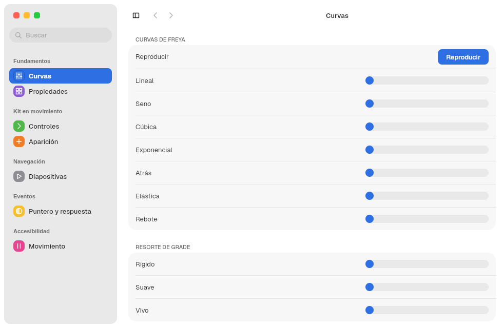
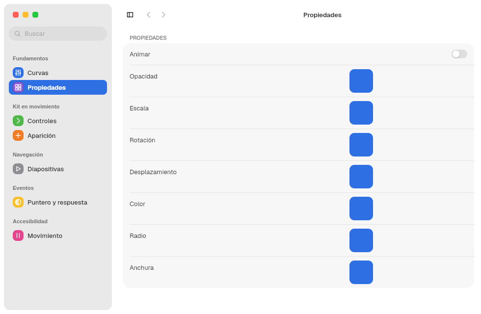
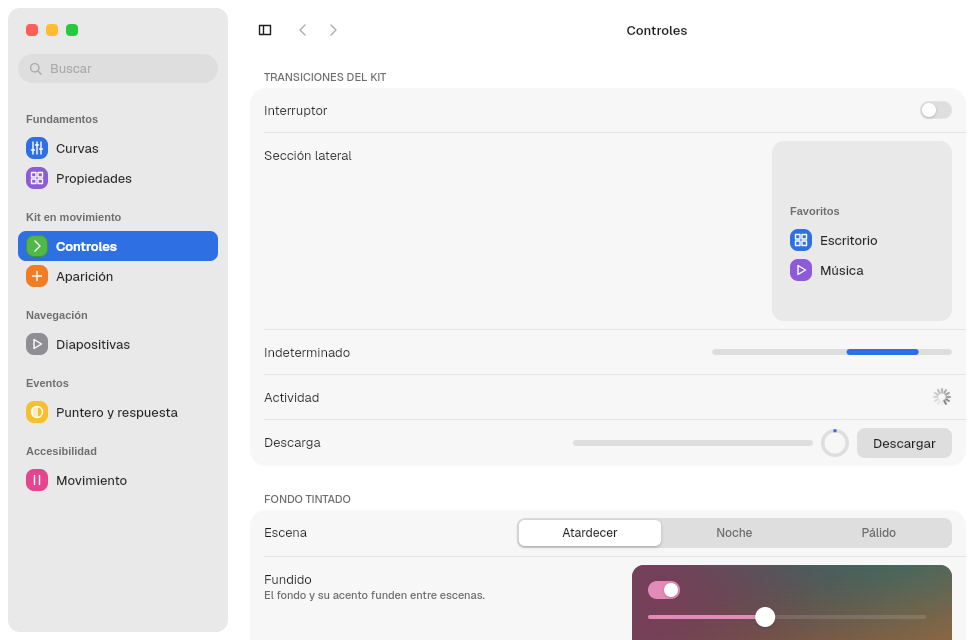
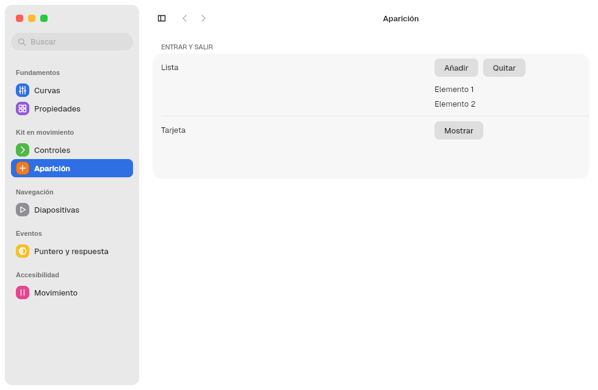
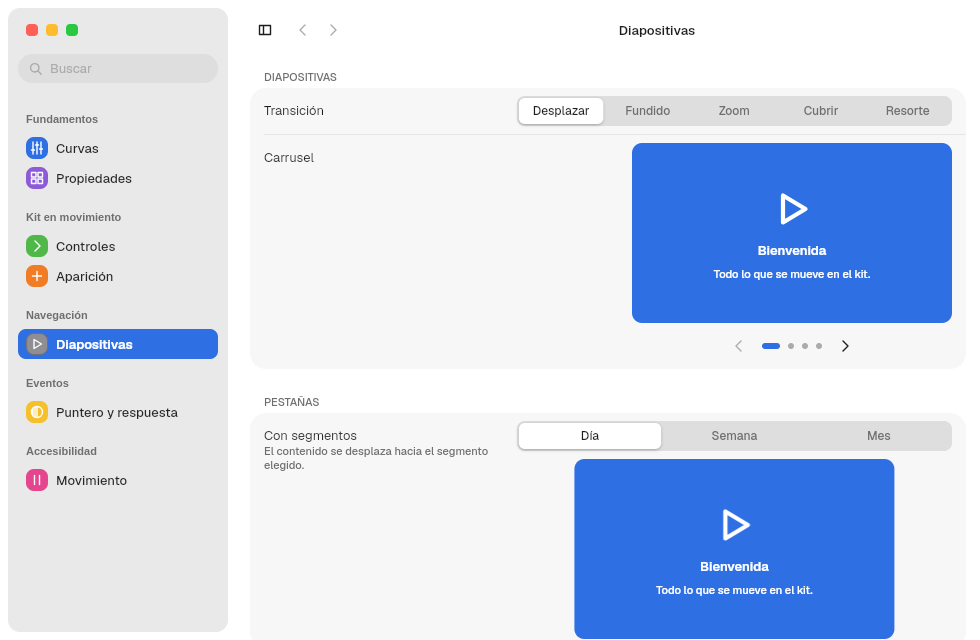
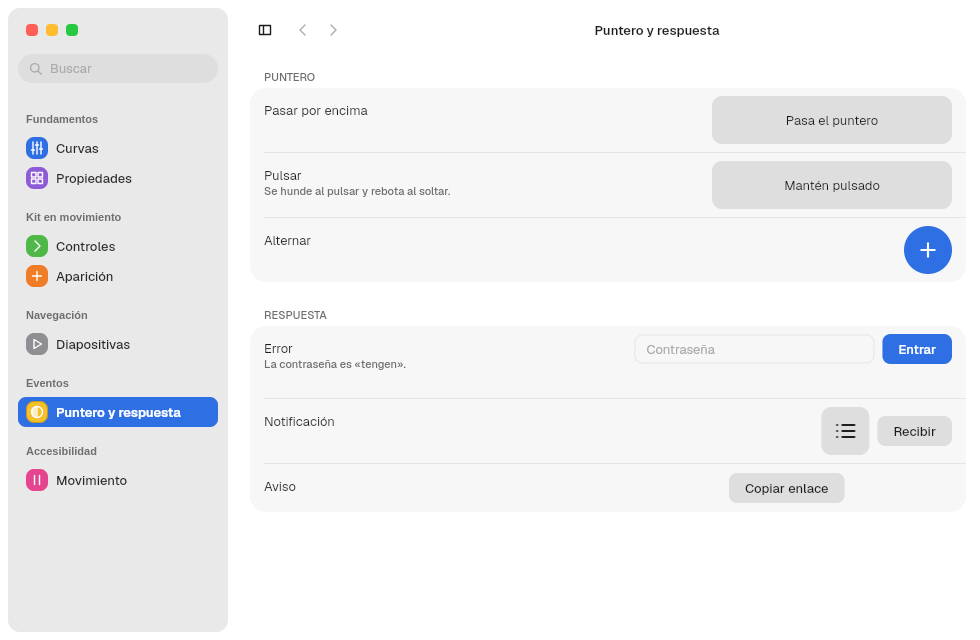
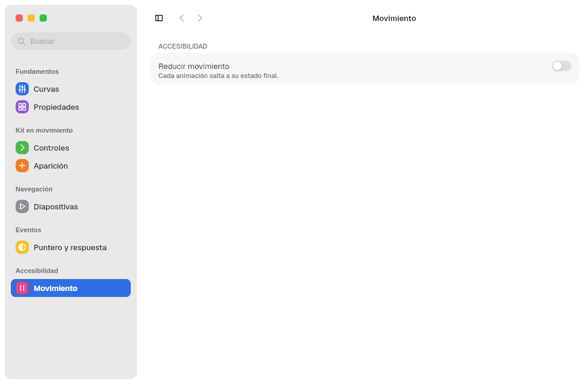

# 12. Animaciones

**Objetivo:** saber qué se anima ya, cómo animar algo propio y cómo se respeta
el movimiento reducido.
**Lector:** quien añade movimiento a una app o a un componente.

## Base

Las animaciones usan `freya-animation` (`use_animation`,
`use_animation_transition`, `AnimNum` con `Ease` y `Function`) y el resorte
propio del kit, **Grade**: `animation::Spring`. Las duraciones salen de Tengen:

| Token | ms | Uso típico |
|---|---|---|
| `DURATION_FAST_MS` | 120 | Respuestas inmediatas: seguir el puntero, barras de desplazamiento |
| `DURATION_BASE` | 220 | Mostrar, ocultar y plegar |
| `DURATION_SLOW_MS` | 420 | Fundidos de fondo |

## Qué se anima en el kit

| Elemento | Duración | Curva |
|---|---|---|
| Pomo del `Switch` | `SWITCH.transition_ms` | Ease out, cúbica |
| Plegar una `SidebarSection` | `DURATION_BASE` | Ease out, cúbica |
| Mostrar u ocultar la barra lateral | `DURATION_BASE` | Ease out, cúbica |
| Ancho de la barra lateral al arrastrar | `DURATION_FAST_MS` | `Spring`, sin rebote |
| Aparición de titlebars ocultas (`Reveal`) | `DURATION_BASE` | Ease out, cúbica |
| `ProgressBar` indeterminada | `PROGRESS.indeterminate_ms` | In-out, cúbica, en bucle |
| `Spinner` | `PROGRESS.spinner_ms` | Lineal, en bucle |
| Fundido entre fondos de `Backdrop` | `DURATION_SLOW_MS` | In-out, cúbica |
| Barra de desplazamiento | `DURATION_FAST_MS` | Fundido |

Pulsar un botón lo escala a `BUTTON.pressed_scale` sin animación.

## El resorte: `Spring`

```rust
use freya_animation::prelude::use_animation_transition;

let destino = use_state(|| 0.0f32);
let movimiento = use_animation_transition(destino, |desde, hasta| {
    Spring::new(desde, hasta, Duration::from_millis(DURATION_BASE), 0.3)
});
let x = movimiento.get().current();
```

- La app necesita `freya-animation` en su `Cargo.toml`; `Spring` se importa
  de `barrier_kit::animation`.
- `Spring::new(desde, hasta, duración, rebote)`. El rebote va de 0 a 1.
- Con rebote 0 es una curva ease-out cúbica. Con más, es una oscilación
  amortiguada.
- Implementa `AnimatedValue`, así que sirve en `use_animation` como cualquier
  animación de Freya.

## Movimiento reducido

Con `reduced_motion = true` en `appearance.domain`, cada animación del kit usa
duración 0 y los bucles se detienen. Una animación propia debe hacer lo mismo:

```rust
let tiempo = if theme::resolved().reduced_motion { 0 } else { DURATION_BASE };
```

## Verlo en vivo: Tengen Motion Show

| Curvas de Freya y resortes de Grade | Propiedades animables |
|---|---|
|  |  |

| Controles del kit | Aparición |
|---|---|
|  |  |

| Diapositivas | Puntero y respuesta | Movimiento reducido |
|---|---|---|
|  |  |  |

Motion Show es un banco de pruebas: lo que funciona allí se lleva luego al kit.

Siguiente: [13. Fondos tintados y medios](13-fondos-y-medios.md).
