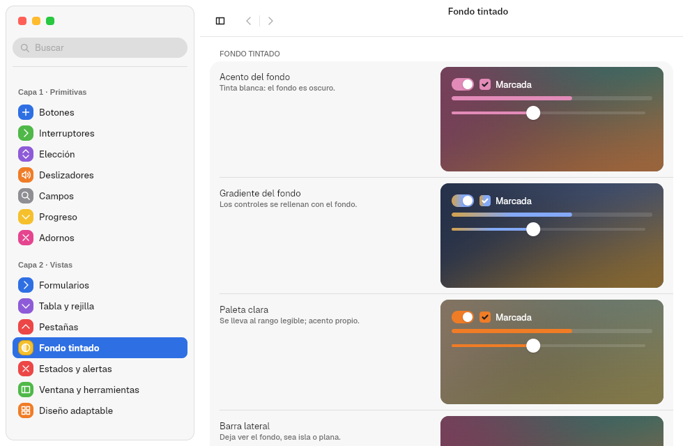
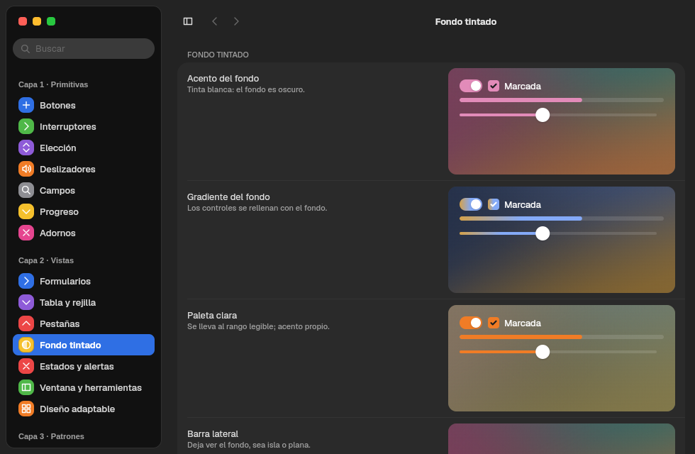
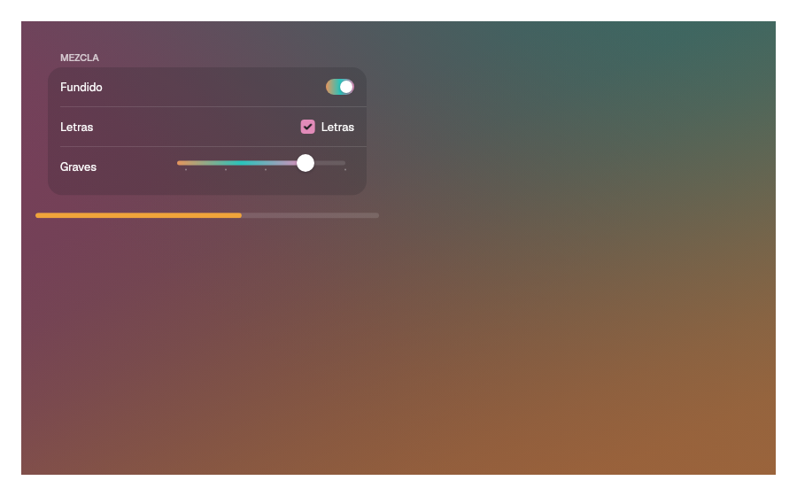

# 12. Tinted backdrops and media

**Goal:** paint color backdrops computed from an image, give an area its own
accent and play video.
**Reader:** anyone who makes apps with cover art, photos or video.

## `Backdrop`: a backdrop that tints its content

```rust
Backdrop::new(BackdropSource::Image(portada), Reproductor).accent(Accent::FromBackdrop)
```

| Source | Result |
|---|---|
| `BackdropSource::Image(bytes)` | Samples the image and extracts three colors with k-means in OKLab (`vow_appearance::backdrop::palette_from_pixels`) |
| `BackdropSource::Colors([a, b, c])` | Uses three given colors |
| `BackdropSource::None` | No backdrop: the normal system window |

1. It paints three gradient layers at 127°, 217° and 336° with dithering, so
   no banding shows.
2. It picks a legible ink (light or dark) based on the backdrop. It is the same
   in light and dark mode.
3. When the source changes, it fades from one backdrop to the other over
   `DURATION_SLOW_MS`.

| Light | Dark |
|---|---|
|  |  |

### The accent inside the backdrop

| `Accent` | The accent is… |
|---|---|
| `System` (default) | The system one |
| `Own(color)` | The app's own |
| `FromBackdrop` | The most vivid color of the backdrop |

Controls with a fill accept `.tint(Tint::Backdrop)` to fill with the backdrop
gradient.



**Important:** the content must be a child component of the `Backdrop` (a
`struct` that implements `Component`). Functions evaluated in the parent still
read the system palette. The
[`ambiente.rs`](../../crates/barrier-kit/examples/ambiente.rs) example does it
this way.

## Media: `media`

| Piece | For |
|---|---|
| `scrim(ScrimEdge::Leading \| Bottom)` | Gradient scrim that blends an image or a video into the window |
| `material(radio)`, `top_glass()` | Glass over the content |
| `MediaButton::new(texto).symbol(Symbol::Play)` | Large play button |
| `RoundButton::new(símbolo, etiqueta).selected(bool)` | Round glass button |
| `use_artwork(ruta)` | Loads cover art in the background |
| `register_font(bytes)` | Registers a custom font (for example, for titles) |

## Video (`video` feature)

```rust
let video = VideoStream::open("trailer.webm", true)?;
VideoView::new(video).width(Size::fill()).corner_radius(12.0)
```

GStreamer decodes and the kit picks the most direct path:

| `Decoding` | When | Cost |
|---|---|---|
| `GpuZeroCopy` | VA-API is present and the Vulkan device imports dmabuf | No copies: the frame goes from GPU to GPU |
| `GpuDownload` | VA-API is present but there is no dmabuf import | One download per frame |
| `Cpu` | No VA-API | The CPU decodes |

`video.decoding()` tells which one is in use. `play()`, `pause()`,
`seek(segundos)`, `position()` and `duration()` control playback.

Marea (chapter [14](14-apps-de-prueba.en.md)) uses all of this.

Next: [13. Platform](13-plataforma.en.md).
