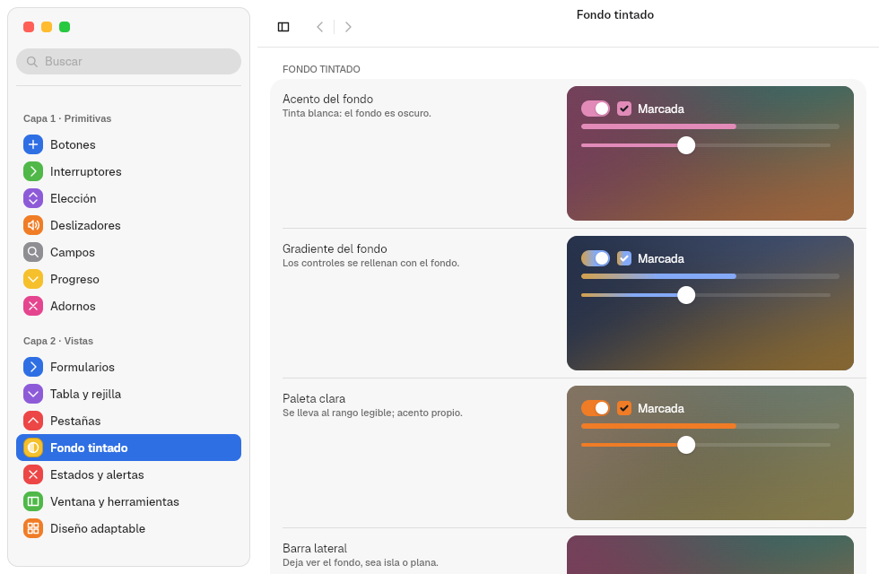
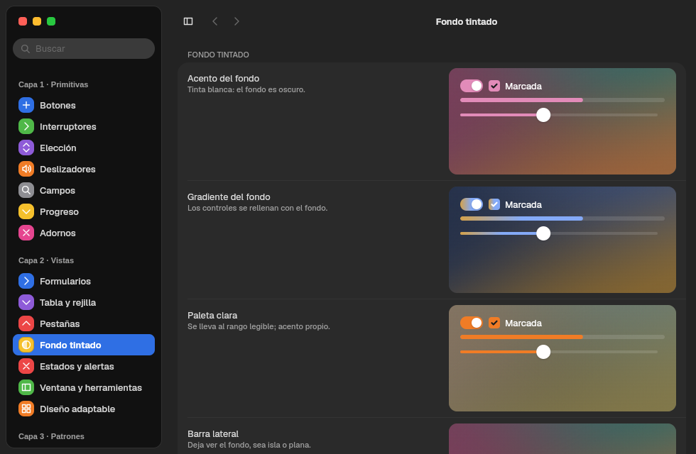
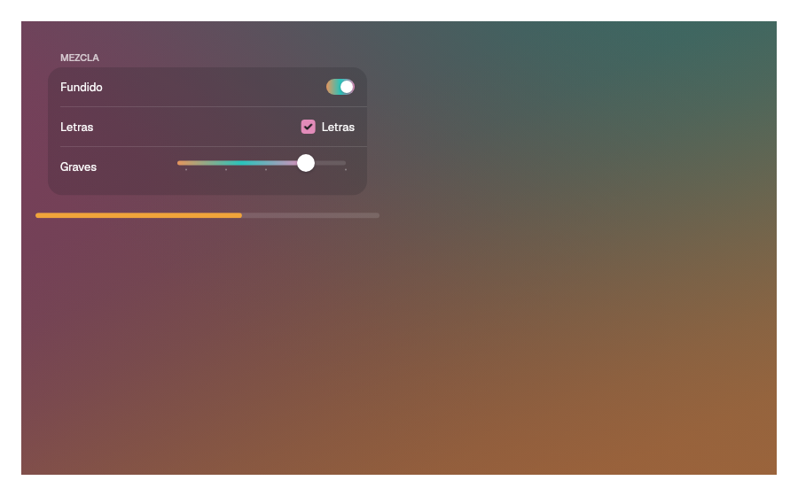

# 12. Fondos tintados y medios

**Objetivo:** pintar fondos de color calculados desde una imagen, dar a una
zona su propio acento y reproducir vídeo.
**Lector:** quien hace apps con carátulas, fotos o vídeo.

## `Backdrop`: un fondo que tiñe su contenido

```rust
Backdrop::new(BackdropSource::Image(portada), Reproductor).accent(Accent::FromBackdrop)
```

| Fuente | Resultado |
|---|---|
| `BackdropSource::Image(bytes)` | Muestrea la imagen y saca tres colores con k-medias en OKLab (`vow_appearance::backdrop::palette_from_pixels`) |
| `BackdropSource::Colors([a, b, c])` | Usa tres colores dados |
| `BackdropSource::None` | Sin fondo: la ventana normal del sistema |

1. Pinta tres capas de degradado a 127°, 217° y 336° con dithering, para que
   no se vean bandas.
2. Elige una tinta legible (clara u oscura) según el fondo. Es la misma en
   modo claro y oscuro.
3. Al cambiar de fuente, funde de un fondo a otro en `DURATION_SLOW_MS`.

| Claro | Oscuro |
|---|---|
|  |  |

### El acento dentro del fondo

| `Accent` | El acento es… |
|---|---|
| `System` (por defecto) | El del sistema |
| `Own(color)` | Uno propio de la app |
| `FromBackdrop` | El color más vivo del fondo |

Los controles con relleno aceptan `.tint(Tint::Backdrop)` para rellenarse con
el degradado del fondo.



**Importante:** el contenido tiene que ser un componente hijo del `Backdrop`
(un `struct` que implementa `Component`). Las funciones evaluadas en el padre
leen todavía la paleta del sistema. El ejemplo
[`ambiente.rs`](../../crates/barrier-kit/examples/ambiente.rs) lo hace así.

## Medios: `media`

| Pieza | Para |
|---|---|
| `scrim(ScrimEdge::Leading \| Bottom)` | Velo degradado que funde una imagen o un vídeo con la ventana |
| `material(radio)`, `top_glass()` | Cristal sobre el contenido |
| `MediaButton::new(texto).symbol(Symbol::Play)` | Botón grande de reproducir |
| `RoundButton::new(símbolo, etiqueta).selected(bool)` | Botón redondo de cristal |
| `use_artwork(ruta)` | Carga una carátula en segundo plano |
| `use_artwork_from(cargador)` | Igual, con los bytes de cualquier origen (por ejemplo, `video::fetch(url)`) |
| `register_font(bytes)` | Registra una fuente propia (por ejemplo, para títulos) |

## Vídeo (feature `video`)

```rust
let video = VideoStream::open("trailer.webm", true)?;
VideoView::new(video).width(Size::fill()).corner_radius(12.0)
```

GStreamer decodifica y el kit elige el camino más directo:

| `Decoding` | Cuándo | Coste |
|---|---|---|
| `GpuZeroCopy` | Hay VA-API y el dispositivo Vulkan importa dmabuf | Sin copias: el fotograma va de la GPU a la GPU |
| `GpuDownload` | Hay VA-API pero no importación dmabuf | Una descarga por fotograma |
| `Cpu` | No hay VA-API | Decodifica la CPU |

`video.decoding()` dice cuál se usa. `play()`, `pause()`, `seek(segundos)`,
`position()` y `duration()` controlan la reproducción.

El origen puede ser remoto:

| Constructor | Origen |
|---|---|
| `VideoStream::open(ruta, bucle)` | Fichero local |
| `VideoStream::open_uri(url, bucle)` | `http(s)`, con vídeo y audio en el mismo flujo |
| `VideoStream::open_uris(url_vídeo, url_audio, bucle)` | `http(s)`, con vídeo y audio separados (como sirve YouTube) |

`video::fetch(url)` descarga los bytes de un fichero remoto, por ejemplo una
carátula.

El sonido suena en el mismo pipeline y sigue su reloj. Todo vídeo empieza en
silencio; `set_volume(nivel)` lo sube, con `nivel` de 0 a 1 en escala cúbica.
Así las vistas previas y los fondos no suenan, y el reproductor da volumen:

```rust
video.set_volume(0.7);
video.play();
```

Marea (capítulo [14](14-apps-de-prueba.md)) usa todo esto.

Siguiente: [13. Plataforma](13-plataforma.md).
