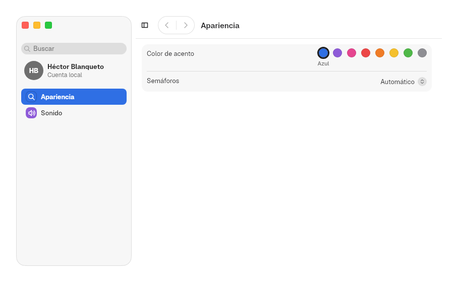
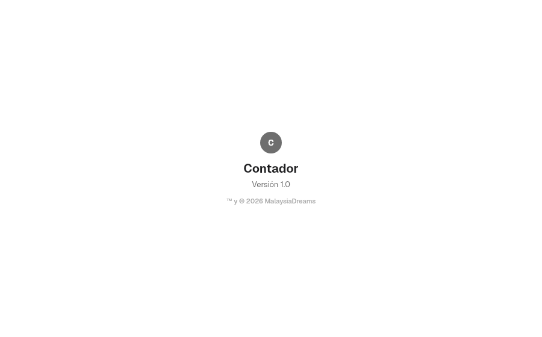

# 12. Patterns

**Goal:** add a complete preferences window, an About window and a language
choice, each with a single piece.
**Scope:** `bk::patterns`: `settings`, `about` and `language`. The
parts they join are in [10](10-sidebar.md) (sidebar and split view) and
[11](11-views.md) (form, history, search). Opening a second window from a
menu is in [13](13-app.md).
**Reader:** anyone who makes a settings window or needs an About window.
**Input:** an app ([2](02-first-app.md)) and its settings as
[`Form`](11-views.md#form)s. **Output:** a preferences window with a sidebar,
search and saved state.

## Steps

1. Write each pane as a [`Form`](11-views.md#form). Give rows `keywords` so the
   search finds them by other words:

   ```rust
   let startup = Form::new().section(
       Section::titled("Startup").row(
           Row::new("Open at login")
               .keywords(&["launch", "boot"])
               .control(Switch::new("Open at login")),
       ),
   );
   ```

2. Wrap each form in a `Pane` with an id, a title, a symbol and a tint:

   ```rust
   let general = Pane::new("general", "General", Symbol::CircleHalf, ACCENT_SWATCHES[0].1, startup);
   ```

3. Group the panes. `None` leaves the group without a title; the sidebar
   separates it from the group above by `SETTINGS.sidebar_group_gap`:

   ```rust
   let group = PaneGroup::new(None).pane(general);
   ```

4. Build the `SettingsWindow`. `.restoration(app_id)` makes it reopen where
   the user left it:

   ```rust
   SettingsWindow::new().restoration("notes").group(group)
   ```

5. Run it as its own window with `run_window`: it draws its own sidebar and
   titlebar, so `Application::window` would add a second titlebar.

   ```rust
   run_window(
       move || SettingsWindow::new().restoration("notes").group(group.clone()),
       WindowOptions::new("Settings", "notes")
           .size((SETTINGS.window_width, SETTINGS.window_height)),
   )
   ```

The names come from `bk::patterns::settings`,
`bk::views::form`, `bk::symbol::Symbol` and `ctdesign`.

## Preferences window

### `SettingsWindow`

A [`SplitView`](10-sidebar.md#splitview) with a sidebar of panes, a search
field, an account row, back and forward buttons and the selected pane's form.
The app only declares the panes. System Settings is built with it.



| Method | Default | Effect |
|---|---|---|
| `SettingsWindow::new()` | — | A window without panes |
| `.group(PaneGroup)` | — | Adds a group of panes to the sidebar |
| `.account(initials, name, detail)` | none | A [`SidebarAccount`](10-sidebar.md#sidebaraccount) under the search field |
| `.restoration(app_id)` | none | Saves and restores the open pane, the recent panes and the sidebar layout |
| `.suggestions(&[pane ids])` | none | Panes listed when the search field is focused and empty |
| `.navigation_destination(State<Option<String>>)` | none | Opens the pane whose id it holds, then sets it back to `None`; an unknown id waits until that pane exists |
| `.sidebar_range(Option<(min, max)>)` | `SplitView`'s | Passed to [`SplitView::sidebar_range`](10-sidebar.md#splitview) |
| `.sidebar_resizable(bool)` | `true` | Passed to `SplitView::resizable` |
| `.narrow_sidebar(NarrowSidebar)` | `Overlay` | Passed to `SplitView::narrow_sidebar` |
| `.sidebar_toggle(bool)` | `true` | With `false`, the bar has no [`SidebarToggle`](10-sidebar.md#hiding-sidebartoggle-and-toggle_sidebar) |

1. It opens the restored pane, or the first pane.
2. The sidebar starts `SETTINGS.sidebar_width` (229) wide, or as restored.
3. Choosing a pane pushes it on the [`History`](11-views.md#history); the bar
   shows its title, the toggle and [`NavigationButtons`](11-views.md#navigationbuttons).
4. With `.restoration(app_id)`, every change is written to
   `<app_id>.state` in the data directory (`~/.local/share/malaysia/`, or
   `MALAYSIA_DATA_DIR`).

### `Pane`

`Pane::new(id, title, symbol, tint, form)`: one sidebar item and the form it
shows. `id` identifies it in suggestions and in the saved state; `symbol` and
`tint` draw its [`SymbolTile`](10-sidebar.md#symboltile). `id` and `title`
are public fields.

`.page(Pane)` adds a page that has no sidebar item, like macOS Accessibility ›
Display. A page can have pages of its own (Display › Text size). A `Row::page(title, id)` in the parent's form opens it; the sidebar
keeps the parent selected, the titlebar shows the page's title and the back
button returns. Search finds the page's rows.

### `PaneGroup`

`PaneGroup::new(Option<title>).pane(Pane)`: panes under a
[`SidebarSection`](10-sidebar.md#sidebarsection) with that title. With `None`,
the panes go straight into the sidebar.

### The search field

The field sits at the top of the sidebar. A popover under it lists what it
finds.

1. Typing searches the pane titles and the titles and `keywords` of every
   row, ignoring case and accents. With no match, it shows "No Results".
2. With the field focused and empty, it shows "Suggestions" (the
   `.suggestions` panes) and then "Recents" (the last 3 panes opened). Without
   `.suggestions`, it shows nothing.
3. Each result has its pane's symbol tile; a row result also shows its pane's
   title.
4. ↑ and ↓ move through the results; Enter opens the one marked.
5. Opening a result shows the pane and highlights the row with
   [`Form::highlighted`](11-views.md#form).

While the search field has the focus, the sidebar selection turns gray
([`SidebarItem::emphasized`](10-sidebar.md#sidebaritem)).

### `index`

`index(&[&Pane]) -> SearchIndex<(&str, Option<&str>)>` builds the search over
the panes: one entry per pane, keyed `(pane id, None)`, and one per row, keyed
`(pane id, Some(row title))`. See [`SearchIndex`](11-views.md#searchindex).

### Style

`SettingsWindow::style` takes a `SettingsWindowStyle`: the gaps between its
parts and the search popover. Each part keeps its own style: the sidebar,
the search field, the bar, the arrows, the split and the forms. The fields
are in [Styles and themes](../../crates/bk/src/styles/settings_window.rs).

```rust
SettingsWindow::new().group(group).style(|s| SettingsWindowStyle {
    suggestion_background: StateValue::new(ShapeStyle::Clear)
        .hovered(ShapeStyle::Role(Role::SelectedControl)),
    ..s
})
```

## About window

### `AboutView`

`AboutView::new(icon, name, copyright)`: the content of an About window,
centered: the icon, the name in `TITLE`, the version in `BODY` and the
copyright in `CAPTION`. It is the content of AppKit's
`orderFrontStandardAboutPanel(_:)`.

```rust
AboutView::new(Avatar::new("N"), "Notes", "© 2026 Jane Appleseed").version("Version 1.0")
```

`.version(text)` adds the version line; without it, the line is left out.
`AboutView` draws only the content: put it under a
[`Titlebar`](09-titlebars.md#titlebar) in a small window.



### Style

`AboutView::style` takes an `AboutViewStyle`: the paints and fonts of the
name, the version and the copyright, and the gaps between them
([Styles and themes](../../crates/bk/src/styles/settings_window.rs)).

## Language picker

How the kit picks the language at launch is in [17](17-languages.md). These
pieces let the user choose it.

### `LanguagePicker`

A pop-up button with "Automatic", "Español" and "English". It reads and writes
the `language` key of a `.domain` file in the config directory
(`~/.config/malaysia/`, or `MALAYSIA_CONFIG_DIR`). "Automatic" removes the key.

| Constructor | File |
|---|---|
| `LanguagePicker::app(domain)` | `<domain>.domain`: the language of one app |
| `LanguagePicker::system()` | `language.domain`: the language of every app |

### Style

`LanguagePicker` is a `PopUpButton` and takes `PopUpButtonStyle` from the
theme and the containers
([Styles and themes](../../crates/bk/src/styles/popup_button.rs)).

### `app_language_row` and `system_language_row`

Ready-made [`Row`](11-views.md#row)s titled "Language" with the picker as
control:

| Function | Detail line |
|---|---|
| `app_language_row(domain)` | "Applies the next time the app opens." |
| `system_language_row()` | "Applies to the apps you open afterwards." |

```rust
Section::titled("Language").row(app_language_row("notes"))
```

### `write_language`

`write_language(path, Option<&str>) -> io::Result<()>` sets or removes the
`language` key in the TOML file at `path` and keeps its other keys.

Next: [13. App infrastructure](13-app.md).
