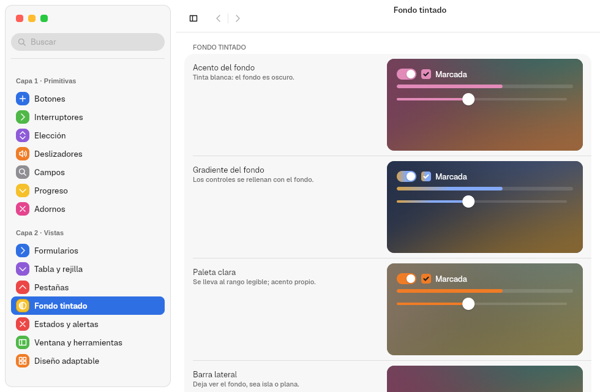
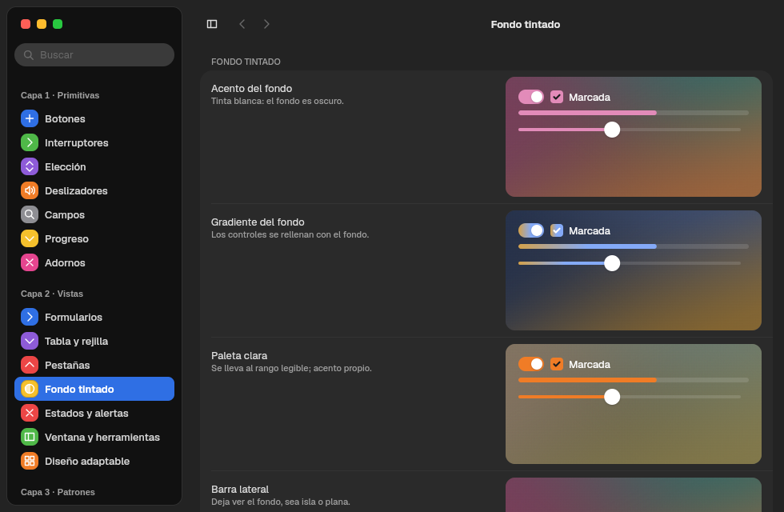
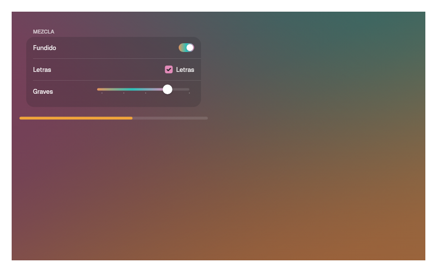

# 13. Tinted backdrops and media

**Goal:** paint color backdrops computed from an image, give an area its own
accent and play video.
**Reader:** anyone who makes apps with cover art, photos or video.

## `Backdrop`: a backdrop that tints its content

```rust
Backdrop::new(BackdropSource::Image(portada), Reproductor).accent(Accent::FromBackdrop)
```

| Source | Result |
|---|---|
| `BackdropSource::Image(bytes)` | Samples the image and extracts three colors with k-means in OKLab (`vow_appearance::backdrop::palette_from_pixels`) |
| `BackdropSource::Colors([a, b, c])` | Uses three given colors |
| `BackdropSource::None` | No backdrop: the normal system window |

1. It paints three gradient layers at 127°, 217° and 336° with dithering, so
   no banding shows.
2. It picks a legible ink (light or dark) based on the backdrop. It is the same
   in light and dark mode.
3. When the source changes, it fades from one backdrop to the other over
   `DURATION_SLOW_MS`.

| Light | Dark |
|---|---|
|  |  |

### The accent inside the backdrop

| `Accent` | The accent is… |
|---|---|
| `System` (default) | The system one |
| `Own(color)` | The app's own |
| `FromBackdrop` | The most vivid color of the backdrop |

Controls with a fill accept `.tint(Tint::Backdrop)` to fill with the backdrop
gradient.



**Important:** the content must be a child component of the `Backdrop` (a
`struct` that implements `Component`). Functions evaluated in the parent still
read the system palette. The
[`ambiente.rs`](../../crates/barrier-kit/examples/ambiente.rs) example does it
this way.

## Media: `media`

| Piece | For |
|---|---|
| `scrim(ScrimEdge::Leading \| Bottom)` | Gradient scrim that blends an image or a video into the window |
| `material(radio)`, `top_glass()` | Glass over the content |
| `MediaButton::new(texto).symbol(Symbol::Play)` | Large play button |
| `RoundButton::new(símbolo, etiqueta).selected(bool)` | Round glass button |
| `use_artwork(ruta)` | Loads cover art in the background |
| `use_artwork_from(cargador)` | The same, with bytes from any source (for example, `video::fetch(url)`) |
| `register_font(bytes)` | Registers a custom font (for example, for titles) |

## Glass that merges: `GlassContainer`

`GlassContainer` (`barrier_kit::glass_container`) is SwiftUI's
`GlassEffectContainer`. Each `.item(id, radius, content)` carries its glass
shape, and `id` plays the role of `glassEffectID`.

```rust
GlassContainer::new(20.0)
    .gap(6.0)
    .item("añadir", 22.0, IconButton::new(Symbol::Plus, "Añadir"))
    .item("quitar", 22.0, IconButton::new(Symbol::Minus, "Quitar"))
```

1. Each item measures its frame and the container paints the union of all of
   them as a single glass: backdrop blur, the `MEDIA.round_glass` tint and
   the `MEDIA.round_rim` border.
2. Shapes closer than `spacing` merge through a smooth minimum of their
   distances ([smin](https://iquilezles.org/articles/smin/)) in an SkSL
   shader; `gap` is the layout gap between items.
3. When the set changes, each shape goes from its previous frame to the new
   one. A new shape grows out of its nearest neighbour and one that leaves
   melts into it.
4. The curve is the kit's spring (`DURATION_BASE`, no bounce) and it honours
   `reduced_motion`. Apple does not publish the morph curve and there are no
   measured macOS 26 captures; when there are, only the duration and the
   bounce change.
5. A container holds up to `MAX_SHAPES` (8) shapes.

## Video (`video` feature)

```rust
let video = VideoStream::open("trailer.webm", true)?;
VideoView::new(video).width(Size::fill()).corner_radius(12.0)
```

GStreamer decodes and the kit picks the most direct path:

| `Decoding` | When | Cost |
|---|---|---|
| `GpuZeroCopy` | VA-API is present and the Vulkan device imports dmabuf | No copies: the frame goes from GPU to GPU |
| `GpuDownload` | VA-API is present but there is no dmabuf import | One download per frame |
| `Cpu` | No VA-API | The CPU decodes |

`video.decoding()` tells which one is in use. `play()`, `pause()`,
`seek(segundos)`, `position()` and `duration()` control playback.

The source can be remote:

| Constructor | Source |
|---|---|
| `VideoStream::open(ruta, bucle)` | Local file |
| `VideoStream::open_uri(url, bucle)` | `http(s)`, with video and audio in the same stream |
| `VideoStream::open_uris(url_vídeo, url_audio, bucle)` | `http(s)`, with video and audio apart (as YouTube serves them) |

`video::fetch(url)` downloads the bytes of a remote file, for example cover art.

Sound plays in the same pipeline and follows its clock. Every video starts
muted; `set_volume(nivel)` raises it, with `nivel` from 0 to 1 on a cubic
scale. That way previews and backgrounds stay silent, and the player sets a
volume:

```rust
video.set_volume(0.7);
video.play();
```

Marea (chapter [15](15-apps-de-prueba.en.md)) uses all of this.

Next: [14. Platform](14-plataforma.en.md).
