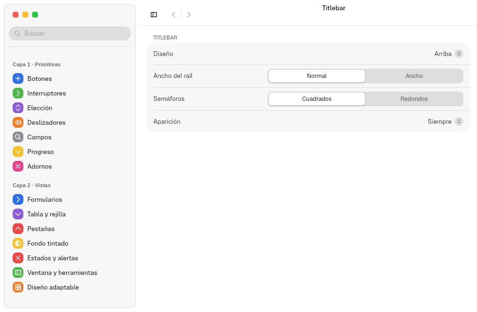
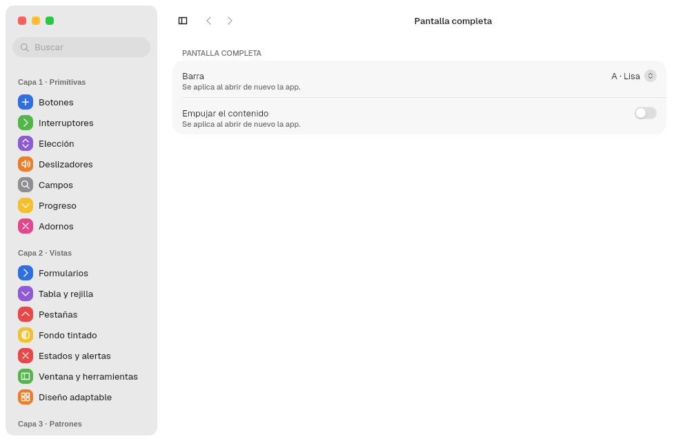
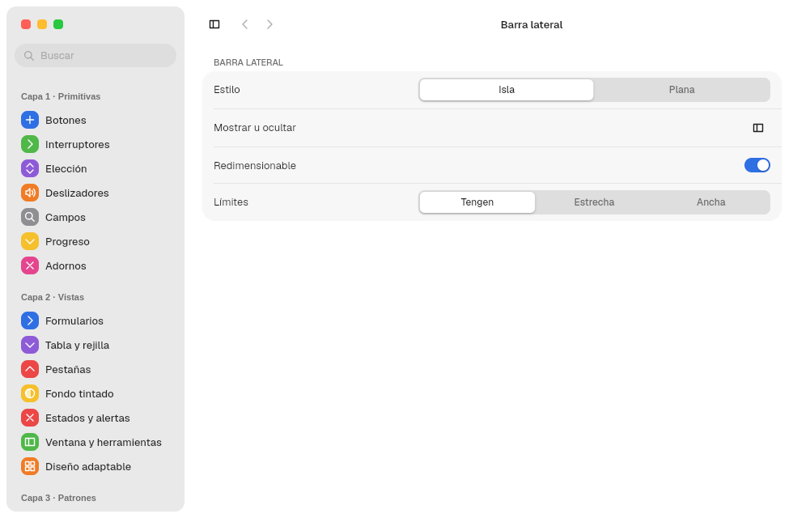

# 15. Apps de prueba

**Objetivo:** saber qué app del repositorio prueba cada parte del kit y cómo
lanzarla.
**Lector:** quien quiere ver el kit funcionando o comprobar un cambio.

## Lanzarlas

1. Entra en el dev shell: `nix develop`.
2. Lanza la app:

   ```sh
   ./dev.sh app tengen-app-show
   ./dev.sh app ondina
   ./dev.sh app marea
   ./dev.sh app trazo
   ```

Corren en cualquier compositor Wayland (capítulo
[14](14-plataforma.md#el-primer-frame)). En Malaysia reciben además bordes, sombra, blur
y menú global.

`dev.sh` fija `MALAYSIA_CONFIG_DIR` y `MALAYSIA_DATA_DIR` en
`$XDG_RUNTIME_DIR/barrierkit` si no están ya definidas. Las apps no tocan tu
configuración real.

## Master Tengen App Show (`tengen-app-show`)

La app de pruebas de los componentes del kit, como `gtk4-widget-factory`. Es un
`PreferencesWindow` dentro de un `WindowChrome`: un grupo por capa y un panel
por componente, más los grupos Ventana y Animación.


| Grupo | Paneles |
|---|---|
| Capa 1 · Primitivas | Botones, Interruptores, Elección, Deslizadores, Campos, Progreso, Adornos |
| Capa 2 · Vistas | Formularios, Tabla y rejilla, Pestañas, Fondo tintado, Estados y alertas, Ventana y herramientas, Diseño adaptable |
| Capa 3 · Patrones | Acerca de, Apariencia (fuerza claro, oscuro o tintado) |
| Ventana | Titlebar, Pantalla completa, Barra lateral |
| Animación | Curvas, Propiedades, Kit en movimiento, Aparición, Diapositivas, Puntero y respuesta, Movimiento |
| App | Deshacer |

| Interruptores | Elección | Deslizadores |
|---|---|---|
|  |  |  |

| Campos | Progreso | Adornos |
|---|---|---|
|  |  |  |

| Tabla y rejilla | Pestañas | Estados y alertas |
|---|---|---|
|  |  |  |

| Diseño adaptable | Acerca de | Apariencia |
|---|---|---|
|  |  |  |

Formularios en oscuro:


Cada componente nuevo del kit llega con su panel aquí.

### Ventana

Los paneles del grupo Ventana cambian la propia ventana de la app. Guardan la
elección con `save_defaults("tengen-app-show")` en
`~/.config/malaysia/tengen-app-show.domain`.

| Panel | Qué prueba |
|---|---|
| Titlebar | Los dos `TitlebarLayout`, el ancho del rail, los semáforos redondos, el rail normal o unificado, sus elementos arriba y abajo, las cinco formas de aparición y los tres bordes en reposo |
| Pantalla completa | La `FullscreenBar` y `fullscreen_push`, en vivo |
| Barra lateral | Isla o plana, mostrar u ocultar, redimensionado y rangos |

| Titlebar | Pantalla completa | Barra lateral |
|---|---|---|
|  |  |  |

Las capturas de cada diseño están en el capítulo [7](07-titlebars.md).

### Animación

Los paneles del grupo Animación enseñan las curvas de Freya, los resortes de
Grade, las propiedades animables, los controles en movimiento, la aparición,
las transiciones entre diapositivas, la respuesta a eventos y el movimiento
reducido. Sus capturas están en el capítulo [12](12-animaciones.md).

## Ondina (`ondina`)

Un reproductor de música que compone la capa 2 a mano: `SplitView`,
`Sidebar`, `Titlebar`, `TabView` y `Backdrop`.

| Claro | Oscuro |
|---|---|
|  |  |

- **Fondo tintado** desde la portada del disco, una paleta o ninguno.
- **Acento** del sistema, del fondo o propio, elegido en su panel Apariencia.
- **Tres tamaños** con `use_breakpoint`. En ancho muestra barra lateral,
  reproductor y cola. En medio, la cola se abre con un botón de la titlebar. En compacto, la barra
  lateral desaparece y las secciones pasan a pestañas bajo la titlebar:

  

- **Acciones propias** con atajos: reproducir o pausar, siguiente (Ctrl+→),
  anterior (Ctrl+←) y secciones (Ctrl+1 a Ctrl+4), en su menú global
  «Controles» y «Ver».

## Marea (`marea`)

Una app de cine y series que prueba el kit con medios (feature `video`):


- Un destacado con vídeo de fondo y un velo (`scrim`) que lo funde con la
  ventana.
- Cristal (`material`) sobre el contenido.
- Estanterías horizontales (`ScrollView` horizontal) con carátulas y vista
  previa en vídeo.
- Chips de género, botones de medios y un reproductor.
- Un destacado de prueba, «Sprite Fright», que muestra el póster y tres
  imágenes con fundido. Con el ratón quieto 2 s sobre él, reproduce el
  comienzo del cortometraje desde YouTube (lo resuelve `yt-dlp`). La fila
  «Películas abiertas» abre el mismo vídeo.

Los vídeos y fotogramas de prueba se generan con
`node crates/marea/media/generate.mjs`. Necesita `ffmpeg` con libx264 y Node
con Playwright y Chromium, que el dev shell no trae. Quedan fuera los
`sprite-fright-*` de
`media/stills/`: fotogramas de «Sprite Fright» (Blender Studio, CC BY 4.0) y
un título dibujado con Creepster (ver `NOTICE`). La captura se hizo sin GPU: el vídeo se
decodificó por CPU (`Decoding::Cpu`).

## Trazo (`trazo`)

Prueba las gráficas (capítulo [19](19-graficas.md)) en tres pestañas:

| Pestaña | Contenido |
|---|---|
| Gráficas 2D | Líneas monótonas, áreas apiladas, barras agrupadas con regla, barras apiladas, puntos, escalones, pastel, donut, mapa de calor, flujo y reloj de flujo |
| Monitor | CPU de usuario y sistema, uso por núcleo, memoria, red, carga media, reloj de núcleos, memoria por proceso (barras horizontales) y procesos, leídos de `/proc` cada segundo |
| 3D | Suzanne de Blender (3936 triángulos), superficie sin(r)/r y nube de puntos; se giran arrastrando o por planos |

`cargo test -p trazo` comprueba que cada pestaña dibuja sus gráficas; con
`TRAZO_SHOT=<carpeta>` guarda una captura por pestaña.

Siguiente: [16. Preguntas frecuentes](16-preguntas.md).
