# 15. Apps de prueba

**Objetivo:** saber qué app del repositorio prueba cada parte del kit y cómo
lanzarla.
**Lector:** quien quiere ver el kit funcionando o comprobar un cambio.

## Lanzarlas

1. Entra en el dev shell: `nix develop`.
2. Lanza la app:

   ```sh
   ./dev.sh app tengen-app-show
   ./dev.sh app tengen-motion-show
   ./dev.sh app ondina
   ./dev.sh app marea
   cargo run -p rotulo
   ```

Corren en cualquier compositor que dibuje el primer frame (capítulo
[14](14-plataforma.md)). En MalaysiaDreams reciben además bordes, sombra, blur
y menú global.

## Master Tengen App Show (`tengen-app-show`)

El catálogo vivo del kit, como `gtk4-widget-factory`. Es un `PreferencesWindow`
con un grupo por capa y un panel por componente.

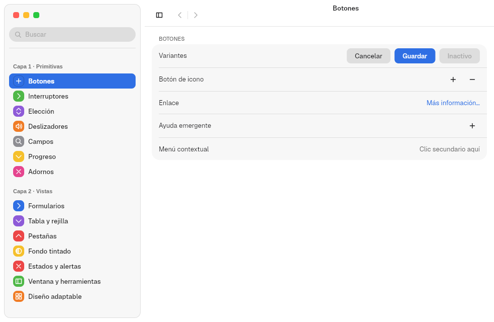

| Grupo | Paneles |
|---|---|
| Capa 1 · Primitivas | Botones, Interruptores, Elección, Deslizadores, Campos, Progreso, Adornos |
| Capa 2 · Vistas | Formularios, Tabla y rejilla, Pestañas, Fondo tintado, Estados y alertas, Ventana y herramientas, Diseño adaptable |
| Capa 3 · Patrones | Acerca de, Apariencia (fuerza claro, oscuro o tintado) |
| App | Deshacer, Barra lateral (redimensionado y rangos) |

| Interruptores | Elección | Deslizadores |
|---|---|---|
| 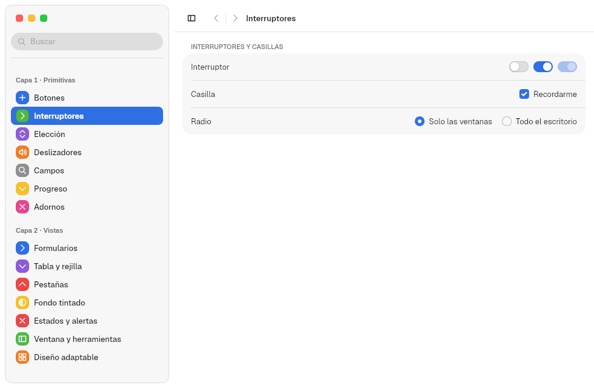 | 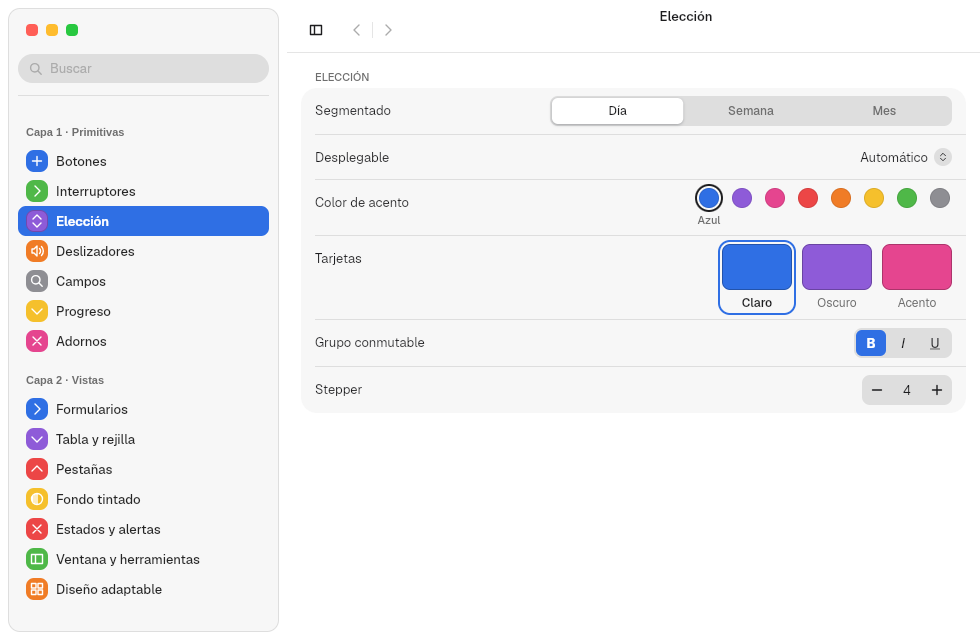 | 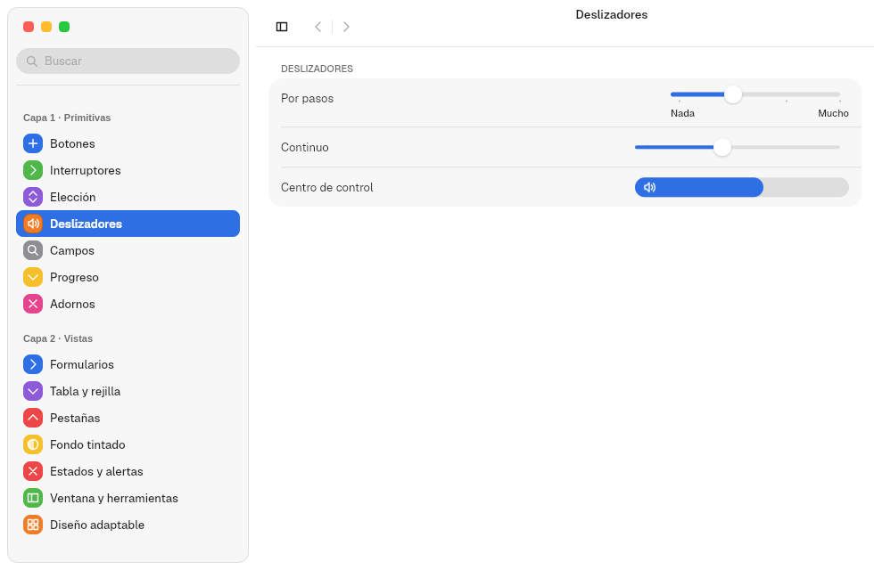 |

| Campos | Progreso | Adornos |
|---|---|---|
| 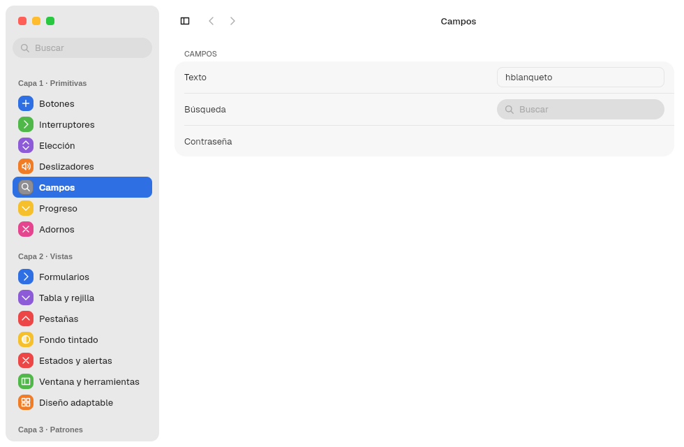 | 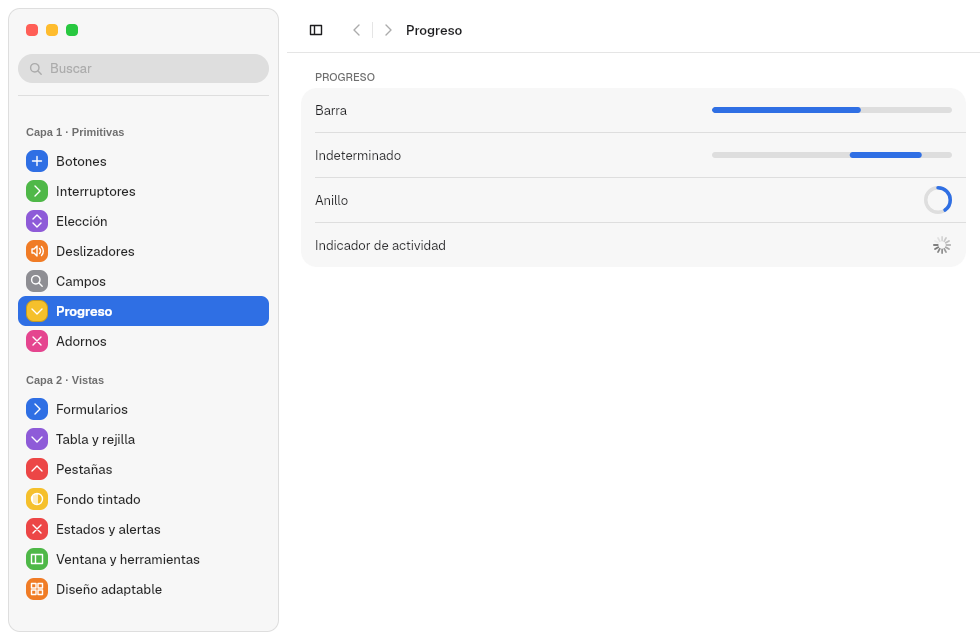 | 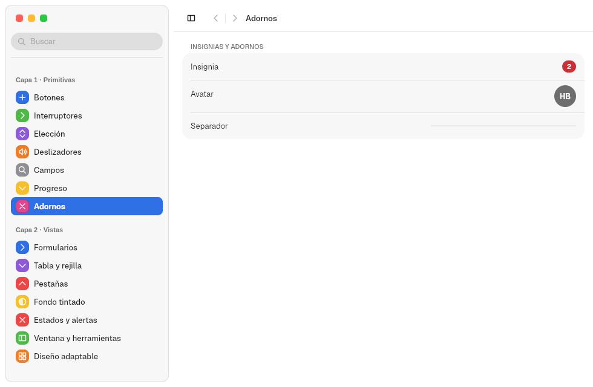 |

| Tabla y rejilla | Pestañas | Estados y alertas |
|---|---|---|
| 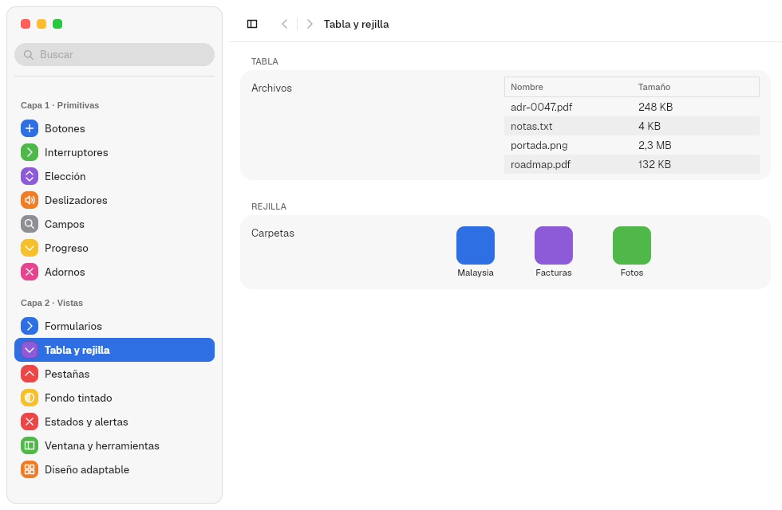 | 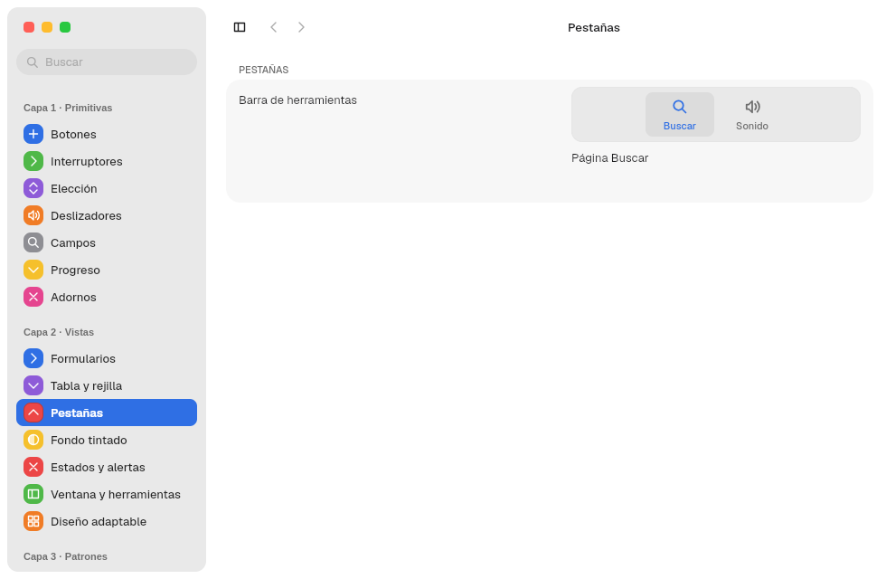 | 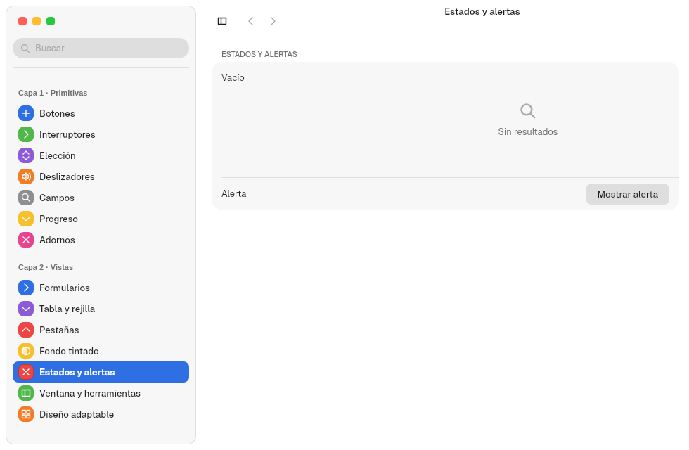 |

| Diseño adaptable | Acerca de | Apariencia |
|---|---|---|
| 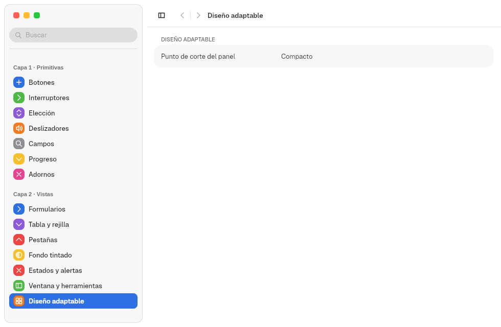 | 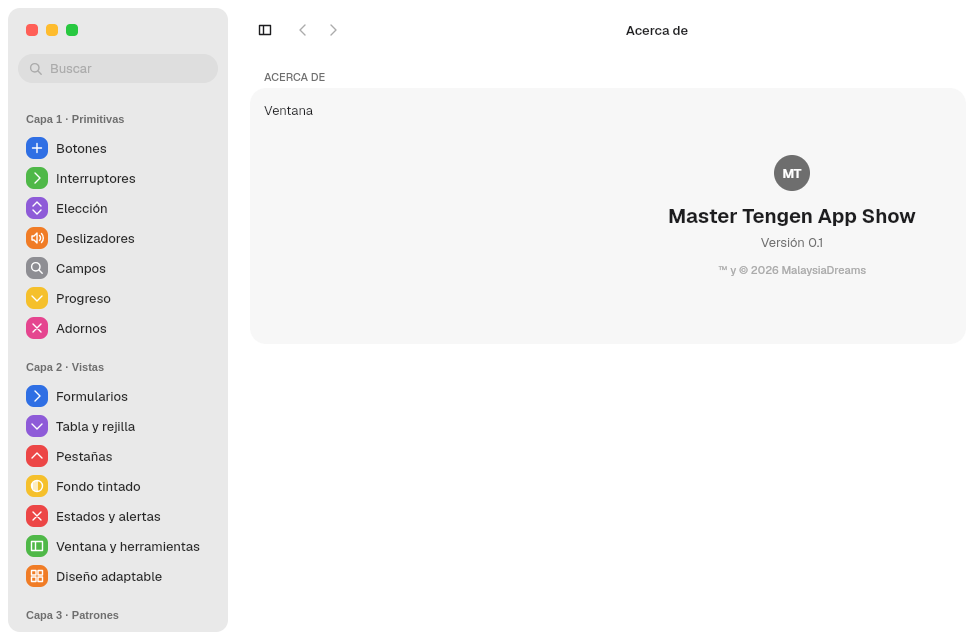 | 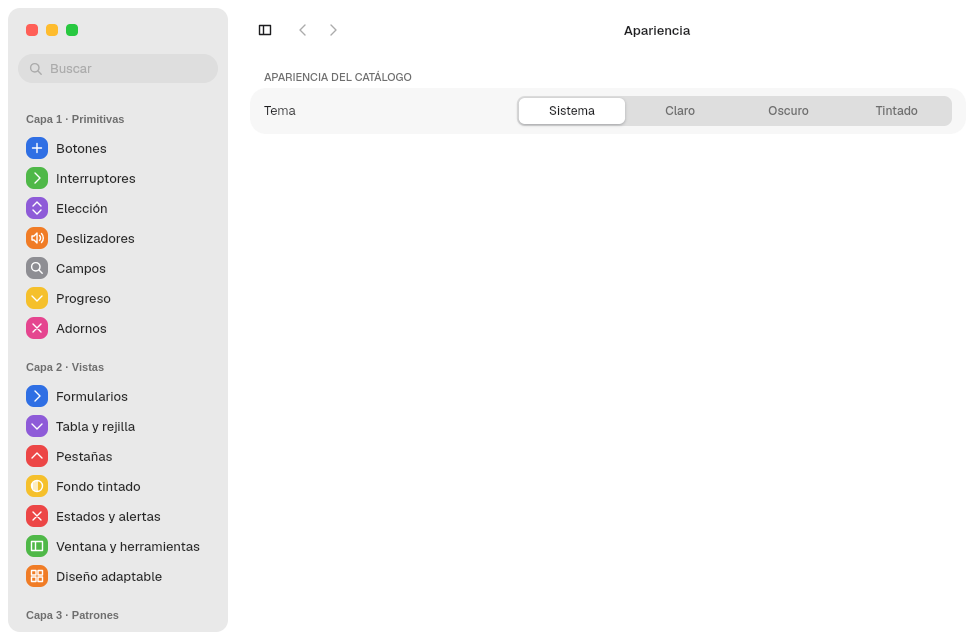 |

Formularios en oscuro:

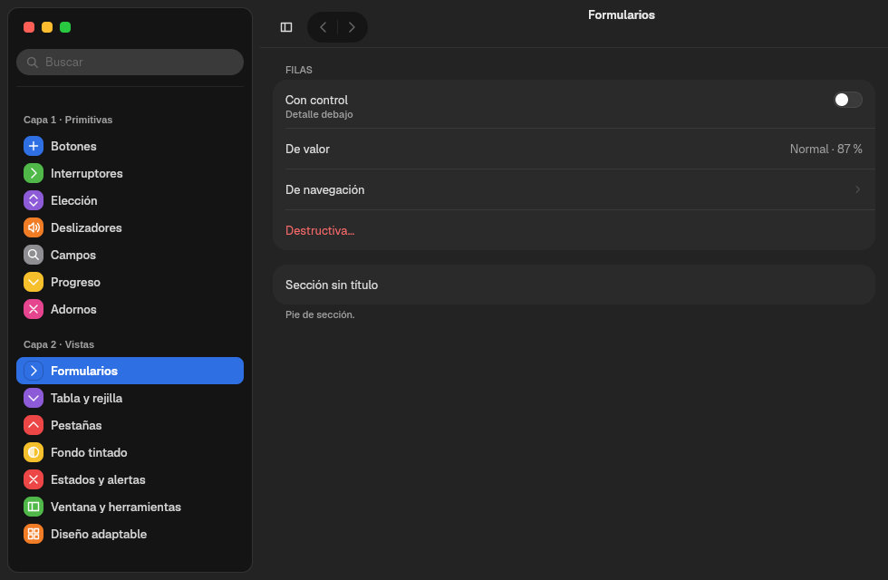

Cada componente nuevo del kit llega con su panel aquí.

## Master Tengen Motion Show (`tengen-motion-show`)

El catálogo de movimiento, también un `PreferencesWindow`: curvas de Freya,
resortes de Grade, propiedades animables, controles en movimiento, aparición,
transiciones entre diapositivas, respuesta a eventos y movimiento reducido. Sus
capturas están en el capítulo [12](12-animaciones.md).

## Ondina (`ondina`)

Un reproductor de música que compone la capa 2 a mano: `SplitView`,
`Sidebar`, `Titlebar`, `TabView` y `Backdrop`.

| Claro | Oscuro |
|---|---|
| 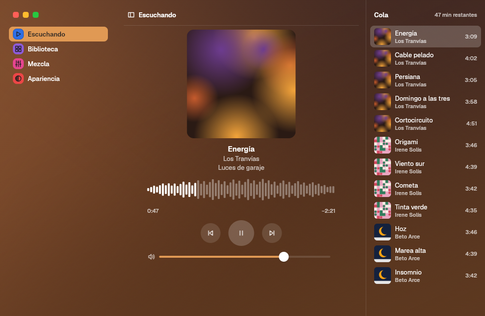 |  |

- **Fondo tintado** desde la portada del disco, una paleta o ninguno.
- **Acento** del sistema, del fondo o propio, elegido en su panel Apariencia.
- **Tres tamaños** con `use_breakpoint`. En ancho muestra barra lateral,
  reproductor y cola. En medio, la cola se abre con un botón de la titlebar. En compacto, la barra
  lateral desaparece y las secciones pasan a pestañas bajo la titlebar:

  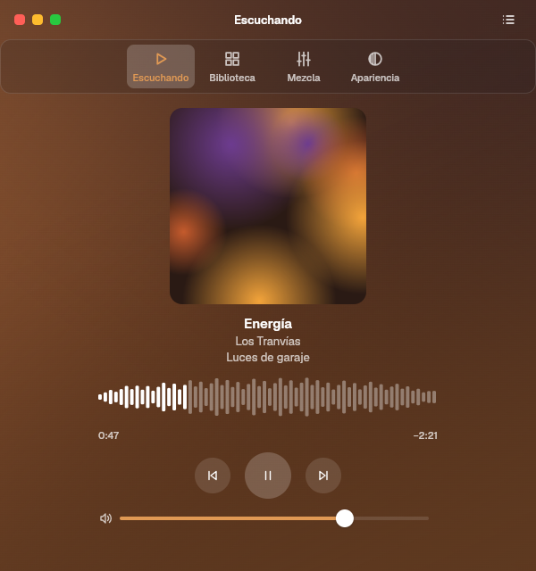

- **Acciones propias** con atajos: reproducir o pausar, siguiente (Ctrl+→),
  anterior (Ctrl+←) y secciones (Ctrl+1 a Ctrl+4), en su menú global
  «Controles» y «Ver».

## Rótulo (`rotulo`)

Prueba los cinco `TitlebarLayout`, el lado del rail, su ancho, los semáforos
redondos, la píldora vertical u horizontal, las cinco formas de aparición, los tres bordes en reposo y la barra
lateral en isla o plana. Guarda la elección con `save_defaults("rotulo")`.
Sus capturas están en el capítulo [7](07-titlebars.md).

## Marea (`marea`)

Una app de cine y series que prueba el kit con medios (feature `video`):

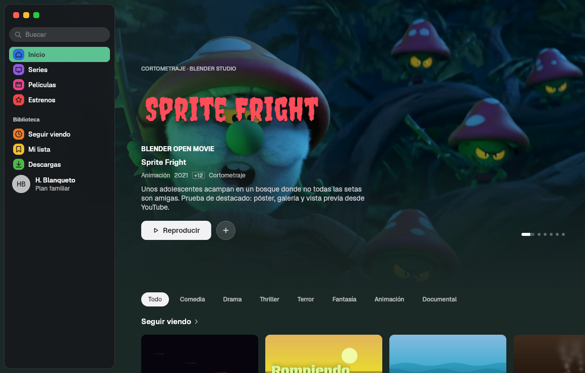

- Un destacado con vídeo de fondo y un velo (`scrim`) que lo funde con la
  ventana.
- Cristal (`material`) sobre el contenido.
- Estanterías horizontales (`ScrollView` horizontal) con carátulas y vista
  previa en vídeo.
- Chips de género, botones de medios y un reproductor.

Los vídeos y fotogramas de prueba se generan con
`crates/marea/media/generate.mjs`. La captura se hizo sin GPU: el vídeo se
decodificó por CPU (`Decoding::Cpu`).

Siguiente: [16. Preguntas frecuentes](16-preguntas.md).
