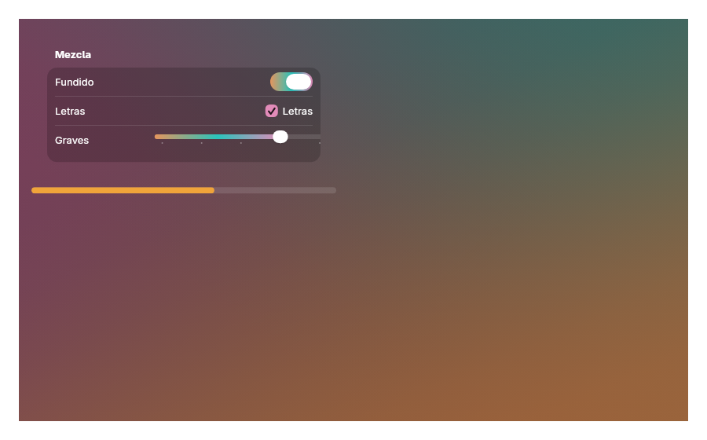

# 15. Backdrops and media

**Goal:** paint a backdrop tinted from an image, place media pieces over it,
and merge glass shapes.
**Scope:** `bk::backdrop`, `media` and `glass_container`.
The window's own glass bars are in [9. Titlebars](09-titlebars.md); the
palette a backdrop replaces is in
[4. Appearance and tokens](04-appearance-and-tokens.md); the controls that
take a `Tint` are in [5. Controls](05-controls.md).
**Reader:** anyone who makes apps with cover art or photos.
**Input:** an app with a window and the bytes of an image. **Output:** a view
whose background, text and accent follow that image, with media controls.

## Steps

1. Move the content that sits on the backdrop into its own component. It must
   read the palette below the `Backdrop`, not in the parent:

   ```rust
   #[derive(PartialEq)]
   struct Player;

   impl Component for Player {
       fn render(&self) -> impl IntoElement {
           VStack::new()
               .child(Text::new(tr!("now-playing")).font(HEADLINE))
               .child(MediaButton::new(tr!("play")).symbol(Symbol::Play))
       }
   }
   ```

2. Wrap it in a `Backdrop` with the image bytes, and take the accent from the
   image:

   ```rust
   Backdrop::new(BackdropSource::Image(cover), Player).accent(Accent::FromBackdrop)
   ```

3. Load the cover off the interface thread with `use_artwork`, and show it
   when it arrives:

   ```rust
   let artwork = use_artwork(cover_path);
   rect().maybe_child(artwork.read().clone().map(|handle| image(handle).expanded()))
   ```

4. Blend the cover into the window with a `Scrim`, and put glass behind
   floating controls with `Material` or a `GlassContainer`.

## Backdrop

`Backdrop` paints a color backdrop and gives its content a palette that is
legible on it.

| Item | What it is |
|---|---|
| `Backdrop::new(source, child)` | The backdrop and its content; it fills its parent |
| `.accent(accent)` | The accent inside it; default `Accent::System` |

| `BackdropSource` | Result |
|---|---|
| `Image(bytes)` | Decodes the image on a background thread, scales it to `BACKDROP.samples` pixels a side and takes three colors with k-means in OKLab |
| `Colors([a, b, c])` | Uses the three colors given |
| `None` | No backdrop: the window surface color and the system palette |

1. It paints a base color and three linear gradients, at the angles in
   `BACKDROP.angles` (127°, 217°, 336°), with dithering so no banding shows.
2. It picks one ink, light or dark, from the backdrop's average color. Labels,
   separators, control and content backgrounds derive from that ink, so the
   result is the same in light and dark mode.
3. When the source changes, it fades from the old colors to the new ones over
   `DURATION_SLOW_MS`, in-out cubic, or at once with reduced motion.
4. Inside it, a [`Titlebar`](09-titlebars.md#titlebar) has no background, and a
   `ToolGroup` capsule takes its fill, separator and rim from the backdrop's
   palette, so its icons stay legible.

| `Accent` | The accent inside the backdrop is… |
|---|---|
| `System` (default) | The system accent |
| `Own(color)` | The app's color |
| `FromBackdrop` | The most vivid color of the image, adjusted to stay legible on the ink; with `Colors`, the first color |

The content gets the palette through context. Code evaluated in the parent,
before the `Backdrop` renders, still reads the system palette.

✗ `Backdrop::new(source, Text::new(title))`, built in the parent's render.
✓ `Backdrop::new(source, Player)`, with `Player` a `Component`.




`Backdrop::style(|s| ..)` changes the angles and opacity of the gradient
layers and the fade of a new source; the fields are in
[Styles and themes](../../crates/bk/src/styles/backdrop.rs).

### Tint

Controls with a fill take `.tint(Tint)`: `Slider`, `Switch`, `Checkbox`,
`RadioGroup`, `ProgressView` and `LevelSlider`.

| `Tint` | The fill is… |
|---|---|
| `Accent` (default) | The accent of the palette in context |
| `Color(color)` | A fixed color |
| `Backdrop` | A horizontal gradient of the backdrop's three colors; the accent outside a `Backdrop` |

In an inactive window `Accent` and `Backdrop` fall back to the palette's accent. The tint
sets the `fill` of the control's style, so a `Color` tint stays.

## Media

`bk::media` has the pieces of a media view. Their colors and sizes
are the `MEDIA` tokens of `ctdesign`, fixed for a dark image behind them.

| Item | What it is |
|---|---|
| `MediaButton::new(label)` | A large light pill button; `.symbol(symbol)` adds an icon, `.on_press(..)` the action |
| `RoundButton::new(symbol, label)` | A round glass button with an icon; `label` is its accessible name; `.selected(true)` fills it light; `.on_press(..)` |
| `Scrim::new(edge)` | A gradient rect that fades from the ground color to transparent; size and place it yourself with Freya's layout methods |
| `ScrimEdge::Leading`, `Bottom` | The edge the scrim is solid on |
| `ground()` | The color under the content: the backdrop's average inside a `Backdrop`, the window background outside |
| `Material::new(corner_radius)` | A layer that fills its parent with blur, the `MEDIA.material_tint` tint and a 1 px rim |
| `TopGlass::new()` | The progressive glass band along the top edge, as in [`FullscreenBar::ProgressiveGlass`](09-titlebars.md) |
| `use_artwork(path)` | Reads and decodes an image in the background; returns `State<Option<ImageHandle>>`, `None` until it is ready |
| `use_artwork_from(load)` | The same with bytes from `load: FnOnce() -> Option<Vec<u8>> + Send` |

`use_artwork` loads again when its path changes; `use_artwork_from` loads once per
component. Loads share three reading threads and three
decoding threads, so a grid of covers does not start a thread per cover and one slow
file does not block the rest. A component that unmounts before its turn skips the
load. `use_artwork` keeps the last 32 decoded files, keyed by path and modification
time; `use_artwork_from` has no key and keeps none.

`Material` and `TopGlass` are positioned absolutely: put them as the first
child of the element they sit behind, and put what draws over the glass (the
title bar, the buttons) in that same element. Under a compositor that composes
the blur ([below](#who-draws-the-blur)) that element is the chrome.

When the user reduces transparency (`reduce_transparency`, off by default),
the glass is solid and sharp: `Material` and `GlassContainer` fill with the
opaque `MEDIA.material_tint` and keep their rim; `TopGlass` is an opaque band
in the window color, `FULLSCREEN_GLASS.height` deep.

### Who draws the blur

[ADR 0091](../decisions.md) gives the blur of `Material`, `TopGlass`, the glass
bars of [9](09-titlebars.md) and the sidebar to the compositor,
[ADR 0098](../decisions.md) is how the kit does it and
[ADR 0100](../decisions.md) says what is moved and what is not. The kit checks
the compositor once per window:

| Compositor | `Material`, `TopGlass`, `FullscreenBar::Glass` and `ProgressiveGlass` |
|---|---|
| `infinity_window_style_v1` version 10 or later (and `wl_subcompositor`) | Paint nothing and declare themselves: `TopGlass` and `ProgressiveGlass` a soft scroll edge, `Glass` a hard one, `Material` a `within_window` backdrop of `MaterialStyle::material` with its corner radius. The compositor draws the material, with its measured blur, saturation and tint |
| Version 9 or lower, another compositor, no global | The opaque solid the kit draws under Reduce Transparency |
| Either, with `reduce_transparency` | The same opaque solid |

In the first row the element that holds the glass is the window's chrome: it and
everything inside it draw on a synchronized sub-surface above the window, so
they stay sharp over the compositor's blur. Four rules follow:

1. Put the glass and what draws over it in one element, and give that element
   something beside it in the window: a glass in the window's only top-level
   element has nothing below it to blur and declares nothing.
2. The chrome covers its element and its glass, cut to the window. What it
   paints outside is cut.
3. The chrome draws above everything else of the window, whatever the layers of
   the rest. Popovers and menus are their own windows and are not affected.
4. One chrome holds one material and one scroll edge: the first of each. Malaysia
   serves 4 requesting surfaces per toplevel and the sidebar's is the window's
   own, so a window opens at most 3 chromes, and the material of one chrome does
   not blur another's. Put a second material in another element.

The kit draws no tint or rim of its own in that mode, so `tint` and `border` of
`MaterialStyle` have no effect there. On Wayland two things keep drawing their blur with Skia,
because the compositor does not serve them yet: `GlassContainer` (the lens and
the merging) and the per-control `ShapeStyle::Material(Thickness)` (a material per
control would exceed the requesters). The sidebar is not Skia: from version 10 it is a `behind_window` request for the `sidebar`
material, before that `set_glass`
([18](18-platform.md#wayland-protocols)). `./dev.sh check` runs the tests of
this path against a fake compositor; a real session needs Malaysia to serve the
requests ([18](18-platform.md#glass-over-the-windows-content)).

### On macOS

WindowServer is the compositor, so the same declarations become native views
(`platform/macos/blur.rs`), as in the table's first row:

| Declaration | Native view |
|---|---|
| The sidebar's panel (`WindowGlass`, `Sidebar`) | With `WindowOptions::opaque(false)`: an `NSVisualEffectView`, `sidebar` material, `behindWindow`, below the content view, and the window turns non-opaque. The default is the flat sidebar, which is what SwiftUI draws in an ordinary window |
| `Material` | An `NSVisualEffectView`, `withinWindow`, of `MaterialStyle::material`, with the corner radius, over the content |
| `TopGlass`, `ProgressiveGlass`, `FullscreenBar::Glass` | An `NSVisualEffectView` of the window background material along the edge; the soft ones have a gradient mask, the hard one none |
| The glass of a `ToolGroup` (the toolbar capsules, the sidebar toggle) | An `NSGlassEffectView` (`regular`) one `HAIRLINE` inside the group, because AppKit draws the glass rim outside its frame, with the inner capsule's radius; two or more in one chrome sit in an `NSGlassEffectContainerView` and merge when near. On macOS before 26 the group paints its own fill |
| `GlassContainer` | One `NSGlassEffectView` per item at the item's frame, all in one `NSGlassEffectContainerView` whose `spacing` is the container's: shapes nearer than it merge with the system's neck and lens. `GlassContainerStyle::clear` makes them `NSGlassEffectViewStyle.clear`. `tint`, `rim` and `blur` do not apply, and the shapes jump to a new frame without the kit's morph |
| The chrome of a glass | A second `CAMetalLayer` view above the effect, which takes no event |

The effect views read what the content layer drew, with no frame of lag
([measurements](../research/macos-arm-port.md#blur-three-proposals)); Reduce
Transparency and Increase Contrast are AppKit's. The layers of a window with
chromes present inside one Core Animation transaction, so the content and what
lies over the glass move together. A `ToolGroup` over scrolling content is
[`recipes/glass_toolbar.rs`](../../agents/recipes/glass_toolbar.rs): its `Titlebar` needs a
clear background to let the glass show.

### Style

`MediaButton` and `RoundButton` take `.style(|s| ..)` with a `MediaButtonStyle` and a
`RoundButtonStyle`. Their fields are in
[Styles and themes](../../crates/bk/src/styles/media_button.rs).

`Material`, `TopGlass` and `GlassContainer` take `.style(|s| ..)` with a
`MaterialStyle`, a `TopGlassStyle` and a `GlassContainerStyle`: tint, blur,
rim and, for the container, the morph; `MaterialStyle` has no blur: the compositor draws it, and `MaterialStyle::material` is the
`NSVisualEffectView.Material` a compositor draws behind `Material` (Tengen:
`HudWindow`). Their fields are in
[Styles and themes](../../crates/bk/src/styles/material.rs).
`Scrim` has no style: its gradient follows the ground color.

## Glass that merges

`GlassContainer` draws several glass shapes as one, like SwiftUI's
`GlassEffectContainer`. Each item's `id` plays the role of `glassEffectID`.

```rust
GlassContainer::new(20.0)
    .gap(6.0)
    .item("add", 22.0, RoundButton::new(Symbol::Plus, tr!("add")))
    .item("remove", 22.0, RoundButton::new(Symbol::Minus, tr!("remove")))
```

| Item | What it is |
|---|---|
| `GlassContainer::new(spacing)` | Shapes closer than `spacing` merge |
| `.gap(gap)` | The layout gap between items; default `spacing` |
| `.item(id, radius, content)` | One shape around `content`, laid out in a row; `radius` is capped at half its height |
| `GlassContainerStyle::clear` | `false`; `true` asks a platform that draws the glass itself (macOS 26) for the clear glass. The Skia lens ignores it |
| `MAX_SHAPES` | 8; shapes past it are not drawn |

1. Each item measures its frame. The container paints the union of all frames
   as one glass: backdrop blur (`MEDIA.material_blur`), the
   `MEDIA.round_glass` tint and the `MEDIA.round_rim` edge.
2. The union is a smooth minimum of the rounded-box distances
   ([smin](https://iquilezles.org/articles/smin/)) in an SkSL shader, so near
   shapes melt into each other.
3. When the set of items or their frames change, each shape moves from its
   old frame to the new one with the `animation` of its style (Tengen:
   `Ease` over `DURATION_BASE`, the cubic ease-out; none with
   reduced motion). The first layout does not animate.

The morph plan is public, for tests and for other containers:

| Item | What it is |
|---|---|
| `Frame` | `x`, `y`, `width`, `height`, `radius`; `.lerp(&to, t)` mixes two frames |
| `Morph` | One shape's move: `id`, `from`, `to` |
| `plan(shown, target)` | The moves from the frames on screen to the new ones |

`plan` keeps each `id` on its own frame. A new id grows out of the nearest
shown frame, and an id that leaves melts into the nearest new one. Apple does
not publish its morph curve; only the duration and the bounce would change.

## Glass on any view

`view.glass_effect(Glass::REGULAR, Shape::Capsule)` puts glass behind one
view, as SwiftUI's `glassEffect(_:in:)` does ([ADR 0113](../decisions.md)).
It is a `GlassContainer` of one item, so it takes the native glass on macOS 26
and later and the kit's blur or opaque solid elsewhere, as the container does.

```rust
Text::new("Capsule").padding(14.0).glass_effect(Glass::REGULAR, Shape::Capsule)
```

| Item | What it is |
|---|---|
| `Glass::REGULAR`, `Glass::CLEAR` | The variant; the Skia fallback ignores `CLEAR` |
| `.glass_effect(glass, shape)` | `Capsule` rounds to half the height, `Circle` is centered and square; `RoundedRectangle` takes its radius; an uneven shape takes its largest corner |

- The view draws in the chrome above the glass, so a subtree (a stack with
  buttons) works. Hit testing is the view's.
- On macOS each glass is its own native view with its own radius and variant,
  so a glass inside another glass composes as in SwiftUI. The compositor
  request of Malaysia holds one radius and one variant per chrome. Sibling
  glasses are separate chromes, up to 8 per window on macOS; later ones get no
  glass.
- `Shape::Circle` is the largest circle centered in the view. An uneven shape
  takes its largest corner. Under Reduce Transparency a regular glass is the
  toolbar's plain fill ([comparison with SwiftUI](../research/glass-effect-comparison.md)).
- `tint`, `interactive`, `glassEffectUnion` and `glassEffectID` are not built;
  `GlassContainer` is the merge.

## Compositing groups

`CompositingGroup` draws its children into one layer and runs an effect over the
layer ([ADR 0103](../decisions.md)). Freya paints one node at a time, so the kit
paints the tree itself: `bk::group::render` replaces Freya's
`RenderPipeline::render` and paints every scene as before until a group
appears.

| Item | What it does |
|---|---|
| `CompositingGroup::new(effect).child(view)` | The group; its root is a plain container |
| `GroupEffect::Opacity(a)` | The layer at opacity `a`: children that overlap show no seam |
| `GroupEffect::Blur(radius)` | A Gaussian blur in points; the layer grows by three radii |
| `GroupEffect::ColorMatrix(m)` | A 4x5 row-major color matrix, as Skia reads it |
| `GroupEffect::ScrollEdge { depth, progress, dark }` | The pocket of a scroll view under a toolbar: the first `depth` points blurred (`SCROLL_POCKET_BLUR`) and toned to `scale * content + offset` (`SCROLL_POCKET_*`, measured per appearance), over the unblurred content, shown by `progress`. The edge is a hard step, as in macOS |
| `GroupEffect::Shader(ShaderEffect::new(sksl, uniforms))` | An SkSL image filter: `uniform shader content;` is the layer; uniforms bind by name ([P2](../research/shader-needs.md#prerequisites)); `time` is the seconds since the group appeared |

- A group paints at the place of its root; an overlay under it paints in the
  main pass, outside the layer.
- Groups nest: an inner group paints inside the outer one.
- A node with a shadow takes an unbounded layer: Freya keeps the reach of a
  shadow private.
- `progress` of a scroll edge is the app's: move it with `with_animation` and `use_animated` ([14](14-animations.md#implicit-animation)).
- Reduced motion does not stop a `time` uniform: the app decides what to do with
  it.

✗ `Opacity` on each child: the overlap shows both colors.
✓ `CompositingGroup::new(GroupEffect::Opacity(0.5))` around both.

Next: [17. Languages](17-languages.md).
