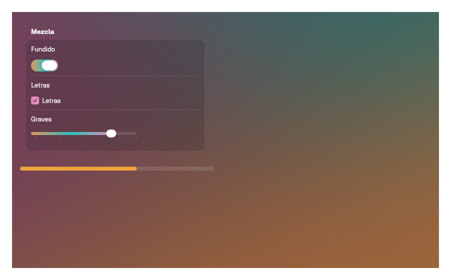

# 15. Backdrops and media

**Goal:** paint a backdrop tinted from an image, place media pieces over it,
merge glass shapes and play video.
**Scope:** `bk::backdrop`, `media`, `glass_container` and `video`.
The window's own glass bars are in [9. Titlebars](09-titlebars.md); the
palette a backdrop replaces is in
[4. Appearance and tokens](04-appearance-and-tokens.md); the controls that
take a `Tint` are in [5. Controls](05-controls.md).
**Reader:** anyone who makes apps with cover art, photos or video.
**Input:** an app with a window and the bytes of an image. **Output:** a view
whose background, text and accent follow that image, with media controls and
optional video.

## Steps

1. Move the content that sits on the backdrop into its own component. It must
   read the palette below the `Backdrop`, not in the parent:

   ```rust
   #[derive(PartialEq)]
   struct Player;

   impl Component for Player {
       fn render(&self) -> impl IntoElement {
           VStack::new()
               .child(Text::new(tr!("now-playing")).font(HEADLINE))
               .child(MediaButton::new(tr!("play")).symbol(Symbol::Play))
       }
   }
   ```

2. Wrap it in a `Backdrop` with the image bytes, and take the accent from the
   image:

   ```rust
   Backdrop::new(BackdropSource::Image(cover), Player).accent(Accent::FromBackdrop)
   ```

3. Load the cover off the interface thread with `use_artwork`, and show it
   when it arrives:

   ```rust
   let artwork = use_artwork(cover_path);
   rect().maybe_child(artwork.read().clone().map(|handle| image(handle).expanded()))
   ```

4. Blend the cover into the window with a `Scrim`, and put glass behind
   floating controls with `Material` or a `GlassContainer`.
5. For video, enable the `video` feature, open a `VideoStream` and show it in
   a `VideoView` ([Video](#video)).

## Backdrop

`Backdrop` paints a color backdrop and gives its content a palette that is
legible on it.

| Item | What it is |
|---|---|
| `Backdrop::new(source, child)` | The backdrop and its content; it fills its parent |
| `.accent(accent)` | The accent inside it; default `Accent::System` |

| `BackdropSource` | Result |
|---|---|
| `Image(bytes)` | Decodes the image on a background thread, scales it to `BACKDROP.samples` pixels a side and takes three colors with k-means in OKLab |
| `Colors([a, b, c])` | Uses the three colors given |
| `None` | No backdrop: the window surface color and the system palette |

1. It paints a base color and three linear gradients, at the angles in
   `BACKDROP.angles` (127°, 217°, 336°), with dithering so no banding shows.
2. It picks one ink, light or dark, from the backdrop's average color. Labels,
   separators, control and content backgrounds derive from that ink, so the
   result is the same in light and dark mode.
3. When the source changes, it fades from the old colors to the new ones over
   `DURATION_SLOW_MS`, in-out cubic, or at once with reduced motion.
4. Inside it, a [`Titlebar`](09-titlebars.md#titlebar) has no background, and a
   `ToolGroup` capsule takes its fill, separator and rim from the backdrop's
   palette, so its icons stay legible.

| `Accent` | The accent inside the backdrop is… |
|---|---|
| `System` (default) | The system accent |
| `Own(color)` | The app's color |
| `FromBackdrop` | The most vivid color of the image, adjusted to stay legible on the ink; with `Colors`, the first color |

The content gets the palette through context. Code evaluated in the parent,
before the `Backdrop` renders, still reads the system palette.

✗ `Backdrop::new(source, Text::new(title))`, built in the parent's render.
✓ `Backdrop::new(source, Player)`, with `Player` a `Component`.




### Tint

Controls with a fill take `.tint(Tint)`: `Slider`, `Switch`, `Checkbox`,
`RadioGroup`, `ProgressView` and `LevelSlider`.

| `Tint` | The fill is… |
|---|---|
| `Accent` (default) | The accent of the palette in context |
| `Color(color)` | A fixed color |
| `Backdrop` | A horizontal gradient of the backdrop's three colors; the accent outside a `Backdrop` |

In an inactive window every tint falls back to the palette's accent.

## Media

`bk::media` has the pieces of a media view. Their colors and sizes
are the `MEDIA` tokens of `ctdesign`, fixed for a dark image behind them.

| Item | What it is |
|---|---|
| `MediaButton::new(label)` | A large light pill button; `.symbol(symbol)` adds an icon, `.on_press(..)` the action |
| `RoundButton::new(symbol, label)` | A round glass button with an icon; `label` is its accessible name; `.selected(true)` fills it light; `.on_press(..)` |
| `Scrim::new(edge)` | A gradient rect that fades from the ground color to transparent; size and place it yourself with Freya's layout methods |
| `ScrimEdge::Leading`, `Bottom` | The edge the scrim is solid on |
| `ground()` | The color under the content: the backdrop's average inside a `Backdrop`, the window background outside |
| `Material::new(corner_radius)` | A layer that fills its parent with blur, the `MEDIA.material_tint` tint and a 1 px rim |
| `TopGlass::new()` | The progressive glass band along the top edge, as in [`FullscreenBar::ProgressiveGlass`](09-titlebars.md) |
| `use_artwork(path)` | Reads and decodes an image in the background; returns `State<Option<ImageHandle>>`, `None` until it is ready |
| `use_artwork_from(load)` | The same with bytes from `load: FnOnce() -> Option<Vec<u8>> + Send`, for example `video::fetch(url)` |

`use_artwork` runs once per component. Loads share one reading thread and one
decoding thread, so a grid of covers does not start a thread per cover.

`Material` and `TopGlass` are positioned absolutely: put them as the first
child of the element they sit behind.

## Glass that merges

`GlassContainer` draws several glass shapes as one, like SwiftUI's
`GlassEffectContainer`. Each item's `id` plays the role of `glassEffectID`.

```rust
GlassContainer::new(20.0)
    .gap(6.0)
    .item("add", 22.0, RoundButton::new(Symbol::Plus, tr!("add")))
    .item("remove", 22.0, RoundButton::new(Symbol::Minus, tr!("remove")))
```

| Item | What it is |
|---|---|
| `GlassContainer::new(spacing)` | Shapes closer than `spacing` merge |
| `.gap(gap)` | The layout gap between items; default `spacing` |
| `.item(id, radius, content)` | One shape around `content`, laid out in a row; `radius` is capped at half its height |
| `MAX_SHAPES` | 8; shapes past it are not drawn |

1. Each item measures its frame. The container paints the union of all frames
   as one glass: backdrop blur (`MEDIA.material_blur`), the
   `MEDIA.round_glass` tint and the `MEDIA.round_rim` edge.
2. The union is a smooth minimum of the rounded-box distances
   ([smin](https://iquilezles.org/articles/smin/)) in an SkSL shader, so near
   shapes melt into each other.
3. When the set of items or their frames change, each shape moves from its
   old frame to the new one with the kit's `Spring` (`DURATION_BASE`, no
   bounce, 0 ms with reduced motion). The first layout does not animate.

The morph plan is public, for tests and for other containers:

| Item | What it is |
|---|---|
| `Frame` | `x`, `y`, `width`, `height`, `radius`; `.lerp(&to, t)` mixes two frames |
| `Morph` | One shape's move: `id`, `from`, `to` |
| `plan(shown, target)` | The moves from the frames on screen to the new ones |

`plan` keeps each `id` on its own frame. A new id grows out of the nearest
shown frame, and an id that leaves melts into the nearest new one. Apple does
not publish its morph curve; only the duration and the bounce would change.

## Video

`bk::video` needs the `video` feature and GStreamer.

```rust
let video = VideoStream::open("trailer.mp4", true)?;
video.set_volume(0.7);
video.play();
VideoView::new(video).corner_radius(12.0)
```

| Constructor | Source |
|---|---|
| `VideoStream::open(path, looping)` | A local file |
| `VideoStream::open_uri(url, looping)` | `http(s)`, video and audio in one stream |
| `VideoStream::open_uris(video_url, audio_url, looping)` | `http(s)`, video and audio apart, as YouTube serves them |
| `video::fetch(url)` | Downloads a remote file's bytes, for example a cover |

They return `Result<_, VideoError>`: `Init` when GStreamer does not start,
`Open` when no decoder could open the source. A stream opens paused on its
first frame; a local source has 3 s to get there, a remote one 15 s.

| `VideoStream` method | What it does |
|---|---|
| `play()`, `pause()`, `playing()` | Playback |
| `seek(seconds)` | Jumps to the key frame nearest to `seconds` |
| `position()`, `duration()` | Seconds; 0 when unknown |
| `ended()`, `failed()` | End of a stream without looping; a GStreamer error |
| `set_volume(level)` | `level` 0–1 on a cubic scale |
| `decoding()` | The path in use |

GStreamer decodes, and the kit tries the most direct path first:

| `Decoding` | When | Cost |
|---|---|---|
| `GpuZeroCopy` | VA-API H.264 elements are present and the Vulkan device imports dmabuf | No copies: the frame goes from GPU to GPU |
| `GpuDownload` | VA-API H.264 elements are present, without dmabuf import | One download per frame |
| `Cpu` | Otherwise, or when the GPU paths fail | `decodebin3` on the CPU, any format |

The GPU paths read H.264 in MP4. If a path fails to show the first frame, the
next one is tried.

Sound plays in the same pipeline and follows its clock. Every stream starts at
volume 0, so previews and backgrounds stay silent; a player calls
`set_volume`. A looping stream seeks back to 0 at the end.

| `VideoView` | What it is |
|---|---|
| `VideoView::new(stream)` | Draws the current frame; fills its parent by default |
| `.width(size)`, `.height(size)` | Its size |
| `.corner_radius(radius)` | Rounded corners |

The frame fills the view and is cropped to keep its proportions.

Next: [16. Charts](16-charts.md).
